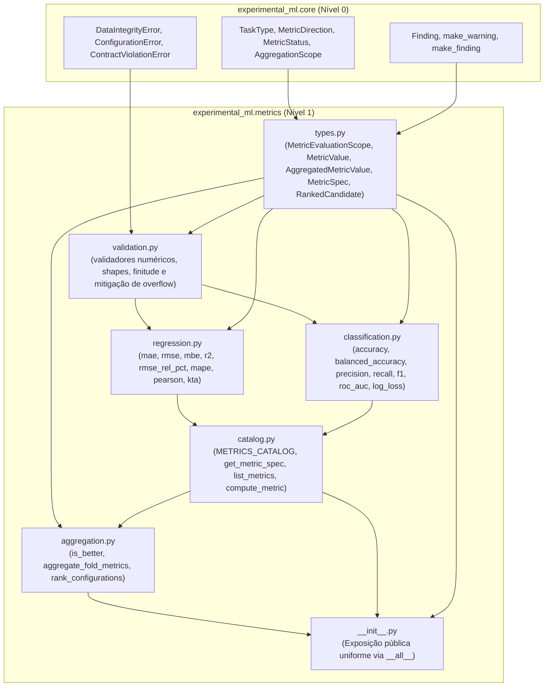

# m1-3-metrics Design

**Spec**: `.specs/features/m1-3-metrics/spec.md`
**Status**: Approved
**Approved**: 2026-11-03 - user: "aprovado"

---

## Architecture Overview

O módulo `experimental_ml.metrics` é um pacote de fundação transversal de **Nível 1** na arquitetura do framework. Ele fornece funções puras vetorizadas, estruturas de dados imutáveis e o catálogo formal `METRICS_CATALOG` para avaliação de desempenho de modelos preditivos em precisão dupla (`float64`).

Seguindo estritamente o **ADR-008** (programação funcional e modular sem classes de serviço mutáveis) e o **ADR-005** (tratamento explícito de indefinições numéricas), o design físico decompõe o módulo em submódulos de alta coesão e baixo acoplamento:

> **Grafo Acíclico Unidirecional de Dependências Internas:**  
> `types` $\to$ `validation` $\to$ (`regression`, `classification`) $\to$ `catalog` $\to$ `aggregation` $\to$ `__init__`.  
> Essa topologia garante que `aggregation.py` possa resolver `MetricSpec` através de `catalog.py` (ou receber injeção explícita de `MetricSpec`) com **zero dependências circulares**.

---

## Code Reuse Analysis

### Existing Components to Leverage

| Component | Location | How to Use |
| --- | --- | --- |
| `StrEnum` | `src/experimental_ml/core/enums.py` | Herança para `MetricEvaluationScope` garantindo compatibilidade direta com strings e JSON. |
| `TaskType` | `src/experimental_ml/core/enums.py` | Declaração das modalidades suportadas por cada métrica em `MetricSpec.supported_tasks`. |
| `MetricDirection` | `src/experimental_ml/core/enums.py` | Direção de otimização em `MetricValue`, `MetricSpec`, `is_better` e `rank_configurations`. |
| `MetricStatus` | `src/experimental_ml/core/enums.py` | Representação de status (`VALID`, `UNDEFINED_NAN`, `PARTIAL_COVERAGE`, `UNRANKABLE`). |
| `AggregationScope` | `src/experimental_ml/core/enums.py` | Validação de escopos em `MetricValue` e `AggregatedMetricValue`. |
| `Finding`, `make_warning` | `src/experimental_ml/core/findings.py` | Criação de diagnósticos heurísticos imutáveis anexados a `MetricValue` e `AggregatedMetricValue`. |
| `DataIntegrityError` | `src/experimental_ml/core/findings.py` | Exceção para entradas com dimensões incompatíveis, não-finitos (`NaN`/`Inf`) ou probabilidades inválidas. |
| `ConfigurationError` | `src/experimental_ml/core/findings.py` | Exceção para identificadores de métricas não registrados ou escopos/modos inválidos. |

### Integration Points

| System / Module | Integration Method |
| --- | --- |
| `src/experimental_ml/metrics/__init__.py` | Exportação unificada de todos os tipos, enumerações, catálogo e funções puras via `__all__`. |
| `experimental_ml.features` (Etapa 2) | Consome `compute_metric` e `kta` para seleção de atributos no treino de cada fold. |
| `experimental_ml.tuning` (Etapa 3B) | Consome `is_better` e `compute_metric` na validação cruzada aninhada (*Nested CV*). |
| `experimental_ml.orchestration` (Etapa 4B) | Consome `compute_metric` e instancia `MetricValue` para registrar o desempenho por célula/fold. |
| `experimental_ml.statistics` (Etapa 5) | Consome `aggregate_fold_metrics` e `rank_configurations` para consolidação descritiva e ranqueamento. |

---

## Components and Interfaces

### 1. `types.py` — Tipos Imutáveis e Enumeração de Escopo
- **Location**: `src/experimental_ml/metrics/types.py`
- **Purpose**: Define o enum de escopo de avaliação e as estruturas de dados imutáveis do domínio de métricas.
- **Interfaces**:
  - `class MetricEvaluationScope(StrEnum)`:
    - `PER_FOLD = "PER_FOLD"`: cálculo isolado sobre a partição de teste/validação $k$.
    - `FOLD_AGGREGATION = "FOLD_AGGREGATION"`: resumo estatístico descritivo (média, desvio, mediana, IQR) de valores `PER_FOLD`.
    - `POOLED_OOF = "POOLED_OOF"`: cálculo global sobre o vetor concatenado de todas as predições fora de dobra (*out-of-fold*).
    - `FINAL_HOLDOUT = "FINAL_HOLDOUT"`: cálculo sobre o conjunto de teste final isolado mantido à parte de toda validação cruzada.
  - `@dataclass(frozen=True, slots=True) class MetricValue`:
    - `metric_id: str`
    - `value: float` (invariante: se `status == VALID`, `math.isfinite(value) == True`; se `status == UNDEFINED_NAN`, `math.isnan(value) == True`)
    - `status: MetricStatus` (estados admissíveis gerados na avaliação atômica: exclusivamente `MetricStatus.VALID` ou `MetricStatus.UNDEFINED_NAN`)
    - `direction: MetricDirection`
    - `scope: MetricEvaluationScope | AggregationScope` (validado em `__post_init__` contra os membros de `MetricEvaluationScope` e `AggregationScope`)
    - `n_samples: int`
    - `warnings: tuple[Finding, ...]`
  - `@dataclass(frozen=True, slots=True) class AggregatedMetricValue`:
    - `metric_id: str`
    - `mean: float`, `std: float`, `median: float`, `iqr: float`
    - `status: MetricStatus` (estados admissíveis gerados na agregação de dobras: `MetricStatus.VALID` se $k = K$, `MetricStatus.PARTIAL_COVERAGE` se $0 < k < K$, ou `MetricStatus.UNDEFINED_NAN` se $k = 0$)
    - `direction: MetricDirection`
    - `scope: AggregationScope | MetricEvaluationScope` (validado em `__post_init__` restringindo-se aos escopos de agregação)
    - `valid_folds: int`, `total_folds: int`, `coverage: float`
    - `fold_values: tuple[MetricValue, ...]`
    - `warnings: tuple[Finding, ...]`
  - `@dataclass(frozen=True, slots=True) class MetricSpec`:
    - `metric_id: str`, `name: str`, `family: str`
    - `direction: MetricDirection`
    - `compare_by_abs: bool` (**fonte única de verdade** para comparação por magnitude absoluta)
    - `supported_tasks: tuple[TaskType, ...]`
    - `func: Callable[..., MetricValue]`
    - `rtol: float`, `atol: float`
    - `requires_probabilities: bool`, `requires_kernel_matrix: bool`
  - `@dataclass(frozen=True, slots=True) class RankedCandidate`:
    - `candidate_id: str`
    - `metric: MetricValue | AggregatedMetricValue`
    - `rank: int | None` (inteiro $1..R$ para elegíveis; `None` para `UNRANKABLE`)
    - `status: MetricStatus` (`VALID`, `PARTIAL_COVERAGE` ou `UNRANKABLE`)
- **Dependencies**: `experimental_ml.core.enums`, `experimental_ml.core.findings`.

### 2. `validation.py` — Validações Numéricas e Mitigação de Overflow
- **Location**: `src/experimental_ml/metrics/validation.py`
- **Purpose**: Funções utilitárias puras para conversão segura para `float64`, validação de alinhamento dimensional, checagem de finitude e mitigação de overflow intermediário.
- **Interfaces**:
  - `validate_numeric_arrays(y_true, y_pred, allow_2d_pred=False) -> tuple[np.ndarray, np.ndarray, int]`: Converte para `float64`, valida $n \ge 1$, checa shapes e finitude (lança `DataIntegrityError` se inválido).
  - `validate_scope(scope, allowed_scopes, default) -> MetricEvaluationScope | AggregationScope`: Valida e normaliza o escopo contra conjuntos fechados (lança `ConfigurationError` se inválido).
  - `scaled_quadratic_sum(diff: np.ndarray) -> tuple[float, float]`:
    - Extrai $m = \max |diff|$.
    - Se $m == 0.0$, retorna $(0.0, 0.0)$.
    - Se $m > 0.0$, calcula $s = \sum (diff / m)^2$ e retorna $(m, s)$.
    - *Escopo de proteção:* Previne overflow **intermediário** quando os resíduos ou desvios individuais são finitos em `float64` mas excedem $\sqrt{\text{float64.max}} \approx 1.34 \times 10^{154}$. Não elimina overflow quando a métrica matemática excede `float64.max` ($\approx 1.79 \times 10^{308}$) ou quando a diferença inicial $y_i - \hat{y}_i$ transborda `float64`; nesses casos residuais, a função de métrica aciona a guarda de pós-condição retornando `MetricStatus.UNDEFINED_NAN` com `Finding(code="W_METRIC_NUMERICAL_OVERFLOW")`.
- **Dependencies**: `numpy`, `experimental_ml.core.findings`.

### 3. `regression.py` — Métricas de Regressão e Alinhamento de Kernel
- **Location**: `src/experimental_ml/metrics/regression.py`
- **Purpose**: Implementação puramente vetorizada das 8 métricas de regressão e alinhamento de kernel em conformidade com as regras matemáticas da SPEC.
- **Interfaces**:
  - `mae(y_true, y_pred, *, scope=MetricEvaluationScope.PER_FOLD) -> MetricValue`
  - `rmse(y_true, y_pred, *, scope=MetricEvaluationScope.PER_FOLD) -> MetricValue`
  - `mbe(y_true, y_pred, *, scope=MetricEvaluationScope.PER_FOLD) -> MetricValue` (retorna valor assinado)
  - `r2(y_true, y_pred, *, scope=MetricEvaluationScope.PER_FOLD) -> MetricValue`:
    - $n < 2$: retorna `UNDEFINED_NAN` com `Finding("W_METRIC_INSUFFICIENT_SAMPLES")`.
    - $n \ge 2$ e $SS_{\text{tot}} == 0$: retorna `UNDEFINED_NAN` com `Finding("W_METRIC_ZERO_VARIANCE")` (nunca $0/0 \to 1.0$).
    - $n \ge 2$, $SS_{\text{tot}} > 0$ e preditor constante $\hat{y}_i = \bar{y}$: retorna `0.0` com `status == VALID`.
  - `rmse_rel_pct(y_true, y_pred, *, scope=MetricEvaluationScope.PER_FOLD) -> MetricValue` (indefinido se $|\bar{y}| == 0.0$)
  - `mape(y_true, y_pred, *, scope=MetricEvaluationScope.PER_FOLD) -> MetricValue`:
    - Se $\exists y_i == 0.0$, retorna `UNDEFINED_NAN` com `Finding("W_METRIC_ZERO_TARGET")` (não descarta observações nem adiciona $\epsilon$).
  - `pearson(y_true, y_pred, *, scope=MetricEvaluationScope.PER_FOLD) -> MetricValue` (indefinido se $n < 2$, $\text{Var}(y) == 0$ ou $\text{Var}(\hat{y}) == 0$)
  - `kta(k_true, k_pred, *, centered: bool = False, scope=MetricEvaluationScope.PER_FOLD) -> MetricValue`:
    - Aceita matrizes 2D $(n, n)$ ou constrói Gram $v v^T$ para vetores 1D.
    - Se `centered=True`, aplica dupla centralização $H K H$; se `centered=False`, usa matrizes brutas.
    - Se $\|\tilde{K}_1\|_F == 0$ ou $\|\tilde{K}_2\|_F == 0$, retorna `UNDEFINED_NAN` com `Finding("W_METRIC_ZERO_GRAM_NORM")`.
- **Dependencies**: `numpy`, `validation.py`, `types.py`.

### 4. `classification.py` — Métricas de Classificação Discreta e Probabilística
- **Location**: `src/experimental_ml/metrics/classification.py`
- **Purpose**: Implementação puramente vetorizada das 7 métricas de classificação discreta, probabilística e ranqueamento com regras explícitas por classe e estratégia de média.
- **Interfaces**:
  - `accuracy(y_true, y_pred, *, scope=MetricEvaluationScope.PER_FOLD) -> MetricValue`
  - `balanced_accuracy(y_true, y_pred, *, labels=None, scope=MetricEvaluationScope.PER_FOLD) -> MetricValue`:
    - Definida sobre $\mathcal{C}$: $\text{unique}(\text{labels})$ se fornecido, ou $\text{unique}(y_{\text{true}}) \cup \text{unique}(\hat{y})$ se `labels=None`.
    - Se $|\mathcal{C}| < 2$ ou $\exists c \in \mathcal{C}$ com $TP_c + FN_c == 0$, retorna `UNDEFINED_NAN` com `Finding`.
  - `precision(y_true, y_pred, *, average="binary", pos_label=1.0, labels=None, scope=MetricEvaluationScope.PER_FOLD) -> MetricValue`:
    - Se $\exists c \in \mathcal{C}$ com $TP_c + FP_c == 0$ (nenhuma predição positiva): retorna `UNDEFINED_NAN` com `Finding` (nunca $0/0 \to 0.0$).
    - Se para todo $c$, $TP_c + FP_c > 0$, mas para uma classe $TP_c == 0, FP_c > 0$: $\text{Precision}_c = 0.0$ é um valor válido (`VALID`).
  - `recall(y_true, y_pred, *, average="binary", pos_label=1.0, labels=None, scope=MetricEvaluationScope.PER_FOLD) -> MetricValue`:
    - Se $\exists c \in \mathcal{C}$ com $TP_c + FN_c == 0$ (classe ausente em $y_{\text{true}}$): retorna `UNDEFINED_NAN` com `Finding`.
    - Se para todo $c$, $TP_c + FN_c > 0$, e para uma classe $TP_c + FP_c == 0$ ($TP_c = 0$): $\text{Recall}_c = 0 / FN_c = 0.0$ é um valor válido (`VALID`).
  - `f1(y_true, y_pred, *, average="binary", pos_label=1.0, labels=None, scope=MetricEvaluationScope.PER_FOLD) -> MetricValue`:
    - **Cálculo direto pelo denominador da própria métrica:**
      $$\text{F1}_c = \frac{2 TP_c}{2 TP_c + FP_c + FN_c}$$
    - **Caso indefinido ($0/0$):** Ocorre se e somente se o denominador próprio de F1 for nulo ($2 TP_c + FP_c + FN_c == 0$). Isso equivale a $TP_c = 0$, $FP_c = 0$ E $FN_c = 0$ simultaneamente (classe totalmente ausente tanto em $y_{\text{true}}$ quanto em $\hat{y}$). Nesse caso, retorna `MetricStatus.UNDEFINED_NAN` com `Finding("W_METRIC_F1_ZERO_SUPPORT")`.
    - **Caso matematicamente definido e igual a zero ($0.0$ válido):** Se $2 TP_c + FP_c + FN_c > 0$ e $TP_c == 0$, o numerador é estritamente $0$ e o denominador é estritamente positivo (exemplo: $TP_c = 0$, $FP_c = 0$, $FN_c > 0$ — onde Precision é $0/0$ indefinida, mas o classificador teve $0$ acertos em instâncias reais; ou $TP_c = 0$, $FP_c > 0$, $FN_c = 0$ — onde Recall é $0/0$ indefinida, mas houve apenas falsos positivos). Nesses casos, $\text{F1}_c = 0.0$ é um valor matemático legítimo com `MetricStatus.VALID`.
    - **Agregação macro e weighted:** Se para qualquer $c \in \mathcal{C}$ o denominador próprio for nulo ($2 TP_c + FP_c + FN_c == 0$), propaga `UNDEFINED_NAN`. Caso contrário, pondera as parcelas $\text{F1}_c \in [0.0, 1.0]$ retornando `MetricStatus.VALID`.
  - `roc_auc(y_true, y_score, *, average="macro", labels=None, scope=MetricEvaluationScope.PER_FOLD) -> MetricValue`:
    - Se $|\text{unique}(y_{\text{true}})| < 2$, retorna `UNDEFINED_NAN` com `Finding`.
    - *Binário ($|\mathcal{C}| = 2$):* Classes ordenadas $\mathcal{C} = (c_0, c_1)$ (classe positiva $c_1 = \mathcal{C}[1]$). Aceita escore 1D $(n,)$ para $c_1$, 2D coluna única $(n, 1)$ para $c_1$, ou 2D $(n, 2)$ (usando coluna `1` para $c_1$). Calcula Mann-Whitney $U$ exato com postos médios para empates (`0.5` para escores constantes).
    - *Multiclasse OVR ($|\mathcal{C}| = K \ge 3$):* Exige matriz 2D $(n, K)$ onde a coluna $k$ mapeia para a classe $\mathcal{C}[k]$ (ordem crescente de `unique(y_true)` ou ordem de `labels`). Calcula $\text{AUC}_k$ binário para cada classe. Se qualquer classe em `labels` tiver $N_{+, k} == 0$ ou $N_{-, k} == 0$, propaga `UNDEFINED_NAN` com `Finding`. Agrega por média não ponderada (`"macro"`) ou ponderada por suporte real (`"weighted"`).
  - `log_loss(y_true, y_prob, *, eps=1e-15, labels=None, scope=MetricEvaluationScope.PER_FOLD) -> MetricValue`:
    - Classes $\mathcal{C} = \text{unique}(y_{\text{true}})$ ordenado ou `tuple(labels)`. Se $|\text{unique}(y_{\text{true}})| < 2$, retorna `UNDEFINED_NAN`.
    - Em binário: aceita 1D $(n,)$ com $p_i = P(Y_i = \mathcal{C}[1])$ ou 2D $(n, 2)$ com $[P(Y_i = \mathcal{C}[0]), P(Y_i = \mathcal{C}[1])]$.
    - Em multiclasse: exige 2D $(n, K)$ com coluna $k$ mapeando para $\mathcal{C}[k]$. Lança `DataIntegrityError` se 1D para $K \ge 3$ ou número de colunas $\neq K$.
    - Valida $p_{i,k} \in [-10^{-12}, 1 + 10^{-12}]$ e $\sum_k p_{i,k} \approx 1.0$ (tolerância $10^{-6}$); aplica clipping $[\epsilon, 1 - \epsilon]$ ($\epsilon = 10^{-15}$) e normalização de linhas em 2D.
- **Dependencies**: `numpy`, `validation.py`, `types.py`.

### 5. `catalog.py` — Catálogo Modular e Despacho
- **Location**: `src/experimental_ml/metrics/catalog.py`
- **Purpose**: Registro centralizado das 15 especificações `MetricSpec` e funções de consulta.
- **Interfaces**:
  - `METRICS_CATALOG: Mapping[str, MetricSpec]`: Dicionário imutável mapeando os 15 identificadores minúsculos para suas especificações completas (incluindo `compare_by_abs=True` exclusivamente em `"mbe"`).
  - `get_metric_spec(metric_id: str) -> MetricSpec`: Busca case-insensitive no catálogo (lança `ConfigurationError` se inexistente).
  - `list_metrics(task: TaskType | None = None) -> tuple[str, ...]`: Lista identificadores disponíveis, opcionalmente filtrados por tarefa.
  - `compute_metric(metric_id: str, y_true: Any, y_pred_or_score: Any, **kwargs) -> MetricValue`: Resolve a especificação no catálogo e despacha o cálculo para a função correspondente.
- **Dependencies**: `types.py`, `regression.py`, `classification.py`.

### 6. `aggregation.py` — Comparação, Agregação e Ranqueamento (ADR-005)
- **Location**: `src/experimental_ml/metrics/aggregation.py`
- **Purpose**: Implementa as regras determinísticas de comparação entre candidatos, consolidação entre dobras e ordenação lexicográfica de configurações.
- **Protocolo de Injeção e Resolução de `MetricSpec` (Zero Dependência Circular):**
  - As funções `is_better` e `rank_configurations` suportam dois mecanismos:
    1. *Injeção Explícita:* Parâmetro opcional `metric_spec: MetricSpec | None = None`.
    2. *Resolução Automática via Catálogo:* Se `metric_spec is None`, a função extrai `metric_id` do primeiro candidato válido e invoca `get_metric_spec(metric_id)` de `catalog.py`. Como `catalog.py` não importa `aggregation.py`, a dependência é estritamente unidirecional (`aggregation` $\to$ `catalog`).
  - O atributo booleano `metric_spec.compare_by_abs` é a **fonte única de verdade** para determinar se o valor comparado é $|v|$ ou $v$. Não há qualquer verificação por string literal (`metric_id == "mbe"`).
- **Semântica de Cobertura Polimórfica e Estados Admissíveis de `MetricValue`:**
  - *Estados em `MetricValue` (avaliação atômica de dobra):* Exclusivamente `MetricStatus.VALID` ou `MetricStatus.UNDEFINED_NAN`. Os estados `PARTIAL_COVERAGE` e `UNRANKABLE` **não são estados admissíveis em `MetricValue`**; eles pertencem respectivamente a `AggregatedMetricValue` (agregação entre múltiplas dobras) e a `RankedCandidate` (resultado da ordenação de matrizes).
  - *Regra de cobertura implícita no ranqueamento:*
    - Se o candidato for `AggregatedMetricValue`: `cov = cand.coverage` (razão $k/K \in [0.0, 1.0]$).
    - Se o candidato for `MetricValue`: `cov = 1.0` se `cand.status == MetricStatus.VALID` e `cov = 0.0` se `cand.status == MetricStatus.UNDEFINED_NAN`.
- **Interfaces**:
  - `is_better(cand_a: MetricValue | AggregatedMetricValue, cand_b: MetricValue | AggregatedMetricValue, direction: MetricDirection | None = None, *, metric_spec: MetricSpec | None = None) -> bool`:
    - Se `metric_spec is None`, resolve via `get_metric_spec(cand_a.metric_id)`.
    - Candidato ranqueável (`VALID` ou `PARTIAL_COVERAGE` com valor finito) sempre vence `UNDEFINED_NAN` ou `UNRANKABLE`.
    - Dois candidatos indefinidos retornam `False`.
    - `VALID` sempre precede `PARTIAL_COVERAGE`.
    - Entre dois `PARTIAL_COVERAGE`, maior `coverage` ($k_a/K > k_b/K$) precede menor `coverage`.
    - Para status e cobertura idênticos, compara os valores direcionados segundo `metric_spec.direction` e `metric_spec.compare_by_abs` ($|v_a| < |v_b|$ se `compare_by_abs=True`; $v_a < v_b$ se `MINIMIZE`; $v_a > v_b$ se `MAXIMIZE`).
  - `aggregate_fold_metrics(fold_values: Sequence[MetricValue], *, scope: AggregationScope = AggregationScope.FOLD_AGGREGATION) -> AggregatedMetricValue`:
    - Valida que `fold_values` não é vazio e que todos possuem o mesmo `metric_id` (lança `DataIntegrityError` se divergente).
    - Valida que `scope` pertence aos escopos de agregação (lança `ConfigurationError` se for `PER_FOLD` ou string arbitrária).
    - Calcula estatísticas descritivas (`mean`, `std` amostral com `ddof=1` para $k \ge 2$, `median`, `iqr = Q_{75} - Q_{25}`).
    - $k == K$: status `VALID`, `coverage = 1.0`.
    - $0 < k < K$: status `PARTIAL_COVERAGE`, `coverage = k / K`, anexa warning `W_METRIC_PARTIAL_COVERAGE`.
    - $k == 0$: status `UNDEFINED_NAN`, `coverage = 0.0`, estatísticas `NaN`, anexa warning `W_METRIC_ZERO_COVERAGE`.
  - `rank_configurations(candidates: Mapping[str, MetricValue | AggregatedMetricValue] | Sequence[tuple[str, MetricValue | AggregatedMetricValue]], *, direction: MetricDirection | None = None, metric_spec: MetricSpec | None = None) -> tuple[RankedCandidate, ...]`:
    - Se `metric_spec is None`, resolve a partir do primeiro candidato via `get_metric_spec`.
    - Particiona em ranqueáveis e não ranqueáveis.
    - Candidatos ranqueáveis são ordenados pela tupla lexicográfica:
      $$\text{key}(c) = \left( 0 \text{ if } c.\text{status} == \text{VALID} \text{ else } 1, \; -\text{cov}, \; \text{directed\_val}, \; \text{candidate\_id} \right)$$
      recebendo ranks inteiros sequenciais `1..R`.
    - Candidatos não ranqueáveis (`UNDEFINED_NAN`, `UNRANKABLE` ou valor não-finito) são posicionados ao final, ordenados por `candidate_id`, recebendo `status = MetricStatus.UNRANKABLE` e `rank = None`.
- **Dependencies**: `numpy`, `types.py`, `catalog.py`.

---

## Error Handling Strategy

| Cenário de Erro | Mecanismo de Tratamento | Impacto Observável / Retorno |
| --- | --- | --- |
| Vetor vazio ($n = 0$) ou comprimentos divergentes | `DataIntegrityError` lançado em `validation.py` | Exceção imediata impedindo execução com código de saída 2 na CLI (RNF07). |
| Observações com `NaN`, `+Inf` ou `-Inf` nas entradas | `DataIntegrityError` lançado em `validation.py` | Exceção imediata indicando entrada numérica corrompida. |
| Divisão por zero matemática / variância nula / classe ausente | Capturado analiticamente na função da métrica | Retorna `MetricValue` com `value = float("nan")`, `status = MetricStatus.UNDEFINED_NAN` e `Finding` pedagógico. |
| Overflow intermediário em somas quadráticas ($> 10^{154}$) | Reescalonamento prévio pelo máximo absoluto ($m$) via `scaled_quadratic_sum` | Cálculo exato preservado sem transbordamento prematuro. |
| Overflow numérico residual da métrica matemática ($> 1.8 \times 10^{308}$) | Detecção de valor não-finito pós-cálculo | Converte para `MetricStatus.UNDEFINED_NAN` com `Finding(code="W_METRIC_NUMERICAL_OVERFLOW")`. |
| Probabilidades fora de $[0, 1]$ ou somas $\neq 1.0$ em `log_loss` | `DataIntegrityError` lançado em `log_loss` | Exceção imediata por violação dos axiomas de probabilidade. |
| Escopo arbitrário ou incompatível passado a funções/construtores | `ConfigurationError` lançado na validação de escopo | Exceção imediata rejeitando escopo inválido. |
| Identificador desconhecido em `get_metric_spec` | `ConfigurationError` lançado em `catalog.py` | Exceção imediata indicando métrica não suportada. |

---

## Risks & Concerns

| Preocupação / Risco | Localização Prevista | Impacto | Mitigação no Design |
| --- | --- | --- | --- |
| **Limitação de representabilidade em ponto flutuante** | `regression.py` (`rmse`, `r2`, `pearson`, `kta`) | `scaled_quadratic_sum` mitiga apenas overflow intermediário; valores finais matematicamente superiores a $1.8 \times 10^{308}$ não cabem em `float64` | O design reconhece explicitamente essa fronteira matemática e aplica guarda de pós-condição convertendo transbordamento residual em `UNDEFINED_NAN` com `Finding("W_METRIC_NUMERICAL_OVERFLOW")`. |
| **Acoplamento a nomes literais de métrica** | `aggregation.py` (`is_better`, `rank_configurations`) | Regras especiais como `if metric_id == "mbe"` quebram a extensibilidade do catálogo | O design adota `MetricSpec.compare_by_abs: bool` como fonte única de verdade, resolvido unidirecionalmente via `catalog.py` ou injeção explícita. |
| **Diferença estrutural entre `MetricValue` e `AggregatedMetricValue`** | `aggregation.py` | `MetricValue` não possui atributo `coverage`, podendo gerar `AttributeError` em funções polimórficas | O design define uniformemente que `MetricValue` possui cobertura implícita $1.0$ quando `VALID` e $0.0$ quando `UNDEFINED_NAN`. |
| **Ambiguidade entre agregação por dobra vs. predição OOF agrupada** | `types.py` (`MetricEvaluationScope`) | Confundir média de métricas por dobra com métrica calculada sobre o vetor global OOF | O design formaliza a distinção semântica entre `FOLD_AGGREGATION` (resumo de `MetricValue`s) e `POOLED_OOF` (avaliação única sobre o conjunto concatenado de predições). |

---

## Technical Decisions Summary

| Decisão Arquitetural | Escolha Adotada | Justificativa Técnica |
| --- | --- | --- |
| **Fórmula de F1 e Casos Indefinidos** | Cálculo direto $\frac{2 TP}{2 TP + FP + FN}$; indefinido apenas para $2 TP + FP + FN == 0$ | Se $2 TP + FP + FN > 0$ e $TP == 0$, $\text{F1} = 0.0$ é matematicamente exato mesmo se Precision for $0/0$ indefinida. |
| **Fonte de Verdade e Injeção de `MetricSpec`** | `MetricSpec.compare_by_abs` resolvido via `catalog.py` ou injeção | Elimina checagem por identificador literal e mantém o fluxo de dependências acíclico (`aggregation` $\to$ `catalog`). |
| **Estados Admissíveis e Cobertura Polimórfica** | `MetricValue` só admite `VALID` e `UNDEFINED_NAN`; `cov = 1.0` se `VALID` else `0.0` | `PARTIAL_COVERAGE` e `UNRANKABLE` são restritos a agregações e ranqueamentos; `MetricValue` atômico não é fragmentado. |
| **Precedência de `VALID` sobre `PARTIAL_COVERAGE`** | Chave lexicográfica com prioridade $0$ para `VALID` e $1$ para `PARTIAL` | Evita viés de sobrevivência de modelos avaliados em partições parciais incompletas (**ADR-005**, `CA-E5-01`). |
| **Distinção Semântica dos 4 Escopos** | Enum fechado `MetricEvaluationScope` | Diferencia claramente o nível de amostragem (`PER_FOLD`, `FINAL_HOLDOUT`), resumo descritivo (`FOLD_AGGREGATION`) e avaliação concatenada (`POOLED_OOF`). |
| **Fronteira da Estabilidade Numérica** | `scaled_quadratic_sum` + guarda de não-finitos | Protege contra overflow intermediário e trata transbordamento residual sem falsas premissas de invulnerabilidade. |
