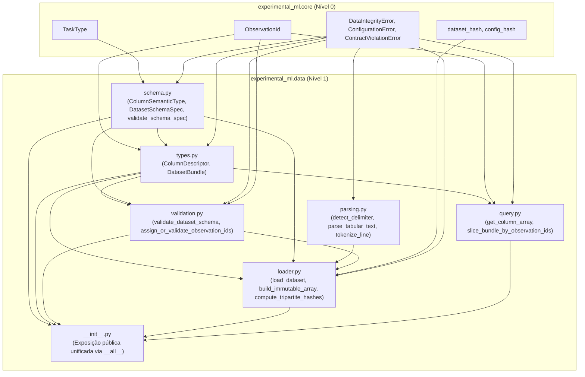

# m1-4-datasets-schemas Design

**Spec**: `.specs/features/m1-4-datasets-schemas/spec.md`
**Status**: Approved
**Approved**: 2026-11-04 - user: "Siga o fluxo do TLC a partir daqui, avançando para a próxima fase do milestone e conduzindo o processo até a implementação e verificação, respeitando os critérios de aceitação já definidos."

---

## Architecture Overview

O módulo `experimental_ml.data` constitui a camada fundacional de ingestão tabular, especificação estrutural e imutabilidade de dados de **Nível 1** na arquitetura do `experimental-ml-framework`. Ele é responsável por:
1. Definir e validar o esquema declarativo de papéis e tipos semânticos (`DatasetSchemaSpec`).
2. Ingerir dados a partir de arquivos tabulares em disco (`.csv`, `.txt`, `.tsv`) e de estruturas em memória (`Mapping[str, Sequence]`, 2D `ndarray`, `Sequence[Mapping]`, duck-typed `DataFrame`).
3. Fornecer isolamento profundo de memória com arrays imutáveis em nível de buffer (`np.frombuffer(bytes)`), garantindo que mutações na fonte original ou no consumidor sejam estritamente bloqueadas.
4. Preservar a identidade e auditabilidade tripartite: `dataset_hash` (conteúdo tabular canônico normalizado em memória), `raw_source_hash` (integridade da fonte bruta) e `schema_hash` (configuração declarativa do esquema), em conformidade com o **ADR-007**.
5. Atribuir ou validar identificadores de observação determinísticos (`ObservationId`) e fornecer utilitários funcionais somente-leitura de consulta (`get_column_array`) e fatiamento ordenado (`slice_bundle_by_observation_ids`).

Seguindo os princípios de programação puramente funcional e modular sem classes com estado mutável (**ADR-008**), o módulo é estruturado com alta coesão e zero acoplamento cíclico:



> **Topologia Acíclica de Dependências:**  
> `schema` $\to$ `types` $\to$ `validation` $\to$ `parsing` $\to$ `loader` $\to$ `query` $\to$ `__init__`.  
> Essa ordem linear impede ciclos e viabiliza desenvolvimento dirigido por testes (*TDD*) unitários em camadas granulares.

---

## Code Reuse Analysis

### Existing Components to Leverage

| Component | Location | How to Use |
| --- | --- | --- |
| `ObservationId` | `src/experimental_ml/core/types.py` | Tipo identificador imutável `@dataclass(frozen=True, slots=True)` validado com regex `^[a-zA-Z0-9_\-\.]{1,128}$`. Usado para indexar e rastrear todas as observações. |
| `TaskType` | `src/experimental_ml/core/enums.py` | Enum canônico `REGRESSION`, `BINARY_CLASSIFICATION`, `MULTICLASS_CLASSIFICATION`, `MULTI_TARGET_REGRESSION`. Usado em `DatasetSchemaSpec.task_type`. |
| `dataset_hash` | `src/experimental_ml/core/hashing.py` | Função canônica de hash estrutural de dataset (**ADR-007**). Usada para calcular `dataset_hash` (conteúdo canônico em memória) e `raw_source_hash` (arquivo em disco ou fonte original). |
| `config_hash` | `src/experimental_ml/core/hashing.py` | Função canônica de hash de configuração determinístico. Usada para computar `schema_hash` a partir de `DatasetSchemaSpec`. |
| `DataIntegrityError` | `src/experimental_ml/core/findings.py` | Exceção levantada para arquivos corrompidos, linhas irregulares (*ragged rows*), delimitador ambíguo, objetos mutáveis em colunas, duplicidade de `ObservationId` ou inconsistências estruturais entre dados e esquema. |
| `ConfigurationError` | `src/experimental_ml/core/findings.py` | Exceção levantada para papéis de colunas conflitantes/sobrepostos, strings de coluna vazias/inválidas ou solicitação de funcionalidades da Onda 2 (`MULTI_TARGET_REGRESSION`, múltiplos alvos). |
| `ContractViolationError` | `src/experimental_ml/core/findings.py` | Exceção para violações de pré/pós-condições internas da arquitetura. |

### Integration Points

| System / Module | Integration Method |
| --- | --- |
| `src/experimental_ml/data/__init__.py` | Exportação limpa de todos os tipos e funções de `data` via `__all__`. |
| `experimental_ml.data` (M2 - Profiling) | Consumirá `DatasetBundle` para gerar `DatasetProfile`, `ColumnProfile` e diagnósticos heurísticos. |
| `experimental_ml.data` (M2 - Sanitization) | Consumirá `DatasetBundle` e aplicará `create_preparation_plan` / `sanitize_dataset` gerando `SanitizedDatasetView`. |
| `experimental_ml.validation` (M2 - Partitioning) | Consumirá `DatasetBundle.observation_ids`, `group_col` e `target_col` para gerar `PartitionPlan`. |
| `tests/unit/test_data_schemas.py` | Bateria abrangente de testes unitários cobrindo todos os 29 critérios de aceitação. |

---

## Components and Interfaces

### 1. `schema.py` — Especificação Estrutural e Tipagem Semântica
- **Location**: `src/experimental_ml/data/schema.py`
- **Purpose**: Define a enumeração `ColumnSemanticType` e a dataclass imutável `DatasetSchemaSpec`, além da função de validação sintática `validate_schema_spec`.
- **Interfaces**:
  - `class ColumnSemanticType(StrEnum)`:
    - `NUMERIC_CONTINUOUS = "NUMERIC_CONTINUOUS"`
    - `NUMERIC_DISCRETE = "NUMERIC_DISCRETE"`
    - `CATEGORICAL = "CATEGORICAL"`
    - `BOOLEAN = "BOOLEAN"`
    - `TEMPORAL = "TEMPORAL"`
    - `IDENTIFIER = "IDENTIFIER"`
  - `@dataclass(frozen=True, slots=True) class DatasetSchemaSpec`:
    - `target_col: str`
    - `task_type: TaskType`
    - `group_col: str | None = None`
    - `observation_id_col: str | None = None`
    - `time_col: str | None = None`
    - `ignore_cols: tuple[str, ...] = ()`
    - `column_semantic_types: Mapping[str, ColumnSemanticType] = field(default_factory=dict)`
    - `target_transform_spec: Any | None = None` (campo reservado da Onda 2; deve ser `None` na Onda 1)
  - `validate_schema_spec(schema: DatasetSchemaSpec) -> None`:
    - Valida que `task_type` pertence a `TaskType` e não é `MULTI_TARGET_REGRESSION`.
    - Valida que nenhum nome de coluna é vazio, somente espaços ou contém quebras de linha (`\n`, `\r`, `\t`, `\x00`).
    - Normaliza os nomes de colunas com Unicode NFC (`unicodedata.normalize("NFC", ...)`).
    - Valida que os papéis de colunas são disjuntos (`target_col != group_col`, etc.).
    - Valida que `target_transform_spec is None`.

### 2. `types.py` — Descritores de Colunas e Bundle Tabular Imutável
- **Location**: `src/experimental_ml/data/types.py`
- **Purpose**: Define as estruturas de dados imutáveis `ColumnDescriptor` e `DatasetBundle`.
- **Interfaces**:
  - `@dataclass(frozen=True, slots=True) class ColumnDescriptor`:
    - `name: str`
    - `physical_type: str` (e.g. `"float64"`, `"int64"`, `"bool"`, `"object"`)
    - `semantic_type: ColumnSemanticType`
    - `is_semantic_declared: bool`
    - `nullable: bool`
    - `null_count: int`
  - `@dataclass(frozen=True, slots=True) class DatasetBundle`:
    - `schema: DatasetSchemaSpec`
    - `n_rows: int`
    - `n_cols: int`
    - `column_names: tuple[str, ...]`
    - `feature_cols: tuple[str, ...]`
    - `columns: Mapping[str, np.ndarray]` (encapsulado via `MappingProxyType`)
    - `descriptors: Mapping[str, ColumnDescriptor]` (encapsulado via `MappingProxyType`)
    - `observation_ids: tuple[ObservationId, ...]`
    - `dataset_hash: str`
    - `raw_source_hash: str`
    - `schema_hash: str`
    - `memory_bytes: int`
    - `source_path: str | None = None`

### 3. `parsing.py` — Detecção de Delimitador e Parsing Estrito
- **Location**: `src/experimental_ml/data/parsing.py`
- **Purpose**: Fornece análise léxica determinística de arquivos tabulares em texto (`.csv`, `.txt`, `.tsv`).
- **Interfaces**:
  - `SUPPORTED_DELIMITERS: tuple[str, ...] = (",", ";", "\t", "|", "whitespace")`
  - `detect_delimiter(sample_lines: Sequence[str]) -> str`:
    - Analisa até as primeiras 100 linhas não-vazias.
    - Avalia a consistência de contagem de colunas para cada delimitador candidato respeitando aspas RFC 4180.
    - Se exatamente um delimitador produzir contagem uniforme constante ($k \ge 2$), retorna o delimitador.
    - Se múltiplos delimitadores produzirem contagens consistentes ou nenhum for consistente, lança `DataIntegrityError` com diagnóstico detalhado.
  - `parse_tabular_text(text_or_lines: Iterable[str], *, delimiter: str, has_header: bool = True, column_names: Sequence[str] | None = None) -> tuple[tuple[str, ...], Mapping[str, list[Any]]]`:
    - Suporta aspas RFC 4180 (`"campo com \"aspas\" e , vírgula"`).
    - Valida que todas as linhas possuem a mesma contagem de colunas; linhas irregulares lançam `DataIntegrityError` informando o número da linha (1-based) e as contagens observada vs esperada.
    - Normaliza os nomes de cabeçalho para Unicode NFC e remove espaços periféricos (*strip*). Rejeita duplicidades pós-normalização.
    - Converte tokens de ausência (`""`, `"NA"`, `"NaN"`, `"null"`, `"None"`, `"nan"`) para sentinela `None` ou `np.nan`.

### 4. `validation.py` — Validador Estrutural de Dados contra Esquema e `ObservationId`
- **Location**: `src/experimental_ml/data/validation.py`
- **Purpose**: Valida a conformidade estrutural entre dados tabulares e o `DatasetSchemaSpec`, deduz os `ColumnDescriptor` e valida/gera os `ObservationId`.
- **Interfaces**:
  - `assign_or_validate_observation_ids(raw_columns: Mapping[str, Sequence[Any]], n_rows: int, observation_id_col: str | None) -> tuple[ObservationId, ...]`:
    - Se `observation_id_col is None`: gera deterministamente `ObservationId(f"obs_{i:06d}")` para $i \in [0, n\_rows - 1]$.
    - Se `observation_id_col` for fornecido: extrai os valores, normaliza com NFC, valida não-nulidade e unicidade estrita (`len(set(ids)) == n_rows`). Sob violação, lança `DataIntegrityError` com a linha 1-based e o valor duplicado/nulo.
  - `validate_dataset_schema(raw_columns: Mapping[str, Sequence[Any]], schema: DatasetSchemaSpec) -> tuple[tuple[str, ...], tuple[str, ...], Mapping[str, ColumnDescriptor]]`:
    - Valida $N > 0$ e $M > 0$.
    - Valida que todas as colunas declaradas no schema (`target_col`, `group_col`, `observation_id_col`, `time_col`, `ignore_cols`, `column_semantic_types`) existem nos dados.
    - Valida que resta pelo menos uma coluna preditora (`len(feature_cols) >= 1`).
    - Atribui os `ColumnDescriptor` com base nos tipos declarados em `column_semantic_types` ou nos fallbacks neutros da especificação.

### 5. `loader.py` — Ingestão Tabular Determinística e Construção de Buffers Imutáveis
- **Location**: `src/experimental_ml/data/loader.py`
- **Purpose**: Ponto de entrada central `load_dataset`, responsável pela conversão para buffers físicos imutáveis, isolamento profundo de memória e cálculo dos hashes tripartites.
- **Interfaces**:
  - `build_immutable_column(data: Sequence[Any], physical_type: str) -> np.ndarray`:
    - Para tipos primitivos (`float64`, `int64`, `bool`): converte os dados para array NumPy temporário, extrai os bytes brutos `bytes_data = temp_arr.tobytes()` e recria o array via `np.frombuffer(bytes_data, dtype=temp_arr.dtype)`.
    - Como a memória subjacente é um objeto Python `bytes` imutável, chamar `arr.setflags(write=True)` levanta deterministicamente `ValueError: cannot set WRITEABLE flag to True of this array`.
    - Para tipo `object` (strings e None): valida que todos os elementos são estritamente escalares imutáveis (`str`, `int`, `float`, `bool`, `None`). Rejeita qualquer contêiner mutável (`list`, `dict`, `set`, `bytearray`) com `DataIntegrityError`. Congela a flag de escrita com `arr.flags.writeable = False`.
  - `load_dataset(source: str | Path | Mapping[str, Sequence] | np.ndarray | Sequence[Mapping] | Any, schema: DatasetSchemaSpec, *, delimiter: str | None = None, has_header: bool = True, column_names: Sequence[str] | None = None, encoding: str = "utf-8") -> DatasetBundle`:
    - Ingestão unificada para arquivo em disco ou estrutura em memória.
    - Cópia defensiva irrestrita: mutações na estrutura original pós-carga têm zero impacto no bundle.
    - Cálculo de `raw_source_hash`: SHA-256 dos bytes brutos em disco + schema_hash via `core.dataset_hash(source_path, schema)` para arquivos; ou hash estrutural canônico da fonte original para estruturas em memória.
    - Cálculo de `dataset_hash`: hash canônico em memória via `core.dataset_hash(bundle_columns, schema)`.
    - Cálculo de `schema_hash`: `core.config_hash(schema)`.
    - Retorna `DatasetBundle` completamente instanciado e encapsulado.

### 6. `query.py` — Utilitários de Consulta Somente-Leitura e Fatiamento Ordenado
- **Location**: `src/experimental_ml/data/query.py`
- **Purpose**: Fornece funções de acesso e recorte seguro ao `DatasetBundle`.
- **Interfaces**:
  - `get_column_array(bundle: DatasetBundle, col_name: str, *, copy: bool = False) -> np.ndarray`:
    - Se `col_name` não existe: lança `DataIntegrityError`.
    - Se `copy=False`: retorna a view somente-leitura com `flags.writeable = False` (tentativa de `setflags(write=True)` em colunas numéricas lança `ValueError`).
    - Se `copy=True`: retorna cópia independente e mutável (`arr.copy()`).
  - `slice_bundle_by_observation_ids(bundle: DatasetBundle, observation_ids: Sequence[ObservationId]) -> DatasetBundle`:
    - Valida que `observation_ids` não é vazio, não contém duplicatas e que todos os IDs pertencem a `bundle.observation_ids`.
    - Preserva estritamente a ordem fornecida pelo chamador.
    - Fatia todas as colunas de acordo com a ordem solicitada, recalculando `n_rows`, `descriptors` e `dataset_hash`.

---

## Data Models

```python
from dataclasses import dataclass, field
from types import MappingProxyType
from typing import Any, Mapping
import numpy as np

from experimental_ml.core.enums import StrEnum, TaskType
from experimental_ml.core.types import ObservationId


class ColumnSemanticType(StrEnum):
    NUMERIC_CONTINUOUS = "NUMERIC_CONTINUOUS"
    NUMERIC_DISCRETE = "NUMERIC_DISCRETE"
    CATEGORICAL = "CATEGORICAL"
    BOOLEAN = "BOOLEAN"
    TEMPORAL = "TEMPORAL"
    IDENTIFIER = "IDENTIFIER"


@dataclass(frozen=True, slots=True)
class DatasetSchemaSpec:
    target_col: str
    task_type: TaskType
    group_col: str | None = None
    observation_id_col: str | None = None
    time_col: str | None = None
    ignore_cols: tuple[str, ...] = ()
    column_semantic_types: Mapping[str, ColumnSemanticType] = field(default_factory=dict)
    target_transform_spec: Any | None = None


@dataclass(frozen=True, slots=True)
class ColumnDescriptor:
    name: str
    physical_type: str
    semantic_type: ColumnSemanticType
    is_semantic_declared: bool
    nullable: bool
    null_count: int


@dataclass(frozen=True, slots=True)
class DatasetBundle:
    schema: DatasetSchemaSpec
    n_rows: int
    n_cols: int
    column_names: tuple[str, ...]
    feature_cols: tuple[str, ...]
    columns: Mapping[str, np.ndarray]
    descriptors: Mapping[str, ColumnDescriptor]
    observation_ids: tuple[ObservationId, ...]
    dataset_hash: str
    raw_source_hash: str
    schema_hash: str
    memory_bytes: int
    source_path: str | None = None
```

---

## Risks & Concerns

| Risk / Concern | Impact | Mitigation in this Design |
| --- | --- | --- |
| **Reativação de escrita em arrays NumPy** (`arr.setflags(write=True)`) | Quebra de imutabilidade de dados compartilhados pelo bundle | Colunas numéricas e booleanas são derivadas de buffers `bytes` imutáveis (`np.frombuffer(b, dtype=...)`). O runtime do NumPy recusa `setflags(write=True)` levantando `ValueError` incondicional. |
| **Mutações in-place em colunas `object`** | Objetos como `list` ou `dict` modificados in-place comprometem a integridade | `build_immutable_column` valida e rejeita estritamente qualquer objeto mutável em colunas `object`, aceitando exclusivamente escalares imutáveis (`str`, `None`, `int`, `float`, `bool`). |
| **Delimitação ambígua em arquivos tabulares** | Parsing incorreto ou inconsistente de colunas e registros | A detecção automática analisa até 100 linhas não-vazias; se mais de um delimitador ou nenhum for uniforme, lança `DataIntegrityError` exigindo delimitação explícita via argumento `delimiter`. |
| **Linhas irregulares (*ragged rows*)** | Dados desalinhados ingeridos silenciosamente | O parser estrito valida a contagem exata de colunas em cada linha física, lançando `DataIntegrityError` com diagnóstico detalhado (linha e contagens). |
| **Divergência de Hashing entre CSV e Memória** | Falha de reprodutibilidade em pipelines que carregam dados de formatos distintos | O `dataset_hash` opera canonicamente sobre os arrays normalizados e a tupla de `ObservationId` em memória; fontes idênticas produzem bytes idênticos no cálculo de hash. |
| **Sobrecarga de memória em cópias defensivas** | Aumento de uso de RAM para bases médias | `load_dataset` faz uma única cópia defensiva na ingestão; chamadas a `get_column_array(..., copy=False)` retornam views somente-leitura com zero alocação de memória adicional. |
