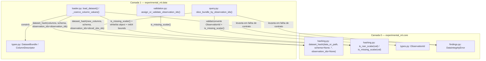

# M1.5 — Revisão do Plano e Saneamento da Fundação M1 (m1-5-foundation-hardening) Design

**Spec**: `.specs/features/m1-5-foundation-hardening/spec.md`
**Status**: Draft

---

## Architecture Overview

A atividade `m1-5-foundation-hardening` realiza o saneamento transversal da fundação M1 (marcos M1.1 a M1.4) antes da abertura do Marco M2, resolvendo os 6 achados de severidade `ALTO` (Faixa P0: `AUD-F-001`, `AUD-F-004`, `AUD-F-005`, `AUD-F-006`, `AUD-F-008`, `AUD-F-009`) e os 4 achados selecionados de severidade `MODERADO` (Faixa P1: `AUD-F-002`, `AUD-F-007`, `AUD-F-010`, `AUD-F-013`), além de documentar o encaminhamento explícito dos 6 achados `ADIADO` (`AUD-F-003`, `AUD-F-011`, `AUD-F-012`, `AUD-F-014`, `AUD-F-015`, `AUD-F-016`).

A direção arquitetural acíclica $L_1 (\text{data}, \text{metrics}) \rightarrow L_0 (\text{core})$ definida em `ADR-008` e conformada a `AD-001` e `AD-002` (`.specs/STATE.md`) permanece estritamente preservada:
- `experimental_ml.core` **não** importa nem depende de `DatasetBundle` ou de qualquer símbolo de `experimental_ml.data`.
- `experimental_ml.core.hashing` centraliza:
  1. As funções canônicas de detecção de ausência escalar `is_nan_scalar(val)` e `is_missing_scalar(val)` (reexportadas em `experimental_ml.core`).
  2. O cálculo criptográfico determinístico `dataset_hash(data_or_path, schema=None, *, observation_ids=None)` com delimitação binária estrutural inequívoca (flags de presença, contagens `<Q`, comprimentos de bytes `<Q` e tags de tipo escalar).
- `experimental_ml.data` (`loader.py`, `query.py`, `validation.py`) consome `is_missing_scalar` e `dataset_hash` de `experimental_ml.core.hashing`, delegando o cálculo de `DatasetBundle.dataset_hash` por passagem explícita de componentes:
  `core.dataset_hash(bundle.columns, bundle.schema, observation_ids=bundle.observation_ids)`.

---

## Code Reuse Analysis

### Existing Components to Leverage

| Component | Location | How to Use |
| --- | --- | --- |
| `dataset_hash`, `config_hash`, `_normalize_float_bytes` | `src/experimental_ml/core/hashing.py` | Estender com `is_nan_scalar`, `is_missing_scalar`, parâmetro `observation_ids: Sequence[Any] \| None = None` e enquadramento binário sem ambiguidade em `_hash_in_memory_tabular` e `_hash_column_binary` |
| `DomainIdentifier`, `ObservationId` | `src/experimental_ml/core/types.py` | Reutilizar validação em `ObservationId.__new__` ao converter strings em `slice_bundle_by_observation_ids` e ao identificar `DomainIdentifier` na *whitelist* de colunas `object` |
| `StrEnum` | `src/experimental_ml/core/enums.py` | Reconhecer instâncias de `StrEnum` na *whitelist* de colunas `object` para materialização como `str` NFC mantendo metadados semânticos em `ColumnDescriptor` |
| `DataIntegrityError`, `ConfigurationError` | `src/experimental_ml/core/findings.py` | Levantar `DataIntegrityError` para violações de fronteira de dados (`slice_bundle_by_observation_ids`, *whitelist* `object` e `OverflowError` em `int64`) |
| `_make_immutable_numeric_array`, `_make_immutable_object_array` | `src/experimental_ml/data/loader.py` | Preservar imutabilidade física via buffer `bytes` para colunas numéricas e estender `_coerce_column_values` com a *whitelist* de escalares imutáveis e captura de `OverflowError` |

### Integration Points

| System | Integration Method |
| --- | --- |
| `experimental_ml.data.loader` $\rightarrow$ `experimental_ml.core.hashing` | Importa `dataset_hash as core_dataset_hash` e `is_missing_scalar`; invoca `core_dataset_hash(immutable_columns, schema, observation_ids=observation_ids)` |
| `experimental_ml.data.query` $\rightarrow$ `experimental_ml.core.hashing` | Importa `dataset_hash as core_dataset_hash` e `is_missing_scalar`; invoca `core_dataset_hash(new_columns, bundle.schema, observation_ids=sliced_obs_ids)` |
| `experimental_ml.data.validation` $\rightarrow$ `experimental_ml.core.hashing` | Importa `is_missing_scalar` para rejeitar valores ausentes (`None`, `float` NaN, `np.floating` NaN) em colunas de `observation_id_col` |
| `tests/integration/test_m1_foundation_integration.py` | Exercita conjuntamente `experimental_ml.core`, `experimental_ml.data` e `experimental_ml.metrics`, além de executar em subprocesso todos os blocos Python de `README.md` |

---

## Components

### 1. Canonical Hashing & Scalar Missingness (`src/experimental_ml/core/hashing.py` & `src/experimental_ml/core/__init__.py`)

- **Purpose**: Centralizar a detecção de `NaN`/ausência escalar para todos os tipos flutuantes nativos e NumPy e fornecer hashing tabular SHA-256 estruturalmente livre de colisões e sensível a `observation_ids`.
- **Location**: `src/experimental_ml/core/hashing.py`, `src/experimental_ml/core/__init__.py`
- **Interfaces**:
  - `is_nan_scalar(val: Any) -> bool`: Retorna `False` para `bool` e `np.bool_`; retorna `bool(math.isnan(val))` para `isinstance(val, float)` e `bool(np.isnan(val))` para `isinstance(val, np.floating)`; retorna `False` para todos os demais tipos.
  - `is_missing_scalar(val: Any) -> bool`: Retorna `val is None or is_nan_scalar(val)`.
  - `dataset_hash(data_or_path: str | Path | bytes | bytearray | memoryview | np.ndarray | Mapping[str, Any] | Sequence[Any], schema: Any = None, *, observation_ids: Sequence[Any] | None = None) -> str`: Calcula o SHA-256 canônico de arquivos brutos, buffers de bytes ou estruturas tabulares em memória.
- **Dependencies**: `hashlib`, `math`, `struct`, `unicodedata`, `numpy`, `experimental_ml.core.findings.ConfigurationError` (sem qualquer importação de `experimental_ml.data`).
- **Reuses**: `config_hash`, `_normalize_float_bytes`.

### 2. Tabular Loader & Object Column Whitelist (`src/experimental_ml/data/loader.py`)

- **Purpose**: Ingerir dados tabulares garantindo contagem consistente de valores ausentes via `is_missing_scalar`, materialização exclusiva de escalares imutáveis da *whitelist* em colunas `dtype=object`, captura de `OverflowError` em `int64` e delegação do `dataset_hash` a `core.dataset_hash`.
- **Location**: `src/experimental_ml/data/loader.py`
- **Interfaces**:
  - `_coerce_column_values(col_name: str, raw_values: Sequence[Any], *, is_from_text: bool) -> tuple[np.ndarray, int]`: Coage os valores brutos para `int64`, `float64` ou `object`, contabilizando `n_missing` via `is_missing_scalar`.
  - `load_dataset(...) -> DatasetBundle`: Constrói o `DatasetBundle` calculando `b_hash = core_dataset_hash(immutable_columns, schema, observation_ids=observation_ids)`.
- **Dependencies**: `experimental_ml.core.hashing` (`dataset_hash`, `is_missing_scalar`), `experimental_ml.core.types.DomainIdentifier`, `experimental_ml.core.enums.StrEnum`, `experimental_ml.core.findings.DataIntegrityError`.
- **Reuses**: `_make_immutable_numeric_array`, `_make_immutable_object_array`, `build_column_descriptors`.

### 3. ObservationId Validation & Query Slicing (`src/experimental_ml/data/validation.py` & `src/experimental_ml/data/query.py`)

- **Purpose**: Validar e preservar instâncias tipadas de `ObservationId` na carga e no fatiamento de `DatasetBundle`, recalculando descritores e `dataset_hash` de forma consistente.
- **Location**: `src/experimental_ml/data/validation.py`, `src/experimental_ml/data/query.py`
- **Interfaces**:
  - `assign_or_validate_observation_ids(raw_columns, n_rows, observation_id_col) -> tuple[ObservationId, ...]`: Usa `is_missing_scalar(val)` para rejeitar qualquer marcador de ausência na coluna de IDs.
  - `slice_bundle_by_observation_ids(bundle: DatasetBundle, observation_ids: Sequence[ObservationId | str]) -> DatasetBundle`: Valida a sequência de entrada, converte elementos `str` válidos para `ObservationId`, preserva `tuple[ObservationId, ...]`, recalcula `n_missing` via `is_missing_scalar` e delega `dataset_hash` para `core_dataset_hash(new_columns, bundle.schema, observation_ids=sliced_obs_ids)`.
- **Dependencies**: `experimental_ml.core.types.ObservationId`, `experimental_ml.core.findings.DataIntegrityError`, `experimental_ml.core.hashing` (`dataset_hash`, `is_missing_scalar`).
- **Reuses**: `ColumnDescriptor`, `DatasetBundle`.

### 4. Documentation, Cross-Module Integration Suite & Governance Closure

- **Purpose**: Alinhar `README.md`, `ARQUITETURA_E_CONTRATOS.md` e `ETAPA_ATUAL_ENGENHARIA.md` ao código real, criar a suíte `tests/integration/test_m1_foundation_integration.py` e consolidar o encerramento formal dos 16 achados em `RESULTS.md`.
- **Location**: `README.md`, `engenharia_software/ARQUITETURA_E_CONTRATOS.md`, `engenharia_software/ETAPA_ATUAL_ENGENHARIA.md`, `tests/integration/test_m1_foundation_integration.py`, `.specs/features/m1-5-foundation-hardening/RESULTS.md`
- **Interfaces**:
  - Suíte `pytest` em `tests/integration/test_m1_foundation_integration.py` com testes fim a fim (`core` + `data` + `metrics`), determinismo entre processos (`PYTHONHASHSEED`) e execução em subprocesso dos 4 blocos Python de `README.md`.

---

## Data Models & Binary Framing Specification

### 1. Enquadramento Binário Canônico de `_hash_in_memory_tabular` (`HARD-01`, `HARD-02`, `HARD-03`)

Para eliminar qualquer colisão de fronteira entre metadados opcionais, nomes de colunas e fluxos de elementos, `_hash_in_memory_tabular(columns, schema, observation_ids=None)` alimenta `hashlib.sha256()` exatamente na seguinte sequência determinística:

1. **Quadro de `schema`**:
   - Se `schema is None`: `b"\x00"`
   - Se `schema is not None`: `b"\x01" + config_hash(schema).encode("ascii")` (64 bytes ASCII hexadecimais de comprimento fixo).
2. **Quadro de `observation_ids`**:
   - Se `observation_ids is None`: `b"\x00"`
   - Se `observation_ids is not None`:
     - Valida que `observation_ids` é uma `Sequence` e **não** é `str | bytes | bytearray | memoryview` (caso contrário, levanta `ConfigurationError`).
     - Escreve `b"\x01" + struct.pack("<Q", len(observation_ids))`.
     - Para cada `oid` em `observation_ids`:
       - Se `oid is None` ou `not isinstance(oid, str)` (nota: `ObservationId` é subclasse de `DomainIdentifier(str)`): levanta `ConfigurationError`.
       - Serializa a identidade exata do domínio: `oid_bytes = str(oid).encode("utf-8")` (sem normalização NFC exclusiva no hashing enquanto `AUD-F-003` permanece `ADIADO`).
       - Escreve `struct.pack("<Q", len(oid_bytes)) + oid_bytes`.
3. **Cabeçalho Tabular**:
   - Escreve `b"TABULAR" + struct.pack("<Q", len(columns))`.
4. **Quadros de Colunas (na ordem exata de `columns`)**:
   - Para cada `(col_name, col_values)`:
     - Normaliza o nome da coluna em NFC: `norm_name = unicodedata.normalize("NFC", str(col_name)).encode("utf-8")`.
     - Escreve `struct.pack("<Q", len(norm_name)) + norm_name`.
     - Invoca `_hash_column_binary(hasher, col_values)`:
       - Sempre escreve o número de elementos da coluna: `struct.pack("<Q", len(arr))`.
       - Ramo `bool`: `b"bool"` + `arr.astype(np.uint8).tobytes()`.
       - Ramo `integer`: `b"int64"` + `arr.astype("<i8").tobytes()`.
       - Ramo `floating`: `b"float64"` + para cada elemento `val`: `_normalize_float_bytes(float(val))` (8 bytes IEEE 754 little-endian com `-0.0 -> +0.0` e `NaN -> 0x7ff8000000000000`).
       - Ramo `object` / outros: `b"object"` + para cada elemento `val`:
         - Se `is_missing_scalar(val)` (`None`, `float` NaN ou `np.floating` NaN): escreve `b"\x00"`.
         - Se `isinstance(val, (bool, np.bool_))`: escreve `b"\x01b" + (b"\x01" if bool(val) else b"\x00")`.
         - Se `isinstance(val, (int, np.integer))`: escreve `b"\x01i" + struct.pack("<q", int(val))` (se fora de `int64`, captura `OverflowError` e escreve comprimento `<Q` + representação decimal ASCII com tag `b"\x01I"`).
         - Se `isinstance(val, (float, np.floating))`: escreve `b"\x01f" + _normalize_float_bytes(float(val))`.
         - Se `isinstance(val, (bytes, np.bytes_))`: `raw_b = bytes(val)`, escreve `b"\x01y" + struct.pack("<Q", len(raw_b)) + raw_b`.
         - Se `isinstance(val, (str, np.str_))`: `s_bytes = unicodedata.normalize("NFC", str(val)).encode("utf-8")`, escreve `b"\x01s" + struct.pack("<Q", len(s_bytes)) + s_bytes`.
         - Caso contrário: levanta `ConfigurationError` informando que o tipo escalar não é suportado para hashing tabular canônico.

### 2. Whitelist de Escalares Imutáveis em `_coerce_column_values` (`HARD-09`, `HARD-10`, `HARD-11`)

Quando uma coluna é materializada como `dtype=object` em `src/experimental_ml/data/loader.py`:
- Valores para os quais `is_missing_scalar(val)` é `True` (`None`, `float("nan")`, `np.float16(np.nan)`, `np.float32(np.nan)`, `np.float64(np.nan)`, etc.) são convertidos para `None` e incrementam `n_missing`.
- Valores não ausentes são validados contra a *whitelist* estrita de tipos exatos:
  1. `type(val) is str or isinstance(val, (np.str_, DomainIdentifier, StrEnum))`: materializado como `unicodedata.normalize("NFC", str(val))` (tipo `str` nativo imutável). A informação semântica da coluna permanece integralmente preservada em `DatasetSchemaSpec.column_semantic_types` e `ColumnDescriptor` (`role`, `semantic_type`, `is_semantic_declared`).
  2. `type(val) is bytes or isinstance(val, np.bytes_)`: materializado como `bytes(val)`.
  3. `type(val) is bool or isinstance(val, np.bool_)`: materializado como `bool(val)`.
  4. `type(val) is int or isinstance(val, np.integer)`: validado no intervalo $[-2^{63}, 2^{63}-1]$ via `struct.pack("<q", int(val))` (capturando `(OverflowError, struct.error)` como `DataIntegrityError`) e materializado como `int(val)`.
  5. `type(val) is float or isinstance(val, np.floating)`: materializado como `float(val)` (valores `NaN` já foram interceptados no passo anterior por `is_missing_scalar(val)` e convertidos para `None`).
- Qualquer outro objeto — incluindo contêineres (`list`, `dict`, `set`, `bytearray`, `memoryview`), objetos mutáveis (`types.SimpleNamespace`, instâncias de classes arbitrárias), subclasses definidas pelo usuário de `str`/`int`/`float`/`bytes` (que possuem `__dict__` mutável) e tipos numéricos não tabulares (`complex`, `Decimal`, `Fraction`) — levanta imediatamente `DataIntegrityError` identificando a coluna, o índice da linha e o tipo rejeitado.

---

## Error Handling Strategy

| Error Scenario | Handling | User Impact |
| --- | --- | --- |
| `slice_bundle_by_observation_ids` recebe `str`/`bytes` puro, sequência vazia, item não-`str`/`ObservationId`, `ObservationId` inválido, duplicata ou ID inexistente no bundle (`HARD-08`) | Valida tipo da sequência e converte cada item via `ObservationId(item)` capturando `ValueError` | Levanta `DataIntegrityError` com mensagem diagnóstica clara |
| Coluna `object` contém objeto fora da *whitelist* (`SimpleNamespace`, `list`, subclasse mutável, `Decimal`, `complex`) (`HARD-10`) | Rejeita na validação por *whitelist* em `_coerce_column_values` | Levanta `DataIntegrityError` informando nome da coluna, linha e tipo |
| Inteiro fora do intervalo `int64` $[-2^{63}, 2^{63}-1]$ em coluna numérica ou mista (`HARD-11`) | Captura `(OverflowError, struct.error)` na conversão para `<i8` / `<q` | Levanta `DataIntegrityError` em vez de `OverflowError` não tratado |
| `observation_ids` inválido passado diretamente a `core.dataset_hash` | Valida em `_hash_in_memory_tabular` | Levanta `ConfigurationError` dentro da hierarquia `ExperimentalMLError` |

---

## Risks & Concerns

| Concern | Location (file:line) | Impact | Mitigation |
| --- | --- | --- | --- |
| Alteração dos valores hexadecimais de `dataset_hash` após novo enquadramento binário | `src/experimental_ml/core/hashing.py:137-205` | Hashes calculados em versões anteriores mudam numericamente (sem necessidade de retrocompatibilidade numérica conforme item 4 do Specify) | Verificar se algum teste existente fixa digest literal de `dataset_hash` (nenhum teste atual fixa hash literal de `dataset_hash`, apenas propriedades de igualdade/diferença e formato hex de 64 caracteres) e adicionar testes explícitos de determinismo e separação de tipos |
| Subclasses de `str` ou `int` definidas pelo usuário passando por `isinstance(val, str)` | `src/experimental_ml/data/loader.py:85-103` | Subclasses em Python possuem `__dict__` mutável por padrão, permitindo mutação de atributos anexados pós-carga | Usar verificação de tipo exato (`type(val) is str`) combinada apenas com as classes seladas do domínio (`isinstance(val, (np.str_, DomainIdentifier, StrEnum))`) e converter para `str` nativo |
| Contagem de símbolos exportados em `experimental_ml.core.__all__` | `src/experimental_ml/core/__init__.py` | A exportação de `is_nan_scalar` e `is_missing_scalar` aumenta `core.__all__` de 25 para 27 símbolos | Atualizar `tests/unit/test_core.py` e a documentação (`ETAPA_ATUAL_ENGENHARIA.md`, `ARQUITETURA_E_CONTRATOS.md`) de forma sincronizada |

---

## Tech Decisions

| Decision | Choice | Rationale |
| --- | --- | --- |
| Preservação da direção `data -> core` em `dataset_hash` (`HARD-03`, `HARD-04`) | `core.dataset_hash(data_or_path, schema=None, *, observation_ids=None)` sem aceitar `DatasetBundle` | Mantém `core` 100% desacoplado de `data` (`ADR-008`) e garante `bundle.dataset_hash == core.dataset_hash(bundle.columns, bundle.schema, observation_ids=bundle.observation_ids)` |
| Serialização de `observation_ids` no hashing sem NFC exclusivo (`HARD-03`) | Usar `str(oid).encode("utf-8")` exato do domínio em `_hash_in_memory_tabular` | Enquanto `AUD-F-003` permanece `ADIADO`, dois `ObservationId` distintos no domínio não devem colidir no hash |
| Tags de tipo escalar no ramo `object` de `_hash_column_binary` (`HARD-02`) | Prefixar `b"\x00"` (ausente), `b"\x01b"` (`bool`), `b"\x01i"` (`int`), `b"\x01f"` (`float`), `b"\x01y"` (`bytes`) e `b"\x01s"` (`str`) | Impede colisões entre escalares com mesma representação textual (`"1"`, `1`, `1.0`, `True`, `b"1"`) |

