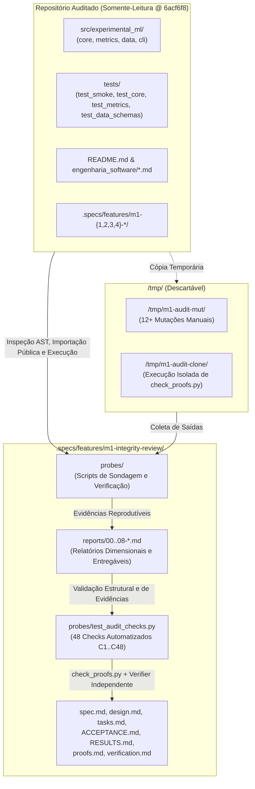

# m1-integrity-review Design

**Spec**: `.specs/features/m1-integrity-review/spec.md`
**Status**: Approved
**Approved**: 2026-11-05 - user: "confirmo todas recomendacoes"

---

## Architecture Overview

A **Auditoria Geral de Integridade do Projeto (M1 — Project Integrity Review)** é estruturada como uma atividade formal de verificação e diagnóstico sob o fluxo do TLC Spec-Driven Development, operando em estrito isolamento em relação ao código-fonte (`src/`), à suíte de testes (`tests/`), aos arquivos de configuração (`pyproject.toml`, `.agent/`) e aos registros históricos homologados dos marcos `m1-1-setup-cli-smoke`, `m1-2-core`, `m1-3-metrics` e `m1-4-datasets-schemas`.

Toda a instrumentação de sondagem (*probes*), evidências brutas, relatórios dimensionais e artefatos de governança residem exclusivamente sob `.specs/features/m1-integrity-review/` na branch dedicada `audit/m1-integrity-review`. Operações que precisem mutar código (como testes de mutação para aferir a força da suíte) ou executar scripts que reescrevam artefatos (como `check_proofs.py` nos marcos M1.1–M1.4) operam sobre cópias efêmeras em `/tmp/` que são removidas após a coleta das evidências.



---

## Component Design

### 1. Sonda de Linha de Base e Arquitetura (`probes/ast_and_arch_probe.py`)
- **Responsabilidade**: Coletar os dados de linha de base (`AUD-01`..`AUD-04`) e executar todas as verificações estáticas e dinâmicas da Dimensão A (`ARCH-01`..`ARCH-07`).
- **Verificações**:
  - Extração via `ast` do grafo completo de importações internas (`module -> module`), incluindo importações dentro de funções, e validação contra os níveis de dependência da Seção 2.3 de `ARQUITETURA_E_CONTRATOS.md` e detecção de ciclos.
  - Classificação exaustiva de todas as classes em `src/` (`frozen dataclass`, `Enum`, `Exception`, `str` subclass imutável ou outro) frente ao **ADR-008**.
  - Mapeamento de responsabilidades implementadas em mais de um módulo (normalização Unicode NFC, validação de identificadores/nomes, validação numérica, cálculo de hash).
  - Identificação de símbolos exportados em `__all__` sem referências externas em `src/` ou `tests/`.
  - Comparação entre a API pública documentada em `ARQUITETURA_E_CONTRATOS.md` (Seções 2.3 e 3.1) e os símbolos efetivamente exportados por `core`, `metrics` e `data`.

### 2. Sonda de Integração entre Módulos (`probes/integration_probe.py`)
- **Responsabilidade**: Executar fluxos integrados reais combinando `experimental_ml.core`, `experimental_ml.metrics` e `experimental_ml.data` (`INT-01`..`INT-08`).
- **Verificações**:
  - Fluxo ponta a ponta: `load_dataset` (CSV e `dict`) $\rightarrow$ `slice_bundle_by_observation_ids` (divisão simulada em 2 folds usando `derive_seeds`) $\rightarrow$ `get_column_array` $\rightarrow$ `compute_metric` (`rmse`, `r2`, `mae`, `pearson`, `accuracy`, `f1`, `roc_auc`, `log_loss`) $\rightarrow$ `aggregate_fold_metrics` $\rightarrow$ `is_better` / `rank_configurations`.
  - Verificação de identidade de tipos (`ObservationId`, `TaskType`) e da hierarquia de exceções (`ExperimentalMLError`) nas fronteiras entre módulos.
  - Comparação de `dataset_hash`, `raw_source_hash` e `schema_hash` entre CSV (`,`), TSV (`\t`), CRLF vs LF e `dict` em memória.
  - Determinismo inter-processos executando o fluxo completo sob `PYTHONHASHSEED=0` e `PYTHONHASHSEED=12345`.
  - Invariância e compatibilidade de buffers somente-leitura (`copy=False`) ao passar pelas 15 funções de `METRICS_CATALOG`.
  - Análise exata da relação entre `bundle.dataset_hash` e chamadas diretas a `core.dataset_hash`.
  - Comportamento de colunas com `dtype` físico `int64` e `bool` extraídas de `DatasetBundle` quando passadas às métricas de regressão e classificação.

### 3. Sonda de Qualidade de Implementação e Desempenho (`probes/quality_and_perf_probe.py`)
- **Responsabilidade**: Avaliar a qualidade interna do código, casos extremos, imutabilidade adversarial, escalabilidade e compatibilidade de interpretadores (`QUAL-01`..`QUAL-06`).
- **Verificações**:
  - Varredura AST para `except:` nu, `except Exception` sem re-raise, argumentos padrão mutáveis, `assert` de validação em tempo de execução, variáveis globais mutáveis e importações não utilizadas.
  - Auditoria de anotações de tipos (`__annotations__` / AST) em todas as funções e métodos públicos de `core`, `metrics` e `data`.
  - Bateria de casos extremos (*edge cases*): entradas vazias, tamanhos discrepantes, `NaN`, `±Inf`, nomes de colunas Unicode em NFD, IDs de observação duplicados e inteiros além de `int64` (`2**63`).
  - Benchmark de escalabilidade temporal e de memória: `load_dataset` (CSV e memória) e `dataset_hash` com $10\,000$ e $100\,000$ linhas $\times 20$ colunas numéricas, calculando a razão $T(100\text{k}) / T(10\text{k})$.
  - Ataque adversarial de imutabilidade em `DatasetBundle`: tentativas de mutação via `setattr`, `delattr`, `columns[...] = ...`, `descriptors[...] = ...`, `get_column_array(..., copy=False).setflags(write=True)`, escrita em `arr[0]`, views transpostas/fatiadas, e elementos de colunas `object`.
  - Verificação empírica nos interpretadores Python disponíveis no host (`/usr/bin/python3.12`, `/usr/bin/python3.14`) e registro de `NÃO VERIFICÁVEL` para Python 3.10 e 3.11.

### 4. Sonda de Estratégia de Testes e Confiabilidade do TLC (`probes/testing_and_tlc_probe.py`)
- **Responsabilidade**: Medir cobertura, executar análise de mutação em cópia isolada, avaliar isolamento/ordem da suíte e auditar os validadores TLC (`TEST-01`..`TEST-08`).
- **Verificações**:
  - Cobertura de linhas por arquivo de `src/experimental_ml/` usando `sys.settrace` durante a execução de `pytest tests/`, identificando intervalos de linhas não cobertos.
  - Execução de $\ge 12$ mutações cirúrgicas em `/tmp/m1-audit-mut/` (mínimo 3 em `core`, 3 em `metrics`, 3 em `data`, 1 em `cli`), cada uma violando um critério de especificação aprovado, verificando se a suíte falha (*mutation killed*) ou passa (*mutation survived*).
  - Contagem de testes em `tests/` que importam e integram simultaneamente 2 ou mais pacotes de `core`, `metrics` e `data`.
  - Execução individual (`pytest <nodeid>`) e em ordem direta e reversa dos arquivos de teste.
  - Execução de `validate_spec.py --strict`, `validate_tasks.py --strict`, `validate_verification.py --strict` e (em clone descartável `/tmp/m1-audit-clone`) `check_proofs.py` para `m1-1`, `m1-2`, `m1-3` e `m1-4`, além de testes adversariais sobre os próprios validadores TLC.

### 5. Sonda de Documentação e Rastreabilidade (`probes/docs_and_traceability_probe.py`)
- **Responsabilidade**: Auditar a correspondência exata entre documentação e código e construir a matriz de rastreabilidade (`DOC-01`..`DOC-07`).
- **Verificações**:
  - Extração e execução isolada de cada bloco ```python do `README.md` em subprocesso `.venv/bin/python`, verificando exceções e valores comentados.
  - Comparação bidirecional entre a árvore de diretórios do `README.md` e o sistema de arquivos real (`src/` e `tests/`).
  - Conferência de contagens de testes, status de marcos e hashes de commits entre todos os documentos e `pytest --collect-only` / `git log`.
  - Verificação de importabilidade de todos os símbolos públicos citados como implementados na documentação.
  - Análise comparativa entre o texto do **ADR-007**, a `spec.md` do M1.4 e o código de `core/hashing.py` e `data/loader.py`.
  - Verificação estrutural dos artefatos de governança de M1.1–M1.4 e `.specs/STATE.md`.

### 6. Suíte de Verificação dos Critérios da Auditoria (`probes/test_audit_checks.py`)
- **Responsabilidade**: Prover 48 testes automatizados (`test_c01_aud_01` a `test_c48_ready_08`) executados por `pytest` para comprovar mecanicamente que todos os relatórios (`00` a `08`), evidências, matrizes, contagens, verificações independentes e a invariante de não interferência (`git diff` vazio no código do projeto) foram integralmente cumpridos.

---

## Deliverables Mapping

| Entregável Solicitado | Arquivo Gerado | Critérios Cobertos |
| :--- | :--- | :--- |
| Protocolo e Linha de Base | `reports/00-baseline.md` | `AUD-01`, `AUD-02`, `AUD-03`, `AUD-04` |
| 1. Especificação e critérios da auditoria | `reports/01-especificacao-criterios.md` + `spec.md` | Estrutura geral, dimensões A–F e regra de decisão |
| 2. Relatório de integridade arquitetural | `reports/02-arquitetura.md` | `ARCH-01` a `ARCH-07` |
| 3. Relatório de integração entre módulos | `reports/03-integracao.md` | `INT-01` a `INT-08` |
| 4. Relatório de qualidade e estratégia de testes | `reports/04-qualidade-e-testes.md` | `QUAL-01` a `QUAL-06`, `TEST-01` a `TEST-08` |
| 5. Matriz de conformidade e rastreabilidade | `reports/05-rastreabilidade.md` | `DOC-01` a `DOC-07` |
| 6. Registro consolidado de achados e riscos | `reports/06-achados.md` | `READY-03`, `READY-04` |
| 7. Plano de correções priorizadas | `reports/07-plano-correcoes.md` | `READY-05` |
| 8. Parecer final de prontidão para o M2 | `reports/08-parecer.md` + `RESULTS.md` | `READY-01`, `READY-02`, `READY-06`, `READY-07`, `READY-08` |

