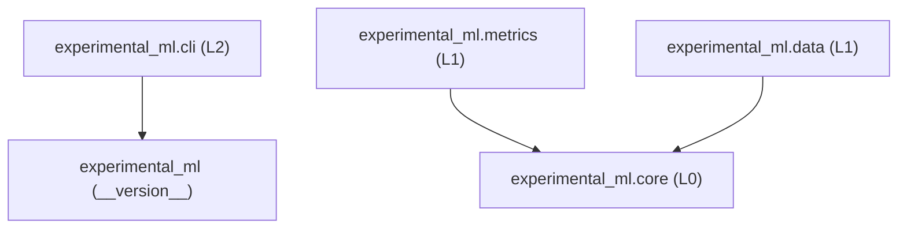

# 2. Relatório de Integridade Arquitetural (`02-arquitetura.md`)

**Dimensão:** A — Integridade Arquitetural (`ARCH-01` a `ARCH-07`)  
**Sonda Executada:** [ast_and_arch_probe.py](file:///home/alexandrerangel/Projetos/iniciacao_cientifica/experimental-ml-framework/.specs/features/m1-integrity-review/probes/ast_and_arch_probe.py)

---

## 1. Grafo de Importações AST e Direção de Dependências (`ARCH-01`, `ARCH-02`, `ARCH-03`)

A varredura AST completa dos 21 arquivos Python em `src/experimental_ml/` extraiu **57 arestas internas de importação** entre módulos do projeto.

### 1.1 Dependências Efetivas por Subpacote

| Subpacote | Nível Arquitetural | Módulos Internos Importados | Pacotes do Projeto Importados | Pacotes Externos / Stdlib |
| :--- | :---: | :--- | :--- | :--- |
| `experimental_ml.core` | $L_0$ | `enums`, `findings`, `hashing`, `seeds`, `types` | **Nenhum (`[]`)** | `dataclasses`, `enum`, `hashlib`, `math`, `pathlib`, `struct`, `typing`, `unicodedata`, `numpy` |
| `experimental_ml.metrics` | $L_1$ | `aggregation`, `catalog`, `classification`, `regression`, `types`, `validation` | **`core`** (`enums`, `findings`) | `dataclasses`, `math`, `typing`, `numpy` |
| `experimental_ml.data` | $L_1$ | `loader`, `parsing`, `query`, `schema`, `types`, `validation` | **`core`** (`enums`, `findings`, `hashing`, `types`) | `csv`, `dataclasses`, `io`, `math`, `pathlib`, `re`, `types`, `typing`, `unicodedata`, `numpy` |
| `experimental_ml.cli` | $L_2$ | `main` | `experimental_ml` (`__version__`) | `argparse`, `sys`, `typing` |

### 1.2 Verificação de Regras de Fronteira e Ciclos

* **Ciclos de importação (`ARCH-02`):** `0` ciclos detectados (`module_cycles: []`), tanto entre subpacotes quanto entre módulos internos de cada subpacote.
* **Isolamento de `core` (`ARCH-03`):** Confirmado (`package_dependencies["core"] == []`). Nenhum arquivo em `src/experimental_ml/core/` importa `metrics`, `data` ou `cli`.
* **Independência mútua entre `metrics` e `data` (`ARCH-03`):** Confirmada. `metrics` importa apenas `core`; `data` importa apenas `core`.
* **Conformidade com a Seção 2.3 de `ARQUITETURA_E_CONTRATOS.md` (`ARCH-01`):** A direção das dependências implementadas obedece estritamente ao grafo acíclico documentado ($L_1 \rightarrow L_0$).

---

## 2. Paradigma Estrutural e Funcional — Conformidade com ADR-008 (`ARCH-04`)

O **ADR-008** ([ARQUITETURA_E_CONTRATOS.md](file:///home/alexandrerangel/Projetos/iniciacao_cientifica/experimental-ml-framework/engenharia_software/ARQUITETURA_E_CONTRATOS.md#L214-L218)) determina que o código interno seja organizado em estruturas de dados imutáveis (`@dataclass(frozen=True, slots=True)`, `NamedTuple`, `TypedDict`, `Enum`) e funções puras, proibindo classes de serviço com estado mutável ou hierarquias de herança profunda.

A inspeção AST identificou **30 classes** em `src/experimental_ml/`:

| Categoria de Classe | Quantidade | Classes Identificadas | Conformidade ADR-008 |
| :--- | :---: | :--- | :--- |
| Enumerações (`Enum` / `StrEnum`) | 10 | `StrEnum`, `TaskType`, `ExecutionStatus`, `FindingSeverity`, `MetricDirection`, `AggregationScope`, `MetricStatus`, `ErrorPolicy`, `ColumnSemanticType`, `MetricEvaluationScope` | **Conforme** |
| Exceções de Domínio (`Exception`) | 4 | `ExperimentalMLError`, `ContractViolationError`, `DataIntegrityError`, `ConfigurationError` | **Conforme** |
| Estruturas de Dados Imutáveis (`@dataclass(frozen=True, slots=True)`) | 7 | `Finding`, `DatasetSchemaSpec`, `ColumnDescriptor`, `DatasetBundle`, `MetricValue`, `AggregatedMetricValue`, `MetricSpec`, `RankedCandidate` *(8 no total com `Finding`)* | **Conforme** (`frozen=True, slots=True`) |
| Identificadores de Domínio (`str` subclass) | 9 | `DomainIdentifier`, `ExperimentId`, `PartitionPlanId`, `ScenarioId`, `ModelId`, `CellId`, `ComparisonId`, `ArtifactId`, `ObservationId` | **Ressalva (Achado `AUD-F-003`)** |

### Achado Arquitetural em `DomainIdentifier` (`AUD-F-003`)
Em [types.py](file:///home/alexandrerangel/Projetos/iniciacao_cientifica/experimental-ml-framework/src/experimental_ml/core/types.py#L6-L50), `DomainIdentifier(str)` e suas 8 subclasses não declaram `__slots__ = ()`. Em Python, qualquer subclasse de `str` sem `__slots__ = ()` recebe automaticamente um dicionário de instância `__dict__` mutável:
* `obs = ObservationId("obs_000000"); obs.mutated = [1, 2, 3]` executa sem erro, violando a imutabilidade estrita de identificadores e aumentando o consumo de memória por observação.
* Adicionalmente, `DomainIdentifier.__new__` levanta `ValueError` bruto (fora da hierarquia `ExperimentalMLError`), não normaliza strings para Unicode NFC e rejeita apenas `\n`, `\r`, `\t` (aceitando caracteres de controle ASCII `< 32` como `\x00`, em desacordo com o `README.md` linha 64).

---

## 3. Sobreposição de Responsabilidades e Duplicação de Código (`ARCH-05`)

A inspeção transversal identificou quatro pontos de duplicação ou divergência de responsabilidade entre módulos:

1. **Detecção de valores ausentes (`NaN`) duplicada e incompleta para tipos flutuantes NumPy (`AUD-F-008`):**
   * [hashing.py](file:///home/alexandrerangel/Projetos/iniciacao_cientifica/experimental-ml-framework/src/experimental_ml/core/hashing.py#L189) (`_is_null_or_nan`) e [loader.py](file:///home/alexandrerangel/Projetos/iniciacao_cientifica/experimental-ml-framework/src/experimental_ml/data/loader.py#L69) (`_is_missing_token`) implementam separadamente `isinstance(val, float) and math.isnan(val)`.
   * Como `np.float32` e `np.float16` herdam de `np.floating` (e **não** de `float` do Python), ambos os módulos deixam de reconhecer `np.float32(np.nan)` como valor ausente! Em `load_dataset`, um `ndarray` 2D com `dtype=np.float32` contendo `np.nan` gera `ColumnDescriptor.n_missing == 0` enquanto o array convertido para `float64` contém `NaN`.
2. **Duplicação de `StrEnum` em `core/enums.py` e reuso interno:**
   * `StrEnum` é definido em [enums.py](file:///home/alexandrerangel/Projetos/iniciacao_cientifica/experimental-ml-framework/src/experimental_ml/core/enums.py#L8-L12) e importado internamente por `data/schema.py` e `metrics/types.py`, mas não consta em `core.__all__`.
3. **Normalização Unicode NFC repetida em três módulos:**
   * Implementada manualmente em `core/hashing.py` (`_normalize_str`), `data/schema.py` (`_normalize_col_name`) e `data/loader.py`, mas omitida em `core/types.py` (`DomainIdentifier`) e `data/validation.py` (`assign_or_validate_observation_ids`).
4. **Serialização em memória de `core.dataset_hash` vs. `DatasetBundle` (`AUD-F-004`, `AUD-F-005`):**
   * Em [hashing.py](file:///home/alexandrerangel/Projetos/iniciacao_cientifica/experimental-ml-framework/src/experimental_ml/core/hashing.py#L205-L218), `_hash_in_memory_tabular` concatena nomes de colunas no SHA-256 sem delimitador nem prefixo de comprimento (`for col_name in col_names: hasher.update(col_name.encode("utf-8"))`), permitindo colisão trivial entre `{"ab": [1], "c": [2]}` e `{"a": [1], "bc": [2]}`.
   * Além disso, `core.dataset_hash(bundle.columns, bundle.schema)` não recebe nem incorpora `bundle.observation_ids`, fazendo com que dois `DatasetBundle` com mesmas colunas mas `observation_ids` distintos (ex.: após fatiamento ou reindexação quando `observation_id_col=None`) tenham exatamente o mesmo `dataset_hash`.

---

## 4. Auditoria de Símbolos Públicos Exportados (`ARCH-06`)

Foram inspecionados todos os **60 símbolos públicos** exportados em `__all__` nos pacotes `experimental_ml` (1), `experimental_ml.core` (25), `experimental_ml.metrics` (22) e `experimental_ml.data` (12):

* **Símbolos órfãos (não referenciados nem em `src/` nem em `tests/`):** **`0`**. Todos os 60 símbolos possuem cobertura direta na suíte de testes.
* **Símbolos de `core` provisionados para marcos futuros (M2–M7) e ainda não consumidos por `metrics` ou `data`:**
  * Identificadores: `ExperimentId`, `PartitionPlanId`, `ScenarioId`, `ModelId`, `CellId`, `ComparisonId`, `ArtifactId` (consumidos a partir de M2–M7).
  * Enumerações e utilitários: `ExecutionStatus`, `ErrorPolicy`, `ContractViolationError`, `make_finding`, `derive_seeds`, `spawn_child_seeds` (consumidos em M2–M6).
  * Justificativa arquitetural: pertencem legitimamente à entrega M1.2 (`core`) conforme Seção 7.1 de `ARQUITETURA_E_CONTRATOS.md`.

---

## 5. Coerência entre Arquitetura Documentada e Implementação (`ARCH-07`)

| Item Verificado | Documentado em `ARQUITETURA_E_CONTRATOS.md` / `README.md` | Implementado em `src/experimental_ml/` | Diagnóstico |
| :--- | :--- | :--- | :--- |
| Exemplo de `DatasetSchemaSpec` no `README.md` | `DatasetSchemaSpec(..., semantic_types={...})` e `bundle.n_features` (`README.md:302-316`) | Campo real é `column_semantic_types`; atributo real é `bundle.feature_cols` (`len(bundle.feature_cols)`) | **Divergência Crítica de Documentação (`AUD-F-001`)** |
| Árvore de arquivos de `core` no `README.md` | Lista `core/exceptions.py` e `core/identifiers.py` (`README.md:122,125`) | Arquivos reais são `core/findings.py` e `core/types.py` | **Divergência de Documentação (`AUD-F-002`)** |
| Semântica de `dataset_hash` quanto à ordem de colunas e `observation_ids` | Afirma que `dataset_hash` é "invariante a ... ordenação de chaves" (`ARQUITETURA:250`, `README:103`) e distingue `observation_ids` (`ARQUITETURA:210,707`) | `dataset_hash` depende da ordem de colunas de `Mapping` e ignora `observation_ids` quando `observation_id_col=None` | **Divergência Contrato vs. Código (`AUD-F-005`, `AUD-F-010`)** |
| Contrato de `ADR-007` para `dataset_hash(path, schema)` | Define `dataset_hash(path, schema)` como SHA-256 dos bytes brutos do arquivo + schema (`ARQUITETURA:209`) | `core.dataset_hash(path, schema)` calcula SHA-256 dos bytes brutos, que `DatasetBundle` armazena em `raw_source_hash`, enquanto `bundle.dataset_hash` usa `core.dataset_hash(bundle.columns, schema)` | **Ambiguidade de Nomenclatura (`AUD-F-010`)** |
