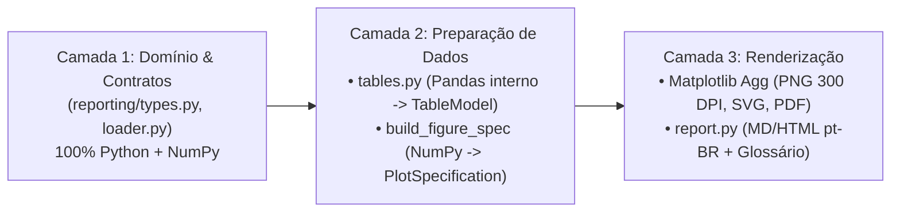

# Design — Marco M10: Redesenho do Subsistema de Visualização Científica e Relatórios

- **Feature**: `m10-scientific-visualization-reporting-redesign`
- **Spec**: [`spec.md`](./spec.md)
- **Decisions**: `AD-033`, `AD-034`, `AD-035`, `AD-036`

---

## 1. Arquitetura em 3 Camadas

### Invariantes de Fronteira (`AD-033`, `AD-034`, `AD-035`)
- **Núcleo puro**: `core`, `metrics`, `data`, `features/{stats,selection}`, `models`, `tuning`, `validation`, `orchestration`, `statistics` e `reporting/types.py` nunca importam `pandas` nem `matplotlib`.
- **`pandas` permitido**: exclusivamente dentro de `reporting/tables.py` (via lazy import dentro das funções) para organização, junção, ordenação e agregação, convertendo o resultado de volta para `TableModel` (`tuple[MappingProxyType, ...]`), além de `TableModel.to_dataframe()` e `ExperimentRunSummary.to_dataframe()` como utilitários opcionais de borda.
- **`matplotlib` permitido**: exclusivamente dentro de `features/visualization.py` e `reporting/figures.py` (backend `Agg`, lazy import para manter `CLI-10`).

---

## 2. Componentes e Mudanças por Módulo

### 2.1. Dependências e Revisão Controlada de `XCUT-02` (`T1`)
- `pyproject.toml`: adicionar `"matplotlib>=3.7.0"` e `"pandas>=2.0.0"` em `dependencies`.
- `docs/engenharia_software/ESPECIFICACAO_REQUISITOS.md`: registrar a revisão controlada de `XCUT-02` restrita às camadas de borda (`reporting/tables.py`, `reporting/figures.py`, `features/visualization.py`).
- Testes de invariantes (`test_mvp_audit_invariants.py`, `test_m71_integration.py`, `test_m72_integration.py`, `test_m73_integration.py`, `test_run_e2e.py`): ajustar allowlist AST/runtime para refletir a fronteira exata de `AD-033`/`AD-034` enquanto mantém o bloqueio estrito no restante do framework.

### 2.2. Contratos e Preparação Tabular com Pandas (`T2`)
- `src/experimental_ml/reporting/types.py`:
  - Em `PlotSeries`: adicionar campo opcional `point_labels: tuple[str, ...] = ()` e `x_numeric: tuple[float, ...] = ()` (ou permitir `x_values: tuple[str | float, ...]` com `point_labels` explícito para Pareto/Scatter).
  - Em `PlotSpecification`: adicionar campos opcionais `reference_y: float | None = None`, `reference_label: str = ""`, `subtitle: str = ""`, `metric_direction: str = ""`.
  - Em `TableModel`: adicionar método `to_dataframe(self)` (lazy import `pandas`) apenas para conveniência na borda.
- `src/experimental_ml/reporting/tables.py`:
  - Usar `pandas.DataFrame` internamente (lazy import) para:
    - **Tabela B (`B_FEATURE_SCENARIOS`)**: incluir `mode`, `strategy` (`dynamic_method` ou `"FIXED"`), `n_features` (exibindo candidatos/parâmetros quando `DYNAMIC`), `parameters` e `scientific_justification`.
    - **Tabela C (`C_MODELS_CONFIG`)**: incluir `display_name`, `family`, `task_type` (resolvido via `capabilities` / catálogo quando ausente), `preprocessing` (L1/L2 resumido) e `hyperparameters`.
    - **Tabela D (`D_PREDICTIVE_PERFORMANCE`)**: ordenação determinística por métrica/desempenho (preservando coluna `holdout_mean` do `M9`).
    - **Tabela E (`E_STATISTICAL_COMPARISONS`)**: aplicar filtro por `sel.model_ids` e `sel.scenario_ids` além de `sel.metric_ids`, e incluir intervalo de confiança de Nadeau-Bengio.
    - **Tabela G (`G_MODEL_SPECIFIC_ARTIFACTS`)**: agregar vetores/dicionários de `cell_diagnostics` (ex.: `feature_importances`, `coefficients`) entre folds com `mean` ± `std` por atributo via Pandas em vez de string truncada.

### 2.3. Visualização Exploratória da Etapa 2 (`T3`)
- `src/experimental_ml/features/visualization.py`:
  - Separar preparação de dados (`_prepare_target_chart_data`, `_prepare_redundancy_heatmap_data`) da renderização Matplotlib (`Agg`).
  - `render_exploratory_target_chart`: gráfico de barras horizontais ordenado por magnitude com suporte UTF-8 em português, ajuste automático de margens (`bbox_inches="tight"`), valores anotados e escala dinâmica.
  - `render_exploratory_redundancy_heatmap`: matriz quadrada com `imshow`, barra de cores com escala explícita, rótulos rotacionados sem colisão e anotações numéricas adaptativas.

### 2.4. Gráficos Científicos da Etapa 6 (`T4`)
- `src/experimental_ml/reporting/figures.py`:
  - `build_figure_spec`:
    - **Família D**: `BAR_COMPARISON` com barras de erro/IC (e `holdout` quando presente) + `SCATTER_PARITY` (ou resíduos) quando predições OOF estão disponíveis.
    - **Família E**: `PAIRED_DIFF_CI` com `reference_y=0.0`, filtrado por `sel` e com ICs de Nadeau-Bengio.
    - **Família F**: `PARETO_TRADEOFF` com coordenadas numéricas reais (`x_values` = tempo médio `total_cell_mean_s`, `y_values` = métrica preditiva) e `point_labels` com `model_id/scenario_id`.
    - **Família G**: `BAR_COMPARISON` / `HEATMAP` de diagnósticos reais agregados por atributo (ex.: top importâncias) quando disponíveis em `cell_diagnostics`.
  - `render_figure(spec, fmt)` via Matplotlib (`Agg`):
    - Renderização unificada para `"png"` (300 DPI), `"svg"` e `"pdf"` com suporte UTF-8 completo, títulos/subtítulos, gridlines, escalas numéricas em X e Y, legendas, linha de referência `y=0` em `PAIRED_DIFF_CI`, scatter 2D real com rótulos anotados em `PARETO_TRADEOFF` e `SCATTER_PARITY`, `HEATMAP` e `LINE_LEARNING`.

### 2.5. Relatório Consolidado em `pt-BR` e Integração `pipeline.py` (`T5`–`T6`)
- `src/experimental_ml/reporting/report.py`:
  - Tradução completa de `render_full_report` (Markdown e HTML com `<html lang="pt-BR">`), `@media print` no CSS, renderização de `table.caption`/`table.notes` no HTML, incorporação visual das figuras (`` / `<figure>`) e seção final de **Glossário Estatístico**.
- `src/experimental_ml/pipeline.py` & `src/experimental_ml/cli/cmd_report.py`:
  - `run_experiment`: gerar `exploratory_features.html` + PNGs na Etapa 2 e exportar figuras/tabelas vinculadas ao `report.{md,html}` na Etapa 6 (e expor `ExperimentRunSummary.to_dataframe()` opcional).
