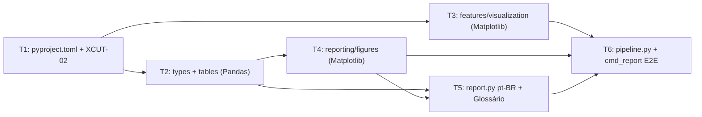

# Tasks — Marco M10: Redesenho do Subsistema de Visualização Científica e Relatórios

- **Feature**: `m10-scientific-visualization-reporting-redesign`
- **Branch**: `feat/m10-visualization-reporting`

---

## Task Breakdown

## Execution Plan

### T1: Atualizar `pyproject.toml`, instalar `matplotlib`/`pandas` e revisar testes de `XCUT-02` (`AD-033`, `AD-034`, `AD-035`)
- [ ] Implement & test T1
**Where**: `pyproject.toml`, `docs/engenharia_software/ESPECIFICACAO_REQUISITOS.md`, `tests/integration/test_mvp_audit_invariants.py`, `tests/integration/reporting/test_m71_integration.py`, `tests/integration/reporting/test_m72_integration.py`, `tests/integration/reporting/test_m73_integration.py`, `tests/integration/cli/test_run_e2e.py`
**Depends on**: none
**Tests**: `tests/integration/test_mvp_audit_invariants.py` valida que `matplotlib` só é importado em `features/visualization.py` e `reporting/figures.py` e `pandas` só em `reporting/tables.py` (+ `to_dataframe()`), mantendo núcleo 100% puro.
**Gate**: `.venv/bin/pytest tests/integration/test_mvp_audit_invariants.py tests/integration/reporting/ -q`

### T2: Enriquecer contratos em `reporting/types.py` e preparar Tabelas A–G com Pandas em `reporting/tables.py` (`AD-034`, `M10-05`)
- [ ] Implement & test T2
**Where**: `src/experimental_ml/reporting/types.py`, `src/experimental_ml/reporting/tables.py`, `tests/unit/reporting/test_reporting_types.py`, `tests/unit/reporting/test_reporting_tables.py`
**Depends on**: T1
**Tests**: Testes unitários verificando `TableModel` imutável (sem `DataFrame`), `to_dataframe()` opcional, metadados completos em Tabelas B e C, filtro `model_ids`/`scenario_ids` na Tabela E e agregação numérica por atributo/fold na Tabela G.
**Gate**: `.venv/bin/pytest tests/unit/reporting/ -q`

### T3: Migrar gráficos exploratórios da Etapa 2 para Matplotlib (`Agg`) (`M10-04`, `VAL-QUAL-001`)
- [ ] Implement & test T3
**Where**: `src/experimental_ml/features/visualization.py`, `tests/unit/features/test_exploratory_visualization.py`
**Depends on**: T1
**Tests**: Testes verificando separação preparação→renderização, assinatura PNG válida, preservação de UTF-8 com acentos em português e ausência de truncamento com nomes de atributos longos.
**Gate**: `.venv/bin/pytest tests/unit/features/ -q`

### T4: Reestruturar `reporting/figures.py` com Matplotlib (`PNG 300 DPI`, `SVG`, `PDF`) e gráficos reais A–G (`M10-02`, `M10-03`, `VAL-BUG-006`)
- [ ] Implement & test T4
**Where**: `src/experimental_ml/reporting/figures.py`, `src/experimental_ml/reporting/packaging.py`, `tests/unit/reporting/test_reporting_figures.py`
**Depends on**: T2
**Tests**: Testes verificando coordenadas 2D reais em `PARETO_TRADEOFF`, linha `y=0` em `PAIRED_DIFF_CI`, `SCATTER_PARITY`, `HEATMAP`, `LINE_LEARNING`, diagnósticos da Família G e geração válida/determinística em `PNG`, `SVG` e `PDF`.
**Gate**: `.venv/bin/pytest tests/unit/reporting/ -q`

### T5: Padronizar `report.md` e `report.html` em `pt-BR` com figuras embutidas e Glossário Estatístico (`M10-06`, `VAL-QUAL-002`)
- [ ] Implement & test T5
**Where**: `src/experimental_ml/reporting/report.py`, `tests/unit/reporting/test_reporting_report.py`
**Depends on**: T2, T4
**Tests**: Testes verificando `<html lang="pt-BR">`, títulos/seções em português, imagens embutidas em MD/HTML, `@media print` e seção de Glossário Estatístico.
**Gate**: `.venv/bin/pytest tests/unit/reporting/ -q`

### T6: Alinhar `pipeline.py` (`run_experiment`) e `cli/cmd_report.py` com artefatos visuais das Etapas 2 e 6 (`M10-06`)
- [ ] Implement & test T6
**Where**: `src/experimental_ml/pipeline.py`, `src/experimental_ml/cli/cmd_report.py`, `tests/integration/reporting/test_m10_reporting_e2e.py`
**Depends on**: T3, T4, T5
**Tests**: Teste E2E verificando geração de `exploratory_features.{md,html}` + PNGs na Etapa 2, figuras e tabelas vinculadas ao `report.{md,html}` na Etapa 6 e suíte completa verde.
**Gate**: `.venv/bin/pytest tests/ -q`

---

## Gate Check Commands

Build: none - pacote Python puro sem etapa de compilação separada; validação via pytest

---

## Test Coverage Matrix

| Requisito | Tarefa | Teste(s) |
| :--- | :--- | :--- |
| M10-01 | T1 | `tests/integration/test_mvp_audit_invariants.py::test_xcut02_no_prohibited_external_dependencies` |
| M10-02 | T4 | `tests/unit/reporting/test_reporting_figures.py::test_m10_figures_pareto_paired_parity_and_formats` |
| M10-03 | T4 | `tests/unit/reporting/test_reporting_figures.py::test_m10_figures_pareto_paired_parity_and_formats` |
| M10-04 | T3 | `tests/unit/features/test_exploratory_visualization.py::test_m10_exploratory_charts_matplotlib_utf8` |
| M10-05 | T2 | `tests/unit/reporting/test_reporting_tables.py::test_m10_tables_pandas_prep_and_enriched_metadata` |
| M10-06 | T5, T6 | `tests/integration/reporting/test_m10_reporting_e2e.py::test_m10_pipeline_e2e_ptbr_report_and_figures` |

---

## Checks

**Run m10_invariants**: `.venv/bin/pytest tests/integration/test_mvp_audit_invariants.py -v`
**Run m10_unit**: `.venv/bin/pytest tests/unit/reporting/test_reporting_tables.py tests/unit/reporting/test_reporting_figures.py tests/unit/reporting/test_reporting_report.py tests/unit/features/test_exploratory_visualization.py -v`
**Run m10_e2e**: `.venv/bin/pytest tests/integration/reporting/test_m10_reporting_e2e.py -v`

**C1** - Auditoria AST confirma revisão controlada de `XCUT-02`: `matplotlib` apenas em `visualization.py`/`figures.py` e `pandas` apenas em `tables.py` (+ `to_dataframe()`), com núcleo puro (`M10-01`)
Proof: run m10_invariants | test_xcut02_no_prohibited_external_dependencies PASSED

**C2** - `reporting/figures.py` gera gráficos reais em `PNG`, `SVG` e `PDF` com `PARETO_TRADEOFF` em `(x, y)` numérico, `PAIRED_DIFF_CI` com `y=0`, `SCATTER_PARITY` e diagnósticos G (`M10-02`, `M10-03`)
Proof: run m10_unit | test_m10_figures_pareto_paired_parity_and_formats PASSED

**C3** - `features/visualization.py` renderiza gráficos exploratórios da Etapa 2 via Matplotlib com UTF-8 em português e sem truncamento (`M10-04`)
Proof: run m10_unit | test_m10_exploratory_charts_matplotlib_utf8 PASSED

**C4** - `reporting/tables.py` prepara Tabelas A–G com Pandas internamente e retorna `TableModel` imutável com metadados B/C completos, filtro E e agregação G (`M10-05`)
Proof: run m10_unit | test_m10_tables_pandas_prep_and_enriched_metadata PASSED

**C5** - `report.md`/`report.html` em `pt-BR` com figuras embutidas, `@media print`, glossário estatístico e integração E2E no `pipeline.py` (`M10-06`)
Proof: run m10_e2e | test_m10_pipeline_e2e_ptbr_report_and_figures PASSED

---

## Handoff

- **Feature**: `m10-scientific-visualization-reporting-redesign`
- **Phase / Task**: `Specify` aprovado (`AD-033`–`AD-036`), `Design` e `Tasks` elaborados na branch `feat/m10-visualization-reporting`. Aguardando aprovação de `tasks.md` pelo desenvolvedor para iniciar `T1`.
- **In-progress**: none
- **Next step**: Aprovação de `tasks.md` para iniciar `Execute` (`T1`–`T6`).
