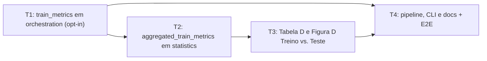

# Tasks — M11.1: Avaliação em Treino (`train_metrics`) e Comparação Treino vs. Teste

- **Feature**: `m11-1-train-test-diagnostics`
- **Branch**: `feat/m11-1-train-test-diagnostics`

---

## Task Breakdown

## Execution Plan

### T1: Coleta opt-in e persistência de `train_metrics` em `orchestration` (`M111-01`)
- [ ] Implement & test T1
**Where**: `src/experimental_ml/orchestration/types.py`, `src/experimental_ml/orchestration/execution.py`, `src/experimental_ml/orchestration/engine.py`, `src/experimental_ml/orchestration/storage.py`, `tests/unit/orchestration/test_single_cell_execution.py`
**Depends on**: none
**Tests**: Testes unitários verificando que `collect_train_metrics=False` mantém `train_metrics` vazio, e `collect_train_metrics=True` preenche `train_metrics` e faz round-trip JSON retrocompatível.
**Gate**: `.venv/bin/pytest tests/unit/orchestration/ -q`

### T2: Consolidação descritiva isolada de `aggregated_train_metrics` em `statistics` (`M111-02`)
- [ ] Implement & test T2
**Where**: `src/experimental_ml/statistics/types.py`, `src/experimental_ml/statistics/consolidation.py`, `src/experimental_ml/statistics/storage.py`, `tests/unit/statistics/test_consolidation.py`
**Depends on**: T1
**Tests**: Teste verificando que `aggregated_train_metrics` consolida médias/DP de treino sem alterar `aggregated_metrics`, `fold_metrics` nem comparações pareadas de `DEV_CV`, com round-trip JSON.
**Gate**: `.venv/bin/pytest tests/unit/statistics/ -q`

### T3: Exibição de `Train Mean` na Tabela D e barras `Treino` vs. `DEV_CV` na Figura D (`M111-03`)
- [ ] Implement & test T3
**Where**: `src/experimental_ml/reporting/tables.py`, `src/experimental_ml/reporting/figures.py`, `tests/unit/reporting/test_reporting_tables.py`, `tests/unit/reporting/test_reporting_figures.py`
**Depends on**: T2
**Tests**: Testes verificando coluna `train_mean` na Tabela D e série `Treino (DEV_CV)` na Figura D renderizada em `PNG`, `SVG` e `PDF`.
**Gate**: `.venv/bin/pytest tests/unit/reporting/ -q`

### T4: Expor `collect_train_metrics` em `pipeline.py` / CLI, documentar e validar E2E (`M111-01`, `M111-03`)
- [ ] Implement & test T4
**Where**: `src/experimental_ml/pipeline.py`, `src/experimental_ml/cli/main.py`, `src/experimental_ml/cli/cmd_run.py`, `src/experimental_ml/cli/cmd_quickrun.py`, `docs/guia/03_interpretando_resultados.md`, `tests/integration/reporting/test_m11_1_train_test_e2e.py`
**Depends on**: T1, T3
**Tests**: Teste E2E via `run_experiment(..., collect_train_metrics=True)` validando `Train Mean` na Tabela D, gráfico comparativo e integridade documental.
**Gate**: `.venv/bin/pytest tests/ -q`

---

## Gate Check Commands

Build: none - pacote Python puro sem etapa de compilação separada; validação via pytest

---

## Test Coverage Matrix

| Requisito | Tarefa | Teste(s) |
| :--- | :--- | :--- |
| M111-01 | T1, T4 | `tests/unit/orchestration/test_single_cell_execution.py::test_m11_1_train_metrics_opt_in_and_storage` |
| M111-02 | T2 | `tests/unit/statistics/test_consolidation.py::test_m11_1_train_metrics_consolidated_isolated_from_dev_cv` |
| M111-03 | T3, T4 | `tests/integration/reporting/test_m11_1_train_test_e2e.py::test_m11_1_e2e_train_vs_test_table_and_figure` |

---

## Checks

**Run m11_1_unit**: `.venv/bin/pytest tests/unit/orchestration/test_single_cell_execution.py tests/unit/statistics/test_consolidation.py -v`
**Run m11_1_e2e**: `.venv/bin/pytest tests/integration/reporting/test_m11_1_train_test_e2e.py -v`

**C1** - `collect_train_metrics=False` por padrão não avalia treino; quando `True`, `CellResultRecord.train_metrics` é preenchido e serializado com retrocompatibilidade (`M111-01`)
Proof: run m11_1_unit | test_m11_1_train_metrics_opt_in_and_storage PASSED

**C2** - `ConfigurationSummary.aggregated_train_metrics` consolidado e isolado dos testes pareados `DEV_CV` (`M111-02`)
Proof: run m11_1_unit | test_m11_1_train_metrics_consolidated_isolated_from_dev_cv PASSED

**C3** - Tabela D exibe `Train Mean` e Figura D plota barras comparativas `Treino` vs. `DEV_CV` em `PNG`/`SVG`/`PDF` (`M111-03`)
Proof: run m11_1_e2e | test_m11_1_e2e_train_vs_test_table_and_figure PASSED

---

## Handoff

- **Feature**: `m11-1-train-test-diagnostics`
- **Phase / Task**: `Specify` aprovado (`AD-038`); `Design` e `Tasks` elaborados na branch `feat/m11-1-train-test-diagnostics`. Aguardando aprovação de `tasks.md` para iniciar `T1`.
- **In-progress**: none
- **Next step**: Aprovação de `tasks.md` pelo desenvolvedor para iniciar `Execute` (`T1`–`T4`).
