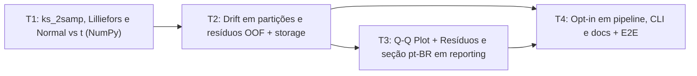

# Tasks — M11.2: Teste Kolmogorov-Smirnov, Detecção de *Dataset Shift* e Diagnóstico de Resíduos OOF

- **Feature**: `m11-2-ks-drift-residuals`
- **Branch**: `feat/m11-2-ks-drift-residuals`
**Approved**: 2026-11-28 - user: "aprovado"

---

## Task Breakdown

## Execution Plan

### T1: Implementar `ks_2samp`, `ks_normal_lilliefors` e comparação AIC Normal vs. Student-$t$ em NumPy puro (`M112-01`)
- [x] Implement & test T1
**Where**: `src/experimental_ml/statistics/distributions_diagnostics.py`, `src/experimental_ml/statistics/__init__.py`, `tests/unit/statistics/test_ks_diagnostics.py`
**Depends on**: none
**Tests**: Testes unitários verificando `ks_2samp` (mesma distribuição vs. deslocada), `ks_normal_lilliefors` (Normal vs. exponencial/cauda pesada) e AIC Student-$t$ < AIC Normal em dados com outliers.
**Gate**: `.venv/bin/pytest tests/unit/statistics/test_ks_diagnostics.py -v`

### T2: Implementar detecção de *dataset shift* pós-split e análise de resíduos OOF + persistência (`M112-02`, `M112-03`)
- [x] Implement & test T2
**Where**: `src/experimental_ml/statistics/distributions_diagnostics.py`, `src/experimental_ml/statistics/storage.py`, `src/experimental_ml/reporting/types.py`, `src/experimental_ml/reporting/loader.py`, `tests/unit/statistics/test_ks_diagnostics.py`
**Depends on**: T1
**Tests**: Testes verificando detecção de *shift* em `CV_AND_HOLDOUT` e `TEMPORAL`, análise de resíduos OOF e round-trip JSON opcional sem quebrar experimentos antigos.
**Gate**: `.venv/bin/pytest tests/unit/statistics/ tests/unit/reporting/ -q`

### T3: Renderizar gráfico `Resíduos vs. Predito + Q-Q Plot` e exibir diagnósticos no relatório `pt-BR` (`M112-03`)
- [ ] Implement & test T3
**Where**: `src/experimental_ml/reporting/figures.py`, `src/experimental_ml/reporting/report.py`, `tests/unit/reporting/test_reporting_figures.py`, `tests/unit/reporting/test_reporting_report.py`
**Depends on**: T2
**Tests**: Testes verificando geração do gráfico diagnóstico de resíduos + Q-Q Plot em `PNG`, `SVG` e `PDF`, e exibição da seção diagnóstica em `report.md` e `report.html`.
**Gate**: `.venv/bin/pytest tests/unit/reporting/ -q`

### T4: Expor flags opt-in em `pipeline.py` / CLI, documentar e validar E2E (`M112-02`, `M112-03`)
- [ ] Implement & test T4
**Where**: `src/experimental_ml/pipeline.py`, `src/experimental_ml/cli/main.py`, `src/experimental_ml/cli/cmd_init.py`, `src/experimental_ml/cli/cmd_stats.py`, `docs/guia/03_interpretando_resultados.md`, `tests/integration/reporting/test_m11_2_ks_drift_residuals_e2e.py`
**Depends on**: T2, T3
**Tests**: Teste E2E verificando comportamento padrão (`False`, zero artefatos extras) e opt-in (`check_ks_drift=True`, `analyze_oof_residuals=True`) gerando `ks_drift_report.json`, `oof_residuals_diagnostics.json`, gráfico Q-Q Plot e suíte completa verde.
**Gate**: `.venv/bin/pytest tests/ -q`

---

## Gate Check Commands

Build: none - pacote Python puro sem etapa de compilação separada; validação via pytest

---

## Test Coverage Matrix

| Requisito | Tarefa | Teste(s) |
| :--- | :--- | :--- |
| M112-01 | T1 | `tests/unit/statistics/test_ks_diagnostics.py::test_m11_2_ks_2samp_and_lilliefors_pure_numpy` |
| M112-02 | T2, T4 | `tests/unit/statistics/test_ks_diagnostics.py::test_m11_2_partition_ks_drift_cv_holdout_and_temporal` |
| M112-03 | T3, T4 | `tests/integration/reporting/test_m11_2_ks_drift_residuals_e2e.py::test_m11_2_e2e_opt_in_ks_drift_and_oof_qq_plot` |

---

## Checks

**Run m11_2_unit**: `.venv/bin/pytest tests/unit/statistics/test_ks_diagnostics.py -v`
**Run m11_2_e2e**: `.venv/bin/pytest tests/integration/reporting/test_m11_2_ks_drift_residuals_e2e.py -v`

**C1** - `ks_2samp` e `ks_normal_lilliefors` em NumPy puro calculam $D_{\text{KS}}$ e $p$-valor consistentes (`M112-01`)
Proof: run m11_2_unit | test_m11_2_ks_2samp_and_lilliefors_pure_numpy PASSED

**C2** - `check_ks_drift` (opt-in `False` por padrão) detecta *shift* em `CV_AND_HOLDOUT` e `TEMPORAL` sem alterar `DEV_CV` (`M112-02`)
Proof: run m11_2_unit | test_m11_2_partition_ks_drift_cv_holdout_and_temporal PASSED

**C3** - `analyze_oof_residuals` (opt-in `False` por padrão) computa Lilliefors + AIC Normal vs. Student-$t$ e gera Q-Q Plot em `PNG`/`SVG`/`PDF` (`M112-03`)
Proof: run m11_2_e2e | test_m11_2_e2e_opt_in_ks_drift_and_oof_qq_plot PASSED

---

## Handoff

- **Feature**: `m11-2-ks-drift-residuals`
- **Phase / Task**: `Specify` aprovado (`AD-039`); `Design` e `Tasks` elaborados na branch `feat/m11-2-ks-drift-residuals`. Aguardando aprovação de `tasks.md` para iniciar `T1`.
- **In-progress**: none
- **Next step**: Aprovação de `tasks.md` pelo desenvolvedor para iniciar `Execute` (`T1`–`T4`).
