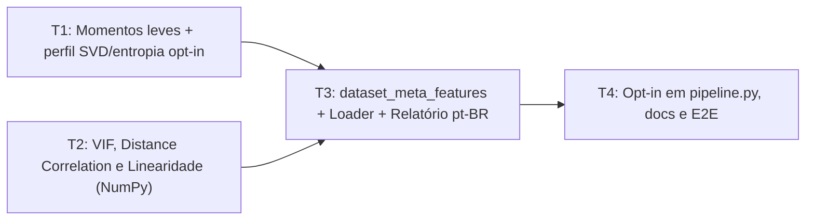

# Tasks — M11.3: Caracterização Estatística Ampliada dos Datasets e `dataset_meta_features`

- **Feature**: `m11-3-dataset-characterization`
- **Branch**: `feat/m11-3-dataset-characterization`
**Approved**: 2026-11-28 - user: "aprovado"

---

## Task Breakdown

## Execution Plan

### T1: Métricas leves e perfil estrutural opt-in em `data/profiling.py` (`M113-01`)
- [x] Implement & test T1
**Where**: `src/experimental_ml/data/profiling.py`, `src/experimental_ml/data/codecs.py`, `tests/unit/data/test_profiling.py`
**Depends on**: none
**Tests**: Testes unitários verificando `skewness`, excesso de `kurtosis` (Fisher), `outlier_rate_iqr` e `profile_dataset(..., extended_stats=True/False)` com `samples_to_features_ratio`, `intrinsic_dim_ratio_95` e `target_entropy_norm`.
**Gate**: `.venv/bin/pytest tests/unit/data/test_profiling.py -q`

### T2: Implementar VIF, *Distance Correlation* e linearidade em NumPy puro (`M113-02`)
- [ ] Implement & test T2
**Where**: `src/experimental_ml/features/stats.py`, `src/experimental_ml/features/exploration.py`, `tests/unit/features/test_stats.py`, `tests/unit/features/test_exploration.py`
**Depends on**: none
**Tests**: Testes verificando `compute_vif`, `compute_distance_correlation`, `compute_linearity_score` (regressão OLS $R^2$ e classificação Ridge/LDA) e `explore_features(..., extended_stats=True/False)` sob `EXPLORATORY_FULL_DATA`.
**Gate**: `.venv/bin/pytest tests/unit/features/test_stats.py tests/unit/features/test_exploration.py -q`

### T3: Implementar `build_dataset_meta_features`, loader e tabela `pt-BR` no relatório (`M113-03`)
- [ ] Implement & test T3
**Where**: `src/experimental_ml/features/exploration.py`, `src/experimental_ml/reporting/types.py`, `src/experimental_ml/reporting/loader.py`, `src/experimental_ml/reporting/report.py`, `tests/unit/reporting/test_reporting_report.py`
**Depends on**: T1, T2
**Tests**: Testes verificando construção de `dataset_meta_features`, carregamento opcional em `LoadedExperimentData` e tabela `Caracterização Estatística Ampliada (Meta-Features)` em `report.md` e `report.html`.
**Gate**: `.venv/bin/pytest tests/unit/reporting/test_reporting_report.py -q`

### T4: Expor flags opt-in em `pipeline.py`, documentar e validar E2E (`M113-03`)
- [ ] Implement & test T4
**Where**: `src/experimental_ml/pipeline.py`, `docs/guia/03_interpretando_resultados.md`, `tests/integration/reporting/test_m11_3_dataset_characterization_e2e.py`
**Depends on**: T3
**Tests**: Teste E2E verificando padrão (`False`, sem `dataset_meta_features.json`) e opt-in (`export_meta_features=True`, gravando `dataset_meta_features.json` e renderizando tabela no relatório) + suíte completa verde.
**Gate**: `.venv/bin/pytest tests/ -q`

---

## Gate Check Commands

Build: none - pacote Python puro sem etapa de compilação separada; validação via pytest

---

## Test Coverage Matrix

| Requisito | Tarefa | Teste(s) |
| :--- | :--- | :--- |
| M113-01 | T1 | `tests/unit/data/test_profiling.py::test_m11_3_numeric_moments_and_extended_profile` |
| M113-02 | T2 | `tests/unit/features/test_stats.py::test_m11_3_vif_distance_corr_and_linearity`, `tests/unit/features/test_exploration.py::test_m11_3_explore_features_extended_opt_in` |
| M113-03 | T3, T4 | `tests/unit/reporting/test_reporting_report.py::test_m11_3_report_includes_dataset_meta_features`, `tests/integration/reporting/test_m11_3_dataset_characterization_e2e.py::test_m11_3_e2e_opt_in_dataset_meta_features` |

---

## Checks

**Run m11_3_prof**: `.venv/bin/pytest tests/unit/data/test_profiling.py -k test_m11_3_numeric_moments_and_extended_profile -v`
**Run m11_3_feat**: `.venv/bin/pytest tests/unit/features/test_stats.py tests/unit/features/test_exploration.py -k m11_3 -v`
**Run m11_3_e2e**: `.venv/bin/pytest tests/integration/reporting/test_m11_3_dataset_characterization_e2e.py -v`

**C1** - `NumericDistributionStats` calcula momentos leves e `profile_dataset(extended_stats=True)` preenche indicadores SVD/razão/entropia (`M113-01`)
Proof: run m11_3_prof | test_m11_3_numeric_moments_and_extended_profile PASSED

**C2** - `compute_vif`, `compute_distance_correlation` e `compute_linearity_score` em NumPy puro integram `explore_features(extended_stats=True)` (`M113-02`)
Proof: run m11_3_feat | test_m11_3_vif_distance_corr_and_linearity PASSED

**C3** - `run_experiment(export_meta_features=True)` grava `dataset_meta_features.json` e exibe tabela `pt-BR` no relatório sem efeitos quando `False` (`M113-03`)
Proof: run m11_3_e2e | test_m11_3_e2e_opt_in_dataset_meta_features PASSED

---

## Handoff

- **Feature**: `m11-3-dataset-characterization`
- **Phase / Task**: `Specify`, `Design` e `Tasks` elaborados na branch `feat/m11-3-dataset-characterization`. Aguardando aprovação de `spec.md` e `tasks.md` para iniciar `T1`.
- **In-progress**: none
- **Next step**: Aprovação do desenvolvedor para iniciar `Execute` (`T1`–`T4`).
