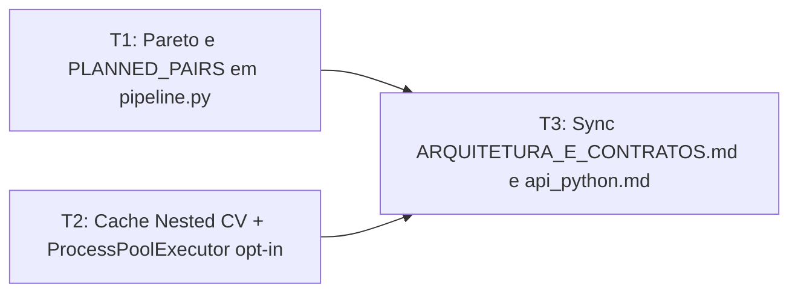

# Tasks — M11.4: Fechamento Onda 1 (Pareto/`PLANNED_PAIRS`, Desempenho e Docs)

- **Feature**: `m11-4-wave1-polish`
- **Branch**: `feat/m11-4-wave1-polish`
**Approved**: 2026-11-28 - user: "aprovado"

---

## Task Breakdown

## Execution Plan

### T1: Expor `comparison_scope`, `planned_pairs` e `pareto_objectives` em `run_experiment` (`M114-01`)
- [x] Implement & test T1
**Where**: `src/experimental_ml/pipeline.py`, `tests/integration/reporting/test_m11_4_wave1_polish_e2e.py`
**Depends on**: none
**Tests**: Teste validando `run_experiment` com `ComparisonScope.PLANNED_PAIRS` + `planned_pairs` e `pareto_objectives` customizados (ex.: incluindo `n_selected_features` / `fit_mean_s`).
**Gate**: `.venv/bin/pytest tests/integration/reporting/test_m11_4_wave1_polish_e2e.py -q`

### T2: Cache intra-célula no Nested CV e `execution_backend="process"` opt-in (`M114-02`)
- [x] Implement & test T2
**Where**: `src/experimental_ml/tuning/engine.py`, `src/experimental_ml/orchestration/engine.py`, `tests/unit/tuning/test_tuning_execution.py`, `tests/unit/orchestration/test_matrix_engine_parallel.py`
**Depends on**: none
**Tests**: Testes unitários provando que `select_features_in_fold` / `fit_two_layer_preprocessing` executam 1x por sub-fold interno (mesmo resultado com múltiplos candidatos) e que `execution_backend="process"` conclui matriz via `ProcessPoolExecutor`.
**Gate**: `.venv/bin/pytest tests/unit/tuning/ tests/unit/orchestration/ -q`

### T3: Sincronização documental (`VAL-QUAL-004`) e suíte completa (`M114-03`)
- [x] Implement & test T3
**Where**: `docs/engenharia_software/ARQUITETURA_E_CONTRATOS.md`, `docs/referencia/api_python.md`, `docs/engenharia_software/REGISTRO_DE_VALIDACAO_DO_MVP.md`
**Depends on**: T1, T2
**Tests**: Conferência de nomenclatura e símbolos + suíte completa `.venv/bin/pytest tests/ -q`.
**Gate**: `.venv/bin/pytest tests/ -q`

---

## Gate Check Commands

Build: none - pacote Python puro sem etapa de compilação separada; validação via pytest

---

## Test Coverage Matrix

| Requisito | Tarefa | Teste(s) |
| :--- | :--- | :--- |
| M114-01 | T1 | `tests/integration/reporting/test_m11_4_wave1_polish_e2e.py::test_m11_4_run_experiment_planned_pairs_and_pareto` |
| M114-02 | T2 | `tests/unit/tuning/test_tuning_execution.py::test_m11_4_nested_cv_caches_inner_fold_preprocessing`, `tests/unit/orchestration/test_matrix_engine_parallel.py::test_m11_4_process_pool_backend` |
| M114-03 | T3 | `tests/integration/reporting/test_m11_4_wave1_polish_e2e.py::test_m11_4_docs_symbols_synced` |

---

## Checks

**Run m11_4_e2e**: `.venv/bin/pytest tests/integration/reporting/test_m11_4_wave1_polish_e2e.py -v`
**Run m11_4_perf**: `.venv/bin/pytest tests/unit/tuning/test_tuning_execution.py tests/unit/orchestration/test_matrix_engine_parallel.py -k m11_4 -v`

**C1** - `run_experiment` respeita `comparison_scope`, `planned_pairs` e `pareto_objectives` customizados (`M114-01`)
Proof: run m11_4_e2e | test_m11_4_run_experiment_planned_pairs_and_pareto PASSED

**C2** - Cache intra-célula no Nested CV reduz recomputação mantendo resultado e `execution_backend="process"` executa via `ProcessPoolExecutor` (`M114-02`)
Proof: run m11_4_perf | test_m11_4_nested_cv_caches_inner_fold_preprocessing PASSED

**C3** - `ARQUITETURA_E_CONTRATOS.md` e `api_python.md` sincronizados (`M114-03`)
Proof: run m11_4_e2e | test_m11_4_docs_symbols_synced PASSED

---

## Handoff

- **Feature**: `m11-4-wave1-polish`
- **Phase / Task**: `Specify` e `Tasks` elaborados na branch `feat/m11-4-wave1-polish`. Aguardando aprovação para iniciar `Execute` (`T1`–`T3`).
- **In-progress**: none
- **Next step**: Aprovação de `spec.md` e `tasks.md` pelo desenvolvedor.
