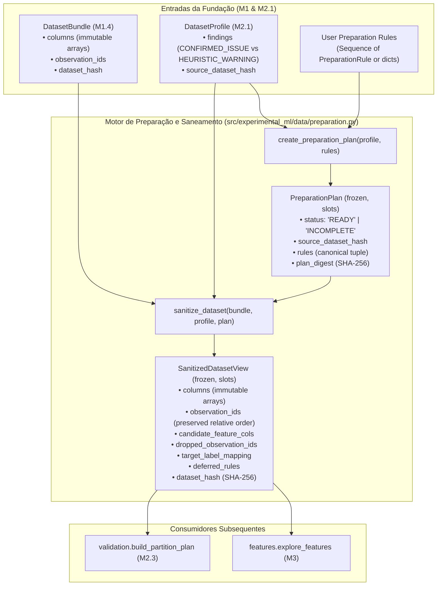

# M2.2 — Preparation Plan and Sanitized Dataset View Technical Design

**Spec**: `.specs/features/m2-2-preparation-plan-sanitization/spec.md`  
**Sub-Milestone**: M2.2 (`m2-2-preparation-plan-sanitization`)  
**Status**: Approved  
**Approved**: 2026-11-07 - user: "avanca"  

---

## Architecture Overview

O Sub-marco M2.2 implementa a geração declarativa do plano de preparação (`create_preparation_plan`, `PreparationPlan`, `PreparationRule`) e a execução do saneamento determinístico pré-partição (`sanitize_dataset`, `SanitizedDatasetView`), fechando a Etapa 1 da arquitetura na camada `data` (`src/experimental_ml/data/preparation.py`).

O módulo atua como uma barreira de integridade e prevenção de vazamento de dados (**ADR-002**):
1. **Auditoria de Cobertura:** `create_preparation_plan` inspeciona os achados do `DatasetProfile` (gerado no M2.1) e exige regras explícitas para todos os `CONFIRMED_ISSUE`. Se houver achado sem regra ou com regra inadmissível, o plano é marcado como `INCOMPLETE`.
2. **Saneamento Estrutural Restrito:** `sanitize_dataset` consome o plano `READY`, o `DatasetProfile` e o `DatasetBundle`. Aplica exclusivamente regras que alteram a geometria e codificação discreta do dataset (`DROP_ROWS`, `EXCLUDE_COLUMN`, `MAP_BINARY_TARGET`).
3. **Preservação de Transformações que Aprendem Parâmetros (Zero Data Leakage):** Nenhuma transformação estatística (como imputação por média/mediana ou codificação de categorias) é executada globalmente na Etapa 1. Colunas associadas a `DEFER_INTRA_FOLD` ou `ACCEPT_AS_IS` são copiadas para a `SanitizedDatasetView` **100% bit a bit**, com seus valores e nulos intactos, para ajuste exclusivo no treino de cada partição na Etapa 4B.
4. **Imutabilidade e Rastreabilidade:** O `DatasetBundle` de entrada permanece inalterado (`bundle.dataset_hash` intacto). A visão saneada encapsula arrays imutáveis (`writeable = False`), expõe a linhagem (`source_dataset_hash`, `plan_digest`, `target_label_mapping`, `dropped_observation_ids`) e calcula deterministicamente seu novo `dataset_hash`.



---

## Code Reuse Analysis

### Componentes Existentes Reaproveitados

| Componente | Localização | Modo de Reuso | Justificativa |
| :--- | :--- | :--- | :--- |
| `ObservationId` | `src/experimental_ml/core/types.py` | Importação direta | Tipagem estrita de identificadores de observação mantidos e descartados |
| `TaskType` | `src/experimental_ml/core/enums.py` | Importação direta | Validação de tipo de tarefa em mapeamento binário de alvo |
| `FindingSeverity` | `src/experimental_ml/core/enums.py` | Importação direta | Filtro estrito de achados `CONFIRMED_ISSUE` no perfil |
| `Finding` | `src/experimental_ml/core/findings.py` | Importação direta | Inspeção dos achados reportados no `DatasetProfile` |
| `ConfigurationError` | `src/experimental_ml/core/findings.py` | Exceção levantada | Regras duplicadas, inadmissíveis ou mirando achados inexistentes |
| `ContractViolationError` | `src/experimental_ml/core/findings.py` | Exceção levantada | Invocação de `sanitize_dataset` com plano `INCOMPLETE` |
| `DataIntegrityError` | `src/experimental_ml/core/findings.py` | Exceção levantada | Divergência de hashes ou resultado com 0 linhas / 0 features |
| `config_hash` | `src/experimental_ml/core/hashing.py` | Função pura | Cálculo determinístico do `plan_digest` SHA-256 (ADR-007) |
| `dataset_hash` | `src/experimental_ml/core/hashing.py` | Função pura | Cálculo formal do `dataset_hash` canônico de `SanitizedDatasetView` |
| `is_missing_scalar`, `is_nan_scalar` | `src/experimental_ml/core/scalars.py` | Importação direta | Detecção centralizada de valores ausentes durante `DROP_ROWS` |
| `DatasetBundle` | `src/experimental_ml/data/types.py` | Consumo de tipo | Entrada somente-leitura do saneamento |
| `DatasetProfile` | `src/experimental_ml/data/profiling.py` | Consumo de tipo | Entrada para validação de cobertura de achados |
| `DatasetSchemaSpec` | `src/experimental_ml/data/schema.py` | Consumo e derivação | Esquema original e derivação do esquema da visão saneada |
| `ColumnSemanticType` | `src/experimental_ml/data/schema.py` | Importação direta | Preservação de tipos semânticos na visão saneada |

---

## Data Models (`src/experimental_ml/data/preparation.py`)

Todas as estruturas seguem rigorosamente **ADR-008**: dataclasses imutáveis (`frozen=True, slots=True`), sem métodos de negócio com estado mutável, tuplas para sequências e `MappingProxyType` para dicionários.

### 1. `PreparationRule`

Representação imutável de uma regra individual de tratamento de achado.

```python
@dataclass(frozen=True, slots=True)
class PreparationRule:
    """Regra explícita de tratamento associada a uma chave (código, coluna) de achado."""

    code: str
    column: str | None
    rule_kind: str
    params: MappingProxyType[str, Any] = field(default_factory=lambda: MappingProxyType({}))

    def __post_init__(self) -> None:
        if not self.code or not self.code.strip():
            raise ConfigurationError("PreparationRule code cannot be empty")
        if not self.rule_kind or not self.rule_kind.strip():
            raise ConfigurationError("PreparationRule rule_kind cannot be empty")
        # Garante encapsulamento MappingProxyType
        if not isinstance(self.params, MappingProxyType):
            object.__setattr__(self, "params", MappingProxyType(dict(self.params)))
```

### 2. `PreparationPlan`

Plano consolidado com status de cobertura e digest canônico.

```python
@dataclass(frozen=True, slots=True)
class PreparationPlan:
    """Plano declarativo e imutável de preparação da base tabular."""

    source_dataset_hash: str
    source_profile_digest: str
    rules: tuple[PreparationRule, ...]
    status: str  # "READY" ou "INCOMPLETE"
    unresolved_findings: tuple[tuple[str, str | None], ...]
    plan_digest: str
```

### 3. `SanitizedDatasetView`

Visão tabular imutável dos dados após saneamento estrutural pré-partição.

```python
@dataclass(frozen=True, slots=True)
class SanitizedDatasetView:
    """Visão tabular imutável saneada apta ao particionamento e validação."""

    columns: MappingProxyType[str, np.ndarray]
    schema: DatasetSchemaSpec
    observation_ids: tuple[ObservationId, ...]
    candidate_feature_cols: tuple[str, ...]
    dropped_observation_ids: tuple[ObservationId, ...]
    target_label_mapping: MappingProxyType[str, int] | None
    deferred_rules: tuple[PreparationRule, ...]
    source_dataset_hash: str
    plan_digest: str
    dataset_hash: str
```

---

## Regras de Negócio e Vocabulário de Admissibilidade

### Tabela de Admissibilidade por Código de `CONFIRMED_ISSUE`

| Código do Achado | Severidade | Regras Admissíveis | Parâmetros Obrigatórios / Validados | Ação em `sanitize_dataset` |
| :--- | :--- | :--- | :--- | :--- |
| `E1_TARGET_MISSING` | `CONFIRMED_ISSUE` | `DROP_ROWS` | Nenhum | Descarta observações com target ausente |
| `E1_GROUP_EMPTY_VALUES` | `CONFIRMED_ISSUE` | `DROP_ROWS` | Nenhum | Descarta observações com group ausente |
| `E1_FEATURE_MISSING` | `CONFIRMED_ISSUE` | `DROP_ROWS`, `EXCLUDE_COLUMN`, `DEFER_INTRA_FOLD`, `ACCEPT_AS_IS` | Se `DEFER_INTRA_FOLD`: `imputation_strategy in ("MEAN", "MEDIAN", "MODE")` | `DROP_ROWS`: filtra linhas; `EXCLUDE_COLUMN`: remove coluna; `DEFER`/`ACCEPT`: mantém intacta |
| `E1_CONSTANT_FEATURE_COLUMN` | `CONFIRMED_ISSUE` | `EXCLUDE_COLUMN`, `ACCEPT_AS_IS` | Nenhum | `EXCLUDE_COLUMN`: remove coluna; `ACCEPT`: mantém intacta |
| `E1_COLUMN_ALL_MISSING` | `CONFIRMED_ISSUE` | `EXCLUDE_COLUMN`, `ACCEPT_AS_IS` | Nenhum | `EXCLUDE_COLUMN`: remove coluna; `ACCEPT`: mantém intacta |
| `E1_IDENTIFIER_COLUMN_SUSPECTED` | `CONFIRMED_ISSUE` | `EXCLUDE_COLUMN`, `ACCEPT_AS_IS` | Nenhum | `EXCLUDE_COLUMN`: remove coluna; `ACCEPT`: mantém intacta |
| `E1_CATEGORICAL_UNENCODED` | `CONFIRMED_ISSUE` | `EXCLUDE_COLUMN`, `DEFER_INTRA_FOLD`, `ACCEPT_AS_IS` | Se `DEFER_INTRA_FOLD`: `encoding_strategy: str` não vazia | `EXCLUDE_COLUMN`: remove coluna; `DEFER`/`ACCEPT`: mantém intacta |
| `E1_TARGET_BINARY_UNMAPPED` | `CONFIRMED_ISSUE` | `MAP_BINARY_TARGET` | `positive_label: str` igual a uma das duas classes observadas no perfil | Mapeia `positive_label -> 1` e outra classe -> `0` em `int64` |
| `E1_TARGET_ALL_MISSING` | `CONFIRMED_ISSUE` | *(Nenhuma - irresolúvel)* | — | Permanece `INCOMPLETE` |
| `E1_TARGET_ZERO_VARIANCE` | `CONFIRMED_ISSUE` | *(Nenhuma - irresolúvel)* | — | Permanece `INCOMPLETE` |
| `E1_TARGET_CLASS_COUNT_INVALID` | `CONFIRMED_ISSUE` | *(Nenhuma - irresolúvel)* | — | Permanece `INCOMPLETE` |
| `E1_TARGET_NOT_NUMERIC` | `CONFIRMED_ISSUE` | *(Nenhuma - irresolúvel)* | — | Permanece `INCOMPLETE` |

---

## Interfaces e Algoritmos dos Componentes

### 1. `create_preparation_plan(profile: DatasetProfile, rules: Sequence[PreparationRule | dict[str, Any]]) -> PreparationPlan`

1. **Normalização:** Converte cada entrada de `rules` em uma instância imutável `PreparationRule`.
2. **Catalogação de Achados:** Extrai de `profile.findings` todos os achados com `severity == FindingSeverity.CONFIRMED_ISSUE`. A chave canônica é `(finding.code, finding.context.get("column"))`.
3. **Validação de Regras:**
   - Para cada regra:
     - Verifica se sua chave `(code, column)` existe entre os `CONFIRMED_ISSUE` do perfil. Se não existir (ou for `HEURISTIC_WARNING`), levanta `ConfigurationError`.
     - Verifica se a chave já foi alvo de outra regra no mesmo plano (proibição de regras duplicadas). Se duplicada, levanta `ConfigurationError`.
     - Verifica se `rule_kind` pertence à lista de regras admissíveis para aquele `code` na tabela de admissibilidade. Se não, levanta `ConfigurationError`.
     - Valida parâmetros específicos:
       - `MAP_BINARY_TARGET`: exige parâmetro `positive_label` presente e compatível com as classes observadas no perfil do alvo.
       - `DEFER_INTRA_FOLD` para `E1_FEATURE_MISSING`: exige `imputation_strategy` em `{"MEAN", "MEDIAN", "MODE"}`.
       - `DEFER_INTRA_FOLD` para `E1_CATEGORICAL_UNENCODED`: exige `encoding_strategy` como string não-vazia.
4. **Verificação de Cobertura:**
   - Identifica chaves de `CONFIRMED_ISSUE` que não possuem regra correspondente.
   - Se houver chaves não cobertas (ou com achados irresolúveis), define:
     - `status = "INCOMPLETE"`
     - `unresolved_findings = tuple(chaves_não_cobertas)`
   - Se todas as chaves de `CONFIRMED_ISSUE` estiverem cobertas por regras admissíveis, define:
     - `status = "READY"`
     - `unresolved_findings = ()`
5. **Ordenação Canônica e Digest:**
   - Ordena as regras por `(code, column or "")`.
   - Gera o digest do plano via `config_hash({"source_dataset_hash": ..., "rules": [...]})`.
   - Retorna a instância imutável de `PreparationPlan`.

### 2. `sanitize_dataset(bundle: DatasetBundle, profile: DatasetProfile, plan: PreparationPlan) -> SanitizedDatasetView`

1. **Pré-condições e Vínculo de Hashes:**
   - Se `plan.status != "READY"`: levanta `ContractViolationError("PreparationPlan status must be READY to sanitize dataset")`.
   - Se `plan.source_dataset_hash != bundle.dataset_hash`: levanta `DataIntegrityError("Plan source dataset hash does not match bundle")`.
   - Se `profile.source_dataset_hash != bundle.dataset_hash`: levanta `DataIntegrityError("Profile source dataset hash does not match bundle")`.
2. **Determinação de Linhas Válidas (`DROP_ROWS`):**
   - Identifica todas as colunas com regra `DROP_ROWS`.
   - Varre as linhas do `bundle`. Uma linha é descartada se contiver valor ausente (`is_missing_scalar` ou `is_nan_scalar`) em qualquer coluna com regra `DROP_ROWS`.
   - Constrói a tupla ordenada de `ObservationId` sobreviventes (`valid_observation_ids`) mantendo estritamente a ordem relativa original do bundle.
   - Constrói a tupla ordenada de `ObservationId` descartados (`dropped_observation_ids`).
   - Se `len(valid_observation_ids) == 0`: levanta `DataIntegrityError("Sanitization dropped all rows")` (PREP-09).
3. **Determinação de Colunas Válidas (`EXCLUDE_COLUMN`):**
   - Identifica todas as colunas com regra `EXCLUDE_COLUMN`.
   - As colunas de papel `target`, `group`, `observation_id`, `time` nunca podem ser excluídas por `EXCLUDE_COLUMN` (validado em `create_preparation_plan`).
   - Filtra `bundle.feature_cols` removendo as colunas excluídas para compor `candidate_feature_cols`.
   - Se `len(candidate_feature_cols) == 0`: levanta `DataIntegrityError("Sanitization left zero candidate feature columns")` (PREP-09).
4. **Construção dos Arrays Saneados:**
   - Para cada coluna que permanece na visão:
     - Se for a coluna alvo e houver regra `MAP_BINARY_TARGET(positive_label)`:
       - Extrai os valores das linhas válidas.
       - Mapeia valores iguais a `positive_label` para `1` e o valor alternativo para `0`.
       - Converte o array para `np.int64`.
       - Registra `target_label_mapping = MappingProxyType({str(alt_label): 0, str(positive_label): 1})`.
     - Caso contrário:
       - Fatia o array original nas linhas válidas.
       - As colunas associadas a `DEFER_INTRA_FOLD` ou `ACCEPT_AS_IS` são copiadas sem qualquer alteração matemática, mantendo valores ausentes e strings intactos (PREP-07).
     - Assegura que o array fatiado seja somente-leitura (`arr.flags.writeable = False`).
5. **Derivação do Esquema da Visão:**
   - Constrói um `DatasetSchemaSpec` derivado para a visão:
     - `target_col = bundle.schema.target_col`
     - `task_type = bundle.schema.task_type`
     - `group_col = bundle.schema.group_col`
     - `observation_id_col = bundle.schema.observation_id_col`
     - `time_col = bundle.schema.time_col`
     - `column_semantic_types`: mantém os tipos semânticos das colunas restantes (se alvo mapeado, tipo semântico ajustado para `BOOLEAN` ou mantido `CATEGORICAL`).
     - `ignore_cols`: colunas ignoradas originais menos as que foram excluídas (ou preservadas conforme papéis).
6. **Cálculo do `dataset_hash`:**
   - Calcula o hash canônico da visão através de:
     `dataset_hash = core.dataset_hash(view_columns, view_schema, observation_ids=valid_observation_ids)`
7. **Retorno:**
   - Retorna a instância imutável `SanitizedDatasetView`.
   - O `bundle` de entrada permanece 100% inalterado (invariante comprovado por teste).

---

## Error Handling Strategy

| Cenário de Erro | Exceção Levantada | Justificativa e Impacto |
| :--- | :--- | :--- |
| `rules` contém regra para código que é `HEURISTIC_WARNING` ou inexistente no perfil | `ConfigurationError` | Impede parametrização errônea; alertas heurísticos não admitem regras de preparação estrutural |
| `rules` contém regras duplicadas para a mesma chave `(code, column)` | `ConfigurationError` | Ambiguidade de decisão no plano de preparação |
| `rule_kind` não é admissível para o código do achado (ex.: `DROP_ROWS` em coluna constante) | `ConfigurationError` | Violação do catálogo fechado de regras |
| Parâmetros de regra inválidos (ex.: `positive_label` ausente ou classe inexistente) | `ConfigurationError` | Parametrização deficiente de regra |
| Invocação de `sanitize_dataset` com `plan.status != "READY"` | `ContractViolationError` | Violação de contrato operacional; não é permitido sanear base sob plano incompleto |
| `plan.source_dataset_hash != bundle.dataset_hash` | `DataIntegrityError` | Quebra de rastreabilidade entre o plano e a base fornecida |
| `profile.source_dataset_hash != bundle.dataset_hash` | `DataIntegrityError` | Quebra de consistência entre o perfil e a base fornecida |
| Saneamento descarta 100% das linhas ($N=0$) | `DataIntegrityError` | Dataset resultante sem observações para experimentos |
| Saneamento descarta 100% dos preditores candidatos ($M=0$) | `DataIntegrityError` | Dataset resultante sem variáveis explicativas |

---

## Risks & Concerns

| Preocupação | Localização | Impacto | Mitigação |
| :--- | :--- | :--- | :--- |
| Preservação de instâncias `ObservationId` durante descarte de linhas | `src/experimental_ml/data/preparation.py` | Conversão acidental para `str` pura enfraqueceria tipagem de domínio | Selecionar elementos do vetor original `bundle.observation_ids` preservando as instâncias `ObservationId` (conforme testado em `HARD-07`) |
| Modificação acidental de arrays originais | `src/experimental_ml/data/preparation.py` | Quebra do invariante de pureza e mutação do `DatasetBundle` | Utilizar indexação booleana ou posicional do NumPy que gera novas cópias de arrays, garantindo isolamento de memória e `writeable = False` |
| Coerção indevida de tipos no mapeamento binário de alvo | `src/experimental_ml/data/preparation.py` | Comparação de `positive_label` com valores de tipos heterogêneos | Comparar via igualdade exata e registrar `target_label_mapping` rastreável em `int64` |
| Risco de vazamento de dados via transformações globais | `src/experimental_ml/data/preparation.py` | Violação de ADR-002 | Proibir rigorosamente a execução de imputação ou codificação na Etapa 1; colunas deferidas passam intactas |

---

## Technical Decisions (ADR Alignment)

| Decisão | Escolha | Racional |
| :--- | :--- | :--- |
| Localização do código | `src/experimental_ml/data/preparation.py` | Mantém coesão da Etapa 1 na camada `data` (Nível 1), consumindo apenas `core` e tipos locais |
| Pureza de interfaces | Funções explícitas sem classes de serviço (ADR-008) | `create_preparation_plan` e `sanitize_dataset` recebem todos os parâmetros e não guardam estado |
| Tipagem de retorno | `SanitizedDatasetView` | Contrato autônomo e desacoplado que expõe apenas os atributos necessários para `validation` (D13) |
| Símbolos exportados | `PreparationRule`, `PreparationPlan`, `SanitizedDatasetView`, `create_preparation_plan`, `sanitize_dataset` | Re-exportação explícita em `src/experimental_ml/data/__init__.py` |
