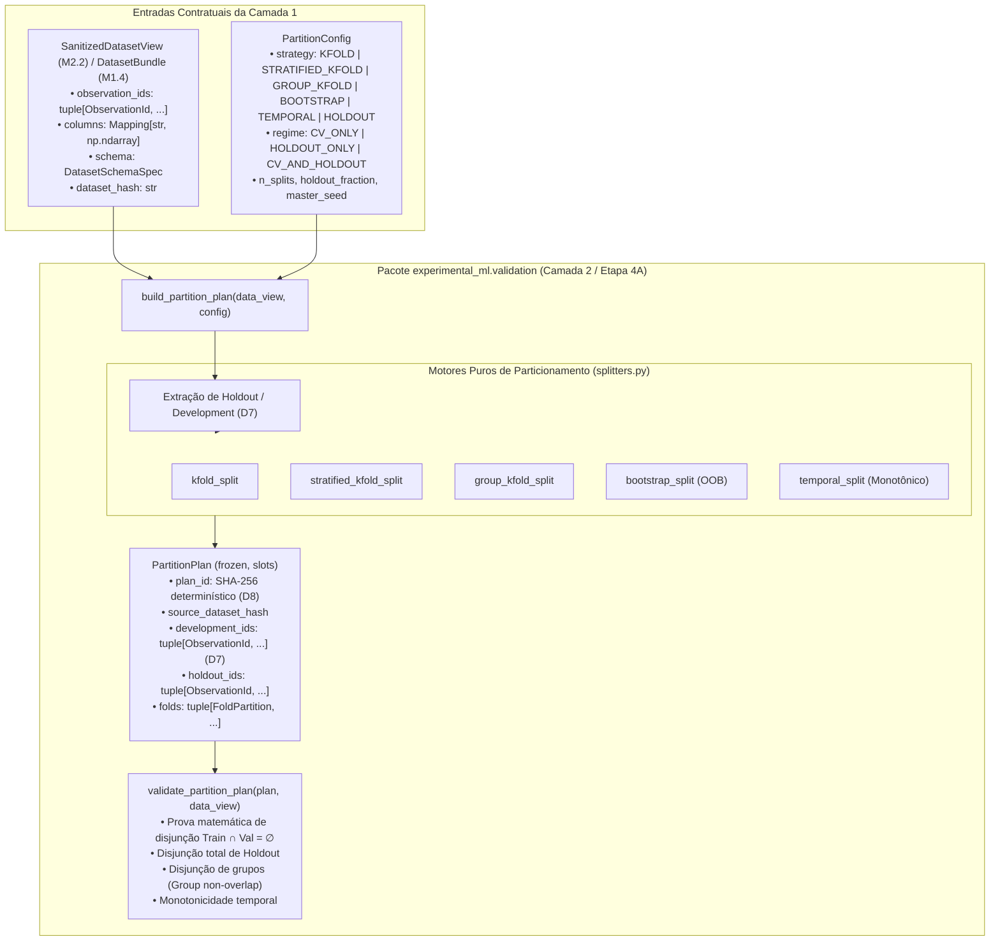

# M2.3 — Partitioning Engine Technical Design

**Spec**: `.specs/features/m2-3-partitioning-engine/spec.md`  
**Sub-Milestone**: M2.3 (`m2-3-partitioning-engine`)  
**Status**: Approved  
**Approved**: 2026-11-07 - user: "aprovado"  

---

## Architecture Overview

O Sub-marco M2.3 implementa a Camada 2 (Nível 2 / Etapa 4A) do framework no pacote `experimental_ml.validation`. O módulo é responsável por gerar, validar matematicamente e expor o plano de particionamento compartilhado e imutável (`PartitionPlan`), garantindo que todos os modelos, cenários de atributos e configurações executem sobre divisões estritamente idênticas e auditadas sem vazamento de dados (**ADR-002**, **RF4.1**, **RF4.2**).

A arquitetura estabelece uma barreira contratual estrita:
1. **Desacoplamento Contratual de `data`:** O pacote `validation` opera sobre `SanitizedDatasetView` (produzida no M2.2) ou `DatasetBundle` (produzido no M1.4), consumindo exclusivamente os contratos públicos (`observation_ids`, `columns`, `schema`, `dataset_hash`). O pacote `validation` não importa nem conhece lógicas internas de sanitização, diagnóstico ou perfilamento.
2. **Separação em Regimes e Estratégias (Decisão D7):** Suporta três regimes de avaliação:
   - `CV_ONLY`: Validação cruzada ou bootstrap em todo o conjunto de dados (`development_ids = total`, `holdout_ids = ()`).
   - `HOLDOUT_ONLY`: Separação de treino/desenvolvimento e teste final (`holdout_ids`).
   - `CV_AND_HOLDOUT`: Separação prioritária do conjunto de teste intocado (`holdout_ids`), confinando toda a validação cruzada exclusivamente a `development_ids`.
3. **Catálogo de Estratégias de Divisão Pura:** K-Fold, Stratified K-Fold, Group K-Fold, Bootstrap (com validação Out-of-Bag), Temporal (sem vazamento futuro) e Holdout.
4. **Reprodutibilidade e Rastreabilidade (Decisão D8):** A semente mestre (`master_seed`) gera fluxos pseudoaleatórios determinísticos e isolados via `SeedSequence`/`derive_seeds`, gerando um identificador imutável `plan_id` (SHA-256 canônico) que vincula dados, configuração e partições resultantes.
5. **Auditoria Matemática a Priori:** A função `validate_partition_plan` prova matematicamente a disjunção dos conjuntos ($\text{Train} \cap \text{Val} = \emptyset$ e $\text{Train}/\text{Val} \cap \text{Holdout} = \emptyset$), integridade de grupos e monotonicidade temporal antes que qualquer modelo seja treinado.



---

## Code Reuse Analysis

### Existing Components to Leverage

| Component | Location | How to Use |
| :--- | :--- | :--- |
| `ObservationId` | `src/experimental_ml/core/types.py` | Tipo canônico e imutável de identificador de observação |
| `TaskType` | `src/experimental_ml/core/enums.py` | Validação de tarefas de classificação vs regressão para estratificação |
| `derive_seeds` | `src/experimental_ml/core/seeds.py` | Derivação hierárquica e determinística de sementes via `SeedSequence` |
| `ConfigurationError`, `DataIntegrityError` | `src/experimental_ml/core/findings.py` | Exceções estruturadas para erros de configuração e violações de integridade |
| `SanitizedDatasetView` | `src/experimental_ml/data/preparation.py` | Contrato de dados saneados consumido como entrada |
| `DatasetBundle` | `src/experimental_ml/data/types.py` | Contrato de dados brutos consumido alternativamente |
| `DatasetSchemaSpec` | `src/experimental_ml/data/schema.py` | Metadados de papéis de colunas (`target_col`, `group_col`, `time_col`) |

### Integration Points

| System / Module | Integration Method |
| :--- | :--- |
| `data` $\rightarrow$ `validation` | Unidirecional: `validation` consome `SanitizedDatasetView` sem acoplamento a implementações privadas de preparação |
| `validation` $\rightarrow$ `orchestration` (M5) | O `PartitionPlan` gerado em M2.3 será consumido na Etapa 4B pela execução matricial $(\text{Modelos} \times \text{Cenários} \times \text{Folds})$ |

---

## Components and Interfaces

### 1. `experimental_ml.validation.types`
- **Purpose**: Estruturas de dados imutáveis com `slots` para configuração, partições individuais e o plano de particionamento consolidado.
- **Location**: `src/experimental_ml/validation/types.py`
- **Interfaces**:
  - `PartitionStrategy`: Enum com valores `"KFOLD"`, `"STRATIFIED_KFOLD"`, `"GROUP_KFOLD"`, `"BOOTSTRAP"`, `"TEMPORAL"`, `"HOLDOUT"`.
  - `EvaluationRegime`: Enum com valores `"CV_ONLY"`, `"HOLDOUT_ONLY"`, `"CV_AND_HOLDOUT"`.
  - `FoldPartition`: Dataclass congelada com slots: `fold_index: int`, `train_ids: tuple[ObservationId, ...]`, `val_ids: tuple[ObservationId, ...]`.
  - `PartitionConfig`: Dataclass congelada com slots e validação em `__post_init__` (`n_splits`, `holdout_fraction`, `master_seed`, etc.).
  - `PartitionPlan`: Dataclass congelada com slots contendo `plan_id`, `source_dataset_hash`, `regime`, `strategy`, `development_ids`, `holdout_ids`, `folds` e `config`.

### 2. `experimental_ml.validation.splitters`
- **Purpose**: Funções puras que realizam a partição dos identificadores de observações conforme cada estratégia matemática.
- **Location**: `src/experimental_ml/validation/splitters.py`
- **Interfaces**:
  - `kfold_split(observation_ids: Sequence[ObservationId], n_splits: int, shuffle: bool, seed: int) -> list[tuple[tuple[ObservationId, ...], tuple[ObservationId, ...]]]`
  - `stratified_kfold_split(observation_ids: Sequence[ObservationId], target: np.ndarray, n_splits: int, shuffle: bool, seed: int) -> list[tuple[tuple[ObservationId, ...], tuple[ObservationId, ...]]]`
  - `group_kfold_split(observation_ids: Sequence[ObservationId], groups: np.ndarray, n_splits: int, shuffle: bool, seed: int) -> list[tuple[tuple[ObservationId, ...], tuple[ObservationId, ...]]]`
  - `bootstrap_split(observation_ids: Sequence[ObservationId], n_bootstraps: int, seed: int) -> list[tuple[tuple[ObservationId, ...], tuple[ObservationId, ...]]]`
  - `temporal_split(observation_ids: Sequence[ObservationId], times: np.ndarray, n_splits: int) -> list[tuple[tuple[ObservationId, ...], tuple[ObservationId, ...]]]`
  - `holdout_split(observation_ids: Sequence[ObservationId], holdout_fraction: float, stratify: bool, target: np.ndarray | None, groups: np.ndarray | None, seed: int) -> tuple[tuple[ObservationId, ...], tuple[ObservationId, ...]]`

### 3. `experimental_ml.validation.engine`
- **Purpose**: Construtor principal que coordena a extração de dados, separação de holdout/desenvolvimento e montagem do `PartitionPlan`.
- **Location**: `src/experimental_ml/validation/engine.py`
- **Interfaces**:
  - `build_partition_plan(data_or_view: SanitizedDatasetView | DatasetBundle, config: PartitionConfig) -> PartitionPlan`
  - `_compute_plan_id(source_dataset_hash: str, config: PartitionConfig, development_ids: Sequence[ObservationId], holdout_ids: Sequence[ObservationId], folds: Sequence[FoldPartition]) -> str`

### 4. `experimental_ml.validation.validators`
- **Purpose**: Validador matemático formal de planos de partição.
- **Location**: `src/experimental_ml/validation/validators.py`
- **Interfaces**:
  - `validate_partition_plan(plan: PartitionPlan, data_or_view: SanitizedDatasetView | DatasetBundle) -> None`

---

## Data Models

```python
from __future__ import annotations
from dataclasses import dataclass, field
from enum import StrEnum
from types import MappingProxyType
from typing import Any, Mapping, Sequence
import numpy as np

from experimental_ml.core.types import ObservationId
from experimental_ml.data.schema import DatasetSchemaSpec

class PartitionStrategy(StrEnum):
    KFOLD = "KFOLD"
    STRATIFIED_KFOLD = "STRATIFIED_KFOLD"
    GROUP_KFOLD = "GROUP_KFOLD"
    BOOTSTRAP = "BOOTSTRAP"
    TEMPORAL = "TEMPORAL"
    HOLDOUT = "HOLDOUT"

class EvaluationRegime(StrEnum):
    CV_ONLY = "CV_ONLY"
    HOLDOUT_ONLY = "HOLDOUT_ONLY"
    CV_AND_HOLDOUT = "CV_AND_HOLDOUT"

@dataclass(frozen=True, slots=True)
class FoldPartition:
    fold_index: int
    train_ids: tuple[ObservationId, ...]
    val_ids: tuple[ObservationId, ...]

    def __post_init__(self) -> None:
        if not isinstance(self.train_ids, tuple):
            object.__setattr__(self, "train_ids", tuple(self.train_ids))
        if not isinstance(self.val_ids, tuple):
            object.__setattr__(self, "val_ids", tuple(self.val_ids))

@dataclass(frozen=True, slots=True)
class PartitionConfig:
    strategy: PartitionStrategy
    regime: EvaluationRegime = EvaluationRegime.CV_ONLY
    n_splits: int = 5
    holdout_fraction: float | None = None
    n_bootstraps: int | None = None
    time_col: str | None = None
    group_col: str | None = None
    stratify: bool = False
    shuffle: bool = True
    master_seed: int = 42

@dataclass(frozen=True, slots=True)
class PartitionPlan:
    plan_id: str
    source_dataset_hash: str
    regime: EvaluationRegime
    strategy: PartitionStrategy
    development_ids: tuple[ObservationId, ...]
    holdout_ids: tuple[ObservationId, ...]
    folds: tuple[FoldPartition, ...]
    config: PartitionConfig
```

---

## Algoritmos de Divisão Pura (Detalhamento)

### 1. K-Fold (`kfold_split`)
- Divide $N$ observações em $K$ folds.
- Se `shuffle=True`, permuta os índices utilizando gerador derivado de `master_seed`.
- Tamanhos de cada fold: primeiros $N \pmod K$ folds recebem $\lfloor N/K \rfloor + 1$ observações; os demais recebem $\lfloor N/K \rfloor$.
- Garante cobertura total de $N$ sem sobreposição entre validações.

### 2. Stratified K-Fold (`stratified_kfold_split`)
- Agrupa observações por classe presente em `target`.
- Dentro de cada classe $c$, permuta os índices deterministamente se `shuffle=True`.
- Distribui os índices de cada classe entre os $K$ folds de maneira intercalada (round-robin balanceado).
- Garante que em cada fold $k$, a proporção de cada classe reflita a proporção global dentro da margem discreta de $\pm 1$ amostra.

### 3. Group K-Fold (`group_kfold_split`)
- Agrupa observações por valor único da coluna de grupo.
- Se a contagem de grupos únicos $G < K$, levanta `ConfigurationError`.
- Ordena os grupos em ordem decrescente de tamanho (número de observações por grupo), com desempate determinístico pelo valor do grupo.
- Utiliza algoritmo guloso (*greedy packing*) para alocar cada grupo ao fold com menor número acumulado de observações, garantindo partições aproximadamente balanceadas em tamanho amostral.
- Garante $\text{Groups}(\text{Train}_k) \cap \text{Groups}(\text{Val}_k) = \emptyset$ para todo fold $k$.

### 4. Temporal Split (`temporal_split`)
- Ordena as observações cronologicamente de acordo com os valores de `time_col`. Em caso de empates em timestamp, desempata pela ordem original de `observation_ids`.
- `shuffle` é estritamente proibido / ignorado (`shuffle = False`).
- Divide as observações ordenadas em $K+1$ segmentos cronológicos. No esquema padrão de janela expansiva (*expanding window*):
  - Fold $k \in \{0, \dots, K-1\}$: treino é formado pelas observações dos segmentos $0$ até $k$; validação é formada pelas observações do segmento $k+1$.
- Garante $\max(\text{Time}(\text{Train}_k)) \le \min(\text{Time}(\text{Val}_k))$, eliminando vazamento temporal para o futuro.

### 5. Bootstrap Split (`bootstrap_split`)
- Para cada iteração $b \in \{0, \dots, B-1\}$:
  - Deriva uma semente filha determinística a partir de `master_seed` para a iteração $b$.
  - Amostra $N$ observações com reposição a partir de `development_ids`.
  - As observações selecionadas formam `train_ids` (tamanho $N$).
  - As observações que não foram sorteadas em nenhuma das $N$ extrações formam o conjunto de validação Out-of-Bag (`val_ids`).
- Em virtude da probabilidade de não-sorteio de $(1 - 1/N)^N \approx e^{-1} \approx 36.8\%$, cada fold de validação OOB contém aproximadamente $36.8\%$ do conjunto de desenvolvimento.

### 6. Holdout Split (`holdout_split`)
- Separa uma fração $\alpha = \text{holdout_fraction}$ do conjunto de dados total.
- Se `stratify=True`, extrai a fração $\alpha$ preservando proporções de classes.
- Se `group_col` estiver ativo, extrai grupos inteiros até totalizar aproximadamente a fração $\alpha$.
- O conjunto retido forma `holdout_ids`; o conjunto restante forma `development_ids`.

---

## Error Handling Strategy

| Cenário de Erro | Tratamento | Tipo de Exceção |
| :--- | :--- | :--- |
| `n_splits < 2` em regime de validação cruzada | Rejeição no construtor de configuração | `ConfigurationError` |
| `holdout_fraction <= 0` ou `>= 1.0` em regime com holdout | Rejeição no construtor de configuração | `ConfigurationError` |
| `group_col` não declarado no esquema ou ausente dos dados em `GROUP_KFOLD` | Rejeição antes de particionar | `ConfigurationError` |
| Número de grupos únicos menor que `n_splits` em `GROUP_KFOLD` | Rejeição imediata antes de alocar grupos | `ConfigurationError` |
| `time_col` ausente dos dados em `TEMPORAL` | Rejeição antes de ordenar temporalmente | `ConfigurationError` |
| Sobreposição detectada $\text{Train}_k \cap \text{Val}_k \neq \emptyset$ | Bloqueio imediato no validador matemático | `DataIntegrityError` |
| Sobreposição de observações de holdout no treino ou validação de CV | Bloqueio imediato no validador matemático | `DataIntegrityError` |
| Sobreposição de grupos entre treino e validação em `GROUP_KFOLD` | Bloqueio imediato no validador matemático | `DataIntegrityError` |
| Inversão cronológica detectada em `TEMPORAL` | Bloqueio imediato no validador matemático | `DataIntegrityError` |

---

## Risks & Concerns

| Preocupação / Risco | Localização | Impacto | Mitigação no Design |
| :--- | :--- | :--- | :--- |
| **Instabilidade entre versões de NumPy (Decisão D8):** `np.random.default_rng` pode mudar permutações entre versões maiores do NumPy | `src/experimental_ml/validation/splitters.py` | Quebra de reprodutibilidade exata de partições entre diferentes ambientes | Uso de geradores determinísticos com sementes filhas derivadas via `SeedSequence` e algoritmos puros de partição, registrando rastreabilidade completa no `PartitionPlan` |
| **Vazamento entre folds de grupos com desbalanceamento severo:** Grupos gigantescos podem forçar um fold a ficar muito maior que outros | `src/experimental_ml/validation/splitters.py` | Desbalanceamento de tamanho de validação | Algoritmo guloso de empacotamento decrescente (*greedy LPT bin-packing*) que minimiza discrepância de carga |
| **Vazamento acidental de Holdout:** Modelos consumirem `holdout_ids` durante a validação cruzada | `src/experimental_ml/validation/engine.py` | Vazamento de teste final (quebra de integridade científica) | Decisão D7: separação física estrita onde `development_ids` é o único universo visível para a geração dos folds de validação cruzada |

---

## Tech Decisions (Consolidadas D1–D12)

| Decisão | Escolha | Racional |
| :--- | :--- | :--- |
| **D7** | Inclusão de `development_ids` em `PartitionPlan` | Permite que a validação cruzada atue exclusivamente sobre o subconjunto de desenvolvimento quando há holdout |
| **D8** | Determinismo e rastreabilidade estritos no `PartitionPlan` | Mesma configuração, mesmos dados e mesma `master_seed` geram idênticas partições e `plan_id` SHA-256 |
| **Ressalva M2.3** | Dependência exclusivamente contratual de `data` | O pacote `validation` opera sobre `SanitizedDatasetView` ou `DatasetBundle` sem acoplamento a implementações privadas de preparação |
