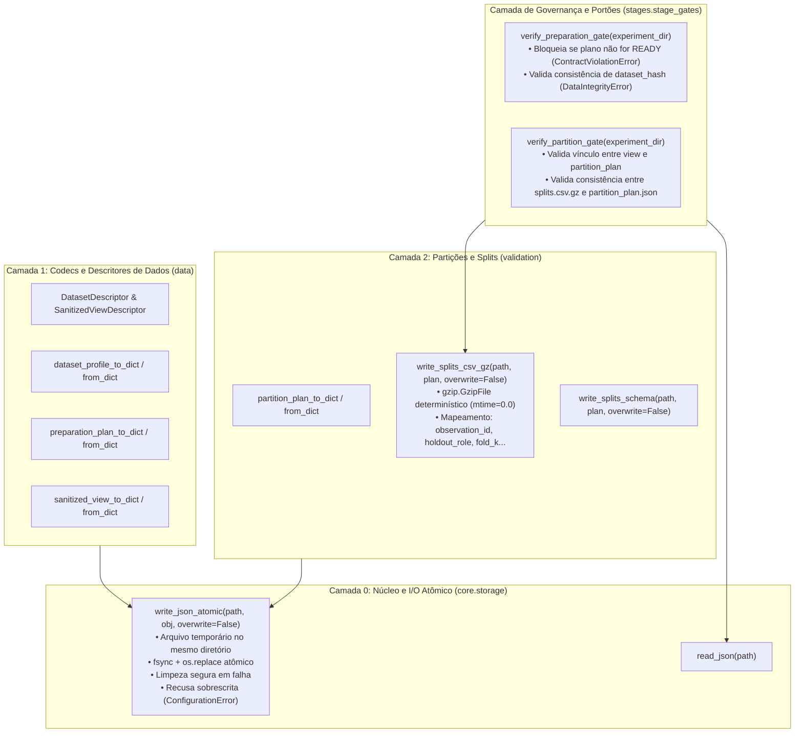

# M2.4 — Artifacts Persistence & Stage Gates Technical Design

**Spec**: `.specs/features/m2-4-artifacts-stage-gates/spec.md`  
**Sub-Milestone**: M2.4 (`m2-4-artifacts-stage-gates`)  
**Status**: Approved  
**Approved**: 2026-11-07 - user: "aprovado"  

---

## Architecture Overview

O Sub-marco M2.4 implementa a camada de persistência atômica, serialização sem perda (*codecs*) e validação de vínculos de integridade entre etapas (*stage gates*) para os artefatos da Etapa 1 e Etapa 4A, conforme estabelecido nos requisitos `STORE-01` a `STORE-07`, nas Decisões D6, D10 e D11 do Marco M2 e no critério de governança `CA-GER-01`.



---

## Code Reuse Analysis

### Existing Components to Leverage

| Component | Location | How to Use |
| :--- | :--- | :--- |
| `ObservationId` | `src/experimental_ml/core/types.py` | Tipo canônico para identificadores de observações nos splits |
| `ConfigurationError`, `DataIntegrityError`, `ContractViolationError` | `src/experimental_ml/core/findings.py` | Exceções estruturadas para violações de pré-condições e invariantes |
| `DatasetProfile`, `ColumnProfile`, `ProfileConfig` | `src/experimental_ml/data/profiling.py` | Objetos perfilados para conversão bidirecional |
| `PreparationPlan`, `PreparationRule`, `SanitizedDatasetView` | `src/experimental_ml/data/preparation.py` | Estruturas de saneamento serializadas e validadas |
| `PartitionPlan`, `FoldPartition`, `PartitionConfig` | `src/experimental_ml/validation/types.py` | Estruturas de partição serializadas e confrontadas com splits |
| `validate_partition_plan` | `src/experimental_ml/validation/validators.py` | Validação matemática de integridade |

### Layer Separation & Dependencies (ADR-002, XCUT-01)

- `core.storage`: Opera puramente sobre arquivos e serialização JSON/texto sem importar módulos superiores de `data` ou `validation`.
- `data.codecs`: Converte tipos de `data` e `core`. Não importa `validation`.
- `validation.storage` e `validation.codecs`: Converte tipos de `validation` e `core`. Não importa lógicas internas de `data.preparation` ou `data.profiling`.
- `stages.stage_gates`: Coordena os portões consumindo descritores e codecs públicos de `data`, `validation` e `core`.

---

## Components and Interfaces

### 1. `experimental_ml.core.storage`
- **Purpose**: I/O atômico em disco imune a falhas de processo ou energia, e leitura segura.
- **Location**: `src/experimental_ml/core/storage.py`
- **Interfaces**:
  - `write_json_atomic(path: Path | str, payload: Any, *, overwrite: bool = False, indent: int = 2) -> None`:
    - Verifica se o caminho alvo já existe; se existir e `overwrite=False`, dispara `ConfigurationError` (STORE-07).
    - Cria diretório pai se não existir.
    - Grava em arquivo temporário nomeado (`NamedTemporaryFile(dir=parent_dir, delete=False)`).
    - Sanitiza payloads garantindo ausência de `NaN` ou `Infinity` (STORE-02).
    - Executa `flush` e `os.fsync` antes do fechamento.
    - Substitui atomicamente o arquivo de destino via `os.replace`.
    - Captura qualquer exceção, remove o arquivo temporário via `os.unlink` silencioso se ainda existir, e relança o erro sem poluir o destino (STORE-01).
  - `read_json(path: Path | str) -> Any`:
    - Abre e decodifica documento JSON com `encoding="utf-8"`.

### 2. `experimental_ml.data.descriptors` & `experimental_ml.data.codecs`
- **Purpose**: Metadados leves de etapa e codecs de conversão bidirecional para objetos de `data`.
- **Location**: `src/experimental_ml/data/descriptors.py`, `src/experimental_ml/data/codecs.py`
- **Interfaces**:
  - `DatasetDescriptor`: Dataclass imutável com slots (`dataset_hash`, `raw_source_hash`, `n_observations`, `n_columns`, `column_names`, `column_types`, `target_col`, `task_type`).
  - `SanitizedViewDescriptor`: Dataclass imutável com slots (`dataset_hash`, `source_dataset_hash`, `source_plan_digest`, `n_observations`, `candidate_feature_cols`, `dropped_observation_ids`, `target_label_mapping`, `deferred_rules_count`).
  - `dataset_descriptor_to_dict(desc: DatasetDescriptor) -> dict[str, Any]` / `dataset_descriptor_from_dict(d: dict[str, Any]) -> DatasetDescriptor`
  - `dataset_profile_to_dict(profile: DatasetProfile) -> dict[str, Any]` / `dataset_profile_from_dict(d: dict[str, Any]) -> DatasetProfile`
  - `preparation_plan_to_dict(plan: PreparationPlan) -> dict[str, Any]` / `preparation_plan_from_dict(d: dict[str, Any]) -> PreparationPlan`
  - `sanitized_view_descriptor_to_dict(view_desc: SanitizedViewDescriptor) -> dict[str, Any]` / `sanitized_view_descriptor_from_dict(d: dict[str, Any]) -> SanitizedViewDescriptor`

### 3. `experimental_ml.validation.codecs` & `experimental_ml.validation.storage`
- **Purpose**: Serialização de `PartitionPlan` e escrita tabular determinística de `splits.csv.gz`.
- **Location**: `src/experimental_ml/validation/codecs.py`, `src/experimental_ml/validation/storage.py`
- **Interfaces**:
  - `partition_plan_to_dict(plan: PartitionPlan) -> dict[str, Any]` / `partition_plan_from_dict(d: dict[str, Any]) -> PartitionPlan`
  - `write_splits_csv_gz(path: Path | str, plan: PartitionPlan, *, overwrite: bool = False) -> None`:
    - Verifica pré-existência se `overwrite=False`.
    - Escreve via `gzip.GzipFile(mtime=0.0)` para garantir reprodutibilidade bit a bit (STORE-04).
    - Cabeçalho: `observation_id,holdout_role,fold_0,fold_1,...,fold_{K-1}`.
    - Valores: `holdout_role` em `{"DEVELOPMENT", "HOLDOUT"}`; `fold_k` em `{"TRAIN", "VAL", "EXCLUDED"}`.
    - Ordenação de linhas determinística preservando a ordem original de `plan.development_ids` e `plan.holdout_ids`.
  - `read_splits_csv_gz(path: Path | str) -> list[dict[str, str]]`:
    - Lê e retorna mapeamento dos splits.
  - `write_splits_schema(path: Path | str, plan: PartitionPlan, *, overwrite: bool = False) -> None`:
    - Escreve metadados estruturais do CSV (`splits.schema.json`).

### 4. `experimental_ml.stages.stage_gates`
- **Purpose**: Validação de integridade e bloqueio de transição entre etapas.
- **Location**: `src/experimental_ml/stages/stage_gates.py`
- **Interfaces**:
  - `verify_preparation_gate(experiment_dir: Path | str) -> None`:
    - Verifica existência de `data/dataset_descriptor.json`, `data/dataset_profile.json` e `configuration/preparation_plan.json`.
    - Dispara `ContractViolationError` se `preparation_plan.json` estiver ausente ou seu status não for `"READY"` (STORE-05).
    - Dispara `DataIntegrityError` se os hashes do dataset divergirem entre descritor, perfil e plano (STORE-05).
  - `verify_partition_gate(experiment_dir: Path | str) -> None`:
    - Executa `verify_preparation_gate`.
    - Verifica existência de `data/sanitized_view.json`, `partitions/partition_plan.json`, `partitions/splits.csv.gz` e `partitions/splits.schema.json`.
    - Dispara `DataIntegrityError` se `source_dataset_hash` do `PartitionPlan` divergir do `dataset_hash` em `sanitized_view.json`.
    - Dispara `DataIntegrityError` se o conteúdo descompactado de `splits.csv.gz` divergir das partições descritas em `partition_plan.json` (STORE-06).

---

## Directory Layout (ARQUITETURA §5, D11)

```
<experiment-dir>/
├── data/
│   ├── dataset_descriptor.json      # Metadados do dataset original
│   ├── dataset_profile.json         # Estatísticas e achados de perfilamento
│   └── sanitized_view.json          # Metadados da visão pós-saneamento
├── configuration/
│   └── preparation_plan.json        # Plano aprovado (status: READY)
└── partitions/
    ├── partition_plan.json          # Plano de particionamento (plan_id, folds)
    ├── splits.csv.gz                # Matriz comprimida com mapeamento por fold
    └── splits.schema.json           # Esquema declarativo das colunas de splits
```

---

## Verification Strategy

1. **STORE-01 (Escrita Atômica)**:
   - Injetar falha de serialização/escrita e verificar que nenhum arquivo residual temporário permanece e o arquivo original (se existente) permanece inalterado.
2. **STORE-02 (Codecs Lossless)**:
   - Round-trip completo `obj == from_dict(to_dict(obj))` para `DatasetProfile`, `PreparationPlan`, `PartitionPlan`, e descritores.
   - Verificação de ausência estrita de strings/valores `NaN` ou `Infinity`.
3. **STORE-03 & STORE-04 (Splits & Layout)**:
   - Verificação determinística dos bytes gerados por `splits.csv.gz` para o mesmo plano.
4. **STORE-05 & STORE-06 (Portões de Integridade)**:
   - Plano com status `"INCOMPLETE"` ou arquivo ausente dispara `ContractViolationError`.
   - Hashes divergentes ou adulteração manual em `splits.csv.gz` disparam `DataIntegrityError`.
5. **STORE-07 (Sobrescrita)**:
   - Gravação sobre arquivo existente com `overwrite=False` dispara `ConfigurationError`.
