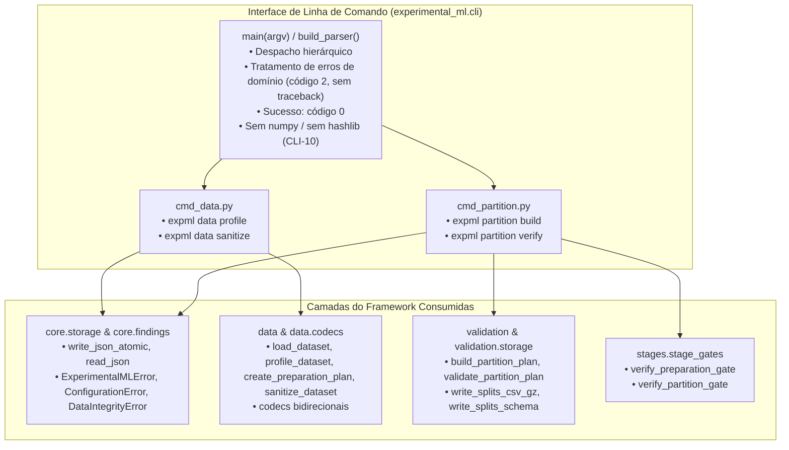

# M2.5 — CLI `data` & `partition` and End-to-End Acceptance Technical Design

**Spec**: `.specs/features/m2-5-cli-end-to-end/spec.md`  
**Sub-Milestone**: M2.5 (`m2-5-cli-end-to-end`)  
**Status**: Approved  
**Approved**: 2026-11-07 - user: "aprovado"  

---

## Architecture Overview

O Sub-marco M2.5 implementa a interface de linha de comando (`expml`) para as etapas de dados e validação, cobrindo os requisitos `CLI-01` a `CLI-12`, os critérios de aceitação `CA-E1-01`, `CA-E1-02`, `CA-E4A-01`, `CA-E4A-02` e `CA-GER-01`, e a arquitetura formal estabelecida em ARQUITETURA §2.4 e §7.

---

## Code Reuse Analysis

### Existing Components to Leverage

| Component | Location | How to Use |
| :--- | :--- | :--- |
| `write_json_atomic`, `read_json` | `src/experimental_ml/core/storage.py` | Gravação atômica imune a falhas e leitura de artefatos JSON |
| `ExperimentalMLError`, `ConfigurationError`, `ContractViolationError`, `DataIntegrityError` | `src/experimental_ml/core/findings.py` | Captura de exceções de domínio e conversão em mensagens instrutivas com código 2 |
| `load_dataset`, `profile_dataset`, `create_preparation_plan`, `sanitize_dataset` | `src/experimental_ml/data/` | Executores de ingestão, diagnóstico e saneamento |
| `DatasetDescriptor`, `SanitizedViewDescriptor`, codecs | `src/experimental_ml/data/descriptors.py`, `codecs.py` | Serialização e reconstrução de objetos do perfil e plano |
| `build_partition_plan`, `validate_partition_plan` | `src/experimental_ml/validation/` | Construção e validação formal de partições |
| `write_splits_csv_gz`, `write_splits_schema` | `src/experimental_ml/validation/storage.py` | Gravação determinística da matriz de splits gzipada |
| `verify_preparation_gate`, `verify_partition_gate` | `src/experimental_ml/stages/stage_gates.py` | Validação de precondições a montante e integridade entre etapas |

### Layer Separation & Dependencies (ADR-002, CLI-10, XCUT-01)

- **Pureza da Camada CLI (`CLI-10`)**: Os módulos sob `src/experimental_ml/cli/` não importam `numpy` nem `hashlib`. Todas as operações numéricas e criptográficas permanecem estritamente encapsuladas nas camadas `core`, `data` e `validation`.
- **Higiene de Saída (`CLI-11`)**: Nenhuma rotina de impressão em terminal (`sys.stdout`, `sys.stderr`) exibe hashes ou digests criptográficos. O usuário recebe contagens de linhas, nomes de atributos, códigos de diagnóstico e resumos estruturados.

---

## Components and Interfaces

### 1. `experimental_ml.cli.main`
- **Purpose**: Ponto de entrada canônico e despachante principal com tratamento uniforme de saída e exceções.
- **Location**: `src/experimental_ml/cli/main.py`
- **Interfaces**:
  - `build_parser() -> argparse.ArgumentParser`: Constrói a árvore de comandos e subcomandos:
    - `expml --version`
    - `expml data profile ...`
    - `expml data sanitize ...`
    - `expml partition build ...`
    - `expml partition verify ...`
  - `main(argv: Sequence[str] | None = None) -> int`:
    - Trata `argv` vazio exibindo `--help` e retornando código `0` (preserva M1.1).
    - Captura `ExperimentalMLError` (e subclasses) e `ValueError` emitidos pelos comandos: imprime `Error: {mensagem}` no `sys.stderr` **sem traceback** e encerra com código `2` (CLI-06).
    - Captura falhas inesperadas (`Exception` genérica): imprime erro no `sys.stderr` e encerra com código `1`.
    - Sob sucesso: encerra com código `0`.

### 2. `experimental_ml.cli.cmd_data`
- **Purpose**: Manipuladores dos subcomandos `data profile` e `data sanitize`.
- **Location**: `src/experimental_ml/cli/cmd_data.py`
- **Interfaces**:
  - `handle_data_profile(args: argparse.Namespace) -> int`:
    - Carrega schema JSON via `read_json` e instancia `DatasetSchemaSpec`.
    - Executa `load_dataset` e `profile_dataset`.
    - Salva `data/dataset_descriptor.json` e `data/dataset_profile.json` com `overwrite=args.force`.
    - Imprime resumo com dimensões e tabela textual de achados diagnósticos (`Finding.code`, coluna, mensagem).
    - Retorna `0`.
  - `handle_data_sanitize(args: argparse.Namespace) -> int`:
    - Lê `data/dataset_descriptor.json`, `data/dataset_profile.json` e arquivo de regras JSON.
    - Executa `create_preparation_plan`.
    - Se `status == "INCOMPLETE"`: imprime cada `CONFIRMED_ISSUE` pendente sem regra e encerra com código `2` sem salvar o plano (CLI-03).
    - Se `status == "READY"`: recarrega fonte e schema, executa `sanitize_dataset`, salva `configuration/preparation_plan.json` e `data/sanitized_view.json`, imprime resumo e retorna `0`.

### 3. `experimental_ml.cli.cmd_partition`
- **Purpose**: Manipuladores dos subcomandos `partition build` e `partition verify`.
- **Location**: `src/experimental_ml/cli/cmd_partition.py`
- **Interfaces**:
  - `handle_partition_build(args: argparse.Namespace) -> int`:
    - Executa `verify_preparation_gate(args.experiment_dir)` garantindo precondições (CLI-07).
    - Carrega configuração de partição JSON e aplica `--seed` sobrescrevendo `master_seed` se informado.
    - Reconstrói a visão saneada determinística a partir de fonte, schema e plano.
    - Executa `build_partition_plan`.
    - Salva `partitions/partition_plan.json`, `partitions/splits.csv.gz` e `partitions/splits.schema.json` com `overwrite=args.force`.
    - Imprime resumo (regime, estratégia, observações em treino/validação por fold e holdout).
    - Retorna `0`.
  - `handle_partition_verify(args: argparse.Namespace) -> int`:
    - Executa `verify_partition_gate(args.experiment_dir)`.
    - Reconstrói visão e plano, executa `validate_partition_plan`.
    - Imprime confirmação de integridade.
    - Retorna `0`.

---

## Verification Strategy

1. **CLI Base e Preservação M1.1 (`CLI-09`)**:
   - `expml --version` retorna código 0.
   - `expml` sem argumentos exibe `--help` e retorna código 0.
   - Opção inválida exibe erro e encerra com código 2.
2. **Subcomandos e Bloqueios (`CLI-01`, `CLI-02`, `CLI-03`, `CLI-04`, `CLI-05`, `CLI-07`, `CLI-08`)**:
   - `data profile` produz descritor e perfil com saída legível sem hashes (`CLI-11`).
   - `data sanitize` com regras completas produz plano e visão saneada.
   - `data sanitize` com regras incompletas imprime achados não resolvidos e encerra com código 2 sem persistir o plano.
   - `partition build` com e sem `--seed` cria plano e splits comprimidos.
   - `partition verify` valida ou rejeita artefatos adulterados com código 2 sem traceback.
   - Sobrescrita de arquivos sem `--force` encerra com código 2.
3. **Pureza Arquitetural (`CLI-10`)**:
   - Teste de AST verificando que nenhum arquivo em `src/experimental_ml/cli/` importa `numpy` ou `hashlib`.
4. **Homologação Fim a Fim por Subprocesso (`CLI-12`)**:
   - Execução completa da sequência `data profile` $\rightarrow$ `data sanitize` $\rightarrow$ `partition build` $\rightarrow$ `partition verify` através do binário instalado `expml` em duas pastas de trabalho independentes, comprovando bit a bit a equivalência dos bytes de `partition_plan.json` e do conteúdo descompactado de `splits.csv.gz`.
