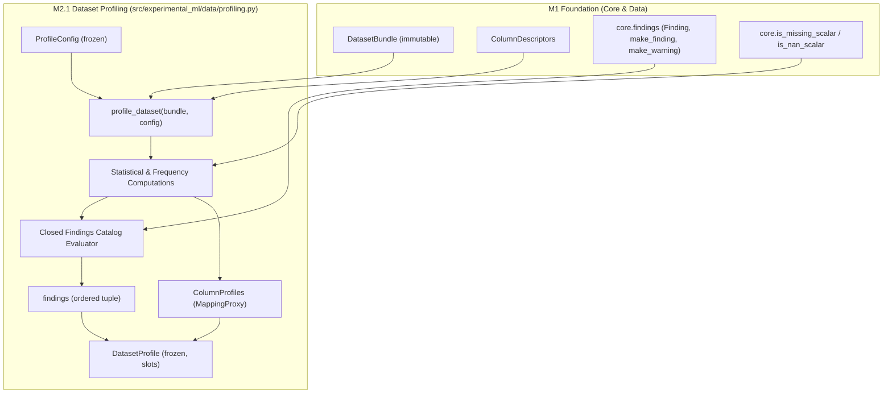

# M2.1 — Stage 1 Structural Dataset Diagnostics (`profile_dataset`) Technical Design

**Spec**: `.specs/features/m2-diagnostics-partitioning/spec.md`  
**Sub-Milestone**: M2.1 (`m2-1-dataset-profiling`)  
**Status**: Consolidated (approved by user for Tasks advance on 2026-11-06)  

---

## 1. Architecture Overview

O Marco M2.1 implementa o diagnóstico estrutural e profiling determinístico do dataset (`profile_dataset` e `DatasetProfile`), constituindo o primeiro pilar da Etapa 1 na Camada 1 (`data`).

O profiler opera como uma função puramente funcional: recebe um `DatasetBundle` imutável (produzido na ingestão pelo M1) e uma configuração imutável opcional `ProfileConfig`. Ele inspeciona as colunas, calcula distribuições estatísticas, detecta linhas duplicadas, avalia a distribuição do alvo e de grupos, e emite um catálogo estritamente fechado de diagnósticos (`Finding`), separando categoricamente **constatações objetivas** (`CONFIRMED_ISSUE`) de **alertas heurísticos** (`HEURISTIC_WARNING`).

A arquitetura respeita estritamente a hierarquia em camadas e a direção de dependências (`core` ← `data`), mantendo o profiler independente de etapas posteriores (como preparação e particionamento) e garantindo imutabilidade total da base fonte.



### Princípios Arquiteturais Aplicados:
1. **Direção Estrita de Dependências (XCUT-01)**: `profiling` reside em `src/experimental_ml/data/` e importa apenas `core` e tipos locais de `data`. Não importa módulos de `validation`, nem módulos futuros de preparação.
2. **Imutabilidade e ADR-008 (XCUT-03)**: Todas as estruturas (`ProfileConfig`, `ColumnProfile`, `DatasetProfile`, etc.) são dataclasses congeladas (`frozen=True, slots=True`) com tuplas e `MappingProxyType`.
3. **Ausência de Efeitos Colaterais (PROF-10)**: O `DatasetBundle` permanece bit a bit inalterado; `bundle.dataset_hash` e os buffers dos arrays NumPy não sofrem mutação.
4. **Determinismo Absoluto**: Duas invocações com o mesmo bundle e configuração produzem instâncias de `DatasetProfile` rigorosamente idênticas, com listas e dicionários ordenados canonicamente.

---

## 2. Code Reuse Analysis

### Componentes Existentes Reaproveitados

| Componente | Localização | Modo de Reuso | Justificativa |
| :--- | :--- | :--- | :--- |
| `Finding`, `make_finding`, `make_warning` | `src/experimental_ml/core/findings.py` | Importação direta | Construção padronizada de achados com severidade explícita |
| `FindingSeverity` | `src/experimental_ml/core/enums.py` | Importação direta | Enums `CONFIRMED_ISSUE` e `HEURISTIC_WARNING` |
| `TaskType` | `src/experimental_ml/core/enums.py` | Importação direta | Inspeção do tipo de tarefa (`REGRESSION`, `BINARY_CLASSIFICATION`, etc.) |
| `is_missing_scalar`, `is_nan_scalar` | `src/experimental_ml/core/scalars.py` | Importação direta | Detecção centralizada de valores ausentes consolidada no M1.5 |
| `ConfigurationError`, `ContractViolationError` | `src/experimental_ml/core/findings.py` | Importação direta | Sinalização de erros de configuração de limiares ou violação de contrato |
| `ObservationId` | `src/experimental_ml/core/types.py` | Importação direta | Tipagem de identificadores de observação duplicados |
| `DatasetBundle` | `src/experimental_ml/data/types.py` | Importação e consumo | Entrada do profiling; leitura de `columns`, `descriptors`, `schema` |
| `ColumnDescriptor` | `src/experimental_ml/data/types.py` | Leitura de campos | Reaproveitamento direto de `physical_type`, `semantic_type`, `n_missing`, `memory_bytes` |
| `ColumnSemanticType` | `src/experimental_ml/data/schema.py` | Importação direta | Checagem de tipo semântico (`CATEGORICAL`, `BOOLEAN`, `NUMERIC`, etc.) |

---

## 3. Data Models & Contracts

Todas as estruturas seguem estritamente ADR-008: dataclasses imutáveis (`frozen=True, slots=True`), sem métodos de serviço embutidos, utilizando tuplas para sequências e `MappingProxyType` para mapeamentos imutáveis.

### 3.1. `ProfileConfig`

Configuração de limiares heurísticos e limites de memória para o profiler.

```python
@dataclass(frozen=True, slots=True)
class ProfileConfig:
    """Configuração imutável de limiares heurísticos e cortes de memória para profiling."""

    near_constant_top_frequency: float = 0.99
    identifier_unique_ratio: float = 0.95
    scale_disparity_orders: float = 3.0
    imbalance_ratio: float = 3.0
    rare_class_proportion: float = 0.05
    small_group_size: int = 5
    max_categories_reported: int = 50
    max_listed_ids: int = 100

    def __post_init__(self) -> None:
        if not (0.5 < self.near_constant_top_frequency <= 1.0):
            raise ConfigurationError(
                f"near_constant_top_frequency deve estar em (0.5, 1.0], obtido: {self.near_constant_top_frequency}"
            )
        if not (0.0 < self.identifier_unique_ratio <= 1.0):
            raise ConfigurationError(
                f"identifier_unique_ratio deve estar em (0.0, 1.0], obtido: {self.identifier_unique_ratio}"
            )
        if self.scale_disparity_orders < 1.0:
            raise ConfigurationError(
                f"scale_disparity_orders deve ser >= 1.0, obtido: {self.scale_disparity_orders}"
            )
        if self.imbalance_ratio < 1.0:
            raise ConfigurationError(
                f"imbalance_ratio deve ser >= 1.0, obtido: {self.imbalance_ratio}"
            )
        if not (0.0 < self.rare_class_proportion <= 0.5):
            raise ConfigurationError(
                f"rare_class_proportion deve estar em (0.0, 0.5], obtido: {self.rare_class_proportion}"
            )
        if self.small_group_size < 1:
            raise ConfigurationError(
                f"small_group_size deve ser >= 1, obtido: {self.small_group_size}"
            )
        if self.max_categories_reported < 1:
            raise ConfigurationError(
                f"max_categories_reported deve ser >= 1, obtido: {self.max_categories_reported}"
            )
        if self.max_listed_ids < 1:
            raise ConfigurationError(
                f"max_listed_ids deve ser >= 1, obtido: {self.max_listed_ids}"
            )
```

### 3.2. Estruturas de Distribuição

```python
@dataclass(frozen=True, slots=True)
class NumericDistributionStats:
    """Estatísticas de distribuição para colunas numéricas calculadas sobre valores válidos."""

    mean: float | None
    std: float | None           # ddof=1 (amostral); None se n_valid < 2
    min: float | None
    q1: float | None            # 25º percentil (método linear)
    median: float | None        # 50º percentil
    q3: float | None            # 75º percentil
    max: float | None
    range: float | None         # max - min
    iqr: float | None           # q3 - q1


@dataclass(frozen=True, slots=True)
class CategoryFrequency:
    """Frequência absoluta e relativa de uma categoria específica."""

    value: Any                  # Valor escalar (str, int, bool)
    count: int                  # Frequência absoluta
    proportion: float           # count / n_valid_total


@dataclass(frozen=True, slots=True)
class CategoricalDistributionStats:
    """Estatísticas para colunas categóricas, booleanas ou texto."""

    cardinality: int            # Número total de categorias distintas não ausentes
    frequencies: tuple[CategoryFrequency, ...]  # Top max_categories_reported categorias ordenadas
    remainder_count: int        # Contagem acumulada das categorias fora do top
    remainder_proportion: float # Proporção acumulada das categorias fora do top
```

### 3.3. Perfis Especializados

```python
@dataclass(frozen=True, slots=True)
class ColumnProfile:
    """Perfil detalhado de uma coluna individual."""

    name: str
    physical_type: str
    semantic_type: ColumnSemanticType
    role: str
    n_missing: int
    missing_proportion: float
    n_unique: int
    numeric_stats: NumericDistributionStats | None
    categorical_stats: CategoricalDistributionStats | None


@dataclass(frozen=True, slots=True)
class TargetProfile:
    """Perfil específico da coluna alvo do dataset."""

    column_name: str
    task_type: TaskType
    numeric_stats: NumericDistributionStats | None
    skewness: float | None                      # Fisher-Pearson sobre valores válidos se n >= 3
    outliers_count_iqr_fences: int | None       # Contagem de valores fora de [Q1 - 1.5*IQR, Q3 + 1.5*IQR]
    class_frequencies: tuple[CategoryFrequency, ...] | None
    majority_minority_ratio: float | None       # Razão contagem_maioria / contagem_minoria (se >= 2 classes)


@dataclass(frozen=True, slots=True)
class GroupProfile:
    """Perfil de agrupamento quando group_col é declarada."""

    group_col: str
    n_groups: int
    min_group_size: int
    median_group_size: float
    max_group_size: int


@dataclass(frozen=True, slots=True)
class DuplicateRowsProfile:
    """Diagnóstico de linhas duplicadas desconsiderando o identificador de observação."""

    n_duplicate_rows: int
    duplicate_observation_ids: tuple[ObservationId, ...]  # Ocorrências duplicadas (excluindo a 1ª)
    is_truncated: bool                                   # True se excedeu max_listed_ids
```

### 3.4. `DatasetProfile`

Estrutura agregadora imutável retornada por `profile_dataset`.

```python
@dataclass(frozen=True, slots=True)
class DatasetProfile:
    """Perfil estrutural e diagnóstico imutável do dataset."""

    source_dataset_hash: str
    n_rows: int
    n_cols: int
    memory_bytes: int
    columns: MappingProxyType[str, ColumnProfile]
    duplicate_rows: DuplicateRowsProfile
    target: TargetProfile
    groups: GroupProfile | None
    findings: tuple[Finding, ...]
```

---

## 4. Closed Findings Catalog & Rules Engine

O catálogo de diagnósticos do M2.1 é **fechado** e composto por 15 códigos estritos: 8 de severidade `CONFIRMED_ISSUE` e 7 de severidade `HEURISTIC_WARNING`.

A chave canônica de um achado é o par `(code, column)`. Achados globais utilizam `column = None`. Achados em colunas com papel `ignored`, `time` ou `observation_id` **não são gerados** para achados específicos de feature (PROF-07).

### 4.1. Catálogo dos 8 `CONFIRMED_ISSUE` (Problemas Confirmados)

| Código | Condição Estrita de Emissão | `column` no `context` | `context` Adicional |
| :--- | :--- | :--- | :--- |
| `E1_TARGET_MISSING` | Alvo com `n_missing > 0` | `schema.target_col` | `{"n_missing": int, "missing_proportion": float}` |
| `E1_GROUP_MISSING` | `schema.group_col` declarado e possui `n_missing > 0` | `schema.group_col` | `{"n_missing": int, "missing_proportion": float}` |
| `E1_FEATURE_MISSING` | Coluna de papel `feature` com `n_missing > 0` | Nome da feature | `{"n_missing": int, "missing_proportion": float}` |
| `E1_CONSTANT_COLUMN` | Coluna de papel `feature` com `n_unique_non_missing <= 1` | Nome da feature | `{"n_unique": int, "constant_value": Any}` |
| `E1_CATEGORICAL_UNENCODED` | Coluna de papel `feature` com tipo físico `object` | Nome da feature | `{"physical_type": "object"}` |
| `E1_TARGET_BINARY_UNMAPPED` | Tarefa `BINARY_CLASSIFICATION` com exatamente 2 classes não ausentes, e conjunto de classes != `{0, 1}` | `schema.target_col` | `{"classes": tuple[str, ...]}` (ordenadas) |
| `E1_TARGET_CLASS_COUNT_INVALID` | Tarefa `BINARY_CLASSIFICATION` com número de classes não ausentes != 2 | `schema.target_col` | `{"n_classes": int, "observed_classes": tuple[str, ...]}` |
| `E1_TARGET_NOT_NUMERIC` | Tarefa `REGRESSION` com tipo físico do alvo em `("object", "bool")` | `schema.target_col` | `{"physical_type": str}` |

> **Regra de Exclusão Mútua para Classificação Binária:** `E1_TARGET_BINARY_UNMAPPED` e `E1_TARGET_CLASS_COUNT_INVALID` são mutuamente exclusivos. Se o número de classes não ausentes for diferente de 2 ($K \ne 2$), emite-se exclusivamente `E1_TARGET_CLASS_COUNT_INVALID`. Apenas quando $K == 2$ e as classes diferirem de `{0, 1}` é que se emite `E1_TARGET_BINARY_UNMAPPED`. Jamais ambos são emitidos para o mesmo dataset.

### 4.2. Catálogo dos 7 `HEURISTIC_WARNING` (Alertas Heurísticos)

| Código | Condição Estrita de Emissão | `column` no `context` | `context` Adicional |
| :--- | :--- | :--- | :--- |
| `W1_POSSIBLE_IDENTIFIER` | Coluna de papel `feature` com tipo `int64` ou `object` e razão `n_unique / n_rows >= config.identifier_unique_ratio` | Nome da feature | `{"unique_ratio": float, "threshold": float}` |
| `W1_NEAR_CONSTANT_COLUMN` | Coluna de papel `feature` não constante onde o valor mais frequente satisfaz `top_freq / n_valid >= config.near_constant_top_frequency` | Nome da feature | `{"top_frequency_ratio": float, "top_value": Any, "threshold": float}` |
| `W1_SCALE_DISPARITY` | Features numéricas elegíveis com pelo menos duas medianas absolutas não nulas onde a razão entre a maior e menor satisfaz `>= 10^config.scale_disparity_orders` | `None` (dataset-level) | `{"min_median": float, "max_median": float, "ratio": float, "orders": float}` |
| `W1_CLASS_IMBALANCE` | Tarefa de classificação onde a razão entre a contagem da classe majoritária e a minoritária satisfaz `>= config.imbalance_ratio` | `schema.target_col` | `{"imbalance_ratio": float, "threshold": float, "majority_class": Any, "minority_class": Any}` |
| `W1_RARE_CLASS` | Tarefa de classificação onde pelo menos uma classe possui proporção `< config.rare_class_proportion` | `schema.target_col` | `{"rare_classes": tuple[dict, ...], "threshold": float}` |
| `W1_SMALL_GROUPS` | `schema.group_col` declarado e pelo menos um grupo possui contagem `< config.small_group_size` | `schema.group_col` | `{"n_small_groups": int, "min_group_size": int, "threshold": int}` |
| `W1_DUPLICATE_ROWS` | `n_duplicate_rows > 0` (linhas idênticas ignorando exclusivamente a coluna com papel `observation_id`) | `None` (dataset-level) | `{"n_duplicate_rows": int, "is_truncated": bool}` |

### 4.3. Ordenação Canônica e Determinística dos Achados (PROF-07)

Os achados em `profile.findings` são obrigatoriamente ordenados por chave determinística tripla:
1. **Severidade**: `CONFIRMED_ISSUE` (prioridade 0) antes de `HEURISTIC_WARNING` (prioridade 1).
2. **Código**: Ordem alfabética do código (`code`).
3. **Coluna**: Nome da coluna associada (strings vazias ou `""` para `column is None`, garantindo precedência determinística).

```python
def finding_sort_key(f: Finding) -> tuple[int, str, str]:
    sev_order = 0 if f.severity == FindingSeverity.CONFIRMED_ISSUE else 1
    col = ""
    if f.context and f.context.get("column") is not None:
        col = str(f.context.get("column"))
    return (sev_order, f.code, col)
```

---

## 5. Statistical & Algorithmic Specifications

### 5.1. Estatísticas Numéricas e Casos Limite (PROF-02, PROF-12)

Para qualquer coluna numérica (`int64`, `float64`):
1. **Filtro de Valores Válidos**: Valores são extraídos via máscara `~core.is_nan_scalar(x)` / `~core.is_missing_scalar(x)`. Para arrays NumPy `float64`, utiliza-se `~np.isnan(arr)`. Para `int64`, todos os valores são válidos (ausência em `int64` foi rejeitada no M1.5).
2. **Amostra com Zero Observações Válidas ($N_{\text{valid}} == 0$) (PROF-12)**:
   - Todas as estatísticas numéricas (`mean`, `std`, `min`, `q1`, `median`, `q3`, `max`, `range`, `iqr`) retornam estritamente `None`.
   - Se a coluna tiver papel `feature`, emite `E1_CONSTANT_COLUMN` e `E1_FEATURE_MISSING`. Nenhuma exceção é levantada.
3. **Amostra com Uma Observação Válida ($N_{\text{valid}} == 1$)**:
   - Medidas pontuais coincidem com o valor único: `mean = median = min = max = q1 = q3 = float(val)`.
   - Dispersões de amplitude: `range = 0.0`, `iqr = 0.0`.
   - Desvio padrão amostral: `std = None` (matematicamente indefinido para $ddof=1$, pois o denominador $N - 1 = 0$; nenhum valor é inventado).
4. **Variância Zero ($N_{\text{valid}} \ge 2$ com todos os valores idênticos)**:
   - `min = max = q1 = median = q3 = mean = float(val)`.
   - `range = 0.0`, `iqr = 0.0`, `std = 0.0`.
5. **Quartis**: Calculados via `np.percentile(valid_vals, [25, 50, 75], method="linear")`.

### 5.2. Colunas Categóricas e Distinção de Tipos Heterogêneos (PROF-03)

O framework distingue estritamente o tipo físico em memória da interpretação semântica da coluna:
1. **Não Presunção de Homogeneidade em `object`**:
   - Uma coluna com tipo físico `object` não é presumida como contendo categorias textuais homogêneas. No M1.5, estabeleceu-se uma whitelist estrita de tipos escalares imutáveis permitidos em arrays `object` (`str`, `bytes`, `bool`, `int`, `float`, ou `None`).
   - A coluna pode, portanto, apresentar tipos escalares heterogêneos válidos.
2. **Cálculo de Frequências e Cardinalidade**:
   - Opera sobre valores válidos (excluindo os ausentes identificados por `core.is_missing_scalar`).
   - O agrupamento de frequências respeita a igualdade escalar de valor e tipo.
3. **Ordenação Canônica e Desempate**:
   - Critério 1: Contagem absoluta decrescente (`count DESC`).
   - Critério 2 (Desempate): Ordenação estável pela chave composta determinística `(type(value).__name__, str(value))` em ordem lexicográfica crescente. Isso impede falhas em tempo de execução de comparação não suportada entre tipos heterogêneos em Python (ex.: `TypeError: '<' not supported between instances of 'int' and 'str'`).
4. **Corte e Remanescente**: Retém-se até `max_categories_reported`. O excesso é totalizado em `remainder_count` e `remainder_proportion`.
5. **Achado `E1_CATEGORICAL_UNENCODED`**: Aplica-se a qualquer feature cujo tipo físico seja `object`. O framework exige codificação explícita dessa coluna antes do treino de modelos tabulares, sem presumir automaticamente ordem ordinal ou nominal.

### 5.3. Linhas Duplicadas e Tratamento de Ausentes (PROF-04)

1. **Universo de Comparação Estrito**:
   - **Apenas e exclusivamente** a coluna com papel `observation_id` é excluída da tupla comparada.
   - Todas as demais colunas do bundle (`feature`, `target`, `group`, `time`, `ignored`) participam integralmente da comparação de igualdade da linha.
2. **Normalização de Ausentes e Tipos Heterogêneos**:
   - Em operações padrão de comparação, `NaN != NaN`. Para a identificação correta de duplicatas, duas linhas que apresentam ausência na mesma coluna devem ser consideradas idênticas nessa coluna.
   - Cada valor escalar $v$ da linha é mapeado em uma representação canônica imutável:
     * Se `core.is_missing_scalar(v)` for verdadeiro: mapeado para a sentinela imutável única `_MISSING_SENTINEL`.
     * Se for valor presente: tupla `(type(v).__name__, v)`.
   - Essa normalização impede colisões incorretas entre tipos distintos (ex.: `1` inteiro vs `"1"` string ou `True` booleano) e unifica todas as representações de ausente (`None`, `np.nan`, `float('nan')`).
3. **Algoritmo Determinístico**:
   - As linhas são varridas na ordem ordinal estrita da base fonte ($0 \le i < N$).
   - A primeira ocorrência de uma tupla normalizada é mantida como a original.
   - Qualquer ocorrência subsequente dessa mesma tupla é classificada como duplicata; seu `ObservationId` correspondente é registrado.
   - Se o número total de duplicatas exceder `config.max_listed_ids`, a lista é truncada e o flag `is_truncated = True` é ativado.
   - Se `n_duplicate_rows > 0`, emite o alerta heurístico `W1_DUPLICATE_ROWS` em nível de dataset (`column = None`).

### 5.4. Perfil do Alvo e Regras de Emissão (PROF-05, PROF-09, D2)

1. **Regressão (`REGRESSION`)**:
   - Estatísticas numéricas calculadas sobre os valores válidos do alvo conforme a seção 5.1.
   - `skewness` (assimetria amostral ajustada de Fisher-Pearson):
     * Se $N_{\text{valid}} < 3$ ou se a variância for zero ($std == 0.0$): `skewness = None` (indefinido matematicamente; nenhum valor é inferido).
     * Se $N_{\text{valid}} \ge 3$ e $std > 0.0$:
       $$g_1 = \frac{n}{(n-1)(n-2)} \sum_{i=1}^n \left(\frac{y_i - \bar{y}}{s}\right)^3$$
   - `outliers_count_iqr_fences`:
     * Se $N_{\text{valid}} < 4$ ou se $IQR$ for `None`: `outliers_count_iqr_fences = None`.
     * Se $IQR == 0.0$:
       - Se todos os valores válidos forem idênticos (variância zero): `outliers_count_iqr_fences = 0`.
       - Se houver valores discrepantes que colapsaram o IQR para zero: conta valores estritamente fora de $[Q1, Q3]$.
     * Se $IQR > 0.0$: conta observações válidas estritamente fora do intervalo de cercas $[Q1 - 1.5 \cdot IQR, \; Q3 + 1.5 \cdot IQR]$.
2. **Classificação Binária (`BINARY_CLASSIFICATION`) — AUD-F-011 / D2**:
   - As classes não ausentes são coletadas e ordenadas. Seja $K$ a quantidade de classes distintas.
   - **Caso $K \ne 2$**: Emite **exclusivamente** `E1_TARGET_CLASS_COUNT_INVALID`. O contexto registra `{"n_classes": K, "observed_classes": tuple(sorted(classes))}`.
   - **Caso $K == 2$**:
     * Se as classes forem equivalentes a $\{0, 1\}$ (inteiros ou floats inteiros sem parte fracionária): alvo conforme; nenhum achado é emitido.
     * Se as classes forem diferentes de $\{0, 1\}$ (ex.: strings `{"nao", "sim"}` ou números `{1, 2}`): emite **exclusivamente** `E1_TARGET_BINARY_UNMAPPED`. O contexto registra `{"classes": tuple(sorted(classes))}`. Não há inferência automática da classe positiva.
   - `E1_TARGET_BINARY_UNMAPPED` e `E1_TARGET_CLASS_COUNT_INVALID` nunca são emitidos simultaneamente.

### 5.5. Disparidade de Escala (`W1_SCALE_DISPARITY`)

1. **Universo de Variáveis Elegíveis**:
   - Apenas colunas com papel `feature` e tipo físico numérico (`int64`, `float64`).
   - Alvos, grupos, IDs, tempos e colunas ignoradas são rigorosamente excluídos.
2. **Condição de Cálculo**:
   - Para cada feature numérica elegível $j$, calcula-se a mediana dos valores absolutos dos dados válidos: $M_j = \text{median}(|x_{ij}|)$.
   - Filtram-se as medianas estritamente não nulas ($M_j > 0$). Seja $\mathcal{M}_{+} = \{M_j \mid M_j > 0\}$.
   - **Exigência de Evidência Empírica**: São necessárias pelo menos duas medianas não nulas ($|\mathcal{M}_{+}| \ge 2$).
   - Se $|\mathcal{M}_{+}| < 2$ (ex.: dataset possui apenas uma feature numérica, ou todas as features têm mediana nula): o alerta `W1_SCALE_DISPARITY` **não é emitido** (ausência de base matemática comparativa).
   - Se $|\mathcal{M}_{+}| \ge 2$, calcula-se a razão $R = \frac{\max(\mathcal{M}_{+})}{\min(\mathcal{M}_{+})}$. Se $R \ge 10^{\text{scale\_disparity\_orders}}$, emite `W1_SCALE_DISPARITY` em nível de dataset (`column = None`).

### 5.6. Perfil de Agrupamento (PROF-06)

Quando `schema.group_col` está presente:
1. Agrupa os valores válidos do identificador de grupo.
2. Extrai os tamanhos de cada grupo $\{S_1, S_2, \dots, S_K\}$.
3. Calcula `n_groups = K`, `min_group_size = min(S)`, `median_group_size = np.median(S)`, `max_group_size = max(S)`.
4. Se algum grupo tiver $S_k < config.small_group_size$, emite `W1_SMALL_GROUPS`.

---

## 6. Functional API & Module Layout

O código de M2.1 será organizado dentro de `src/experimental_ml/data/`:

- `src/experimental_ml/data/profiling.py`: Módulo principal contendo a função pública `profile_dataset`, classes de perfil (`DatasetProfile`, `ColumnProfile`, etc.) e funções internas de cálculo estatístico.
- `src/experimental_ml/data/__init__.py`: Exportará explicitamente `profile_dataset`, `DatasetProfile`, `ColumnProfile` e `ProfileConfig`.

### 6.1. Assinatura da API Pública

```python
def profile_dataset(
    bundle: DatasetBundle,
    config: ProfileConfig | None = None,
) -> DatasetProfile:
    """Gera o diagnóstico estrutural e perfil estatístico completo e imutável de um DatasetBundle.

    Args:
        bundle: DatasetBundle imutável oriundo de load_dataset.
        config: Configuração opcional de limiares heurísticos e cortes de memória.
                Se None, adota os valores padrão estabelecidos no M2 Specify.

    Returns:
        DatasetProfile imutável contendo métricas estruturais, resumos de distribuição,
        análise de linhas duplicadas, perfil de alvo e grupos, e catálogo fechado de achados.

    Raises:
        ConfigurationError: Se algum limiar de ProfileConfig estiver fora dos intervalos válidos.
    """
```

---

## 7. Determinism, Immutability & Traceability

1. **Fonte Imutável**: `profile_dataset` acessa arrays de `bundle.columns` de forma estritamente somente-leitura. Nenhuma operação in-place é realizada. Ao final da execução de testes, `bundle.dataset_hash` é verificado contra seu valor original.
2. **Reprodutibilidade**: Sem estados aleatórios globais e sem dependência de geradores pseudoaleatórios. A função depende unicamente de cálculos numéricos determinísticos e ordenação estável.
3. **Isolamento de Memória (RNF04)**: Colunas com cardinalidade extrema (ex.: strings com 1.000.000 valores distintos) têm sua memória protegida no relatório JSON pelo limite configurável `max_categories_reported`. Linhas duplicadas são igualmente limitadas por `max_listed_ids`.

---

## 8. Error Handling Strategy

| Cenário de Erro | Comportamento do Sistema | Exceção / Retorno |
| :--- | :--- | :--- |
| Limiar em `ProfileConfig` inválido (ex.: `imbalance_ratio = -1.0`) | Rejeição imediata antes de processar qualquer dado (PROF-11) | `ConfigurationError` |
| Coluna totalmente ausente | Processamento normal: estatísticas como `None`, achados `E1_CONSTANT_COLUMN` e `E1_FEATURE_MISSING` emitidos (PROF-12) | Retorno de `DatasetProfile` sem erro |
| Divisão por zero em variância / assimetria | Tratamento numérico seguro retornando `None` | Estatística como `None` |
| Classes inválidas em classificação binária | Emissão de `E1_TARGET_CLASS_COUNT_INVALID` ou `E1_TARGET_BINARY_UNMAPPED` no catálogo de achados (PROF-09) | Retorno de `DatasetProfile` com finding |
| Alvo não numérico em regressão | Emissão de `E1_TARGET_NOT_NUMERIC` no catálogo de achados | Retorno de `DatasetProfile` com finding |

---

## 9. Risks & Concerns

| Preocupação / Risco | Localização Potencial | Impacto | Mitigação |
| :--- | :--- | :--- | :--- |
| Custo de detecção de linhas duplicadas em datasets com centenas de milhares de linhas | `src/experimental_ml/data/profiling.py` | Gargalo de desempenho de CPU/memória | Utilização de ordenação lexicográfica vetorizada em NumPy (`np.lexsort` ou visualização estruturada de bytes) para detecção em tempo $O(N \log N)$ em vez de comparações par-a-par $O(N^2)$. |
| Explosão de categorias em colunas de alta cardinalidade | `src/experimental_ml/data/profiling.py` | Alto consumo de memória e JSON inchado | Aplicação estrita do limite `max_categories_reported`, agregando o excesso em `remainder_count` e `remainder_proportion`. |
| Empate não determinístico na frequência de categorias | `src/experimental_ml/data/profiling.py` | Flutuação da ordem do top-K entre ambientes | Regra de desempate secundária lexicográfica por UTF-8 (`str(value)`). |
| Mutação inadvertida de arrays do `DatasetBundle` | `src/experimental_ml/data/profiling.py` | Quebra de invariante do M1 e corrupção de hash | Uso de cópias ou máscaras booleanas independentes; teste automatizado checando `bundle.dataset_hash` antes e depois do profiling. |

---

## 10. Test Strategy & Acceptance Mapping (PROF-01 a PROF-12)

Os 12 critérios de aceitação do M2.1 mapeiam-se diretamente para testes automatizados dedicados em `tests/unit/data/test_profiling.py` e `tests/integration/test_profiling_integration.py`:

| Requisito | Foco do Teste | Tipo de Prova / Fixture |
| :--- | :--- | :--- |
| **PROF-01** | `DatasetProfile` estrutural, campos escalares, `ColumnProfile` para cada coluna com contagem de ausentes | Teste unitário com fixture tabular mista (numérica, categórica, booleana) |
| **PROF-02** | Cálculo exato de média, std (`ddof=1`), quartis lineares, min, max, range, IQR sobre dados não ausentes | Fixture com valores numéricos conhecidos e ausentes injetados; validação contra valores teóricos |
| **PROF-03** | Frequências de categorias, ordenação por contagem descrescente e valor UTF-8, limite `max_categories_reported` e remanescente | Coluna categórica com 60 categorias e empates de frequência forçados |
| **PROF-04** | Detecção de linhas duplicadas ignorando `observation_id`, lista de IDs duplicados e flag `is_truncated` | Fixture contendo linhas com mesmo conteúdo mas IDs distintos; teste de corte com `max_listed_ids=2` |
| **PROF-05** | Alvo numérico de regressão (estatísticas, assimetria, outliers 1.5·IQR) e alvo de classificação (frequências, razão maioria/minoria) | Fixtures com distribuição enviesada (log-normal) e fixture balanceada/desbalanceada |
| **PROF-06** | Contagem de grupos e tamanhos (mínimo, mediana, máximo) quando `group_col` está presente | Fixture com grupos de tamanhos desiguais (ex: 2, 5, 10, 20 observações) |
| **PROF-07** | Catálogo fechado de achados emitido com severidade idêntica, contexto com `column` e ordenação canônica | Fixture contendo múltiplos problemas simultâneos; verificação da ordem estrita de `findings` |
| **PROF-08** | Alertas heurísticos nunca emitem `CONFIRMED_ISSUE` e problemas confirmados nunca emitem `HEURISTIC_WARNING` | Varredura de todos os 15 achados ativados isoladamente em fixtures dedicadas |
| **PROF-09** | Classificação binária com alvo textual ou diferente de `{0, 1}` emite `E1_TARGET_BINARY_UNMAPPED`; alvo com != 2 classes emite `E1_TARGET_CLASS_COUNT_INVALID` | Fixtures com classes `{"sim", "nao"}`, `{1, 2}`, `{0, 1}` e classes unitárias ou ternárias |
| **PROF-10** | Determinismo (duas chamadas retornam perfis idênticos) e imutabilidade (`bundle.dataset_hash` idêntico antes e depois) | Chamadas repetidas sobre bundle; verificação de igualdade de objetos e integridade de hash |
| **PROF-11** | Limiares de `ProfileConfig` fora da faixa disparam `ConfigurationError` antes de qualquer cálculo | Testes parametrizados para cada campo de `ProfileConfig` com valores fora dos limites válidos |
| **PROF-12** | Coluna com 100% de valores ausentes retorna estatísticas como `None`, emite `E1_CONSTANT_COLUMN` e `E1_FEATURE_MISSING`, e não levanta exceção | Fixture com coluna inteira de `None` / `np.nan` em papel de feature |

