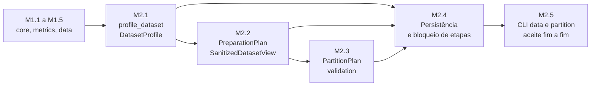

# M2 — Stage 1 Diagnostics, Preparation and Partitioning (m2-diagnostics-partitioning) Specification

**Approved**: 2026-11-06 - user: "As decisões D1–D11 foram avaliadas e estão aprovadas, com ressalvas específicas em D2 e D8."

## Problem Statement

O Marco M1 (M1.1 a M1.5) entregou ingestão imutável (`load_dataset`, `DatasetBundle`), métricas, hashing canônico e uma fundação saneada pela auditoria, mas a Etapa 1 permanece incompleta (não há diagnóstico estrutural, plano explícito de preparação nem visão saneada) e a Etapa 4A não existe (não há `PartitionPlan`). Sem esses artefatos, os Marcos M3 a M5 não dispõem de universo amostral validado nem de partições compartilhadas, reprodutíveis e livres de vazamento. O M2 fecha a Etapa 1 e entrega a Etapa 4A, decomposto em cinco sub-marcos de escopo controlável, preservando a arquitetura em camadas (`core` → `data` → `validation` → `cli`) e os contratos do M1.

## Goals

- [ ] Entregar `profile_dataset` e `DatasetProfile` com separação exata entre `CONFIRMED_ISSUE` e `HEURISTIC_WARNING` sobre um catálogo fechado de códigos (M2.1).
- [ ] Entregar `PreparationPlan`, `create_preparation_plan`, `sanitize_dataset` e `SanitizedDatasetView`, bloqueando o saneamento enquanto houver `CONFIRMED_ISSUE` sem regra explícita e sem aprender parâmetros dos dados (M2.2).
- [ ] Entregar `PartitionPlan`, `build_partition_plan` e `validate_partition_plan` para `K_FOLD`, `STRATIFIED_K_FOLD`, `GROUP_K_FOLD` e holdout nos três regimes de avaliação da Onda 1, determinísticos e matematicamente validados (M2.3).
- [ ] Persistir os artefatos da Etapa 1 e da Etapa 4A com escrita atômica, vínculo de hash e bloqueio de transição entre etapas (M2.4).
- [ ] Expor `expml data profile|sanitize` e `expml partition build|verify` sem lógica de negócio na CLI, com códigos de saída padronizados e cenário de aceite fim a fim (M2.5).

## Out of Scope

Explicitamente excluído para evitar ampliação indevida de escopo.

| Feature | Reason |
| --- | --- |
| Etapa 2 (`features`, `explore_features`, cenários) | Marco M3 |
| Etapas 3 e 4B (`models`, `tuning`, `orchestration`, `execute_single_cell`, `MatrixRunStore`) | Marcos M4 e M5 |
| Etapas 5 e 6 (`statistics`, `reporting`) | Marcos M6 e M7 |
| `MULTI_TARGET_REGRESSION`, `unlabeled_pool`, `BOOTSTRAP`, `TEMPORAL_SPLIT`, `STRATIFIED_GROUP_K_FOLD`, redução `PCA` | Onda 2 (SRS §4, ARQUITETURA §6); rejeitados com `ConfigurationError` explícito, como já ocorre no `DatasetSchemaSpec` |
| `TargetTransformSpec` e `fit_apply_target_transform` | Onda 2 conforme SRS §4 e guard vigente de `DatasetSchemaSpec`; o ajuste ocorre por fold na Etapa 4B (ver decisão D1) |
| Aplicação de imputação, codificação ou escalonamento aprendidos dos dados | ADR-002: transformações parametrizadas são intra-fold (Camadas 1 e 2, Marcos M4 e M5); o M2 apenas declara essas regras |
| Estratificação do holdout, repetição de CV, partições internas de `tuning` | Onda 1 prevê "Holdout Simples" (ARQUITETURA §6.1); partições internas pertencem ao M4 |
| Fatiamento de `SanitizedDatasetView` por partição | Necessidade do `execute_single_cell` (M5); reaproveitará a semântica de `slice_bundle_by_observation_ids` |
| Escrita Parquet de `splits` | Dependência opcional não testável sem novo pacote; ADR-006 admite o fallback `.csv.gz` (decisão D6) |
| Execução do pipeline a partir de `manifest.json`, `experiment_id`, diretório `run_<experiment_id>/` completo | Marcos M5 e M7; o M2 grava apenas o subconjunto `data/`, `configuration/preparation_plan.json` e `partitions/` |
| `AUD-F-003` (`DomainIdentifier`: `__slots__`, NFC, caracteres de controle) | Permanece `ADIADO`; o M2 trata `ObservationId` como cadeia exata, preservando a política de hashing da M1.5 |
| `AUD-F-014`, `AUD-F-015`, `AUD-F-016` | Permanecem `ADIADO` conforme `m1-5-foundation-hardening/RESULTS.md` |
| Regras de domínio aplicado (RNF02) | O framework permanece agnóstico |

---

## Assumptions & Open Questions

Todas as decisões D1–D12 foram confirmadas (`y`) na aprovação formal pelo usuário em 2026-11-06, integrando as ressalvas em D2 e D8 e o isolamento contratual do M2.3 (D13).

| Assumption / decision | Chosen default | Rationale | Confirmed? |
| --- | --- | --- | --- |
| D1 — `TargetTransformSpec` e `fit_apply_target_transform` (ARQUITETURA §2.3 e nota do RF1.7 os atribuem ao M2; SRS §4 e o guard do schema os colocam na Onda 2) | Excluídos do M2; o guard `target_transform_spec is not None` permanece; a divergência documental é corrigida na aprovação | O ajuste é por fold (Etapa 4B); declarar sem poder aplicar cria contrato morto; respeita "não antecipar Onda 2" | y |
| D2 — AUD-F-011: mapeamento de alvo binário textual (aprovado com ressalva) | `profile_dataset` emite `CONFIRMED_ISSUE` `E1_TARGET_BINARY_UNMAPPED` quando o alvo binário não é exatamente `{0, 1}`; o `PreparationPlan` exige a regra explícita `MAP_BINARY_TARGET(positive_label)`, sem inferência automática de classe positiva; a identificação da classe positiva deve ser explícita; `sanitize_dataset` codifica o alvo em `{0, 1}`, preserva essa informação e rastreabilidade nos metadados do artefato saneado (`target_label_mapping`), e não altera o módulo `metrics` | Evita inferência silenciosa; identificação explícita da classe positiva; rastreabilidade entre rótulos originais e codificação; `metrics` opera sobre `{0, 1}` sem alteração de contrato | y |
| D3 — Entrada da CLI | `expml data profile --data PATH --schema SCHEMA.json --output-dir DIR`; papéis declarados em arquivo JSON declarativo, sem flags por papel; demais subcomandos recebem `--experiment-dir` e recarregam fonte, schema e plano a partir dos artefatos | Papéis incluem mapeamentos (`column_semantic_types`, `ignore_cols`) inadequados a flags; alinha-se à declaração por arquivo da ARQUITETURA §2.4 | y |
| D4 — Autoria de regras na CLI | `expml data sanitize --experiment-dir DIR --rules RULES.json` valida as regras contra o perfil, cria o plano e, se `READY`, saneia; plano `INCOMPLETE` não é persistido como `preparation_plan.json`, lista os achados sem regra e encerra com código `2` | CA-E1-02 proíbe gravar `preparation_plan.json` com `status = "READY"` sem cobertura completa; arquivo de regras mantém a decisão do pesquisador explícita e versionável | y |
| D5 — Vocabulário de regras | Conjunto fechado: `DROP_ROWS`, `EXCLUDE_COLUMN`, `MAP_BINARY_TARGET` (estruturais, aplicadas no saneamento) e `DEFER_INTRA_FOLD`, `ACCEPT_AS_IS` (declaradas, não aplicadas); imputação restrita a `MEAN`, `MEDIAN`, `MODE` (ADR-002); a estratégia de codificação é identificador não vazio cujo vocabulário pertence ao M4 | Mantém o M2 sem antecipar o pré-processamento do M4; `ACCEPT_AS_IS` torna explícito que o pesquisador aceita o risco (modelos com tratamento nativo de ausentes ou categorias) | y |
| D6 — Armazenamento de `splits` | `partitions/splits.csv.gz` mais `partitions/splits.schema.json` (fallback de ADR-006), com compressão de conteúdo determinístico; sem escrita Parquet | Mantém `numpy` como única dependência; Parquet fica para extensão opcional posterior | y |
| D7 — Representação do regime `HOLDOUT_ONLY` | `folds = ()`; o plano expõe `development_ids` (conjunto de ajuste) e `holdout_ids` (conjunto de avaliação), disjuntos e cobrindo todas as observações da visão; `development_ids` é campo adicional também nos demais regimes (união de treino e validação de todos os folds) | A ARQUITETURA §3.4 lista `folds` e `holdout_ids`, mas não define o conjunto de ajuste quando não há CV; refinamento do contrato sem alterar campos existentes | y |
| D8 — Determinismo e rastreabilidade das partições (aprovado com ressalva) | Reprodutibilidade (mesma configuração, mesmos dados e mesmas condições declaradas produzem as mesmas partições) e Rastreabilidade (artefatos registram informações suficientes para identificar a configuração e o procedimento); não se exige compatibilidade eterna entre versões futuras do algoritmo; não assumir que `numpy.random.Generator` garante estabilidade entre versões do NumPy; estratégia concreta de implementação delegada ao Design | Garante determinismo e rastreabilidade sem fragilidade acoplada a geradores de terceiros, separando reprodutibilidade operacional de congelamento eterno de versão | y |
| D9 — Limiares heurísticos padrão (`ProfileConfig`, imutável e configurável) | `near_constant_top_frequency=0.99`; `identifier_unique_ratio=0.95` (apenas colunas `int64` e `object`); `scale_disparity_orders=3`; `imbalance_ratio=3.0`; `rare_class_proportion=0.05`; `small_group_size=5`; `max_categories_reported=50`; `max_listed_ids=100` | Alertas heurísticos nunca bloqueiam; limiares configuráveis evitam acoplar a política científica ao código; listas limitadas protegem memória e JSON em colunas de alta cardinalidade (RNF04) | y |
| D10 — Política de sobrescrita de artefatos | Funções de escrita e CLI recusam sobrescrever artefato existente (código `2`), exceto com `overwrite=True` / `--force` | Preserva rastreabilidade e imutabilidade dos artefatos de etapa | y |
| D11 — Artefato adicional `data/sanitized_view.json` e subconjunto de layout | Descritor da visão saneada (hash, contagens, `candidate_feature_cols`, `dropped_observation_ids`, `target_label_mapping`, `deferred_rules`, hash do plano) gravado em `data/`; a ARQUITETURA §5 é atualizada na aprovação | `partition build` precisa verificar o vínculo com a visão sem persistir os dados saneados; a visão é reconstruída de forma determinística a partir da fonte, do schema e do plano | y |
| D12 — Decomposição em cinco sub-marcos (M2.1 a M2.5) com ordem sequencial | Perfil, Plano e saneamento, Particionamento, Persistência e bloqueio de etapas, CLI e aceite fim a fim | Cada sub-marco cabe em um lote de execução (até 8 tarefas) e entrega um contrato verificável isolado; o particionamento depende apenas do tipo `SanitizedDatasetView` | y |
| D13 — Ressalva arquitetural M2.3: isolamento contratual de validation | O pacote `validation` pode receber `SanitizedDatasetView`, mas a dependência é exclusivamente contratual: `validation` não deve depender da lógica interna de sanitização, não deve importar implementações internas do processo de preparação, deve operar sobre identificadores e metadados expostos pelo contrato da visão saneada, produzindo partições rastreáveis e desacopladas de `data` | Preserva a direção estrita de dependências e a separação de responsabilidades; registrado formalmente no Design do M2.3 sem ampliar o escopo do M2.1 | y |
| Definições estatísticas | Desvio-padrão amostral (`ddof=1`), quartis por interpolação linear (padrão do NumPy), estatísticas sobre valores não ausentes, `None` quando não há observações suficientes; JSON nunca contém `NaN` | Convenções fixadas por NumPy e pela necessidade de JSON válido | y |
| Tipos semânticos categóricos | Apenas `ColumnSemanticType.CATEGORICAL`; a distinção nominal/ordinal citada na ARQUITETURA §3.1 não existe no enum e fica fora do M2 | `ColumnSemanticType` possui seis membros fechados desde o M1.4 | y |
| `time_col` no M2 | Perfilado apenas como tipo e ausência; não influencia partições (`TEMPORAL_SPLIT` é Onda 2) | SRS §4 e ARQUITETURA §6.1 | y |
| Classificação multiclasse | Sem exigência de mapeamento de rótulos; exigência de número de classes não se aplica | `accuracy`, `balanced_accuracy`, `roc_auc` e `log_loss` inferem classes (`AUD-F-011`) | y |

**Open questions:** none - as decisões D1–D11 foram avaliadas e aprovadas pelo usuário (com ressalvas em D2 e D8 e ressalva arquitetural em D13 integradas), e todas as premissas estão confirmadas.

---

## Dependencies on M1

| M1 contract consumed | Used by | Note |
| --- | --- | --- |
| `DatasetBundle` (`columns`, `descriptors`, `observation_ids`, `dataset_hash`, `schema`) e `DatasetSchemaSpec` (papéis, `task_type`, `column_semantic_types`) | M2.1, M2.2 | Somente leitura; a base original permanece inalterada |
| `ColumnDescriptor` (`physical_type`, `semantic_type`, `n_missing`, `memory_bytes`, `role`) | M2.1 | Reaproveitado, não recalculado |
| `core.dataset_hash(data, schema, *, observation_ids=...)` e a equivalência `bundle.dataset_hash == core.dataset_hash(bundle.columns, bundle.schema, observation_ids=bundle.observation_ids)` | M2.2, M2.3 | `SanitizedDatasetView` preserva a mesma equivalência |
| `core.config_hash`, `core.is_missing_scalar`, `core.is_nan_scalar` | M2.1 a M2.4 | Detecção de ausência centralizada; nenhuma verificação independente de `NaN` |
| `core.make_finding`, `core.make_warning`, `Finding`, `FindingSeverity` | M2.1 | Achados do perfil usam as construções existentes |
| `core.derive_seeds`, `core.spawn_child_seeds`, `ObservationId`, `PartitionPlanId`, hierarquia `ExperimentalMLError` | M2.3, M2.5 | Sem alteração de contrato |
| `data.slice_bundle_by_observation_ids`, `data.get_column_array` | M2.1 a M2.3 | Sem alteração |
| CLI `expml` (`--version`, `--help`, sem argumentos → código `0`) | M2.5 | Comportamento da M1.1 preservado |

Nenhuma alteração no `core` é planejada além de uma função de escrita atômica de JSON (M2.4); contratos e digests existentes permanecem inalterados.

---

## Findings and Rules Catalog

Catálogo fechado do M2. A chave de um achado é `(code, column)`, com `column = None` para achados de nível de dataset. Apenas colunas de papel `feature` geram achados de feature; colunas `ignored`, `time` e `observation_id` não geram.

| Code | Severity | Condition | Admissible rules |
| --- | --- | --- | --- |
| `E1_TARGET_MISSING` | `CONFIRMED_ISSUE` | Alvo com ao menos um valor ausente | `DROP_ROWS` |
| `E1_GROUP_MISSING` | `CONFIRMED_ISSUE` | `group_col` com ao menos um valor ausente | `DROP_ROWS` |
| `E1_FEATURE_MISSING` | `CONFIRMED_ISSUE` | Feature com ao menos um valor ausente | `DROP_ROWS`, `EXCLUDE_COLUMN`, `DEFER_INTRA_FOLD` (imputação), `ACCEPT_AS_IS` |
| `E1_CONSTANT_COLUMN` | `CONFIRMED_ISSUE` | Feature com no máximo um valor distinto não ausente | `EXCLUDE_COLUMN`, `ACCEPT_AS_IS` |
| `E1_CATEGORICAL_UNENCODED` | `CONFIRMED_ISSUE` | Feature de tipo físico `object` | `EXCLUDE_COLUMN`, `DEFER_INTRA_FOLD` (codificação), `ACCEPT_AS_IS` |
| `E1_TARGET_BINARY_UNMAPPED` | `CONFIRMED_ISSUE` | `BINARY_CLASSIFICATION` com exatamente duas classes não ausentes diferentes de `{0, 1}` | `MAP_BINARY_TARGET` |
| `E1_TARGET_CLASS_COUNT_INVALID` | `CONFIRMED_ISSUE` | `BINARY_CLASSIFICATION` com número de classes não ausentes diferente de 2 | nenhuma (irresolúvel) |
| `E1_TARGET_NOT_NUMERIC` | `CONFIRMED_ISSUE` | `REGRESSION` com alvo de tipo físico `object` ou `bool` | nenhuma (irresolúvel) |
| `W1_POSSIBLE_IDENTIFIER` | `HEURISTIC_WARNING` | Feature `int64` ou `object` com razão de valores distintos ≥ `identifier_unique_ratio` | não aplicável |
| `W1_NEAR_CONSTANT_COLUMN` | `HEURISTIC_WARNING` | Feature não constante cujo valor mais frequente ≥ `near_constant_top_frequency` | não aplicável |
| `W1_SCALE_DISPARITY` | `HEURISTIC_WARNING` | Razão entre as maiores e menores medianas absolutas não nulas das features numéricas ≥ 10^`scale_disparity_orders` | não aplicável |
| `W1_CLASS_IMBALANCE` | `HEURISTIC_WARNING` | Classificação com razão maioria/minoria ≥ `imbalance_ratio` | não aplicável |
| `W1_RARE_CLASS` | `HEURISTIC_WARNING` | Classe com proporção < `rare_class_proportion` | não aplicável |
| `W1_SMALL_GROUPS` | `HEURISTIC_WARNING` | Grupo com menos de `small_group_size` observações | não aplicável |
| `W1_DUPLICATE_ROWS` | `HEURISTIC_WARNING` | Linhas idênticas em todas as colunas exceto a de identificador de observação | não aplicável |

---

## User Stories

### P1: M2.1 — Diagnóstico estrutural do dataset (`profile_dataset`) ⭐ MVP

**User Story**: Como pesquisador, quero um diagnóstico imutável e determinístico da base, que separe problemas confirmados de alertas heurísticos, para decidir explicitamente o tratamento antes de qualquer experimento.

**Why P1**: Origina todos os achados que condicionam o saneamento e a validade das partições; atende RF1.2 a RF1.6 e `CA-E1-01`.

**Acceptance Criteria**:

1. WHEN `profile_dataset(bundle, config=None)` is called THEN the system SHALL return an immutable `DatasetProfile` containing `source_dataset_hash` equal to `bundle.dataset_hash`, `n_rows`, `n_cols`, `memory_bytes` and, for every column, a `ColumnProfile` with physical type, semantic type, `n_missing` and missing proportion (PROF-01).
2. WHEN a numeric column has at least one non-missing value THEN the system SHALL report mean, median, sample standard deviation (`ddof=1`), minimum, maximum, Q1, Q2, Q3, range and IQR computed over non-missing values, and SHALL report `None` for each statistic that is undefined (PROF-02).
3. WHEN a column has semantic type `CATEGORICAL` or `BOOLEAN`, or physical type `object` THEN the system SHALL report its cardinality and its absolute and relative category frequencies ordered by descending frequency and then ascending UTF-8 value, limited to `max_categories_reported` categories plus the remainder count (PROF-03).
4. WHEN the dataset contains rows identical in every column except the observation-identifier role column THEN the system SHALL report `n_duplicate_rows` and up to `max_listed_ids` duplicate `ObservationId` values in order of occurrence excluding the first occurrence, with a truncation flag (PROF-04).
5. WHEN the target is numeric under `REGRESSION` THEN the system SHALL report its distribution statistics, skewness and the count of values outside the 1.5·IQR fences, and WHEN the task is classification THEN the system SHALL report absolute and relative class frequencies and the majority-to-minority ratio (PROF-05).
6. WHERE `schema.group_col` is declared the system SHALL report the number of groups and the minimum, median and maximum number of observations per group (PROF-06).
7. The system SHALL emit exactly one finding for each catalog `(code, column)` key whose condition holds and no other finding, each built with `make_finding` or `make_warning`, carrying `column` in `context`, ordered by severity, code and column, with severity identical to the catalog (PROF-07).
8. IF a heuristic condition holds THEN the system SHALL emit only a `HEURISTIC_WARNING` and SHALL NOT emit a `CONFIRMED_ISSUE` for that condition (PROF-08).
9. WHEN the task is `BINARY_CLASSIFICATION` and the non-missing target classes are exactly two and differ from `{0, 1}` THEN the system SHALL emit `E1_TARGET_BINARY_UNMAPPED` listing the observed classes, and IF the number of non-missing classes differs from two THEN the system SHALL emit `E1_TARGET_CLASS_COUNT_INVALID` (PROF-09).
10. WHILE `profile_dataset` runs the system SHALL leave `bundle.dataset_hash` and every column buffer unchanged, and two calls with the same bundle and configuration SHALL return equal profiles (PROF-10).
11. IF `config` contains a threshold outside its valid range THEN the system SHALL raise `ConfigurationError` before computing any statistic (PROF-11).
12. WHEN a column has no non-missing value THEN the system SHALL report every statistic as `None`, SHALL emit `E1_CONSTANT_COLUMN` and `E1_FEATURE_MISSING` for feature columns, and SHALL NOT raise (PROF-12).

**Independent Test**: Executar `profile_dataset` sobre fixtures sintéticas pequenas e verificar cada código do catálogo, a separação de severidades e a ausência de alteração do `DatasetBundle`.

---

### P1: M2.2 — Plano de preparação e visão saneada ⭐ MVP

**User Story**: Como pesquisador, quero declarar regras explícitas para cada problema confirmado e obter uma visão saneada imutável, para fixar o universo amostral antes do particionamento sem ajustar estatísticas globais.

**Why P1**: Implementa `CA-E1-02` e ADR-002; define o universo `observation_ids` consumido pelo particionamento.

**Acceptance Criteria**:

1. WHEN `create_preparation_plan(profile, rules)` receives exactly one admissible rule for every `CONFIRMED_ISSUE` key in `profile.findings` THEN the system SHALL return an immutable `PreparationPlan` with `status = "READY"`, bound to `profile.source_dataset_hash` and to the profile digest, with rules in canonical order (PREP-01).
2. WHEN at least one `CONFIRMED_ISSUE` key has no rule, or the profile holds a `CONFIRMED_ISSUE` with no admissible rule THEN the system SHALL return `status = "INCOMPLETE"` with `unresolved_findings` listing every uncovered `(code, column)` (PREP-02).
3. IF a rule targets a key that is not a `CONFIRMED_ISSUE` of the profile, duplicates another rule for the same key, uses a rule kind not admissible for its code, or carries invalid parameters THEN the system SHALL raise `ConfigurationError` (PREP-03).
4. WHEN `sanitize_dataset(bundle, profile, plan)` receives a `READY` plan whose bindings match the bundle and the profile THEN the system SHALL apply only `DROP_ROWS`, `EXCLUDE_COLUMN` and `MAP_BINARY_TARGET` and SHALL return an immutable `SanitizedDatasetView` (PREP-04).
5. IF `plan.status` is not `READY` THEN the system SHALL raise `ContractViolationError` and SHALL NOT build a view, and IF the plan, profile and bundle bindings diverge THEN the system SHALL raise `DataIntegrityError` (PREP-05).
6. The `SanitizedDatasetView` SHALL expose `observation_ids` as a tuple of `ObservationId` preserving the original relative order, `candidate_feature_cols`, `dropped_observation_ids`, `target_label_mapping`, `deferred_rules`, the source dataset hash, the plan digest and a `dataset_hash` equal to `core.dataset_hash(view.columns, view.schema, observation_ids=view.observation_ids)` (PREP-06).
7. WHILE a column is covered only by `DEFER_INTRA_FOLD` or `ACCEPT_AS_IS` the system SHALL keep its values, including missing values, bit-identical to the source bundle (PREP-07).
8. WHEN `MAP_BINARY_TARGET(positive_label)` is applied THEN the system SHALL encode the target as `int64` with `positive_label` mapped to 1 and the other class mapped to 0, and SHALL record the mapping in `target_label_mapping` (PREP-08).
9. IF sanitization leaves zero observations or zero candidate feature columns THEN the system SHALL raise `DataIntegrityError` (PREP-09).
10. WHEN `sanitize_dataset` returns THEN the source `DatasetBundle` SHALL keep its `dataset_hash` and column buffers unchanged, and identical bundle, profile and plan SHALL yield an identical view `dataset_hash` and plan digest (PREP-10).

**Independent Test**: Criar plano completo e incompleto sobre fixtures, verificar o bloqueio do saneamento, os valores preservados nas colunas deferidas e a equivalência de `dataset_hash` da visão.

---

### P1: M2.3 — Plano de particionamento auditado (`validation`) ⭐ MVP

**User Story**: Como pesquisador, quero um `PartitionPlan` imutável, determinístico e validado matematicamente, compartilhado por todas as configurações comparadas, para eliminar vazamento entre treino, validação, holdout e grupos.

**Why P1**: Implementa `CA-E4A-01`, `CA-E4A-02`, `CA-COND-PART-01` e `TA-M2.2`/`TA-M2.3`; é pré-requisito do M5.

**Acceptance Criteria**:

1. WHEN `build_partition_plan(view, config, master_seed)` is called with a valid `ValidationConfig` THEN the system SHALL return an immutable `PartitionPlan` with `partition_plan_id`, `evaluation_regime`, `cv_strategy`, `n_splits`, `master_seed`, the view source `dataset_hash`, `development_ids`, `folds` of `FoldSpec(fold_id, train_ids, val_ids)` and `holdout_ids`, after `validate_partition_plan` has accepted it (PART-01).
2. WHEN the strategy is `K_FOLD`, `STRATIFIED_K_FOLD` or `GROUP_K_FOLD` THEN the system SHALL make the `val_ids` of all folds a disjoint cover of `development_ids` and SHALL set each `train_ids` equal to `development_ids` minus its `val_ids` (PART-02).
3. WHEN the strategy is `K_FOLD` THEN the system SHALL produce fold validation sizes differing by at most one observation (PART-03).
4. WHEN the strategy is `STRATIFIED_K_FOLD` THEN the system SHALL distribute each class so that its counts across folds differ by at most one, and IF the task is not classification or the smallest development class has fewer observations than `n_splits` THEN the system SHALL raise `ConfigurationError` (PART-04).
5. WHEN the strategy is `GROUP_K_FOLD` THEN the system SHALL place every group entirely in a single validation fold, SHALL keep the difference between the largest and smallest fold below or equal to the size of the largest group, and IF the number of development groups is below `n_splits` or `group_col` is not declared THEN the system SHALL raise `ConfigurationError` (PART-05).
6. WHEN the regime includes a holdout THEN the system SHALL isolate `holdout_ids` disjoint from `development_ids`, with exactly `ceil(holdout_fraction · n)` observations when `group_col` is not declared and with whole groups totalling at least that number when it is declared, where `n` is the number of view observations, and the union of `development_ids` and `holdout_ids` SHALL equal all view `observation_ids` (PART-06).
7. WHEN the regime is `HOLDOUT_ONLY` THEN the system SHALL return `folds = ()` with `development_ids` and `holdout_ids` disjoint, and WHEN the regime is `CROSS_VALIDATION_ONLY` THEN the system SHALL return `holdout_ids = ()` (PART-07).
8. WHEN `build_partition_plan` is called twice with the same view `dataset_hash`, ordered `observation_ids`, configuration and `master_seed`, including in processes with different `PYTHONHASHSEED`, THEN the system SHALL return identical partitions and the same `partition_plan_id` (PART-08).
9. The `partition_plan_id` SHALL be a 64-hexadecimal digest of the view `dataset_hash`, the configuration, the `master_seed` and the ordered identifier lists, without volatile fields, and SHALL change when any of those inputs changes (PART-09).
10. WHERE only feature values of the view change and identifiers, group labels and target labels stay the same the system SHALL produce identical `folds` and `holdout_ids`, differing only in `partition_plan_id` through the view `dataset_hash` (PART-10).
11. IF `validate_partition_plan(plan, view)` finds a train and validation intersection, a development and holdout intersection, an identifier absent from the view, a group present on both sides of a split, an incomplete cover or a `partition_plan_id` that does not match its content THEN the system SHALL raise `DataIntegrityError` naming the violated invariant (PART-11).
12. IF the configuration requests `BOOTSTRAP`, `TEMPORAL_SPLIT` or `STRATIFIED_GROUP_K_FOLD`, an inconsistent combination of regime, strategy, `n_splits` and `holdout_fraction`, `n_splits` below 2, `n_splits` above the development size, or a `holdout_fraction` outside (0, 1) THEN the system SHALL raise `ConfigurationError` (PART-12).

**Independent Test**: Gerar planos para os três regimes sobre fixtures com e sem grupos, validar as invariantes de interseção nula, comparar execuções repetidas e adulterar um plano para exigir a rejeição do validador.

---

### P2: M2.4 — Persistência de artefatos e bloqueio entre etapas

**User Story**: Como pesquisador, quero artefatos de etapa gravados de forma atômica, auditáveis e verificáveis por hash, para que uma etapa só avance sobre entradas íntegras e consistentes.

**Why P2**: Habilita a CLI e o bloqueio de transição (`CA-GER-01`); depende dos contratos de M2.1 a M2.3.

**Acceptance Criteria**:

1. WHEN `write_json_atomic(path, obj)` is called THEN the system SHALL write a canonical JSON document to a temporary file in the same directory and replace the final name only after the write succeeds, and IF the write fails THEN the system SHALL remove the temporary file and leave the final path absent or with its previous content (STORE-01).
2. The system SHALL provide lossless `to_dict` and `from_dict` conversions for `DatasetProfile`, `PreparationPlan`, `PartitionPlan` and the dataset and sanitized-view descriptors such that the round trip returns an equal object, the JSON bytes are deterministic for equal objects and the JSON contains no `NaN` or `Infinity` (STORE-02).
3. WHEN artifacts are persisted into an experiment directory THEN the system SHALL write `data/dataset_descriptor.json`, `data/dataset_profile.json`, `configuration/preparation_plan.json`, `data/sanitized_view.json`, `partitions/partition_plan.json`, `partitions/splits.csv.gz` and `partitions/splits.schema.json` (STORE-03).
4. WHEN `splits.csv.gz` is written THEN the system SHALL map every `observation_id` to its role per fold and to the holdout, with decompressed content identical across repeated writes of the same plan (STORE-04).
5. IF the source dataset hashes of the plan, the descriptor and the profile diverge, or the `dataset_hash` of the rebuilt view diverges from `partition_plan.json` or `sanitized_view.json`, THEN the system SHALL raise `DataIntegrityError`, and IF `preparation_plan.json` is missing or not `READY` THEN the system SHALL raise `ContractViolationError`, in both cases before producing the next artifact (STORE-05).
6. IF `splits.csv.gz` and `partition_plan.json` describe different partitions, or an artifact was altered after writing THEN the system SHALL detect the divergence and raise `DataIntegrityError` (STORE-06).
7. IF the target artifact already exists THEN the system SHALL refuse to overwrite it and raise `ConfigurationError`, unless `overwrite=True` is passed (STORE-07).

**Independent Test**: Interromper a escrita por exceção injetada, adulterar cada artefato e verificar a detecção, além de round trip e reprodutibilidade de bytes.

---

### P2: M2.5 — CLI `data` e `partition` e aceite fim a fim

**User Story**: Como pesquisador, quero executar a Etapa 1 e a Etapa 4A pelo terminal, passo a passo, com mensagens instrutivas e códigos de saída padronizados, para inspecionar os artefatos entre as etapas.

**Why P2**: Fecha o M2 conforme ARQUITETURA §2.4 e §7; depende de M2.1 a M2.4.

**Acceptance Criteria**:

1. WHEN `expml data profile --data PATH --schema SCHEMA.json --output-dir DIR` is run on a valid dataset THEN the system SHALL write `data/dataset_descriptor.json` and `data/dataset_profile.json`, print the dimensions and the findings with code, column and message, and exit with code 0 (CLI-01).
2. WHEN `expml data sanitize --experiment-dir DIR --rules RULES.json` is run and the plan is `READY` THEN the system SHALL write `configuration/preparation_plan.json` and `data/sanitized_view.json` and exit with code 0 (CLI-02).
3. IF the plan is `INCOMPLETE` THEN the system SHALL NOT write `configuration/preparation_plan.json`, SHALL print each unresolved `CONFIRMED_ISSUE` with its code and column, and SHALL exit with code 2 (CLI-03).
4. WHEN `expml partition build --experiment-dir DIR --config CONFIG.json --seed N` is run on a sanitized experiment THEN the system SHALL write `partitions/partition_plan.json`, `partitions/splits.csv.gz` and `partitions/splits.schema.json`, print the regime, strategy and per-fold sizes, and exit with code 0 (CLI-04).
5. WHEN `expml partition verify --experiment-dir DIR` is run THEN the system SHALL rebuild the view, validate the plan and the hash links, exit with code 0 when all invariants hold and exit with code 2 with a natural-language message otherwise (CLI-05).
6. IF an `ExperimentalMLError`, an invalid argument, an unmet stage precondition or a hash divergence occurs THEN the system SHALL print an instructive message without a traceback and exit with code 2, and IF an unexpected failure occurs THEN the system SHALL exit with code 1 (CLI-06).
7. WHILE a required upstream artifact is missing, not `READY` or inconsistent the system SHALL refuse `partition build` and `partition verify`, exit with code 2 and write no partition artifact (CLI-07).
8. IF an output artifact already exists and `--force` is absent THEN the system SHALL exit with code 2 without modifying it (CLI-08).
9. The system SHALL preserve the M1.1 behavior of `expml` (`--version`, `--help`, no arguments exits with code 0, invalid option exits with code 2) and SHALL expose `--help` for every new subcommand (CLI-09).
10. The CLI command modules SHALL contain no numerical or business logic, importing neither `numpy` nor `hashlib` and calling only public functions of `data`, `validation` and `core` (CLI-10).
11. The system SHALL never print a hash digest in the standard output or standard error of any subcommand (CLI-11).
12. WHEN the end-to-end sequence profile, sanitize, partition build and partition verify is run through the installed `expml` entry point on the synthetic acceptance fixture in two separate directories THEN the system SHALL exit with code 0 at every step and produce identical `partition_plan.json` bytes and identical decompressed `splits.csv.gz` content (CLI-12).

**Independent Test**: Executar a sequência completa por subprocesso sobre a fixture de aceite, adulterar cada artefato e conferir os códigos de saída.

---

### P1: Invariantes transversais do M2 ⭐ MVP

**User Story**: Como mantenedor, quero invariantes arquiteturais verificáveis por teste, para impedir acoplamento, dependências novas e regressão na fundação.

**Why P1**: Responde a `AUD-F-013` e às regras de camada da ARQUITETURA §2.3; aplica-se a todos os sub-marcos.

**Acceptance Criteria**:

1. The system SHALL keep the import direction `core` ← `data` ← `validation` ← `cli`, SHALL keep ingestion independent of profiling and preparation, profiling independent of preparation, and `validation` dependent on `data` only through its public data types and not on profiling or preparation functions, verified by an import-graph test (XCUT-01).
2. The system SHALL keep `numpy>=1.24.0` as the only runtime dependency in `pyproject.toml`, using only the standard library for JSON, gzip and argument parsing (XCUT-02).
3. The system SHALL expose every new result type as an immutable frozen `slots` dataclass using tuples and `MappingProxyType`, and SHALL implement behavior as functions without service classes (ADR-008) (XCUT-03).
4. WHEN a sub-milestone is concluded THEN the system SHALL include its `SPEC.md`, `ACCEPTANCE.md` and `RESULTS.md` (AD-002), a boundary integration test under `tests/integration/`, the documentation updates for README, architecture, requirements, engineering stage and `.specs/STATE.md`, and the exported-symbol counts verified by test (XCUT-04).
5. WHEN any M2 change is merged THEN the system SHALL keep every previously passing test of `tests/` passing and SHALL keep the digests produced by `config_hash` and `dataset_hash` unchanged for inputs not touched by M2 (XCUT-05).
6. The system SHALL profile a 100,000-row by 20-column numeric dataset in at most 30 seconds and build a `K_FOLD` plan for 100,000 observations in at most 10 seconds in the development environment (XCUT-06).

**Independent Test**: Executar os testes de grafo de imports, de dependências e de regressão e registrar a medição de desempenho.

---

## Edge Cases

- IF `n_splits` is greater than the number of development observations THEN the system SHALL raise `ConfigurationError` (PART-12).
- IF all observations belong to a single group and `GROUP_K_FOLD` is requested THEN the system SHALL raise `ConfigurationError` (PART-05).
- IF a classification dataset has a class with fewer observations than `n_splits` under `STRATIFIED_K_FOLD` THEN the system SHALL raise `ConfigurationError` (PART-04).
- WHEN the profile reports duplicate rows THEN the system SHALL only warn through `W1_DUPLICATE_ROWS`, since partitioning does not deduplicate and duplicate rows may cross splits (PROF-04).
- IF the source file is moved or changed between `data profile` and `partition build` THEN the system SHALL detect the hash divergence and exit with code 2 (CLI-07).
- WHEN `sanitize_dataset` drops observations THEN the system SHALL keep the surviving `ObservationId` values unchanged and in original order (PREP-06).

---

## Implicit-Requirement Dimensions Sweep

| Dimension | Resolution for `m2-diagnostics-partitioning` |
| --- | --- |
| Input validation & bounds | Coberto por PROF-11, PREP-03, PART-12 e CLI-06 (limiares, regras, configuração de validação e argumentos) |
| Failure / partial-failure states | Coberto por STORE-01 (escrita atômica) e CLI-03 e CLI-07 (nenhum artefato parcial ou READY indevido); falhas de sistema de arquivos encerram com código 1 sem artefato final |
| Idempotency / retry / duplicate handling | Coberto por PROF-10, PREP-10, PART-08 e CLI-12 (mesmas entradas, mesmas saídas) e por STORE-07 e CLI-08 (não sobrescrita) |
| Auth boundaries & rate limits | N/A because o framework é local, offline e de processo único (RNF03) |
| Concurrency / ordering | Ordenação determinística de achados, categorias e listas (PROF-03, PROF-07, PREP-01); concorrência entre processos N/A because escrita usa arquivo temporário por `pid` e substituição atômica (STORE-01) |
| Data lifecycle / expiry | Artefatos de etapa são imutáveis após a gravação (STORE-07); expiração N/A because não há persistência com TTL |
| Observability | Achados do perfil, resumos da CLI e mensagens instrutivas (CLI-01, CLI-04, CLI-06); hashes ocultos na saída (CLI-11); framework de logging N/A because fora do escopo do M2 |
| External-dependency failure | Sistema de arquivos: STORE-01 e CLI-06; rede e serviços externos N/A because RNF03 |
| State-transition integrity | `PreparationPlan` `INCOMPLETE` → `READY` e bloqueio de etapa por artefatos (PREP-02, PREP-05, STORE-05, CLI-07) |

---

## Milestone Decomposition

| Milestone | Feature slug | Deliverables | Depends on | Requirements | Objective completion criteria |
| --- | --- | --- | --- | --- | --- |
| M2.1 | `m2-1-dataset-profiling` | `ProfileConfig`, `ColumnProfile`, `DatasetProfile`, `profile_dataset`, catálogo de achados | M1 | PROF-01 a PROF-12 | Checks PROF-* verdes em `check_proofs.py`; testes de fronteira `data` + `core`; verificação independente `PASS`; documentação atualizada |
| M2.2 | `m2-2-preparation-sanitization` | `PreparationRule`, `PreparationPlan`, `create_preparation_plan`, `SanitizedDatasetView`, `sanitize_dataset` | M2.1 | PREP-01 a PREP-10 | Checks PREP-* verdes; equivalência de `dataset_hash` da visão; valores deferidos bit-idênticos; verificação independente `PASS` |
| M2.3 | `m2-3-partition-plan` | pacote `validation`: `ValidationConfig`, `FoldSpec`, `PartitionPlan`, `build_partition_plan`, `validate_partition_plan` | M2.2 (apenas o tipo `SanitizedDatasetView`) | PART-01 a PART-12 | Checks PART-* verdes; invariantes de interseção nula; determinismo entre processos; verificação independente `PASS` |
| M2.4 | `m2-4-artifacts-stage-gates` | `write_json_atomic` (`core`), codecs, layout de artefatos, `splits.csv.gz`, verificação de vínculos | M2.1, M2.2, M2.3 | STORE-01 a STORE-07 | Checks STORE-* verdes; injeção de falha na escrita; detecção de adulteração; verificação independente `PASS` |
| M2.5 | `m2-5-cli-end-to-end` | `cmd_data`, `cmd_partition`, códigos de saída, cenário de aceite fim a fim | M2.4 | CLI-01 a CLI-12 | Checks CLI-* verdes; sequência completa por subprocesso; homologação manual registrada como `PENDENTE` até decisão do usuário |
| Transversal | cada sub-marco | Invariantes de camada, dependências, regressão, documentação e desempenho | M1 | XCUT-01 a XCUT-06 | Testes de grafo de imports, de dependência e de regressão verdes em cada sub-marco |

**Ordem recomendada:** M2.1 → M2.2 → M2.3 → M2.4 → M2.5, uma branch e um PR por sub-marco, com o fluxo `Specify → Design → Tasks → Execute → Verify` por sub-marco. O M2.3 depende apenas do tipo `SanitizedDatasetView` e pode iniciar após o congelamento desse contrato no M2.2. A aprovação desta especificação fixa o escopo e os identificadores de requisito; cada sub-marco deriva sua própria `spec.md` sem reabrir decisões já aprovadas. O M2 só é concluído após M2.5 e a decisão de homologação do usuário.

### Architecture acceptance tests mapped to milestones

| Architecture test | Covered by |
| --- | --- |
| `TA-M2.1` (`CA-E1-01` e `CA-E1-02`: diagnóstico, separação de achados, bloqueio do saneamento) | PROF-07 a PROF-10, PREP-01 a PREP-05, CLI-03 |
| `TA-M2.2` (`CA-E4A-01` e `CA-COND-PART-01`: disjunção de treino, validação, holdout e grupos) | PART-02, PART-05, PART-06, PART-11 |
| `TA-M2.3` (`CA-E4A-02`: reprodutibilidade do `PartitionPlan`) | PART-08, PART-09, CLI-12 |

### Documentation reconciliation required on approval

| Document | Item to reconcile | Decision |
| --- | --- | --- |
| `ARQUITETURA_E_CONTRATOS.md` §2.3 item 3 e `ESPECIFICACAO_REQUISITOS.md` RF1.7 | Atribuição de `fit_apply_target_transform` e de "transformações de alvo" ao M2 | D1 |
| `ARQUITETURA_E_CONTRATOS.md` §3.4 | Campo `development_ids` do `PartitionPlan` | D7 |
| `ARQUITETURA_E_CONTRATOS.md` §5 | `data/sanitized_view.json`, `partitions/splits.csv.gz` e `splits.schema.json` | D6, D11 |
| `ARQUITETURA_E_CONTRATOS.md` §3.1 | "categórica nominal/ordinal" versus enum `ColumnSemanticType` com `CATEGORICAL` único | Registrado em Assumptions |

---

## Requirement Traceability

| Requirement ID | Story | Phase | Status |
| --- | --- | --- | --- |
| PROF-01 | P1: M2.1 Diagnóstico estrutural (resumo estrutural e por coluna) | - | Pending |
| PROF-02 | P1: M2.1 Diagnóstico estrutural (estatísticas numéricas) | - | Pending |
| PROF-03 | P1: M2.1 Diagnóstico estrutural (estatísticas categóricas) | - | Pending |
| PROF-04 | P1: M2.1 Diagnóstico estrutural (linhas duplicadas) | - | Pending |
| PROF-05 | P1: M2.1 Diagnóstico estrutural (perfil do alvo) | - | Pending |
| PROF-06 | P1: M2.1 Diagnóstico estrutural (perfil de grupos) | - | Pending |
| PROF-07 | P1: M2.1 Diagnóstico estrutural (catálogo e ordenação de achados) | - | Pending |
| PROF-08 | P1: M2.1 Diagnóstico estrutural (separação de severidades) | - | Pending |
| PROF-09 | P1: M2.1 Diagnóstico estrutural (alvo binário, `AUD-F-011`) | - | Pending |
| PROF-10 | P1: M2.1 Diagnóstico estrutural (pureza e determinismo) | - | Pending |
| PROF-11 | P1: M2.1 Diagnóstico estrutural (validação de limiares) | - | Pending |
| PROF-12 | P1: M2.1 Diagnóstico estrutural (coluna totalmente ausente) | - | Pending |
| PREP-01 | P1: M2.2 Plano e saneamento (plano `READY`) | - | Pending |
| PREP-02 | P1: M2.2 Plano e saneamento (plano `INCOMPLETE`) | - | Pending |
| PREP-03 | P1: M2.2 Plano e saneamento (validação de regras) | - | Pending |
| PREP-04 | P1: M2.2 Plano e saneamento (regras estruturais aplicadas) | - | Pending |
| PREP-05 | P1: M2.2 Plano e saneamento (bloqueio e vínculos de hash) | - | Pending |
| PREP-06 | P1: M2.2 Plano e saneamento (contrato da visão) | - | Pending |
| PREP-07 | P1: M2.2 Plano e saneamento (valores deferidos preservados) | - | Pending |
| PREP-08 | P1: M2.2 Plano e saneamento (mapeamento do alvo binário) | - | Pending |
| PREP-09 | P1: M2.2 Plano e saneamento (visão vazia) | - | Pending |
| PREP-10 | P1: M2.2 Plano e saneamento (imutabilidade da fonte e determinismo) | - | Pending |
| PART-01 | P1: M2.3 Particionamento (contrato do plano) | - | Pending |
| PART-02 | P1: M2.3 Particionamento (cobertura e disjunção) | - | Pending |
| PART-03 | P1: M2.3 Particionamento (balanceamento `K_FOLD`) | - | Pending |
| PART-04 | P1: M2.3 Particionamento (estratificação) | - | Pending |
| PART-05 | P1: M2.3 Particionamento (grupos) | - | Pending |
| PART-06 | P1: M2.3 Particionamento (holdout) | - | Pending |
| PART-07 | P1: M2.3 Particionamento (regimes) | - | Pending |
| PART-08 | P1: M2.3 Particionamento (determinismo entre processos) | - | Pending |
| PART-09 | P1: M2.3 Particionamento (identificador do plano) | - | Pending |
| PART-10 | P1: M2.3 Particionamento (independência de valores de features) | - | Pending |
| PART-11 | P1: M2.3 Particionamento (validador) | - | Pending |
| PART-12 | P1: M2.3 Particionamento (configuração e Onda 2) | - | Pending |
| STORE-01 | P2: M2.4 Persistência (escrita atômica) | - | Pending |
| STORE-02 | P2: M2.4 Persistência (codecs sem perda) | - | Pending |
| STORE-03 | P2: M2.4 Persistência (layout de artefatos) | - | Pending |
| STORE-04 | P2: M2.4 Persistência (`splits.csv.gz`) | - | Pending |
| STORE-05 | P2: M2.4 Persistência (vínculos de hash e bloqueio) | - | Pending |
| STORE-06 | P2: M2.4 Persistência (detecção de adulteração) | - | Pending |
| STORE-07 | P2: M2.4 Persistência (não sobrescrita) | - | Pending |
| CLI-01 | P2: M2.5 CLI (`data profile`) | - | Pending |
| CLI-02 | P2: M2.5 CLI (`data sanitize` com plano `READY`) | - | Pending |
| CLI-03 | P2: M2.5 CLI (`data sanitize` com plano `INCOMPLETE`) | - | Pending |
| CLI-04 | P2: M2.5 CLI (`partition build`) | - | Pending |
| CLI-05 | P2: M2.5 CLI (`partition verify`) | - | Pending |
| CLI-06 | P2: M2.5 CLI (códigos de saída e mensagens) | - | Pending |
| CLI-07 | P2: M2.5 CLI (bloqueio por artefatos) | - | Pending |
| CLI-08 | P2: M2.5 CLI (não sobrescrita) | - | Pending |
| CLI-09 | P2: M2.5 CLI (compatibilidade com a M1.1) | - | Pending |
| CLI-10 | P2: M2.5 CLI (sem lógica de negócio) | - | Pending |
| CLI-11 | P2: M2.5 CLI (hashes ocultos) | - | Pending |
| CLI-12 | P2: M2.5 CLI (aceite fim a fim) | - | Pending |
| XCUT-01 | P1: Invariantes transversais (grafo de imports) | - | Pending |
| XCUT-02 | P1: Invariantes transversais (dependências) | - | Pending |
| XCUT-03 | P1: Invariantes transversais (imutabilidade e ADR-008) | - | Pending |
| XCUT-04 | P1: Invariantes transversais (registros e documentação por sub-marco) | - | Pending |
| XCUT-05 | P1: Invariantes transversais (regressão) | - | Pending |
| XCUT-06 | P1: Invariantes transversais (desempenho) | - | Pending |

**Coverage:** 59 total, 0 mapped to tasks, 59 unmapped (tarefas são geradas por sub-marco nas fases Design e Tasks)

---

## Sources

- `engenharia_software/ARQUITETURA_E_CONTRATOS.md` - §2.3 (dependências de módulos), §2.4 (CLI), ADR-002, ADR-006, ADR-007, ADR-008, §3.1 (Etapa 1), §3.4 (Etapa 4A), §5 (artefatos), §7 (`TA-M2.1` a `TA-M2.3`)
- `engenharia_software/ESPECIFICACAO_REQUISITOS.md` - RF1.1 a RF1.7, RF4.1, RF4.2, RNF01 a RNF07, `CA-GER-01`, `CA-GER-02`, `CA-E1-01`, `CA-E1-02`, `CA-E4A-01`, `CA-E4A-02`, `CA-COND-PART-01`, §4 (Ondas 1 e 2)
- `engenharia_software/ETAPA_ATUAL_ENGENHARIA.md` - estado após a M1.5 e roadmap do M2
- `.specs/STATE.md` - `AD-001` e `AD-002`
- `.specs/features/m1-integrity-review/reports/06-achados.md` - `AUD-F-011` (política de alvo binário, encaminhada ao Specify do M2)
- `.specs/features/m1-5-foundation-hardening/RESULTS.md` - estado dos 16 achados e parecer `APTO` para o M2

---

## Success Criteria

- [ ] Os 59 requisitos (`PROF`, `PREP`, `PART`, `STORE`, `CLI`, `XCUT`) possuem decisão de design, tarefa, check com prova e evidência de execução ao final de seus respectivos sub-marcos.
- [ ] Nenhum `CONFIRMED_ISSUE` não tratado atravessa `sanitize_dataset`, e nenhuma interseção entre treino, validação, holdout ou grupos atravessa `build_partition_plan` (`TA-M2.1` a `TA-M2.3`).
- [ ] A sequência `profile → sanitize → partition build → partition verify` executa pelo `expml` instalado sobre a fixture de aceite e reproduz artefatos idênticos em diretórios distintos.
- [ ] A suíte completa permanece verde a cada sub-marco, sem nova dependência de execução além de `numpy`.
- [ ] Cada sub-marco é verificado de forma independente (`author != verifier`) com `verification.md` de veredito `PASS`, e a homologação manual de cada sub-marco permanece `PENDENTE` até decisão explícita do usuário.
