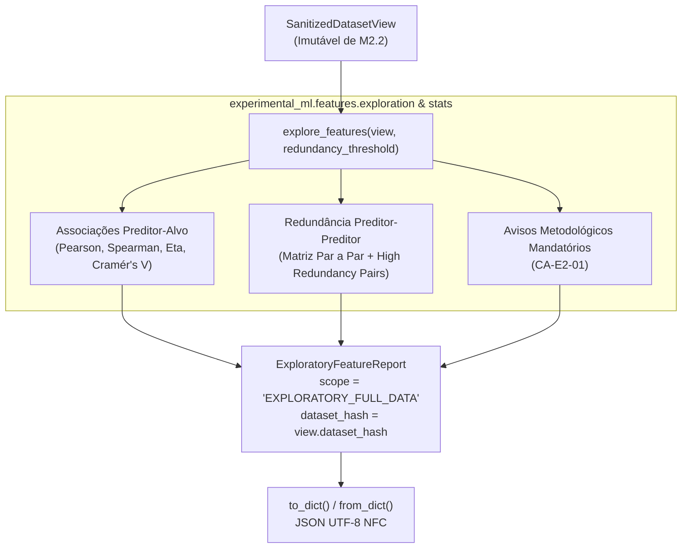

# M3.1 — Relatório Exploratório de Relações de Features Design

**Spec**: `.specs/features/m3-1-exploratory-features/spec.md`  
**Status**: Approved

---

## Architecture Overview

O Sub-marco M3.1 implementa o primeiro módulo da Etapa 2 (`experimental_ml.features`), responsável pela análise exploratória univariada e bivariada dos dados saneados (`SanitizedDatasetView`), antes da definição formal de cenários e sem incorrer em vazamento de dados (*data leakage*).



---

## Code Reuse Analysis

### Existing Components to Leverage

| Component | Location | How to Use |
| :--- | :--- | :--- |
| `SanitizedDatasetView` | `experimental_ml.data.types` | Entrada primária obrigatória (colunas candidatas, tipos de variáveis e alvo) |
| `MetricStatus` | `experimental_ml.metrics.types` | Status padronizado para valores matematicamente indefinidos (`UNDEFINED_NAN`) vs válidos (`VALID`) conforme ADR-005 |
| `TaskType` | `experimental_ml.core.types` | Identificação do regime (`REGRESSION`, `BINARY_CLASSIFICATION`, `MULTICLASS_CLASSIFICATION`) |
| `ValidationError`, `ConfigurationError` | `experimental_ml.core.exceptions` | Exceções de domínio para rejeição de entradas inválidas |

### Integration Points

| System / Boundary | Integration Method |
| :--- | :--- |
| M2 Data Pipeline | Consome `SanitizedDatasetView` diretamente de `stages` / `data` sem mutações |
| M3.2 Feature Scenarios | O relatório exploratório serve de insumo descritivo e diagnóstico para o pesquisador configurar `FeatureScenario` |
| JSON Codec / CLI | `.to_dict()` e `.from_dict()` produzem estruturas limpas compatíveis com `json.dumps` em `M3.4` |

---

## Components

### 1. `experimental_ml.features.types`
- **Purpose**: Define estruturas imutáveis e tipos de dados do relatório exploratório.
- **Interfaces**:
  - `AssociationMeasure(feature_name, target_name, metric_name, value, status, details)`: métrica univariada preditor-alvo.
  - `RedundancyPair(feature_a, feature_b, metric_name, value, status)`: par de preditores correlacionados/redundantes.
  - `ExploratoryFeatureReport(scope, dataset_hash, task_type, target_associations, pairwise_redundancy_matrix, high_redundancy_pairs, warnings, metadata)`: relatório completo.
  - `report.to_dict()` e `ExploratoryFeatureReport.from_dict(data)`: serialização canônica.

### 2. `experimental_ml.features.stats`
- **Purpose**: Algoritmos estatísticos matemáticos implementados 100% em NumPy puro (`XCUT-02`).
- **Interfaces**:
  - `compute_pearson(x: np.ndarray, y: np.ndarray) -> tuple[float, MetricStatus]`
  - `compute_spearman(x: np.ndarray, y: np.ndarray) -> tuple[float, MetricStatus]` (com postos médios para empates)
  - `compute_correlation_ratio(categories: np.ndarray, continuous: np.ndarray) -> tuple[float, MetricStatus]` ($\eta = \sqrt{\text{SS}_{\text{between}} / \text{SS}_{\text{total}}}$)
  - `compute_cramers_v(cat_x: np.ndarray, cat_y: np.ndarray) -> tuple[float, MetricStatus]` ($V = \sqrt{\chi^2 / (N \cdot \min(R - 1, C - 1))}$)

### 3. `experimental_ml.features.exploration`
- **Purpose**: Orquestrador do diagnóstico exploratório de features.
- **Interfaces**:
  - `explore_features(view: SanitizedDatasetView, redundancy_threshold: float = 0.85) -> ExploratoryFeatureReport`

---

## Data Models

```python
class AssociationMeasure(NamedTuple):
    feature_name: str
    target_name: str
    metric_name: str  # "PEARSON", "SPEARMAN", "CORRELATION_RATIO", "CRAMERS_V"
    value: float
    status: MetricStatus  # VALID ou UNDEFINED_NAN
    details: dict[str, Any] = {}

class RedundancyPair(NamedTuple):
    feature_a: str
    feature_b: str
    metric_name: str
    value: float
    status: MetricStatus

class ExploratoryFeatureReport:
    scope: str = "EXPLORATORY_FULL_DATA"
    dataset_hash: str
    task_type: TaskType
    target_associations: tuple[AssociationMeasure, ...]
    pairwise_redundancy_matrix: dict[str, dict[str, float]]
    high_redundancy_pairs: tuple[RedundancyPair, ...]
    warnings: tuple[str, ...]
    metadata: dict[str, Any]
```

---

## Error Handling Strategy

| Error Scenario | Handling | User Impact |
| :--- | :--- | :--- |
| `view` não é `SanitizedDatasetView` | Levanta `ValidationError` | Mensagem explícita exigindo visão saneada de M2 |
| `redundancy_threshold` fora de $[0.0, 1.0]$ | Levanta `ConfigurationError` | Orientação sobre o intervalo admissível |
| Variância zero ou coluna constante | Atribui `value = NaN` e `status = UNDEFINED_NAN` | Previne divisão por zero e preserva a ADR-005 |
| Ausência de preditores candidatos | Levanta `ValidationError` | Notifica que o dataset saneado não possui preditores |

---

## Risks & Concerns

| Concern | Location | Impact | Mitigation |
| :--- | :--- | :--- | :--- |
| Empates em Spearman distorcendo correlação | `features/stats.py` | Divergência com scipy se postos não forem fracionários | Implementar algoritmo canônico de postos médios (`fractional ranking`) em NumPy |
| Divisão por zero em variáveis constantes | `features/stats.py` | RuntimeWarning ou crash numérico | Guard clause verificando variância nula / SS total nulo retornando `UNDEFINED_NAN` |
| Dependência transitiva de bibliotecas de ML | `features/__init__.py` | Violação de XCUT-02 | Testes de unidade checando `sys.modules` e ausência de imports de scipy/sklearn |

---

## Tech Decisions

| Decision | Choice | Rationale |
| :--- | :--- | :--- |
| Fractional ranking em NumPy puro | Método padrão de médias de índices para empates | Garante equivalência exata com `scipy.stats.spearmanr` sem adicionar dependência |
| Matriz de redundância esparsa vs completa | Dicionário de dicionários serializável em JSON | Evita custom encoders para `ndarray` em JSON e garante legibilidade direta |
| Ordenação de `high_redundancy_pairs` | Ordenado por $\|r\|$ decrescente, seguido por `feature_a` e `feature_b` alfabético | Determinismo canônico total em relatórios |
