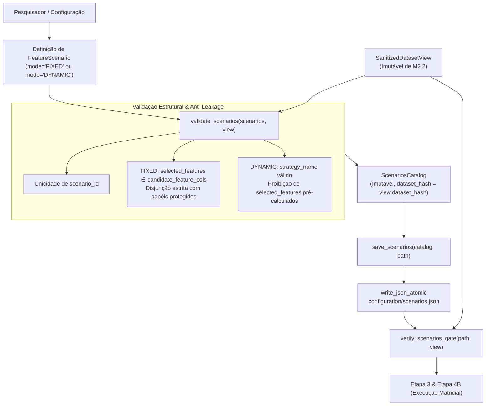

# M3.2 — Definição e Validação de Cenários de Features Design

**Spec**: `.specs/features/m3-2-feature-scenarios/spec.md`  
**Status**: Approved

---

## Architecture Overview

O Sub-marco M3.2 implementa a infraestrutura declarativa de modelagem de cenários de atributos na Etapa 2 (`experimental_ml.features.scenarios`) e os portões de validação correspondentes em `stages`, assegurando o desacoplamento estrito entre a especificação de cenários e o treinamento dos modelos.



---

## Code Reuse Analysis

### Existing Components to Leverage

| Component | Location | How to Use |
| :--- | :--- | :--- |
| `SanitizedDatasetView` | `experimental_ml.data.types` | Fonte de verdade de colunas candidatas e papéis protegidos do esquema |
| `write_json_atomic`, `read_json` | `experimental_ml.core.storage` | Persistência atômica e leitura segura do arquivo `scenarios.json` |
| `ConfigurationError`, `ContractViolationError`, `DataIntegrityError` | `experimental_ml.core.findings` | Exceções padronizadas de domínio e integridade |
| `stage_gates` | `experimental_ml.stages` | Localização do portão `verify_scenarios_gate` integrando com os portões de preparação e particionamento |

### Integration Points

| System / Boundary | Integration Method |
| :--- | :--- |
| `experimental_ml.features` | Exporta `FeatureScenario`, `ScenariosCatalog`, `validate_scenarios`, `save_scenarios`, `load_scenarios` |
| `experimental_ml.stages` | Adiciona `verify_scenarios_gate` re-exportado em `stages/__init__.py` |
| CLI (M3.4) | `expml features scenarios` consumirá as funções `validate_scenarios` e `save_scenarios` |

---

## Components

### 1. `experimental_ml.features.scenarios`
- **Purpose**: Modelos imutáveis de cenários, catálogo, validador e persistência.
- **Interfaces**:
  - `ScenarioMode = Literal["FIXED", "DYNAMIC"]`
  - `FeatureScenario`: contêiner imutável (`frozen=True`, `slots=True`) com parâmetros imutáveis (`MappingProxyType`).
  - `ScenariosCatalog`: catálogo imutável contendo tupla de cenários, `dataset_hash` e metadados.
  - `validate_scenarios(scenarios: Sequence[FeatureScenario], view: SanitizedDatasetView) -> ScenariosCatalog`: validador funcional puro.
  - `save_scenarios(catalog: ScenariosCatalog, path: Path | str, overwrite: bool = False) -> None`: serialização atômica em disco.
  - `load_scenarios(path: Path | str) -> ScenariosCatalog`: desserialização e reconstrução a partir do JSON.

### 2. `experimental_ml.stages.stage_gates`
- **Purpose**: Portão de validação da Etapa 2 para etapas subsequentes.
- **Interfaces**:
  - `verify_scenarios_gate(catalog_path: Path | str, view: SanitizedDatasetView) -> ScenariosCatalog`: valida existência, `dataset_hash` e integridade estrutural.

---

## Data Models

```python
class ScenarioMode(StrEnum):
    FIXED = "FIXED"
    DYNAMIC = "DYNAMIC"

@dataclass(frozen=True, slots=True)
class FeatureScenario:
    scenario_id: str
    name: str
    description: str
    scientific_justification: str
    mode: ScenarioMode | str
    selected_features: tuple[str, ...] = ()
    strategy_name: str | None = None
    strategy_params: Mapping[str, Any] = field(default_factory=lambda: MappingProxyType({}))
    preprocessing_config: Mapping[str, Any] = field(default_factory=lambda: MappingProxyType({}))

@dataclass(frozen=True, slots=True)
class ScenariosCatalog:
    scenarios: tuple[FeatureScenario, ...]
    dataset_hash: str
    metadata: Mapping[str, Any] = field(default_factory=lambda: MappingProxyType({}))
```

---

## Error Handling Strategy

| Error Scenario | Handling | User Impact |
| :--- | :--- | :--- |
| `scenario_id` inválido ou duplicado | Levanta `ConfigurationError` | Notifica colisão de IDs ou formato inválido |
| Cenário `FIXED` com `selected_features` vazio ou duplicado | Levanta `ConfigurationError` | Exige lista explícita não vazia e sem duplicatas |
| Cenário `FIXED` inclui coluna inexistente ou coluna protegida | Levanta `ContractViolationError` | Informa qual coluna viola os papéis ou não é candidata |
| Cenário `DYNAMIC` com `selected_features` não-vazio | Levanta `ContractViolationError` | Alerta sobre prevenção de vazamento de dados pré-partição |
| `dataset_hash` de `scenarios.json` diferente da visão saneada | Levanta `DataIntegrityError` no portão | Impede avanço para treinamento com base incompatível |
| Arquivo `scenarios.json` ausente no portão | Levanta `ContractViolationError` | Solicita execução prévia da etapa de cenários |

---

## Risks & Concerns

| Concern | Location | Impact | Mitigation |
| :--- | :--- | :--- | :--- |
| Cenário dinâmico tentar vazar atributos pré-calculados | `features/scenarios.py` | Data leakage silencioso na Etapa 2 | Validação no construtor e no validador exigindo `selected_features == ()` |
| Cenário fixo incluir coluna de grupo ou tempo | `features/scenarios.py` | Contaminação de partição ou tempo | Interseção obrigatória vazia com `{target, group, time, observation_id} ∪ ignore_cols` |
| Divergência de hash de dataset pós-saneamento | `stages/stage_gates.py` | Execução sobre versão antiga de dados | `verify_scenarios_gate` exige equivalência exata de `dataset_hash` |

---

## Tech Decisions

| Decision | Choice | Rationale |
| :--- | :--- | :--- |
| Modelo único sem classes filhas | `FeatureScenario` único com campo `mode` | Conformidade estrita com ADR-008 (proibição de hierarquias OOP) |
| Tuplas imutáveis e MappingProxyType | `tuple` para coleções ordenadas e `MappingProxyType` para dicionários | Prevenção de mutação acidental em tempo de execução |
| Ordenação canônica no catálogo | Preservação da ordem de declaração dos cenários | Respeita a ordem deliberada de hipóteses científicas do pesquisador |
