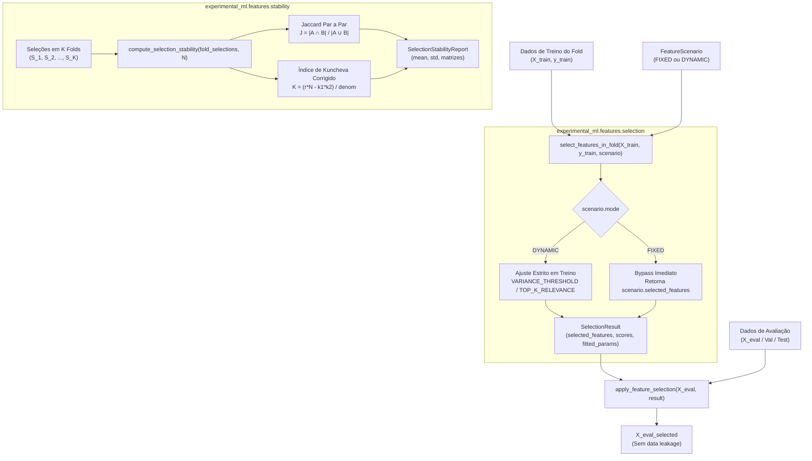

# M3.3 — Seleção Dinâmica Intra-Fold de Features e Estabilidade Design

**Spec**: `.specs/features/m3-3-intra-fold-selection/spec.md`  
**Status**: Approved

---

## Architecture Overview

O Sub-marco M3.3 implementa o mecanismo funcional de execução da seleção de atributos intra-fold (`experimental_ml.features.selection`) e a medição quantitativa de estabilidade entre partições (`experimental_ml.features.stability`), garantindo conformidade rigorosa com a prevenção de vazamento de dados (`RF2.4`, `ADR-002`, `ADR-008`).



---

## Code Reuse Analysis

### Existing Components to Leverage

| Component | Location | How to Use |
| :--- | :--- | :--- |
| `FeatureScenario`, `ScenarioMode` | `experimental_ml.features.scenarios` | Objeto de configuração declarativa da seleção |
| `compute_pearson`, `compute_spearman`, `compute_correlation_ratio` | `experimental_ml.features.stats` | Métricas puras em NumPy para seleção dinâmica por relevância com o alvo |
| `ContractViolationError`, `ConfigurationError`, `DataIntegrityError` | `experimental_ml.core.findings` | Exceções padronizadas de domínio e integridade |

### Integration Points

| System / Boundary | Integration Method |
| :--- | :--- |
| `experimental_ml.features` | Re-exporta `select_features_in_fold`, `apply_feature_selection`, `SelectionResult`, `compute_selection_stability`, `SelectionStabilityReport` |
| `orchestration` (Etapa 4B / M5) | O orquestrador chamará `select_features_in_fold` no loop de treino e `apply_feature_selection` na avaliação |

---

## Components

### 1. `experimental_ml.features.selection`
- **Purpose**: Seleção funcional intra-fold e projeção sobre conjuntos de avaliação.
- **Interfaces**:
  - `SelectionResult`: contêiner imutável (`frozen=True, slots=True`) contendo `selected_features`, `scores`, `fitted_params`, `strategy_name`.
  - `select_features_in_fold(X_train, y_train, scenario, random_state=None) -> SelectionResult`
  - `apply_feature_selection(X_eval, selection_result) -> dict[str, np.ndarray]`

### 2. `experimental_ml.features.stability`
- **Purpose**: Métricas de estabilidade de seleção entre múltiplos folds.
- **Interfaces**:
  - `SelectionStabilityReport`: contêiner imutável contendo média e desvio de Jaccard e Kuncheva, matrizes par a par e metadados.
  - `compute_selection_stability(fold_selections, n_total_candidates) -> SelectionStabilityReport`

---

## Data Models

```python
@dataclass(frozen=True, slots=True)
class SelectionResult:
    selected_features: tuple[str, ...]
    scores: Mapping[str, float] = field(default_factory=lambda: MappingProxyType({}))
    fitted_params: Mapping[str, Any] = field(default_factory=lambda: MappingProxyType({}))
    strategy_name: str = "FIXED"

@dataclass(frozen=True, slots=True)
class SelectionStabilityReport:
    mean_jaccard: float
    std_jaccard: float
    mean_kuncheva: float
    std_kuncheva: float
    pairwise_jaccard: Mapping[str, Mapping[str, float]]
    pairwise_kuncheva: Mapping[str, Mapping[str, float]]
    n_folds: int
    n_total_candidates: int
```

---

## Error Handling Strategy

| Error Scenario | Handling | User Impact |
| :--- | :--- | :--- |
| Estratégia dinâmica resulta em 0 features | Levanta `DataIntegrityError` | Notifica que os parâmetros de seleção eliminaram todos os atributos |
| `apply_feature_selection` encontra coluna ausente em `X_eval` | Levanta `ContractViolationError` | Informa qual atributo selecionado no treino não consta na avaliação |
| `compute_selection_stability` com menos de 2 folds | Levanta `ConfigurationError` | Exige pelo menos 2 partições para computar estabilidade |
| Estratégia dinâmica desconhecida | Levanta `ConfigurationError` | Lista as estratégias suportadas |

---

## Risks & Concerns

| Concern | Location | Impact | Mitigation |
| :--- | :--- | :--- | :--- |
| Divisão por zero em Kuncheva com $k=0$ ou $k=N$ | `features/stability.py` | NaN ou crash numérico | Guard clause retornando 1.0 para concordância perfeita em bordas |
| Mutações externas nos arrays de `apply_feature_selection` | `features/selection.py` | Modificação de buffers | Projeta referências ou fatias com `writeable = False` |
| Import acidental de bibliotecas externas | `features/selection.py` | Violação de XCUT-02 | Testes de unidade e subprocesso checando `sys.modules` |

---

## Tech Decisions

| Decision | Choice | Rationale |
| :--- | :--- | :--- |
| Fórmula simétrica de Kuncheva | Formulação com raiz do produto das variâncias | Trata elegantemente casos onde $k_i \neq k_j$ mantendo limite superior 1.0 |
| Despacho funcional sem classes | Funções puras despachadas por `strategy_name` | Rigorosa aderência à ADR-008 (código funcional sem estado) |
| Retorno de `apply_feature_selection` | Dicionário de arrays `dict[str, np.ndarray]` | Simples, interoperável e livre de wrappers desnecessários |
