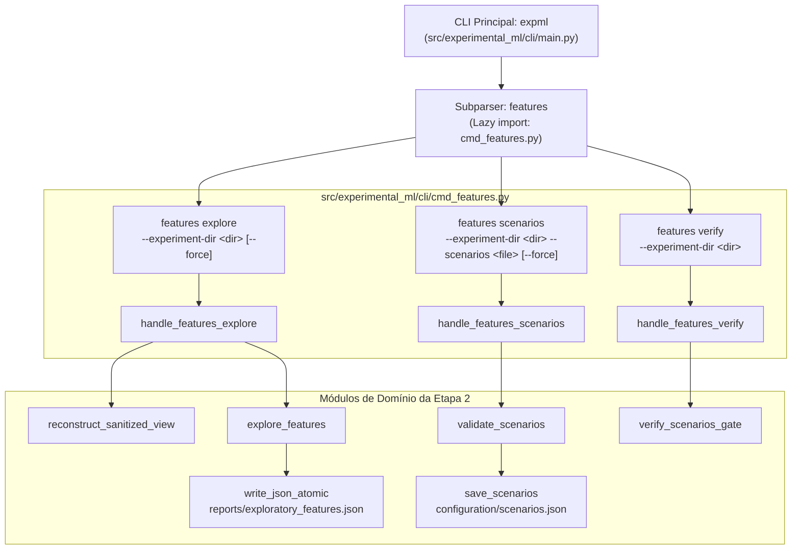

# M3.4 — CLI de Features e Homologação Ponta a Ponta Design

**Spec**: `.specs/features/m3-4-cli-end-to-end/spec.md`  
**Status**: Approved  
**Approved**: 2026-11-10 - user: "aprovado"

---

## Architecture Overview

O Sub-marco M3.4 implementa a interface de linha de comando para a Etapa 2 (`expml features`) e homologa a integração ponta a ponta entre a ingestão e saneamento de dados (Etapa 1), exploração e modelagem de cenários (Etapa 2), e particionamento compartilhado (Etapa 4A), em estrita conformidade com os requisitos `CLI-06` a `CLI-11`, `ADR-002`, `ADR-007` e `ADR-008`.

---

## Code Reuse Analysis

### Existing Components to Leverage

| Component | Location | How to Use |
| :--- | :--- | :--- |
| `reconstruct_sanitized_view` | `experimental_ml.stages` | Reconstrói a visão saneada imutável a partir do diretório do experimento |
| `explore_features` | `experimental_ml.features` | Executa a análise bivariada e matriz de redundância com rótulo `EXPLORATORY_FULL_DATA` |
| `FeatureScenario`, `validate_scenarios`, `save_scenarios` | `experimental_ml.features` | Validação semântica e persistência atômica do catálogo de cenários |
| `verify_scenarios_gate` | `experimental_ml.stages` | Verificação determinística física e lógica do portão de validação de cenários |
| `write_json_atomic`, `read_json` | `experimental_ml.core.storage` | Operações transacionais de E/S atômicas com `fsync` |
| `ExperimentalMLError`, `ConfigurationError` | `experimental_ml.core.findings` | Captura de exceções e tradução em código de saída 2 sem traceback |

### Integration Points

| System / Boundary | Integration Method |
| :--- | :--- |
| `main.py` CLI Dispatcher | Adiciona subparser `features` e direciona as chamadas para `cmd_features.py` |
| `sys.modules` Pureza de Carga (`CLI-10`) | Importa `cmd_features.py` sob demanda para não carregar `numpy` em `--help` |
| Arquivos de Experimento | `reports/exploratory_features.json` e `configuration/scenarios.json` |

---

## Components

### 1. `experimental_ml.cli.cmd_features`
- **Purpose**: Manipuladores de subcomandos para `expml features`.
- **Interfaces**:
  - `handle_features_explore(args: argparse.Namespace) -> int`: reconstrói visão, executa análise e grava relatório.
  - `handle_features_scenarios(args: argparse.Namespace) -> int`: carrega arquivo de cenários, valida contra visão saneada e salva catálogo.
  - `handle_features_verify(args: argparse.Namespace) -> int`: valida portão upstream e catálogo de cenários.

### 2. `experimental_ml.cli.main`
- **Purpose**: Despachante hierárquico com tratamento global de exceções.
- **Modifications**:
  - Adição de `features_parser` com `explore`, `scenarios` e `verify`.
  - Tratamento específico despachando para `cmd_features.py` sem importações estáticas em nível de módulo.

---

## Error Handling Strategy

1. **Erros de Argumento e Sintaxe:** Argumentos ausentes ou inválidos causam saída com código `2` via tratamento padrão de `argparse` do `main.py`.
2. **Erros de Domínio / Violações de Portão:** Levantamento de `ConfigurationError`, `ContractViolationError` ou `DataIntegrityError` é capturado em `main.py`, emitindo mensagem amigável no `stderr` no formato `Error: <mensagem>` e retornando código `2`.
3. **Proteção contra Sobrescrita:** Se o arquivo de destino já existir e `--force` não for especificado, emite `ConfigurationError` com código `2` sem alterar arquivos existentes.
4. **Erros Inesperados:** Qualquer exceção não mapeada retorna código `1` com prefixo `Unexpected error:`.
