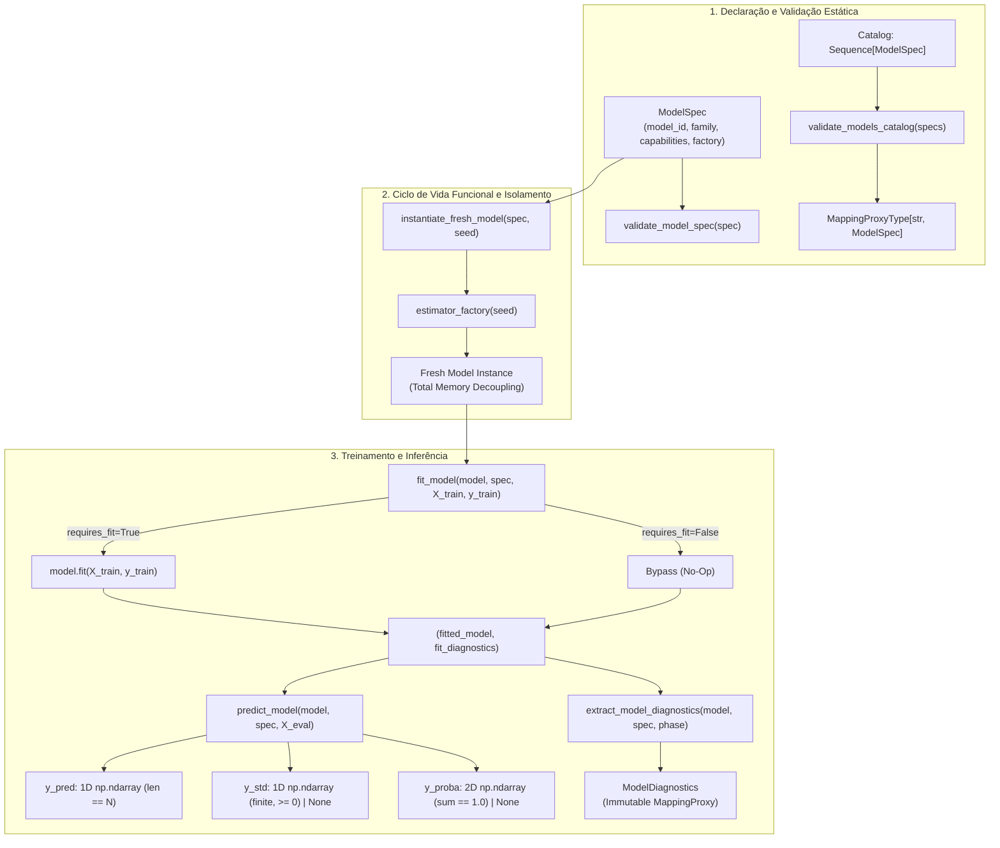

# M4.1 — Registro de Modelos, Capacidades e Contratos Funcionais Design

**Spec**: `.specs/features/m4-1-model-registry-contracts/spec.md`  
**Status**: Approved  

---

## Architecture Overview

O Sub-marco M4.1 estabelece a camada fundamental da Etapa 3 (`experimental_ml.models`), definindo os contratos declarativos, as capacidades operacionais e o ciclo de vida funcional para modelos preditivos, baselines de referência e equações analíticas/biométricas.

A arquitetura desacopla a representação estática de um modelo (`ModelSpec` e `ModelCapabilities`) da sua execução dinâmica (`instantiate_fresh_model`, `fit_model`, `predict_model`), garantindo que o framework suporte algoritmos heterogêneos sob um contrato de inferência estritamente uniforme e imutável.



---

## Code Reuse Analysis

### Existing Components to Leverage

| Component | Location | How to Use |
| :--- | :--- | :--- |
| `ModelId` | `src/experimental_ml/core/types.py` | Identificador de domínio para modelos (`DomainIdentifier`) |
| `ContractViolationError` | `src/experimental_ml/core/findings.py` | Exceção para violações em tempo de execução (reutilização de instâncias, predição sem fit, arrays incompatíveis) |
| `ConfigurationError` | `src/experimental_ml/core/findings.py` | Exceção para configurações inválidas na declaração estática ou falhas de fábrica |
| `TaskType` | `src/experimental_ml/core/enums.py` | Enum para contexto de tarefas preditivas |
| `seed` handling conventions | `src/experimental_ml/core/seeds.py` | Padrões de semente determinística (`ADR-007`) |

### Integration Points

| System / Boundary | Integration Method |
| :--- | :--- |
| M4.2 Preprocessing | O pré-processamento em 2 camadas encapsulará o estimador ajustado mantendo o mesmo contrato `predict_model` |
| M4.3 Nested Tuning | O otimizador de hiperparâmetros utilizará `instantiate_fresh_model` a cada fold para garantir isolamento de instâncias |
| M4.4 Registry & CLI | O registro serializável em disco (`models.json`) consumirá `validate_models_catalog` |
| M5 Matrix Orchestrator | As células de execução orquestrarão o fluxo funcional `instantiate -> fit -> predict -> extract_diagnostics` |

---

## Components

### 1. `experimental_ml.models.types`
- **Purpose**: Define estruturas de dados imutáveis, enums de família de modelos, capacidades e diagnósticos estruturados.
- **Interfaces**:
  - `ModelFamily(str, Enum)`: `CLASSICAL_ML`, `NEURAL_NETWORK`, `QUANTUM_CIRCUIT`, `QUANTUM_KERNEL`, `QUANTUM_SOLVER`, `ANALYTICAL_EQUATION`, `BIOMETRIC_MODEL`, `BASELINE`, `CUSTOM`.
  - `ModelCapabilities`: frozen dataclass (`requires_fit: bool`, `supports_predict: bool`, `supports_uncertainty: bool`, `supports_predict_proba: bool`, `supports_decision_function: bool`, `supports_sample_weight: bool`, `supports_precomputed_kernel: bool`, `supports_internal_parallelism_control: bool`, `expected_input_types: tuple[str, ...]`).
  - `ModelDiagnostics`: frozen dataclass (`model_id: str`, `phase: str`, `diagnostics: Mapping[str, Any]`, `extracted_at: str`).
  - Re-exporta `ModelId`.

### 2. `experimental_ml.models.spec`
- **Purpose**: Especificação declarativa de modelo e validação estática de catálogos em memória.
- **Interfaces**:
  - `ModelSpec`: frozen dataclass (`model_id: str`, `display_name: str`, `family: ModelFamily`, `estimator_factory: Callable[[int | None], Any]`, `capabilities: ModelCapabilities`, `description: str`, `scientific_justification: str`, `parameters: Mapping[str, Any]`, `random_seed_policy: str = "fixed"`).
  - `validate_model_spec(spec: ModelSpec) -> ModelSpec`: validação estrutural pura (regex de `model_id`, campos obrigatórios, callable, coerência de capacidades sem invocar inferência ou treino). Lança `ConfigurationError`.
  - `validate_models_catalog(specs: Sequence[ModelSpec]) -> MappingProxyType[str, ModelSpec]`: validação de coleção em memória, rejeitando duplicatas de `model_id`. Lança `ConfigurationError`.

### 3. `experimental_ml.models.execution`
- **Purpose**: Ciclo de vida funcional de instanciação, treinamento e inferência com garantia de isolamento e validação de saídas.
- **Interfaces**:
  - `instantiate_fresh_model(model_spec: ModelSpec, seed: int | None = None) -> Any`: instanciação via `estimator_factory(seed)`. Audita unicidade de identidade em memória via `WeakSet` rastreado (`ContractViolationError` em singletons). Trata exceções da factory como `ConfigurationError`.
  - `fit_model(model: Any, model_spec: ModelSpec, X_train: np.ndarray, y_train: np.ndarray, sample_weight: np.ndarray | None = None) -> tuple[Any, ModelDiagnostics]`: valida dimensões 2D/1D não-vazias e compatibilidade de $N$. Executa `model.fit` se `requires_fit=True`; bypass no-op se `requires_fit=False`. Retorna `(model, fit_diagnostics)`.
  - `predict_model(model: Any, model_spec: ModelSpec, X_eval: np.ndarray) -> dict[str, np.ndarray | None]`: verifica se o modelo está ajustado (quando `requires_fit=True`), obtém predições e valida saídas. Retorna dicionário com `y_pred` (1D, comprimento $N$), `y_std` (1D, finito, $\ge 0$ se `supports_uncertainty=True`, senão `None`), e `y_proba` (2D, valores em $[0, 1]$, soma das linhas $= 1.0$ se `supports_predict_proba=True`, senão `None`).

### 4. `experimental_ml.models.diagnostics`
- **Purpose**: Extração defensiva de diagnósticos internos e snapshot imutável.
- **Interfaces**:
  - `extract_model_diagnostics(model: Any, model_spec: ModelSpec, phase: str = "fit") -> ModelDiagnostics`: extrai atributos treinados (`coef_`, `intercept_`, `classes_`, etc.) ou invoca `get_diagnostics()`. Converte profundamente para tipos primitivos escalares e mapeamentos imutáveis (`MappingProxyType`). Rejeita mutáveis complexos não-conversíveis com `ContractViolationError`. Não altera o modelo.

### 5. `experimental_ml.models.baselines`
- **Purpose**: Implementações canônicas de baselines estatísticos e equações analíticas sem dependências externas.
- **Interfaces**:
  - `DummyBaselineModel(strategy: str = "mean")`: suporte a regressão (`"mean"`, `"median"` com incerteza em `y_std`) e classificação (`"most_frequent"` com desempate lexicográfico e frequências em `y_proba`).
  - `AnalyticalBiometricModel(formula_name: str, coefficients: Mapping[str, float] | None, required_features: Sequence[int | str])`: modelo sem treino (`requires_fit=False`), avalia equações diretamente em `predict` e valida atributos de entrada (`ContractViolationError` se colunas ausentes).

### 6. `experimental_ml.models.__init__`
- **Purpose**: Fachada pública do subsistema `models`.
- **Interfaces**:
  - Re-exporta todos os tipos, funções e classes via `__all__`.
  - Garante pureza de runtime (`XCUT-02`), sem importação obrigatória de scikit-learn, PyTorch ou SciPy.

---

## Data Models

```python
@dataclass(frozen=True, slots=True)
class ModelCapabilities:
    requires_fit: bool = True
    supports_predict: bool = True
    supports_uncertainty: bool = False
    supports_predict_proba: bool = False
    supports_decision_function: bool = False
    supports_sample_weight: bool = False
    supports_precomputed_kernel: bool = False
    supports_internal_parallelism_control: bool = False
    expected_input_types: tuple[str, ...] = ("dense_numeric",)


@dataclass(frozen=True, slots=True)
class ModelDiagnostics:
    model_id: str
    phase: str
    diagnostics: Mapping[str, Any]
    extracted_at: str


@dataclass(frozen=True, slots=True)
class ModelSpec:
    model_id: str
    display_name: str
    family: ModelFamily
    estimator_factory: Callable[[int | None], Any]
    capabilities: ModelCapabilities
    description: str
    scientific_justification: str
    parameters: Mapping[str, Any] = field(default_factory=lambda: MappingProxyType({}))
    random_seed_policy: str = "fixed"
```

---

## Risks & Concerns

| Risk / Concern | Severity | Mitigation |
| :--- | :--- | :--- |
| **Vazamento de instâncias entre partições (Singleton reuse)** | Alta | `instantiate_fresh_model` audita instâncias ativas via `WeakSet`. Se uma factory retornar o mesmo ponteiro em memória já ativo, `ContractViolationError` é disparado imediatamente (`AC-M41-03-03`). |
| **Inconsistência de formato nas predições** | Alta | `predict_model` centraliza a validação das três chaves (`y_pred`, `y_std`, `y_proba`). Valida dimensões, finitude, limites $[0, 1]$ e somas unitárias antes de entregar ao consumidor. |
| **Falsa validação declarativa (Dummy Inferences)** | Média | `validate_model_spec` é estritamente estática e declarativa, sem invocar treinos artificiais ou inferências dummy. Validação de comportamento real ocorre em tempo de execução via `predict_model`. |
| **Dependência espúria de bibliotecas pesadas de ML** | Média | `experimental_ml.models` depende exclusivamente de `numpy>=1.24.0` (`XCUT-02`). Estimadores externos são aceitos via duck-typing funcional sem imports obrigatórios no runtime central. |
| **Mutação de diagnósticos após extração** | Baixa | `extract_model_diagnostics` realiza cópia defensiva profunda e encapsula coleções em `MappingProxyType`, rejeitando tipos mutáveis arbitrários. |
