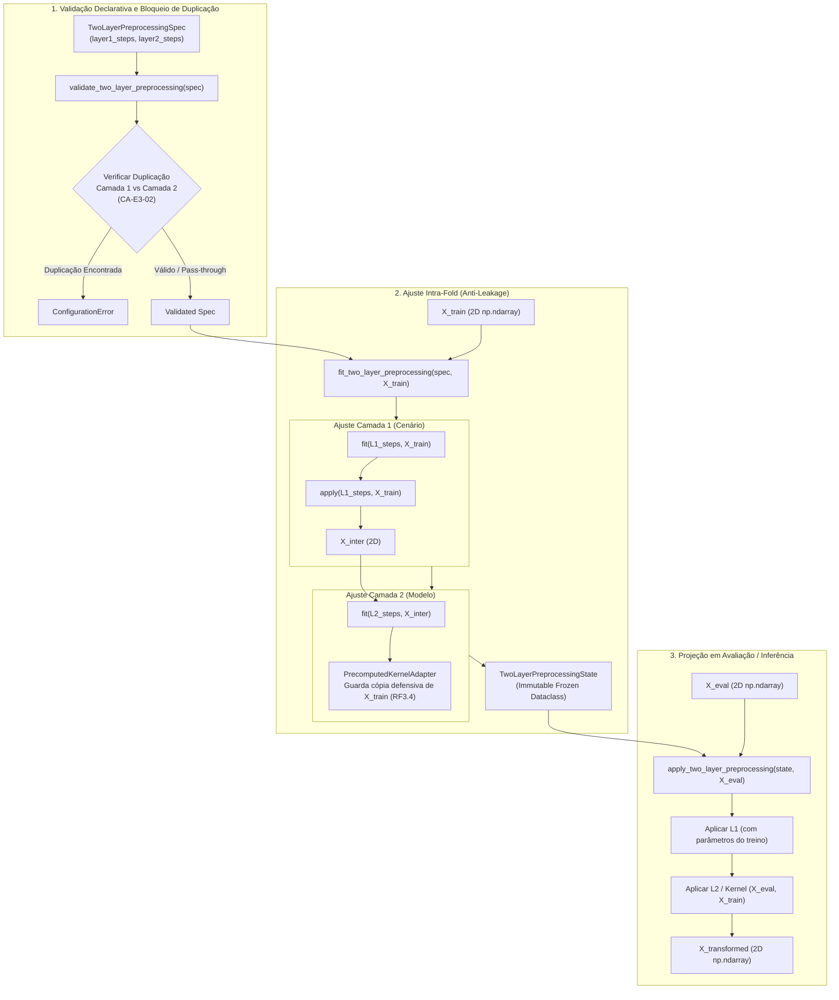

# M4.2 — Pipeline de Pré-processamento em Duas Camadas Design

**Spec**: `.specs/features/m4-2-two-layer-preprocessing/spec.md`  
**Status**: Approved  

---

## Architecture Overview

O Sub-marco M4.2 estabelece o pipeline de transformações em duas camadas da Etapa 3 (`experimental_ml.models.preprocessing`), materializando as decisões arquiteturais **ADR-002**, **RF3.4**, **CA-E3-02** e **CA-E4B-01**.

A arquitetura organiza as transformações de dados em duas fronteiras de responsabilidade estritas e desacopladas:
1. **Camada 1 (Cenário / Domínio):** transformações associadas às hipóteses científicas e de domínio do cenário (ex.: imputação de valores ausentes, codificação de categorias, transformações não-lineares).
2. **Camada 2 (Específica do Modelo):** transformações técnicas estritamente exigidas pela tecnologia do estimador (escalonamentos numéricos, normalização angular para portas quânticas, ou matrizes de Gram para kernels pré-computados).

O pipeline opera sob um paradigma puramente funcional, garantindo que o ajuste (`fit_two_layer_preprocessing`) dependa exclusivamente de $\mathbf{X}_{\text{train}}$, produzindo um estado imutável (`TwoLayerPreprocessingState`) que projeta $\mathbf{X}_{\text{eval}}$ via `apply_two_layer_preprocessing` sem qualquer recalculo de parâmetros ou vazamento de dados.



---

## Code Reuse Analysis

### Existing Components to Leverage

| Component | Location | How to Use |
| :--- | :--- | :--- |
| `ContractViolationError` | `src/experimental_ml/core/findings.py` | Violações de contrato em tempo de execução (arrays 1D, não-finitos, colunas incompatíveis) |
| `ConfigurationError` | `src/experimental_ml/core/findings.py` | Configurações inválidas ou detecção de transformações duplicadas (`CA-E3-02`) |
| `ModelCapabilities` | `src/experimental_ml/models/types.py` | Consulta da flag `supports_precomputed_kernel` |
| `ModelSpec` | `src/experimental_ml/models/spec.py` | Metadados do modelo para vinculação de pré-processamento na Etapa 3 |

### Integration Points

| System / Boundary | Integration Method |
| :--- | :--- |
| M3.3 Feature Selection | O pré-processamento da Camada 1 opera antes da seleção intra-fold; a Camada 2 opera após a seleção intra-fold sobre os atributos retidos |
| M4.1 Model Contracts | A Camada 2 prepara a matriz $\mathbf{X}$ exata esperada por `fit_model` e `predict_model` |
| M4.3 Nested Tuning | O pré-processamento em duas camadas será reajustado dentro de cada dobra interna do Nested CV |
| M5 Matrix Orchestrator | As células de execução orquestrarão `fit_two_layer_preprocessing` e `apply_two_layer_preprocessing` por fold |

---

## Components

### 1. `experimental_ml.models.preprocessing.types`
- **Purpose**: Define enums, especificações declarativas de passos e camadas, e estrutura de estado imutável.
- **Interfaces**:
  - `ScalerType(str, Enum)`: `STANDARD`, `MINMAX`, `MAXABS`, `ROBUST`, `ANGULAR`, `NONE`.
  - `PreprocessingStepSpec`: frozen dataclass (`step_id: str`, `transformer_type: str`, `parameters: MappingProxyType[str, Any]`, `description: str`).
  - `TwoLayerPreprocessingSpec`: frozen dataclass (`layer1_steps: tuple[PreprocessingStepSpec, ...]`, `layer2_steps: tuple[PreprocessingStepSpec, ...]`, `description: str`).
  - `TwoLayerPreprocessingState`: frozen dataclass (`spec: TwoLayerPreprocessingSpec`, `layer1_fitted_state: tuple[Any, ...]`, `layer2_fitted_state: tuple[Any, ...]`).

### 2. `experimental_ml.models.preprocessing.scalers`
- **Purpose**: Implementações puras em NumPy de algoritmos de escalonamento com salvaguardas numéricas para variância zero.
- **Interfaces**:
  - `StandardScaler(with_mean=True, with_std=True)`: padronização $z = (x - \mu) / \sigma$. Variância zero gera $0.0$.
  - `MinMaxScaler(feature_range=(0.0, 1.0))`: escala linear para $[a, b]$. Coluna constante gera $a$.
  - `MaxAbsScaler()`: escala para $[-1.0, 1.0]$ dividindo por $\max(|x|)$. Coluna nula gera $0.0$.
  - `RobustScaler(with_centering=True, with_scaling=True, quantile_range=(25.0, 75.0))`: escala robusta por mediana e IQR. IQR zero gera $0.0$.
  - `AngularScaler(target_range=(0.0, np.pi))`: mapeamento linear min-max para ângulos de portas quânticas.

### 3. `experimental_ml.models.preprocessing.kernel`
- **Purpose**: Adaptador funcional para funções externas de kernel pré-computado com passagem não-vazada de matrizes.
- **Interfaces**:
  - `PrecomputedKernelAdapter(kernel_func: Callable[[np.ndarray, np.ndarray], np.ndarray])`:
    - `fit(X_train)`: avalia `kernel_func(X_train, X_train)`, valida que a matriz é quadrada $(N_{\text{train}}, N_{\text{train}})$ e finita, e armazena cópia defensiva de $\mathbf{X}_{\text{train}}$.
    - `transform(X_eval)`: avalia `kernel_func(X_eval, X_train)` produzindo Gram matrix $(N_{\text{eval}}, N_{\text{train}})$.

### 4. `experimental_ml.models.preprocessing.pipeline`
- **Purpose**: Orquestrador funcional do pré-processamento em duas camadas.
- **Interfaces**:
  - `validate_two_layer_preprocessing(spec: TwoLayerPreprocessingSpec) -> TwoLayerPreprocessingSpec`: detecta conflitos ou duplicatas de escalonadores entre Camada 1 e Camada 2 (`CA-E3-02`).
  - `fit_two_layer_preprocessing(spec: TwoLayerPreprocessingSpec, X_train: np.ndarray) -> TwoLayerPreprocessingState`: ajusta Camada 1 e Camada 2 estritamente em `X_train`.
  - `apply_two_layer_preprocessing(state: TwoLayerPreprocessingState, X_eval: np.ndarray) -> np.ndarray`: projeta `X_eval` através das duas camadas pré-ajustadas.

---

## Data Models

```python
@dataclass(frozen=True, slots=True)
class PreprocessingStepSpec:
    step_id: str
    transformer_type: str
    parameters: Mapping[str, Any] = field(default_factory=lambda: MappingProxyType({}))
    description: str = ""


@dataclass(frozen=True, slots=True)
class TwoLayerPreprocessingSpec:
    layer1_steps: tuple[PreprocessingStepSpec, ...] = ()
    layer2_steps: tuple[PreprocessingStepSpec, ...] = ()
    description: str = ""


@dataclass(frozen=True, slots=True)
class TwoLayerPreprocessingState:
    spec: TwoLayerPreprocessingSpec
    layer1_fitted_state: tuple[Any, ...]
    layer2_fitted_state: tuple[Any, ...]
```

---

## Risks & Concerns

| Risk / Concern | Severity | Mitigation |
| :--- | :--- | :--- |
| **Vazamento de dados por recalculo em avaliação** | Crítica | `apply_two_layer_preprocessing` recebe um `TwoLayerPreprocessingState` imutável e projeta os dados sem chamar métodos `fit` ou atualizar parâmetros estatísticos (`CA-E4B-01`). |
| **Duplicação acidental de escalonadores** | Alta | `validate_two_layer_preprocessing` rejeita a configuração de escalonadores do mesmo tipo ou com a mesma finalidade entre Camada 1 e Camada 2 (`CA-E3-02`). |
| **Divisão por zero em colunas constantes** | Média | Todos os escalonadores em NumPy tratam explicitamente $\sigma = 0$, $\text{range} = 0$, $\text{IQR} = 0$ e $\max(|x|) = 0$, mapeando valores constantes de forma determinística e finita. |
| **Vazamento em kernels pré-computados** | Alta | `PrecomputedKernelAdapter` retém $\mathbf{X}_{\text{train}}$ de forma defensiva e imutável, garantindo que o kernel receba $(\mathbf{X}_{\text{train}}, \mathbf{X}_{\text{train}})$ no treino e $(\mathbf{X}_{\text{eval}}, \mathbf{X}_{\text{train}})$ na inferência (`RF3.4`). |
