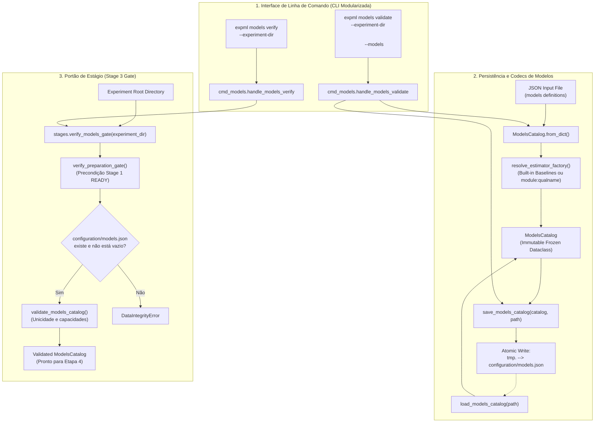

# M4.4 — Persistência de Modelos, Portão de Validação e CLI Design

**Spec**: `.specs/features/m4-4-model-persistence-cli/spec.md`  
**Status**: Approved  

---

## Architecture Overview

O Sub-marco M4.4 consolida a persistência em disco, o portão de estágio e a interface CLI da Etapa 3 (`experimental_ml.models`), integrando os contratos estabelecidos nos sub-marcos anteriores (M4.1 Registro e Contratos, M4.2 Pré-processamento e M4.3 Nested Tuning), em conformidade com **STORE-03**, **STORE-05**, **ARQUITETURA §2.4, §5**, **CLI-10** e **XCUT-02**.

A arquitetura organiza a persistência e a governança de modelos nas seguintes camadas funcionais:
1. **Catálogo e Codecs de Serialização (`src/experimental_ml/models/catalog.py`):**
   - Dataclass imutável `ModelsCatalog` (`models`, `metadata`, `catalog_hash`).
   - Funções puras `to_dict` e `from_dict` para mapeamento bidirecional em JSON.
   - Resolução declarativa e segura de fábricas de estimadores (`resolve_estimator_factory`) suportando baselines canônicos nativos e estimadores externos via formato padrão `module:qualname`.
   - Suporte a especificações integradas de pré-processamento (`TwoLayerPreprocessingSpec`) e espaços de busca de hiperparâmetros (`HyperparameterSearchSpec`).
2. **Armazenamento Atômico (`src/experimental_ml/models/storage.py`):**
   - `save_models_catalog` gravando em `<path>.tmp.<pid>` com substituição atômica via `os.replace` e proteção contra sobrescrita acidental (`overwrite=False`).
   - `load_models_catalog` realizando leitura segura, validação declarativa e cálculo determinístico de `catalog_hash`.
3. **Portão de Estágio de Modelos (`src/experimental_ml/stages/stage_gates.py`):**
   - Constante `MODELS_CATALOG_REL_PATH = "configuration/models.json"`.
   - Função `verify_models_gate(experiment_dir)` garantindo que a base esteja em estado READY (`verify_preparation_gate`), que `models.json` exista, não esteja vazio, possua identificadores únicos e seja declarativamente válido.
4. **Interface CLI Modularizada (`src/experimental_ml/cli/cmd_models.py` e `main.py`):**
   - Subcomando `expml models validate`: valida o arquivo de entrada de modelos e grava `configuration/models.json` com proteção `--force`.
   - Subcomando `expml models verify`: executa a validação do portão de modelos e retorna códigos de saída padronizados (0 para sucesso, 2 para erro de validação/domínio).
   - Isolamento de importações: zero importações pesadas no escopo do módulo `cmd_models.py` (`CLI-10`).

---

## Code Reuse Analysis

### Existing Components to Leverage

- **`experimental_ml.core.storage`**:
  - `read_json`, `write_json_atomic`: persistência e leitura JSON padronizada com escrita temporária e substituição atômica.
- **`experimental_ml.core.hashing`**:
  - `config_hash`: hash canônico SHA-256 de dicionários de configuração para computar `catalog_hash`.
- **`experimental_ml.core.findings`**:
  - `ConfigurationError`: erros de sintaxe ou configuração na validação e carregamento.
  - `ContractViolationError`: violação de contratos e invariantes de modelos.
  - `DataIntegrityError`: artefatos ausentes ou corrompidos em portões de etapa.
- **`experimental_ml.models`**:
  - `ModelSpec`, `ModelCapabilities`, `ModelFamily`: tipos declarativos fundamentais.
  - `validate_model_spec`, `validate_models_catalog`: validadores em memória.
  - `DummyBaselineModel`, `AnalyticalBiometricModel`: baselines canônicos nativos.
- **`experimental_ml.models.preprocessing`**:
  - `TwoLayerPreprocessingSpec`, `PreprocessingStepSpec`: tipos e especificações de pré-processamento.
  - `validate_two_layer_preprocessing`: validador anti-duplicação da Etapa 3.
- **`experimental_ml.tuning`**:
  - `HyperparameterSearchSpec`, `SearchStrategy`: tipos de busca de hiperparâmetros.
  - `validate_search_spec`: validador de espaços de busca e métricas.
- **`experimental_ml.stages.stage_gates`**:
  - `verify_preparation_gate`: pré-condição da Etapa 1.

### New Components to Create

- **`src/experimental_ml/models/catalog.py`**:
  - Dataclass `ModelsCatalog`.
  - Função `resolve_estimator_factory(factory_ref: str | Callable) -> Callable`.
  - Codecs `model_spec_to_dict`, `model_spec_from_dict`, `models_catalog_to_dict`, `models_catalog_from_dict`.
- **`src/experimental_ml/models/storage.py`**:
  - Funções `save_models_catalog` e `load_models_catalog`.
- **`src/experimental_ml/stages/stage_gates.py`**:
  - Adição de `MODELS_CATALOG_REL_PATH` e `verify_models_gate`.
- **`src/experimental_ml/cli/cmd_models.py`**:
  - Handlers de terminal `handle_models_validate` e `handle_models_verify` com importações diferidas (`CLI-10`).
- **`src/experimental_ml/cli/main.py`**:
  - Registro dos subparsers de `models` (`validate` e `verify`) e despacho correspondente.
- **`src/experimental_ml/models/__init__.py`**:
  - Re-exportação de `ModelsCatalog`, `save_models_catalog`, `load_models_catalog`.

---

## Technical Decisions & Risk Mitigations

### 1. Resolução Segura de Estimadores (`resolve_estimator_factory`)
- **Risco:** Execução arbitrária de código ao carregar especificações de modelos de fontes externas.
- **Mitigação:** Suporte estrito a:
  1. Identificadores canônicos reservados de baselines (`DUMMY_BASELINE_MEAN`, `DUMMY_BASELINE_MEDIAN`, `DUMMY_BASELINE_MOST_FREQUENT`, `ANALYTICAL_BIOMETRIC`);
  2. Strings explícitas no formato `modulo:qualname` com validação de que o objeto importado é um `callable` e não None;
  3. Lançamento explícito de `ConfigurationError` caso o módulo ou atributo não exista ou não seja invocável.

### 2. Prevenção de Corrupção em Persistência Concorrente ou Interrompida
- **Risco:** Uma interrupção (ex.: SIGINT ou falta de energia) durante a escrita de `configuration/models.json` deixar o arquivo parcialmente escrito ou inválido.
- **Mitigação:** `save_models_catalog` delega para `write_json_atomic`, que escreve em `<path>.tmp.<pid>` e realiza um `os.replace` atômico na C-API do sistema operacional.

### 3. Pureza de Runtime na CLI (`CLI-10`)
- **Risco:** Executar `expml --help` ou `expml models --help` importar NumPy, SciPy ou bibliotecas de ML, tornando o comando lento.
- **Mitigação:** O arquivo `src/experimental_ml/cli/cmd_models.py` não importa `numpy` nem submódulos pesados no nível de módulo. Todas as dependências científicas são importadas estritamente dentro das funções `handle_*`.
