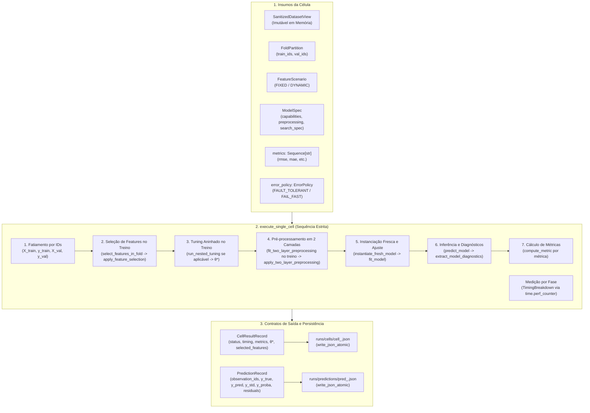

# M5.1 — Contratos da Célula e Execução Unitária Design

**Spec**: `.specs/features/m5-1-cell-execution-contracts/spec.md`  
**Status**: Approved  

---

## 1. Visão Geral da Arquitetura

O Sub-marco M5.1 estabelece a camada de execução unitária da Etapa 4B (`experimental_ml.orchestration`), definindo as estruturas de dados imutáveis, a máquina de estados, o rastreamento desagregado de tempo, a coleta estruturada de predições e o executor funcional de célula `execute_single_cell`.

Cada célula da grade experimental tridimensional $\text{Célula}(m, c, f) = \text{Modelo } m \times \text{Cenário } c \times \text{Fold } f$ é executada de forma puramente funcional e isolada, garantindo conformidade com a política anti-leakage `CA-E4B-01` e resiliência a falhas `CA-E4B-02`.



---

## 2. Análise de Reuso de Código

O executor unitário de célula compõe de forma limpa as capacidades já homologadas nos Marcos M1 a M4, sem duplicar lógica:

| Capacidade Necessária | Módulo Fornecedor | Função Reutilizada |
| :--- | :--- | :--- |
| Fatiamento de dados por `observation_id` | `experimental_ml.data` | `get_column_array`, `slice_view_by_observation_ids` |
| Seleção de atributos intra-fold | `experimental_ml.features` | `select_features_in_fold`, `apply_feature_selection` |
| Busca aninhada de hiperparâmetros | `experimental_ml.tuning` | `run_nested_tuning`, `HyperparameterSearchSpec` |
| Pré-processamento em 2 camadas | `experimental_ml.models` | `fit_two_layer_preprocessing`, `apply_two_layer_preprocessing` |
| Instanciação fresca e isolamento | `experimental_ml.models` | `instantiate_fresh_model` |
| Ajuste funcional e inferência | `experimental_ml.models` | `fit_model`, `predict_model`, `extract_model_diagnostics` |
| Cálculo de métricas e NaNs | `experimental_ml.metrics` | `compute_metric`, `get_metric_spec` |
| Persistência atômica segura | `experimental_ml.core` | `write_json_atomic` |

---

## 3. Modelo de Dados e Estruturas Imutáveis (`orchestration/types.py`)

### 3.1 Identificador e Enums
- **`CellId`**: `NewType` ou subclasse validada de string no formato canônico `cell_{model_id}_{scenario_id}_{fold_id}`.
- **`ExecutionStatus(str, Enum)`**: `PENDING`, `RUNNING`, `COMPLETED`, `FAILED`, `CANCELLED`.
- **`ErrorPolicy(str, Enum)`**: `FAULT_TOLERANT`, `FAIL_FAST`.
- **`CellPhase(str, Enum)`**: `DATA_EXTRACTION`, `FEATURE_SELECTION`, `PREPROCESSING_L1`, `HYPERPARAMETER_TUNING`, `PREPROCESSING_L2`, `MODEL_FIT`, `PREDICTION`, `METRIC_COMPUTATION`.

### 3.2 `TimingBreakdown`
Dataclass imutável (`frozen=True`, `slots=True`) com campos de duração em segundos (float):
- `data_extraction_time_s`: tempo de recorte de dados a partir da visão saneada.
- `feature_selection_time_s`: tempo de ajuste e projeção da seleção de features.
- `tuning_time_s`: tempo de otimização aninhada de hiperparâmetros (0.0 se `FIXED`).
- `preprocessing_time_s`: tempo de ajuste e aplicação das 2 camadas de pré-processamento.
- `fit_time_s`: tempo de treinamento final do estimador selecionado.
- `predict_time_s`: tempo de inferência sobre a partição de avaliação.
- `evaluation_time_s`: tempo de cálculo de todas as métricas requisitadas.
- `total_cell_time_s`: tempo de parede total decorrido na célula.

### 3.3 `PredictionRecord`
Dataclass imutável (`frozen=True`, `slots=True`) registrando as predições no conjunto de validação:
- `cell_id: CellId`
- `observation_ids: tuple[ObservationId, ...]`
- `y_true: tuple[float, ...]`
- `y_pred: tuple[float, ...]`
- `y_std: tuple[float, ...] | None = None`
- `y_proba: tuple[tuple[float, ...], ...] | None = None`
- `residuals: tuple[float, ...] | None = None` (calculado como $y_{\text{true}} - y_{\text{pred}}$ em regressão).

Validações no construtor (`__post_init__`):
- `len(observation_ids) == len(y_true) == len(y_pred)`.
- Se `y_std` estiver presente, `len(y_std) == len(y_true)`.
- Se `residuals` estiver presente, `len(residuals) == len(y_true)`.
- Arrays NumPy convertidos deterministicamente em tuplas imutáveis.

### 3.4 `CellResultRecord`
Dataclass imutável (`frozen=True`, `slots=True`) consolidando o resultado completo:
- `cell_id: CellId`
- `experiment_id: ExperimentId`
- `partition_plan_id: PartitionPlanId`
- `model_id: ModelId`
- `scenario_id: ScenarioId`
- `fold_id: str`
- `status: ExecutionStatus`
- `selected_features: tuple[str, ...]`
- `effective_parameters: MappingProxyType[str, Any]`
- `timing: TimingBreakdown`
- `metrics: MappingProxyType[str, MetricValue]`
- `diagnostics: ModelDiagnostics | None = None`
- `error_type: str | None = None`
- `error_message: str | None = None`
- `error_phase: CellPhase | None = None`
- `error_traceback: str | None = None`

---

## 4. Algoritmo de Execução da Célula (`execute_single_cell`)

```python
def execute_single_cell(
    model_spec: ModelSpec,
    scenario: FeatureScenario,
    fold: FoldPartition,
    sanitized_view: SanitizedDatasetView,
    partition_plan: PartitionPlan,
    metrics: Sequence[str],
    error_policy: ErrorPolicy = ErrorPolicy.FAULT_TOLERANT,
    cell_seed: int | None = None,
) -> tuple[CellResultRecord, PredictionRecord | None]:
    ...
```

### 4.1 Fases e Isolamento Anti-Leakage
1. **Fase `DATA_EXTRACTION`**:
   - Extrai `train_view` usando `slice_view_by_observation_ids(sanitized_view, fold.train_ids)`.
   - Extrai `val_view` usando `slice_view_by_observation_ids(sanitized_view, fold.val_ids)`.
   - Extrai arrays de matriz $X_{\text{train}}, y_{\text{train}}$ e $X_{\text{val}}, y_{\text{val}}$ respeitando os preditores do cenário ou colunas candidatas.
2. **Fase `FEATURE_SELECTION`**:
   - Invoca `select_features_in_fold(scenario, train_view)`.
   - Projeta preditores de treino e validação via `apply_feature_selection(X_eval, selection_result)`.
3. **Fase `HYPERPARAMETER_TUNING`**:
   - Se `model_spec.search_spec` existir e `search_strategy != FIXED`:
     - Executa `run_nested_tuning(search_spec, model_spec, X_train_selected, y_train, seed=cell_seed)`.
     - Deriva `effective_spec` com os melhores hiperparâmetros $\theta^*$.
   - Caso contrário, usa os parâmetros padrão declarados em `model_spec.parameters`.
4. **Fase `PREPROCESSING_L2` (e L1 se houver)**:
   - Se `effective_spec.preprocessing` existir:
     - `state = fit_two_layer_preprocessing(effective_spec.preprocessing, X_train_selected)`.
     - `X_train_proc = apply_two_layer_preprocessing(state, X_train_selected)`.
     - `X_val_proc = apply_two_layer_preprocessing(state, X_val_selected)`.
   - Caso contrário, `X_train_proc = X_train_selected`, `X_val_proc = X_val_selected`.
5. **Fase `MODEL_FIT`**:
   - `model_instance = instantiate_fresh_model(effective_spec, seed=cell_seed)`.
   - `fitted_model, fit_diag = fit_model(model_instance, effective_spec, X_train_proc, y_train)`.
6. **Fase `PREDICTION`**:
   - `outputs = predict_model(fitted_model, effective_spec, X_val_proc)`.
   - `diagnostics = extract_model_diagnostics(fitted_model, effective_spec, "predict")`.
7. **Fase `METRIC_COMPUTATION`**:
   - Para cada métrica em `metrics`:
     - `mv = compute_metric(metric_name, y_val, outputs["y_pred"])`.
     - Registra em `metrics_dict`.
   - Constrói `PredictionRecord` e `CellResultRecord` com `ExecutionStatus.COMPLETED`.

### 4.2 Captura Resiliente de Exceções
- Bloco `try ... except Exception as exc:` envolvendo as fases operacionais.
- Registra `current_phase` a cada transição.
- Se `error_policy == ErrorPolicy.FAIL_FAST`: relança imediatamente `raise`.
- Se `error_policy == ErrorPolicy.FAULT_TOLERANT`:
  - Registra traceback, tipo e mensagem.
  - Constrói `TimingBreakdown` com tempos medidos até a interrupção.
  - Retorna `CellResultRecord(status=ExecutionStatus.FAILED, error_phase=current_phase, ...)` e `None` para `PredictionRecord`.

---

## 5. Serialização e Persistência Atômica (`codecs.py`, `storage.py`)

### 5.1 Codecs
- `cell_result_to_dict` e `cell_result_from_dict`: serializam `MetricValue` usando seu codec canônico, enums para seus valores de string, e tuplas para listas JSON.
- `prediction_record_to_dict` e `prediction_record_from_dict`: serializa `ObservationId` como strings, listas de floats e matrizes bidimensionais para probabilidades.

### 5.2 Armazenamento Atômico
- `save_cell_artifacts(cell_result, prediction_record, run_dir, overwrite=False)`:
  - Cria diretórios `run_dir / "cells"` e `run_dir / "predictions"`.
  - Salva atomicamente `cell_{cell_id}.json` via `write_json_atomic`.
  - Se `prediction_record` não for None, salva atomicamente `pred_{cell_id}.json` via `write_json_atomic`.
  - Se `overwrite == False` e arquivos já existirem, levanta `ConfigurationError`.
