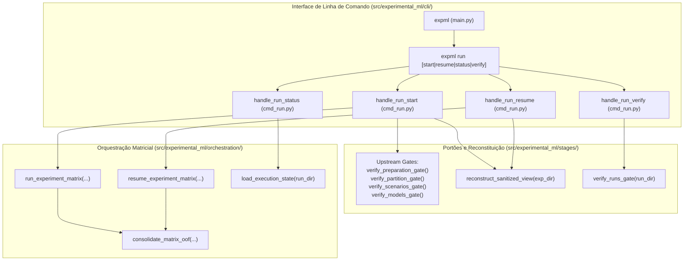

# M5.4 — CLI Run End-to-End Design

**Spec**: `.specs/features/m5-4-cli-run-end-to-end/spec.md`  
**Status**: Approved  

---

## Architecture Overview

O Sub-marco M5.4 completa o Marco M5 implementando a interface de linha de comando `expml run` (Etapa 4B) e sua integração transversal com todos os contratos da arquitetura em conformidade com **CLI-06 a CLI-11**, **STORE-01**, **ADR-008** e **XCUT-02**.

A arquitetura organiza a CLI de execução em quatro operações fundamentais:
1. **`expml run start`**:
   - Reconstitui os insumos das Etapas 1, 2, 3 e 4A (`SanitizedDatasetView`, `PartitionPlan`, `ScenariosCatalog`, `ModelsCatalog`).
   - Valida os portões upstream (`verify_preparation_gate`, `verify_partition_gate`, `verify_scenarios_gate`, `verify_models_gate`).
   - Invoca o orquestrador matricial `run_experiment_matrix` configurado com política de erros, número de workers e consolidação automática de OOF (`auto_consolidate_oof=True`).
   - Grava incrementalmente em `<experiment-dir>/runs` (ou `--run-dir`) com proteção contra sobrescrita indevida (`--force`).
2. **`expml run resume`**:
   - Inspeciona uma execução interrompida em `--run-dir`.
   - Ignora células concluídas com artefatos válidos em disco e reexecuta células pendentes ou com artefatos corrompidos/faltantes.
   - Suporta a reexecução opcional de células falhas com a flag `--retry-failed`.
3. **`expml run status`**:
   - Executa uma leitura estritamente não-destrutiva de `execution_state.json`.
   - Exibe sumário legível no terminal com total de células, distribuídas por status (`COMPLETED`, `FAILED`, `CANCELLED`, `PENDING`, `RUNNING`) e percentual de progresso.
4. **`expml run verify`**:
   - Audita formalmente a execução através de `verify_runs_gate`.
   - Valida a inexistência de estados não-terminais, presença física de todos os artefatos de células, predições e OOF em disco, e consistência cruzada de hashes.



---

## Code Reuse Analysis

### Existing Components to Leverage
- **`experimental_ml.stages.stage_gates`**:
  - `verify_preparation_gate`, `verify_partition_gate`, `verify_scenarios_gate`, `verify_models_gate`: validações de pré-requisito upstream.
  - `verify_runs_gate`: portão de integridade transversal da etapa 4.
  - `reconstruct_sanitized_view`: função pura para reidratação da `SanitizedDatasetView` sem acoplamento a código privado.
  - Constantes canônicas de caminho: `PARTITION_PLAN_REL_PATH`, `SCENARIOS_CATALOG_REL_PATH`, `MODELS_CATALOG_REL_PATH`, `EXECUTION_STATE_REL_PATH`.
- **`experimental_ml.orchestration`**:
  - `run_experiment_matrix`, `resume_experiment_matrix`: motores de execução sequencial e concorrente com checkpointing incremental.
  - `load_execution_state`, `save_execution_state`: serializadores atômicos de estado da matriz.
  - `consolidate_matrix_oof`: motor de agregação OOF e estatísticas de comitê.
- **`experimental_ml.core.findings`**:
  - `ConfigurationError`, `ContractViolationError`, `DataIntegrityError`, `ExperimentalMLError`: hierarquia de exceções canônica tratada sem vazamento de traceback (`CLI-06`).
- **`experimental_ml.models.storage` / `catalog`**:
  - `load_models_catalog`, `ModelsCatalog`: carregamento de modelos validados.
- **`experimental_ml.features.scenarios`**:
  - `load_scenarios`, `ScenariosCatalog`: carregamento de cenários declarativos.
- **`experimental_ml.validation.codecs` / `storage`**:
  - `partition_plan_from_dict`: desserialização de partições.

### New Components to Create
- **`src/experimental_ml/cli/cmd_run.py`**:
  - Manipuladores de subcomando com isolamento de importações (`CLI-10`) e saída estritamente descritiva sem hashes brutos (`CLI-11`).
- **Subparsers em `src/experimental_ml/cli/main.py`**:
  - Registro de `run` com argumentos configuráveis: `--experiment-dir`, `--run-dir`, `-j`/`--jobs`/`--parallel`, `--error-policy`, `--no-oof`, `--retry-failed` e `--force`.
- **Suíte de Testes Unitários e de Integração**:
  - `tests/unit/cli/test_cli_run.py`: testes unitários exaustivos dos 4 subcomandos e validações de erro.
  - `tests/integration/cli/test_run_e2e.py`: validação do ciclo ponta a ponta da CLI e conformidade `XCUT-02`.

---

## Detailed Component Design

### 1. Manipuladores em `src/experimental_ml/cli/cmd_run.py`

#### `handle_run_start(args: argparse.Namespace) -> int`
- Lê `experiment_dir = Path(args.experiment_dir).resolve()`.
- Define `run_dir`: `Path(args.run_dir).resolve()` se fornecido, senão `experiment_dir / "runs"`.
- Proteção `--force`: Se `run_dir / "execution_state.json"` existir e `not args.force`, lança `ConfigurationError(f"Run directory already exists at '{run_dir}'. Use --force to overwrite.")`.
- Valida portões upstream chamando `verify_preparation_gate`, `verify_partition_gate`, `verify_scenarios_gate` e `verify_models_gate`.
- Reconstrói os insumos:
  ```python
  sanitized_view = reconstruct_sanitized_view(experiment_dir)
  partition_plan = partition_plan_from_dict(read_json(experiment_dir / PARTITION_PLAN_REL_PATH))
  scenarios_catalog = load_scenarios(experiment_dir / SCENARIOS_CATALOG_REL_PATH)
  models_catalog = load_models_catalog(experiment_dir / MODELS_CATALOG_REL_PATH)
  ```
- Executa a matriz:
  ```python
  n_workers = int(getattr(args, "jobs", None) or getattr(args, "parallel", 1))
  error_policy = ErrorPolicy(args.error_policy.upper())
  auto_consolidate = not getattr(args, "no_oof", False)
  state = run_experiment_matrix(
      sanitized_view=sanitized_view,
      partition_plan=partition_plan,
      scenarios=scenarios_catalog.scenarios,
      models=models_catalog.models,
      run_dir=run_dir,
      error_policy=error_policy,
      n_workers=n_workers,
      auto_consolidate_oof=auto_consolidate,
  )
  ```
- Formata e emite relatório instrutivo para `sys.stdout`.

#### `handle_run_resume(args: argparse.Namespace) -> int`
- Lê `run_dir = Path(args.run_dir).resolve()`.
- Verifica se `run_dir / "execution_state.json"` existe; se não, lança `ConfigurationError`.
- Infere `experiment_dir` (argumento opcional `--experiment-dir` ou `run_dir.parent` se `run_dir.name == "runs"`).
- Carrega insumos e executa `resume_experiment_matrix`.

#### `handle_run_status(args: argparse.Namespace) -> int`
- Lê `run_dir = Path(args.run_dir).resolve()`.
- Verifica se `run_dir / "execution_state.json"` existe; se não, lança `ConfigurationError`.
- Carrega `state = load_execution_state(run_dir)`.
- Imprime tabela descritiva: Total de células, concluídas, falhas, canceladas, pendentes, percentual de progresso.

#### `handle_run_verify(args: argparse.Namespace) -> int`
- Lê `run_dir = Path(args.run_dir).resolve()`.
- Invoca `summary = verify_runs_gate(run_dir)`.
- Imprime resultado da auditoria e confirma status `READY`.

---

## Observability and Invariants

1. **Supressão de Hashes (`CLI-11`)**: Nenhuma string bruta hexadecimal de SHA-256 é emitida para o terminal. Somente contagens e identificadores legíveis.
2. **Códigos de Saída (`CLI-06`)**: `0` para sucesso; `2` para erro de validação/domínio sem traceback; `1` para erros sistêmicos inesperados.
3. **Pureza de Runtime (`CLI-10`, `XCUT-02`)**: Zero importações de `numpy`, `scipy` ou módulos pesados no carregamento de `main.py` e `cmd_run.py`.
