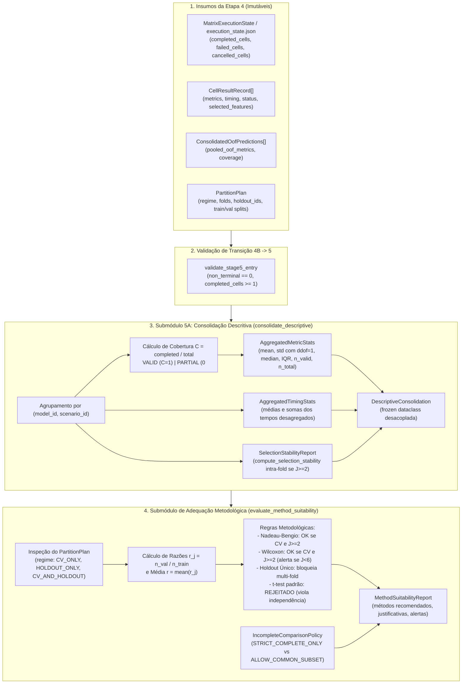

# M6.1 — Consolidação Descritiva e Adequação Metodológica Design

**Spec**: `.specs/features/m6-1-descriptive-consolidation-suitability/spec.md`  
**Status**: Approved  

---

## 1. Visão Geral da Arquitetura

O Sub-marco M6.1 estabelece o alicerce analítico da Etapa 5 (`experimental_ml.statistics`), implementando:
1. A validação de transição da Etapa 4B para a Etapa 5 (`validate_stage5_entry`), assegurando que matrizes em andamento ou totalmente sem sucesso sejam barradas antes do processamento estatístico (`CA-E5-01`).
2. O Submódulo 5A de Consolidação Descritiva (`consolidate_descriptive`), reunindo resultados por configuração `(model_id, scenario_id)`, computando a cobertura efetiva $C$, preservando falhas e cancelamentos em listas discriminadas (`failed_fold_ids`, `cancelled_fold_ids`), agregando métricas e tempos de forma desacoplada com suporte rigoroso a métricas indefinidas (`n_valid == 0`) e integrando estabilidade de atributos (`SelectionStabilityReport`).
3. O Submódulo de Avaliação de Adequação Metodológica (`evaluate_method_suitability`), inspecionando o `PartitionPlan` e os resultados para determinar a validade científica de métodos inferenciais frente à sobreposição de treino em validação cruzada ($r = n_{\text{val}} / n_{\text{train}}$), ausência de dispersão em holdout único ($J = 1$), e limitações estruturais de tamanho amostral ($J < 6$ no teste de Wilcoxon).
4. O tratamento de incompletude (`IncompleteComparisonPolicy`), viabilizando comparações condicionais no subconjunto comum pareado ($J_{\text{pareados}} \ge 2$) ou rejeição estrita.

---

## 2. Análise de Reuso de Código

| Componente Necessário | Módulo Fornecedor | Elemento Reutilizado |
| :--- | :--- | :--- |
| Enums transversais | `experimental_ml.core.enums` | `MetricStatus`, `ExecutionStatus`, `TaskType` |
| Verificação de métricas | `experimental_ml.metrics` | `MetricValue`, `MetricDirection` |
| Estabilidade de seleção | `experimental_ml.features.stability` | `compute_selection_stability`, `SelectionStabilityReport` |
| Regime e partições | `experimental_ml.validation.types` | `PartitionPlan`, `EvaluationRegime`, `FoldPartition` |
| Registros de execução | `experimental_ml.orchestration.types` | `CellResultRecord`, `TimingBreakdown` |
| Estado matricial | `experimental_ml.orchestration.state` | `MatrixExecutionState`, `load_execution_state` |
| Predições OOF | `experimental_ml.orchestration.oof` | `ConsolidatedOofPredictions`, `load_oof_predictions` |
| Exceções de contrato | `experimental_ml.core.exceptions` | `ContractViolationError`, `ConfigurationError` |

---

## 3. Modelo de Dados e Tipos (`experimental_ml.statistics.types`)

### 3.1 Enums
- **`CoverageStatus(StrEnum)`**:
  - `VALID`: $C = 1.0$ (todos os folds concluídos).
  - `PARTIAL_COVERAGE`: $0.0 < C < 1.0$ (pelo menos um fold concluído, mas com falhas/cancelamentos).
  - `NO_COVERAGE`: $C = 0.0$ (nenhum fold concluído).
- **`IncompleteComparisonPolicy(StrEnum)`**:
  - `STRICT_COMPLETE_ONLY`: exige cobertura `VALID` para ambas as configurações comparadas.
  - `ALLOW_COMMON_SUBSET`: permite comparação restrita aos folds comuns válidos ($J_{\text{pareados}} \ge 2$), rotulando compulsoriamente o resultado como condicional.
- **`ApplicabilityStatus(StrEnum)`**:
  - `APPLICABLE`: método matematicamente adequado sem ressalvas impeditivas.
  - `CONDITIONALLY_APPLICABLE`: aplicável mediante condições explícitas (ex.: análise restrita a subconjunto).
  - `NOT_SUITABLE`: cientificamente inadequado para o desenho experimental (ex.: $t$ pareado padrão em CV, ou teste multi-fold em holdout único).
  - `NOT_APPLICABLE`: não executável por falta de dados pareados ($J_{\text{pareados}} < 2$).

### 3.2 Dataclasses Imutáveis (`frozen=True`, `slots=True`)
- **`AggregatedMetricStats`**:
  - `n_valid: int`
  - `n_total: int`
  - `status: MetricStatus`
  - `mean: float | None`
  - `std: float | None` (com `ddof=1` se $n_{\text{valid}} \ge 2$; `None` se $n_{\text{valid}} < 2$)
  - `median: float | None`
  - `iqr: float | None`
  - `q25: float | None`
  - `q75: float | None`
  - `min_value: float | None`
  - `max_value: float | None`
- **`AggregatedTimingStats`**:
  - Médias e totais em segundos para: `data_extraction`, `preprocessing`, `feature_selection`, `tuning`, `fit`, `predict`, `evaluation`, e `total_cell`.
- **`ConfigurationSummary`**:
  - `model_id: str`
  - `scenario_id: str`
  - `total_folds: int`
  - `completed_folds: int`
  - `failed_folds: int`
  - `cancelled_folds: int`
  - `coverage: float`
  - `coverage_status: CoverageStatus`
  - `completed_fold_ids: tuple[str, ...]`
  - `failed_fold_ids: tuple[str, ...]`
  - `cancelled_fold_ids: tuple[str, ...]`
  - `fold_metrics: Mapping[str, Mapping[str, MetricValue]]`
  - `aggregated_metrics: Mapping[str, AggregatedMetricStats]`
  - `pooled_oof_metrics: Mapping[str, MetricValue]`
  - `aggregated_timing: AggregatedTimingStats | None`
  - `feature_stability: SelectionStabilityReport | None`
- **`DescriptiveConsolidation`**:
  - `experiment_id: str`
  - `partition_plan_id: str`
  - `total_configurations: int`
  - `configurations: Mapping[tuple[str, str], ConfigurationSummary]`
  - `timestamp_utc: str`
- **`ApplicableMethod`**:
  - `method_name: str`
  - `status: ApplicabilityStatus`
  - `rationale: str`
  - `assumptions_tested: tuple[str, ...]`
  - `assumptions_untested: tuple[str, ...]`
  - `warnings: tuple[str, ...]`
- **`MethodSuitabilityReport`**:
  - `evaluation_regime: EvaluationRegime`
  - `total_development_partitions: int`
  - `fold_ratios: tuple[float, ...]`
  - `mean_train_overlap_ratio: float`
  - `is_cross_validation: bool`
  - `applicable_methods: Mapping[str, ApplicableMethod]`
  - `warnings: tuple[str, ...]`

---

## 4. Algoritmos e Detalhes dos Submódulos

### 4.1 Validação de Entrada da Etapa 5 (`validate_stage5_entry`)
- Recebe `MatrixExecutionState` (ou carrega de `run_dir / "execution_state.json"`).
- Se houver qualquer célula em `PENDING` ou `RUNNING`, levanta `ContractViolationError("Matrix execution contains active non-terminal cells...")`.
- Se `completed_cells == 0`, levanta `ContractViolationError("Matrix execution contains zero completed cells...")`.
- Retorna `None` se validado com sucesso.

### 4.2 Consolidação Descritiva (`consolidate_descriptive`)
1. Agrupa os `CellResultRecord` por chave de configuração `(cell.model_id, cell.scenario_id)`.
2. Para cada configuração:
   - Identifica `completed_fold_ids`, `failed_fold_ids`, `cancelled_fold_ids`.
   - Computa $C = \frac{\text{completed\_folds}}{\text{total\_folds}}$.
   - Determina `coverage_status` (`VALID` se $C=1.0$, `PARTIAL_COVERAGE` se $0 < C < 1$, `NO_COVERAGE` se $C=0$).
   - Para cada métrica observada nas células concluídas:
     - Filtra valores válidos (`MetricStatus.VALID` e finitos).
     - Se $n_{\text{valid}} == 0$: campos descritivos = `None`, `status = MetricStatus.UNDEFINED_NAN`.
     - Se $n_{\text{valid}} == 1$: média, mediana, min, max computados, `std = None`, `iqr = 0.0`.
     - Se $n_{\text{valid}} \ge 2$: computa média, `std` amostral com `ddof=1`, mediana, percentis 25 e 75, IQR. `status = VALID` se $n_{\text{valid}} == n_{\text{total}}$, senão `PARTIAL_COVERAGE`.
   - Agrega tempos desagregados (médias e somas). Se $C=0$, `aggregated_timing = None`.
   - Se houver seleções de atributos registradas nas células concluídas com $J_{\text{completed}} \ge 2$, invoca `compute_selection_stability(fold_selections, n_total_candidates)`.
   - Anexa métricas pooled OOF se disponíveis para aquela configuração.
3. Retorna instância imutável `DescriptiveConsolidation`.

### 4.3 Avaliação de Adequação Metodológica (`evaluate_method_suitability`)
1. Extrai `regime = partition_plan.regime`.
2. Extrai dobras de desenvolvimento: $J = \text{len}(partition_plan.folds)$.
3. Para cada dobra de CV $j \in \{0, \dots, J-1\}$:
   - $n_{\text{train}, j} = \text{len}(fold.train\_ids)$, $n_{\text{val}, j} = \text{len}(fold.val\_ids)$.
   - $r_j = \frac{n_{\text{val}, j}}{n_{\text{train}, j}}$.
4. Computa a razão média $r = \frac{1}{J} \sum_{j=0}^{J-1} r_j$.
5. Avalia métodos:
   - **`paired_t_test_uncorrected`**: marcado como `NOT_SUITABLE` para CV, com a justificativa: *"Standard paired t-test assumes independent observations, but cross-validation folds violate this assumption due to overlapping training sets (train overlap ratio r = {r:.4f})."*
   - **`nadeau_bengio_paired_t`**: marcado como `APPLICABLE` se `is_cross_validation` e $J \ge 2$, com a justificativa da correção de variância $(\frac{1}{J} + r) s^2_d$.
   - **`wilcoxon_signed_rank_paired`**: marcado como `APPLICABLE` se `is_cross_validation` e $J \ge 2$. Se $J < 6$, anexa aviso metodológico: *"Mathematical limitation: with J = {J} < 6, two-sided p-value cannot reach alpha = 0.05 (minimum exact p-value is 0.0625). Note that J >= 6 is a necessary condition, not a guarantee of adequate statistical power."*
   - **`multi_fold_holdout_test`**: se `regime == EvaluationRegime.HOLDOUT_ONLY`, marcado como `NOT_SUITABLE` (*"Partition-level multi-fold tests are not suitable for single holdout evaluation (J=1) due to lack of sample variance across partitions."*).
6. Função auxiliar `check_pairwise_comparison_eligibility(summary_a, summary_b, policy)`:
   - Identifica a interseção de dobras concluídas com sucesso: $F_{\text{shared}} = \text{completed}_A \cap \text{completed}_B$.
   - Se `policy == STRICT_COMPLETE_ONLY` e qualquer uma tiver `coverage_status != VALID`, retorna `(False, "Coverage is not VALID...", ())`.
   - Se `len(F_shared) < 2`, retorna `(False, "Insufficient shared folds (J_paired < 2)...", ())`.
   - Se `len(F_shared) >= 2` sob `ALLOW_COMMON_SUBSET` com dobras faltantes, retorna `(True, "Conditionally applicable on common subset...", tuple(F_shared))`.

---

## 5. Riscos e Mitigações

| Risco Identificado | Severidade | Mitigação Arquitetural |
| :--- | :--- | :--- |
| Dobras com tamanhos desiguais distorcerem $r$ | Média | Preservar tanto a tupla de razões individuais $(r_0, \dots, r_{J-1})$ quanto a média $r$ em `MethodSuitabilityReport`. |
| Configuração com 0 folds concluídos quebrar estatísticas | Alta | Enum `CoverageStatus.NO_COVERAGE`, campos numéricos anuláveis (`None`), e validação $n_{\text{valid}} > 0$. |
| Holdout final ser misturado com validação cruzada | Crítica | Em `CV_AND_HOLDOUT`, $J$ é obtido estritamente de $\text{len}(plan.folds)$, isolando `plan.holdout_ids`. |
| Falsa expectativa de poder estatístico para $J=6$ | Média | Alerta explícito de que $J \ge 6$ é pré-requisito matemático para bicaudal a $5\%$, não garantia de poder amostral. |
