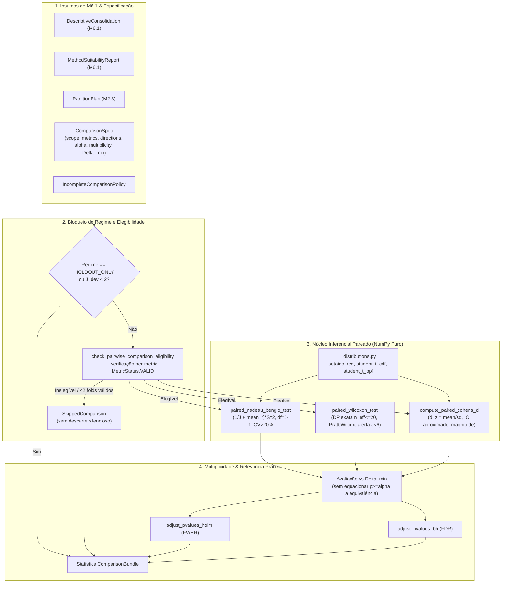

# M6.2 — Inferência Estatística Pareada, Tamanho de Efeito e Ajuste de Multiplicidade Design

**Spec**: `.specs/features/m6-2-paired-inference-multiplicity/spec.md`  
**Status**: Approved  

---

## 1. Visão Geral da Arquitetura

O Sub-marco M6.2 implementa o núcleo inferencial do Submódulo 5B (`experimental_ml.statistics`), operando sobre as consolidações descritivas (`DescriptiveConsolidation`) e relatórios de adequação (`MethodSuitabilityReport`) produzidos em M6.1. Todos os cálculos estatísticos e distribucionais são executados estritamente em Python padrão + NumPy (`XCUT-02`), sem dependência de `scipy` em tempo de execução.

---

## 2. Análise de Reuso de Código

| Componente Necessário | Módulo Fornecedor | Elemento Reutilizado |
| :--- | :--- | :--- |
| Elegibilidade pareada e adequação | `experimental_ml.statistics.suitability` | `check_pairwise_comparison_eligibility`, `MethodSuitabilityReport` |
| Consolidação descritiva e cobertura | `experimental_ml.statistics.types` | `DescriptiveConsolidation`, `ConfigurationSummary`, `CoverageStatus`, `IncompleteComparisonPolicy` |
| Direção de métricas e status | `experimental_ml.metrics.types` / `core.enums` | `MetricDirection`, `MetricStatus`, `MetricValue` |
| Regimes e partições | `experimental_ml.validation.types` | `PartitionPlan`, `EvaluationRegime` |
| Exceções de contrato | `experimental_ml.core.findings` | `ContractViolationError`, `ConfigurationError` |

---

## 3. Modelo de Dados (`experimental_ml.statistics.types`)

### 3.1 Enums
- **`ComparisonScope(StrEnum)`**: `MODELS_WITHIN_SCENARIO`, `SCENARIOS_WITHIN_MODEL`, `FULL_CONFIGURATIONS`, `AGAINST_BASELINE`, `ALL_PAIRWISE`, `PLANNED_HYPOTHESES`.
- **`MultiplicityMethod(StrEnum)`**: `NONE`, `HOLM_BONFERRONI`, `BENJAMINI_HOCHBERG`.
- **`EffectSizeMagnitude(StrEnum)`**: `NEGLIGIBLE` ($|d_z| < 0.2$), `SMALL` ($0.2 \le |d_z| < 0.5$), `MEDIUM` ($0.5 \le |d_z| < 0.8$), `LARGE` ($|d_z| \ge 0.8$).
- **`PracticalRelevanceStatus(StrEnum)`**: `NOT_CONFIGURED`, `STATISTICALLY_SIGNIFICANT_AND_PRACTICAL`, `STATISTICALLY_SIGNIFICANT_NOT_PRACTICAL`, `PRACTICAL_NOT_STATISTICALLY_SIGNIFICANT`, `INCONCLUSIVE`, `EVIDENCE_OF_EQUIVALENCE`.

### 3.2 Dataclasses Congeladas (`frozen=True`)
- **`ComparisonSpec`**: `metrics_of_interest: tuple[str, ...]`, `metric_directions: Mapping[str, MetricDirection]`, `comparison_scope: ComparisonScope`, `baseline_config: tuple[str, str] | None = None`, `planned_pairs: tuple[tuple[tuple[str, str], tuple[str, str]], ...] = ()`, `alpha: float = 0.05`, `multiplicity_method: MultiplicityMethod = MultiplicityMethod.HOLM_BONFERRONI`, `hypothesis_family_spec: Mapping[tuple[tuple[str, str], tuple[str, str], str], str] | None = None`, `practical_relevance_thresholds: Mapping[str, float] | None = None`.
- **`NadeauBengioResult`**: `mean_difference: float`, `std_difference: float`, `corrected_variance: float`, `corrected_se: float`, `t_statistic: float`, `degrees_of_freedom: int`, `p_value: float`, `confidence_interval: tuple[float, float]`, `alpha: float`, `mean_train_val_ratio: float`, `fold_size_cv: float | None`, `warnings: tuple[str, ...]`.
- **`WilcoxonResult`**: `statistic: float`, `w_plus: float`, `w_minus: float`, `n_total: int`, `n_effective: int`, `zero_method: str`, `p_value: float`, `is_exact: bool`, `warnings: tuple[str, ...]`.
- **`EffectSizeResult`**: `cohens_d: float`, `magnitude: EffectSizeMagnitude`, `confidence_interval: tuple[float | None, float | None]`, `alpha: float`, `warnings: tuple[str, ...]`.
- **`PairwiseComparisonResult`**: `comparison_id: str`, `family_id: str`, `metric_name: str`, `direction: MetricDirection`, `config_a: tuple[str, str]`, `config_b: tuple[str, str]`, `shared_fold_ids: tuple[str, ...]`, `observed_mean_a: float`, `observed_mean_b: float`, `observed_difference: float`, `observed_better: tuple[str, str] | None`, `nadeau_bengio: NadeauBengioResult`, `wilcoxon: WilcoxonResult`, `effect_size: EffectSizeResult`, `nadeau_bengio_adjusted_p: float`, `wilcoxon_adjusted_p: float`, `practical_relevance: PracticalRelevanceStatus`, `is_conditional: bool`, `warnings: tuple[str, ...]`.
- **`SkippedComparison`**: `config_a: tuple[str, str]`, `config_b: tuple[str, str]`, `metric_name: str`, `reason: str`.
- **`StatisticalComparisonBundle`**: `experiment_id: str`, `partition_plan_id: str`, `comparison_spec: ComparisonSpec`, `comparisons: tuple[PairwiseComparisonResult, ...]`, `skipped_comparisons: tuple[SkippedComparison, ...]`, `non_applicable_reasons: tuple[str, ...]`, `warnings: tuple[str, ...]`.

---

## 4. Detalhamento Matemático dos Algoritmos

### 4.1 Distribuição $t$ de Student Pura (`_distributions.py`)
- **Função Beta Incompleta Regularizada $I_x(a, b)$**: Implementada via fração continuada modificada de Lentz (Press et al., *Numerical Recipes*), utilizando a identidade de simetria $I_x(a,b) = 1 - I_{1-x}(b,a)$ quando $x > \frac{a+1}{a+b+2}$ para convergência rápida e precisão de máquina ($\sim 10^{-14}$).
- **CDF e $p$-valor Bicaudal de Student-$t$**:
  $$P(|T_\nu| \ge |t|) = I_{\frac{\nu}{\nu + t^2}}\left(\frac{\nu}{2}, \frac{1}{2}\right)$$
- **Quantil $t_{1-\alpha/2, \nu}$**: Busca por bisseção garantida sobre $[0, 10^9]$ seguida de refinamento até tolerância $10^{-12}$.

### 4.2 Nadeau-Bengio (`paired_nadeau_bengio_test`)
- Para $d_j = x_{A,j} - x_{B,j}$, $j = 1, \dots, J$:
  - $\bar{d} = \text{mean}(d)$, $S^2_d = \text{var}(d, \text{ddof}=1)$.
  - $\bar{r} = \text{mean}(\text{train\_val\_ratios})$.
  - $\sigma_{\text{corr}}^2 = \left(\frac{1}{J} + \bar{r}\right) S^2_d$, $\text{SE}_{\text{corr}} = \sqrt{\sigma_{\text{corr}}^2}$.
  - Se $S^2_d = 0$: se $\bar{d} = 0 \implies t = 0.0, p = 1.0, \text{IC} = (0.0, 0.0)$; se $\bar{d} \ne 0 \implies t = \text{sign}(\bar{d}) \cdot \infty, p = 0.0, \text{IC} = (\bar{d}, \bar{d})$, com aviso `zero_difference_variance`.
  - Coeficiente de variação: calculado sobre `fold_val_sizes` (se fornecido) ou `train_val_ratios` (se $\ge 2$ elementos); se $\text{CV} > 0.20$, anexa alerta metodológico.

### 4.3 Wilcoxon Pareado (`paired_wilcoxon_test`)
- **Ranqueamento**:
  - `"wilcox"`: remove $d_j = 0$, obtendo $n_{\text{eff}} = J - n_0$ valores ranqueados de $1$ a $n_{\text{eff}}$ (com média para empates).
  - `"pratt"`: ranqueia todos os $J$ valores absolutos $|d_j|$; os $n_0$ zeros recebem posto médio $(n_0+1)/2$ e são descartados após ranquear, mantendo os postos $\{r_i\}$ dos $n_{\text{eff}}$ elementos não-nulos.
- **Distribuição Nula**:
  - Se $n_{\text{eff}} = 0$: $W = 0.0, p = 1.0$.
  - Se $n_{\text{eff}} \le 20$ e $J \le 25$: **Programação Dinâmica Exata** sobre os postos inteiros dobrados $2 r_i \in \mathbb{Z}_{>0}$, computando a distribuição exata da soma sob $2^{n_{\text{eff}}}$ sinais equiprováveis: $p = \min(1.0, 2 \cdot P(W^+ \le \min(W^+, W^-)))$.
  - Caso contrário: **Aproximação Normal** com correção de continuidade ($0.5$) e correção de empates:
    - Para `"wilcox"`: $\mu = \frac{n(n+1)}{4}$, $\sigma^2 = \frac{n(n+1)(2n+1) - \frac{1}{2}\sum t_k(t_k^2 - 1)}{24}$.
    - Para `"pratt"` (Pratt, 1959): $\mu = \frac{1}{4}[J(J+1) - n_0(n_0+1)]$, $\sigma^2 = \frac{1}{24}[J(J+1)(2J+1) - n_0(n_0+1)(2n_0+1) - \frac{1}{2}\sum_{\text{não-zero}} t_k(t_k^2 - 1)]$.
    - $z = \frac{\max(0, |W^+ - \mu| - 0.5)}{\sigma}$, $p = \text{erfc}(|z| / \sqrt{2})$.
  - Emite alerta obrigatório se $J < 6$ ou $n_{\text{eff}} < 6$.

### 4.4 Cohen's $d_z$ (`compute_paired_cohens_d`)
- $d_z = \bar{d} / s_d$ (`ddof=1`).
- $\text{SE}(d_z) = \sqrt{1/J + d_z^2 / (2J)}$, $\text{IC} = d_z \pm t_{1-\alpha/2, J-1} \cdot \text{SE}(d_z)$ (com ressalva de não-correção por sobreposição de CV).
- Para $s_d = 0$: se $\bar{d} = 0 \implies d_z = 0.0, \text{IC} = (0.0, 0.0)$; se $\bar{d} \ne 0 \implies d_z = \text{sign}(\bar{d}) \cdot \infty, \text{IC} = (\text{None}, \text{None})$.

### 4.5 Ajuste de Multiplicidade (`multiplicity.py`)
- **Holm-Bonferroni**: ordena $p_{(1)} \le \dots \le p_{(m)}$, calcula $\tilde{p}_{(i)} = \max_{k \le i} \min(1.0, (m - k + 1) p_{(k)})$, restaura índices originais.
- **Benjamini-Hochberg**: ordena $p_{(1)} \le \dots \le p_{(m)}$, calcula $\tilde{p}_{(i)} = \min_{k \ge i} \min(1.0, \frac{m}{k} p_{(k)})$ de trás para frente, restaura índices originais.

---

## 5. Estratégia de Testes e Verificação

- **Testes Unitários**:
  - `tests/unit/statistics/test_inference_types.py`: imutabilidade, validações de `ComparisonSpec` e enums.
  - `tests/unit/statistics/test_nadeau_bengio.py`: precisão da CDF/quantil $t$ contra valores analíticos conhecidos, variância corrigida, variância nula ($\bar{d}=0$ e $\bar{d} \ne 0$), alerta de CV $> 20\%$.
  - `tests/unit/statistics/test_wilcoxon_cohen.py`: DP exata (com e sem empates), `"wilcox"` vs `"pratt"` (com verificação exata da fórmula de Pratt), aproximação assintótica ($n > 20$), todos zeros, alerta $n_{\text{eff}} < 6$, Cohen's $d_z$ e intervalos.
  - `tests/unit/statistics/test_multiplicity_comparisons.py`: Holm, BH, monotonicidade, empates, rejeição de $p$ inválido, todos os 6 escopos de `ComparisonScope`, proteção `HOLDOUT_ONLY`, filtragem de `UNDEFINED_NAN` em células `COMPLETED`, e relevância prática.
- **Testes de Integração**:
  - `tests/integration/statistics/test_m62_integration.py`: fluxo ponta a ponta M6.1 $\to$ M6.2 com matriz sintética (inclusive com `UNDEFINED_NAN`, `PARTIAL_COVERAGE` e `CV_AND_HOLDOUT`), e verificação de pureza `XCUT-02` (zero import de `scipy`).
