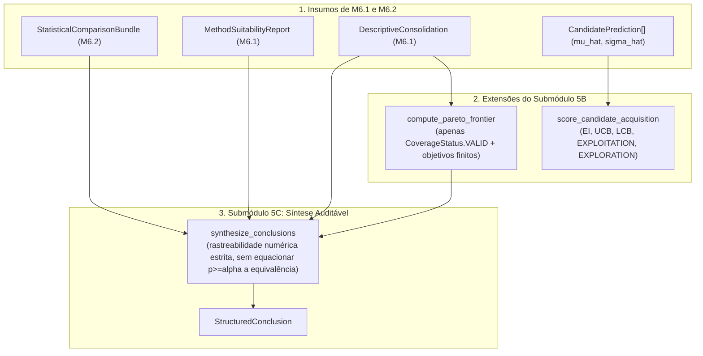

# M6.3 — Fronteira de Pareto, Funções de Aquisição e Síntese de Conclusões Design

**Spec**: `.specs/features/m6-3-pareto-acquisition-synthesis/spec.md`  
**Status**: Approved  

---

## 1. Visão Geral da Arquitetura

O Sub-marco M6.3 completa os submódulos analíticos da Etapa 5 (`experimental_ml.statistics`), conectando os resumos descritivos (5A, M6.1) e inferenciais (5B, M6.2) à análise multiobjetivo de Pareto, à priorização prospectiva por funções de aquisição e à síntese explicativa auditável (5C).

---

## 2. Modelo de Dados (`experimental_ml.statistics.types`)

### 2.1 Enums
- **`ObjectiveSource(StrEnum)`**: `AGGREGATED_METRIC`, `TIMING_MEAN`, `FEATURE_STABILITY`.
- **`AcquisitionCriterion(StrEnum)`**: `EXPECTED_IMPROVEMENT`, `UCB`, `LCB`, `EXPLOITATION`, `EXPLORATION`.

### 2.2 Dataclasses Congeladas (`frozen=True`)
- **`ObjectiveSpec`**: `name: str`, `direction: MetricDirection`, `source: ObjectiveSource = ObjectiveSource.AGGREGATED_METRIC`, `field_name: str | None = None`.
- **`MultiObjectiveSpec`**: `objectives: tuple[ObjectiveSpec, ...]` (exige `len(objectives) >= 1`).
- **`ParetoConfigurationPoint`**: `config_id: tuple[str, str]`, `objective_values: Mapping[str, float]`, `is_pareto_optimal: bool`, `dominated_by: tuple[tuple[str, str], ...]`.
- **`ExcludedParetoConfiguration`**: `config_id: tuple[str, str]`, `reason: str`.
- **`MultiObjectiveSummary`**: `objectives: tuple[ObjectiveSpec, ...]`, `pareto_frontier: tuple[ParetoConfigurationPoint, ...]`, `dominated_configurations: tuple[ParetoConfigurationPoint, ...]`, `excluded_configurations: tuple[ExcludedParetoConfiguration, ...]`.
- **`CandidatePrediction`**: `candidate_id: str`, `mean: float`, `std: float` (rejeita `NaN`/`Inf` e `std < 0`).
- **`AcquisitionScoreRecord`**: `candidate_id: str`, `criterion: AcquisitionCriterion`, `score: float`, `mean: float`, `std: float`, `rank: int`.
- **`StructuredConclusion`**: `primary_metric: str`, `observed_leader: tuple[str, str] | None`, `statistical_evidence_status: str`, `effect_magnitude_summary: str`, `practical_relevance_status: str`, `cost_tradeoff_summary: str`, `methodological_caveats: tuple[str, ...]`, `narrative_text: str`.

---

## 3. Detalhamento dos Algoritmos

### 3.1 Fronteira de Pareto (`multiobjective.py`)
1. Filtra configurações com `coverage_status == CoverageStatus.VALID`; demais vão para `excluded_configurations`.
2. Extrai o valor escalar de cada `ObjectiveSpec`:
   - `AGGREGATED_METRIC`: `summary.aggregated_metrics[obj.field_name or obj.name].mean` (exige `status == MetricStatus.VALID` e valor finito).
   - `TIMING_MEAN`: atributo `mean_{field}_time_s` (ou campo explícito) em `summary.aggregated_timing` (exige não-nulo e finito).
   - `FEATURE_STABILITY`: `summary.feature_stability.mean_jaccard` (exige não-nulo e finito).
3. Dominância estrita: $A$ domina $B$ sse $\forall k,\; A_k \succeq_k B_k$ e $\exists k,\; A_k \succ_k B_k$ (respeitando `MINIMIZE` vs `MAXIMIZE`).
4. Ordena deterministicamente `pareto_frontier` e `dominated_configurations` por `config_id`.

### 3.2 Funções de Aquisição (`acquisition.py`)
- $\Phi(z) = 0.5 \left(1 + \text{erf}(z / \sqrt{2})\right)$, $\phi(z) = \frac{1}{\sqrt{2\pi}} \exp(-0.5 z^2)$ (via `math.erf` e `math.exp`, zero `scipy`).
- `EXPECTED_IMPROVEMENT`:
  - `best_observed` ($f^*$) padrão: `max(mu)` (`MAXIMIZE`) ou `min(mu)` (`MINIMIZE`) entre candidatos.
  - $\Delta = (\mu - f^* - \xi)$ (`MAXIMIZE`) ou $(f^* - \mu - \xi)$ (`MINIMIZE`).
  - Se $\sigma = 0$: $\text{EI} = \max(0.0, \Delta)$; caso contrário $Z = \Delta / \sigma$ e $\text{EI} = \Delta \Phi(Z) + \sigma \phi(Z)$.
- `UCB`: $\mu + \kappa \sigma$; `LCB`: $\mu - \kappa \sigma$ (ordenado do menor para o maior escore LCB).
- `EXPLOITATION`: $\mu$ (ordenado conforme `direction`); `EXPLORATION`: $\sigma$ (decrescente).
- Desempate determinístico por `candidate_id` crescente.

### 3.3 Síntese de Conclusões (`synthesis.py`)
- Identifica `observed_leader` exclusivamente entre configurações com `MetricStatus.VALID` na métrica primária (respeitando `primary_direction`).
- Resume evidência estatística das comparações em `comparison_bundle.comparisons` para `primary_metric`, citando $p_{\text{adj}}$, estatísticas $t$/$W$, $d_z$ de Cohen e classificação de relevância prática.
- Para qualquer comparação com $p_{\text{adj}} \ge \alpha$, declara explicitamente insuficiência de evidência para rejeitar $H_0$ (nunca equivalência).
- Agrega ressalvas metodológicas de `suitability_report.warnings`, `comparison_bundle.non_applicable_reasons`, `comparison_bundle.warnings` e `skipped_comparisons`.
