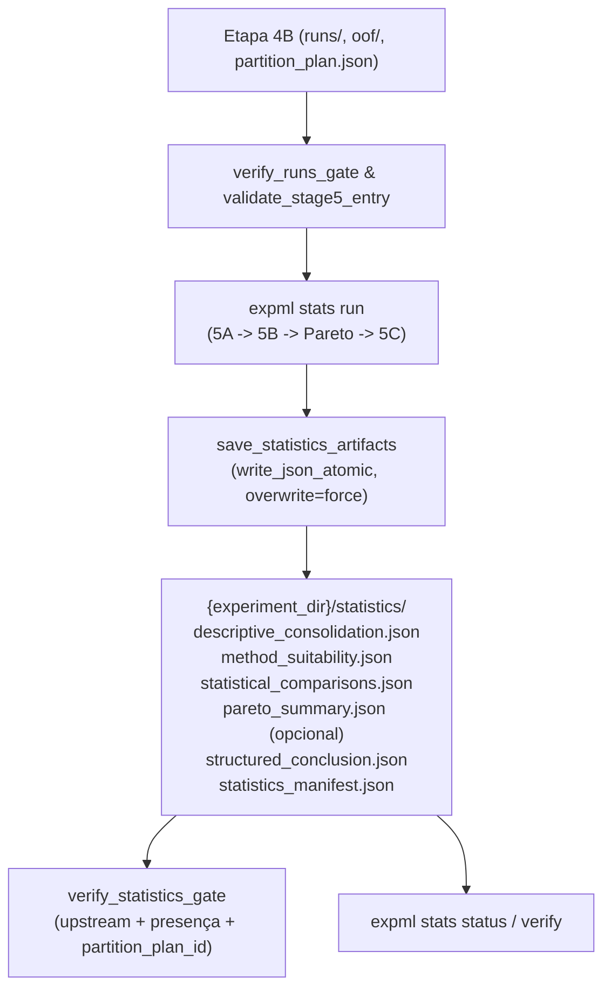

# M6.4 — Persistência Atômica, Portão de Estágio e CLI `expml stats` Design

**Spec**: `.specs/features/m6-4-statistics-persistence-cli/spec.md`  
**Status**: Approved  

---

## 1. Visão Geral da Arquitetura

O Sub-marco M6.4 fecha a Etapa 5 (`experimental_ml.statistics`), garantindo persistência atômica e auditável sob `{experiment_dir}/statistics/`, bloqueio formal de transição para a Etapa 6 (`verify_statistics_gate`) e interface CLI `expml stats` (`run`, `status`, `verify`).

---

## 2. Reuso de Código

| Componente | Módulo Fornecedor | Elemento Reutilizado |
| :--- | :--- | :--- |
| Escrita atômica e leitura JSON | `experimental_ml.core.storage` | `write_json_atomic`, `read_json` |
| Portão upstream Stage 4 | `experimental_ml.stages.stage_gates` | `verify_runs_gate` |
| Carregamento de estado e OOF | `experimental_ml.orchestration` | `load_execution_state`, `load_oof_predictions`, `load_cell_result` |
| Plano de partições | `experimental_ml.validation.storage` | `load_partition_plan` |
| Exceções de domínio | `experimental_ml.core.findings` | `DataIntegrityError`, `ContractViolationError`, `ConfigurationError` |

---

## 3. Detalhamento dos Componentes

### 3.1 Persistência (`src/experimental_ml/statistics/storage.py`)
- **Codificação de não-finitos**: `_encode_float(v)` converte `NaN` $\to$ `{"__nonfinite__": "NaN"}`, `+Inf` $\to$ `{"__nonfinite__": "Inf"}`, `-Inf` $\to$ `{"__nonfinite__": "-Inf"}` para conformidade estrita RFC 8259 sem `0.0` espúrio (`ADR-005`). `_decode_float(v)` restaura `float("nan")`, `float("inf")`, `float("-inf")`.
- **Chaves compostas `(model_id, scenario_id)`**: serializadas como `"<model_id>::<scenario_id>"` ou lista de registros com `model_id` e `scenario_id` explícitos (evita qualquer colisão caso IDs contenham separadores). Usaremos listas explícitas `[ {"model_id": m, "scenario_id": s, "summary": ...}, ... ]`!
- **`save_statistics_artifacts(target_dir, consolidation, suitability, comparisons, conclusion, pareto=None, *, force=False)`**:
  - Valida existência prévia dos arquivos se `force=False`, lançando `ContractViolationError` antes de escrever qualquer arquivo (`STORE-05`).
  - Grava via `write_json_atomic(..., overwrite=force)` os 5 arquivos obrigatórios + `pareto_summary.json` (se fornecido) + `statistics_manifest.json`.
- **`load_statistics_artifacts(target_dir)`**:
  - Lê e reconstrói todas as dataclasses congeladas em um objeto `LoadedStatisticsArtifacts` (ou dicionário tipado) com fidelidade integral de roundtrip.

### 3.2 Portão `verify_statistics_gate` (`src/experimental_ml/stages/stage_gates.py`)
- Aceita `experiment_dir` (ou `statistics/` diretamente).
- Executa `verify_runs_gate(exp_dir)` se `runs/execution_state.json` estiver presente em `exp_dir`.
- Carrega e valida os 5 arquivos obrigatórios em `statistics/` via `load_statistics_artifacts`.
- Verifica alinhamento de `partition_plan_id` entre `statistics_manifest.json`, `descriptive_consolidation.json`, `statistical_comparisons.json` e o `partition_plan.json` / `execution_state.json` upstream.
- Retorna dicionário resumo auditável.

### 3.3 CLI `expml stats` (`src/experimental_ml/cli/cmd_stats.py` & `cli/main.py`)
- Subcomandos registrados em `cli/main.py` com importação preguiçosa (`CLI-10`):
  - `expml stats run --experiment-dir <dir> [--config <json>] [--force]`
  - `expml stats status --experiment-dir <dir>`
  - `expml stats verify --experiment-dir <dir>`
- `cmd_stats.py` mantém apenas imports leves no topo do módulo (`argparse`, `Path`, etc.), carregando `experimental_ml.statistics` e `stage_gates` apenas dentro dos handlers (`CLI-10`).
- Supressão de hashes criptográficos brutos na saída padrão (`CLI-11`).
