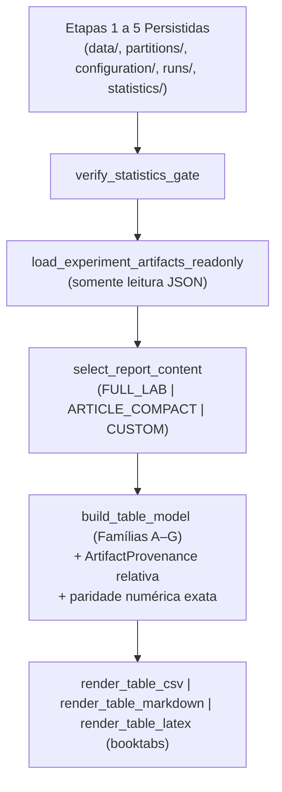

# M7.1 — Contratos de Publicação, Carregamento Somente-Leitura e Tabelas das 7 Famílias Design

**Spec**: `.specs/features/m7-1-reporting-contracts-tables/spec.md`  
**Status**: Approved  

---

## 1. Visão Geral da Arquitetura

O Sub-marco M7.1 cria o pacote `src/experimental_ml/reporting/` em estrita conformidade com `CA-E6-01` (operação somente-leitura, zero invocação de modelos), `CA-E6-02` (exclusão estrutural de campos `*_hash`, caminhos relativos em `ArtifactProvenance`) e `XCUT-02` (apenas biblioteca padrão Python + NumPy).

---

## 2. Modelo de Dados (`src/experimental_ml/reporting/types.py`)

### 2.1 Enums
- **`ReportFamily(StrEnum)`**:
  - `A_DATA_CHARACTERIZATION`
  - `B_FEATURE_SCENARIOS`
  - `C_MODELS_CONFIG`
  - `D_PREDICTIVE_PERFORMANCE`
  - `E_STATISTICAL_COMPARISONS`
  - `F_STABILITY_COST_PARETO`
  - `G_MODEL_SPECIFIC_ARTIFACTS`
- **`ReportAudience(StrEnum)`**: `FULL_LAB`, `ARTICLE_COMPACT`, `CUSTOM`.
- **`PlotType(StrEnum)`**: `BAR_COMPARISON`, `SCATTER_PARITY`, `PAIRED_DIFF_CI`, `PARETO_TRADEOFF`, `HEATMAP`, `LINE_LEARNING`.
- **`ColumnAlignment(StrEnum)`**: `LEFT`, `RIGHT`, `CENTER`.

### 2.2 Dataclasses Congeladas (`frozen=True`)
- **`ArtifactProvenance`**: `artifact_id`, `artifact_type`, `family: ReportFamily`, `experiment_id`, `partition_plan_id`, `model_ids: tuple[str, ...]`, `scenario_ids: tuple[str, ...]`, `metrics: tuple[str, ...]`, `source_relative_paths: tuple[str, ...]`, `created_at_utc: str`. Rejeita caminhos absolutos (`Path(p).is_absolute()`).
- **`ReportContentSelection`**: `audience: ReportAudience`, `families: tuple[ReportFamily, ...]`, `model_ids: tuple[str, ...]`, `scenario_ids: tuple[str, ...]`, `metric_ids: tuple[str, ...]`.
- **`TableColumn`**: `key`, `header`, `align: ColumnAlignment = ColumnAlignment.LEFT`, `numeric_format: str | None = None`.
- **`TableModel`**: `table_id`, `family: ReportFamily`, `title`, `caption`, `columns: tuple[TableColumn, ...]`, `rows: tuple[Mapping[str, Any], ...]`, `notes: tuple[str, ...]`, `provenance: ArtifactProvenance`.
- **`PlotSeries`** & **`PlotSpecification`**: Estruturas imutáveis preparadas para renderização em M7.2.
- **`LoadedExperimentData`**: Contêiner imutável com `experiment_id`, `partition_plan_id`, `statistics: LoadedStatisticsArtifacts`, e dicionários somente-leitura opcionais de `dataset_profile`, `preparation_plan`, `partition_plan`, `scenarios_catalog`, `models_catalog`, `execution_state`.

---

## 3. Seleção de Conteúdo e Tabelas (`loader.py`, `tables.py`)

### 3.1 `select_report_content`
- `FULL_LAB`: todas as 7 famílias (A–G), todos os `model_ids`, `scenario_ids` e `metric_ids` disponíveis ordenados.
- `ARTICLE_COMPACT`: famílias `(D_PREDICTIVE_PERFORMANCE, E_STATISTICAL_COMPARISONS, F_STABILITY_COST_PARETO)` + filtros de IDs se informados (ou todos ordenados).
- `CUSTOM`: famílias explícitas não vazias + filtros de IDs informados.

### 3.2 `build_table_model` (Famílias A–G)
- **Família A**: Resumo estrutural da base (`dataset_profile` / `preparation_plan`) sem expor `dataset_hash`.
- **Família B**: Cenários de atributos (`scenarios_catalog` + estabilidade de seleção de M6.1).
- **Família C**: Catálogo de modelos (`models_catalog` — família, tipo de tarefa, parâmetros sem caminhos/hashes internos).
- **Família D**: Desempenho preditivo (`statistics.consolidation`: `model_id`, `scenario_id`, `metric`, `mean`, `std`, `median`, `iqr`, `coverage`, `coverage_status`, `pooled_oof_mean`). Valores numéricos brutos preservados sem arredondamento!
- **Família E**: Comparações estatísticas (`statistics.comparisons`: `config_a`, `config_b`, `metric`, `observed_difference`, `t_statistic`, `nadeau_bengio_p`, `nadeau_bengio_adjusted_p`, `wilcoxon_w`, `wilcoxon_adjusted_p`, `cohens_d`, `practical_relevance`).
- **Família F**: Estabilidade, custo computacional e Fronteira de Pareto (`fit_mean_s`, `total_cell_mean_s`, `mean_jaccard`, `is_pareto_optimal`).
- **Família G**: Artefatos específicos por família de modelo (quando presentes em `models_catalog`/diagnósticos, ou registro explícito vazio informativo sem inventar dados).

### 3.3 Renderização de Valores e Hashes
- `None` $\to$ `"N/A"`
- `float("nan")` ou marcador `UNDEFINED_NAN` $\to$ `"UNDEFINED_NAN"`
- `+Inf` / `-Inf` $\to$ `"Inf"` / `"-Inf"`
- Campos com sufixo `_hash`, `_digest`, ou nomes `sha256` / `checksum` são estruturalmente excluídos antes de popular `TableModel`.
- `render_table_csv`: RFC 4180 via `csv.writer`, preservação numérica integral (`repr`/`str(float)`).
- `render_table_markdown`: alinhamento `:---`, `:---:`, `---:`, aplicando `numeric_format`.
- `render_table_latex`: `booktabs` (`\toprule`, `\midrule`, `\bottomrule`) com escape LaTeX (`_`, `%`, `&`, `#`, `$`).
