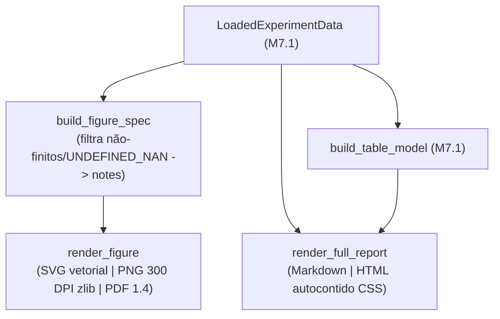

# M7.2 — Figuras Determinísticas e Relatório Científico Completo Design

**Spec**: `.specs/features/m7-2-figures-full-report/spec.md`  
**Status**: Approved  

---

## 1. Visão Geral da Arquitetura

O Sub-marco M7.2 implementa o motor gráfico puro em Python/NumPy (`figures.py`) e o compositor do Relatório Científico Completo (`report.py`), mantendo estrita conformidade com `XCUT-02` (sem `matplotlib`/`pillow`), `RNF03` (HTML autocontido 100% offline), `CA-E6-01` (somente-leitura) e `CA-E6-02` (sem exposição de `*_hash`).

---

## 2. Detalhamento Técnico

### 2.1 Renderização Pura de Figuras (`figures.py`)
- **SVG (`fmt="svg"`)**: Canvas vetorial 800×500 com eixos, marcas de escala, barras/pontos, barras de erro (`y_err`), legenda e título com `xml.sax.saxutils.escape`.
- **PNG 300 DPI (`fmt="png"`)**:
  - Rasteriza linhas, retângulos/barras e marcadores sobre buffer `uint8` RGB `(500, 800, 3)` em NumPy puro.
  - Empacota chunks padrão (`IHDR`, `pHYs` com `11811` px/m em X e Y = 300 DPI, `IDAT` comprimido com `zlib.compress(..., level=9)` e CRC32, `IEND`).
- **PDF 1.4 (`fmt="pdf"`)**:
  - Gera objetos PDF válidos (`Catalog`, `Pages`, `Page`, `Font Helvetica`, `Contents` stream com operadores vetoriais `re`, `m`, `l`, `S`, `BT`/`ET`) e tabela `xref` exata em bytes + `%%EOF`.

### 2.2 Relatório Científico Completo (`report.py`)
- Dataclass congelada `ResearcherDeclarations` em `types.py`: `scientific_objective`, `data_origin_note`, `metric_rationale`, `additional_notes`.
- Seções obrigatórias em Markdown e HTML:
  1. **1. Declarações do Pesquisador (Proveniência Declarada)**: exibe declarações ou aviso explícito caso omitidas.
  2. **2. Fatos Computacionais Registrados**: resumo da base e partições (sem `*_hash`), tabelas das famílias selecionadas (`render_table_markdown` / HTML `<table>`) e referências às figuras geradas.
  3. **3. Interpretações Derivadas e Condicionadas**: `StructuredConclusion` (`observed_leader`, `statistical_evidence_status`, `effect_magnitude_summary`, `practical_relevance_status`, `cost_tradeoff_summary`, `methodological_caveats`, `narrative_text`).
