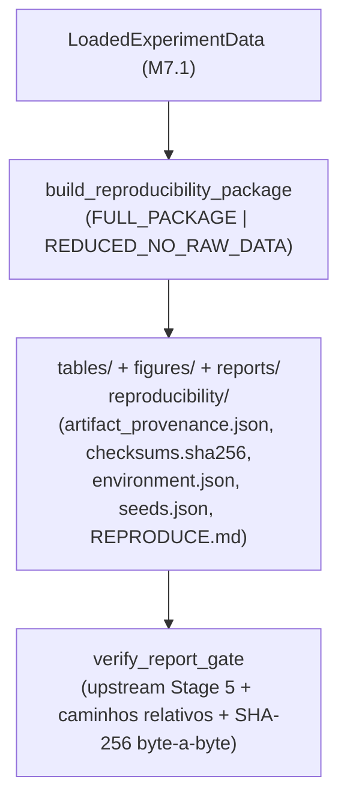

# M7.3 — Pacote de Reprodutibilidade e Portão Stage 6 Design

**Spec**: `.specs/features/m7-3-reproducibility-package-gate/spec.md`  
**Status**: Approved  

---

## 1. Visão Geral

O Sub-marco M7.3 implementa o empacotamento completo e auditável em `src/experimental_ml/reporting/packaging.py` e o portão de integridade Stage 6 `verify_report_gate` em `src/experimental_ml/stages/stage_gates.py`.

---

## 2. Contratos e Fluxo (`packaging.py`, `stage_gates.py`)

- **`PackageMode(StrEnum)`**: `FULL_PACKAGE`, `REDUCED_NO_RAW_DATA`.
- **`ReproducibilityPackageManifest`**: dataclass congelada com `experiment_id`, `partition_plan_id`, `package_mode`, `reproduction_level`, `exported_files: tuple[str, ...]`, `checksums_file: str`, `provenance_file: str`.
- **Escrita atômica e proteção `force=False`**: Verifica previamente se os arquivos de saída existem; se `force=False`, lança `ContractViolationError`. Grava textos/bytes e JSONs com `write_json_atomic`.
- **Caminhos relativos & Checksums**:
  - `artifact_provenance.json` lista 100% dos arquivos exportados (`tables/*`, `figures/*`, `reports/*`) com `output_relative_path` e `provenance`.
  - `checksums.sha256` registra `<sha256_hex>  <relative_posix_path>` ordenado para 100% dos artefatos + `artifact_provenance.json`, `environment.json`, `seeds.json`, `REPRODUCE.md`.
- **`verify_report_gate`**:
  - Verifica `verify_statistics_gate(exp_dir)` se `statistics/` presente em `exp_dir`.
  - Lê `artifact_provenance.json` e `checksums.sha256`; rejeita qualquer caminho absoluto ou `..` traversal.
  - Confirma cobertura de 100% dos artefatos de `artifact_provenance.json` em `checksums.sha256` e recalcula SHA-256 de cada arquivo, lançando `DataIntegrityError` em divergência de 1 byte ou arquivo ausente.
