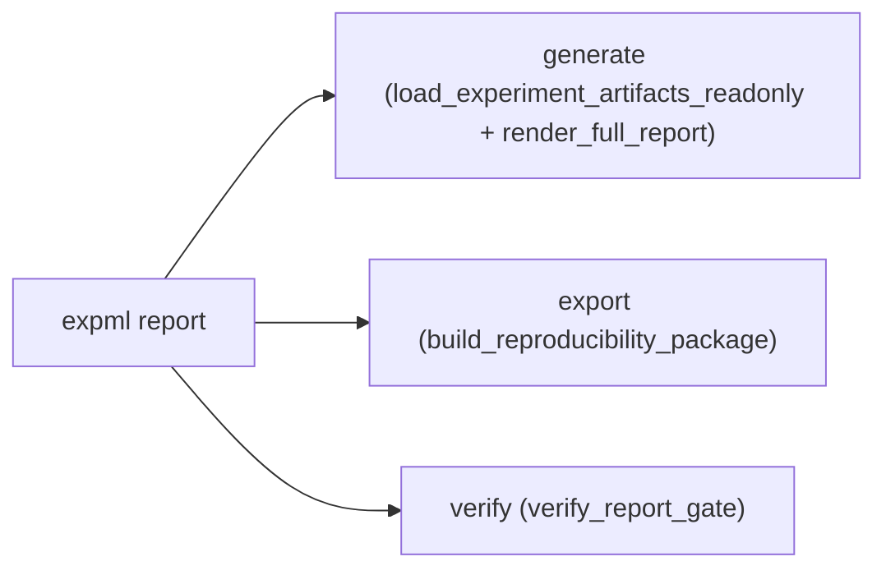

# M7.4 — CLI `expml report` e Integração Ponta a Ponta Design

**Spec**: `.specs/features/m7-4-cli-report-end-to-end/spec.md`  
**Status**: Pending Approval  

---

## 1. Visão Geral

O Sub-marco M7.4 expõe a interface de linha de comando `expml report` (`generate`, `export`, `verify`) em `src/experimental_ml/cli/main.py` e `src/experimental_ml/cli/cmd_report.py`, seguindo o padrão de imports lazy (`CLI-10`), saída JSON estruturada sem hashes (`CLI-11`) e códigos de saída padronizados (`0` sucesso, `2` erro de domínio/integridade), além de validar o fluxo ponta a ponta Estágio 1 → Estágio 6.

---

## 2. Subcomandos e Contratos (`cli/main.py`, `cli/cmd_report.py`)

- **`expml report generate`**:
  - Argumentos: `--experiment-dir` / `--exp-dir` (required), `--output-dir` (default `<exp-dir>/reports`), `--audience` (`FULL_LAB`, `ARTICLE_COMPACT`, `CUSTOM`; default `FULL_LAB`), `--format` (`markdown`, `html`, `both`; default `both`), `--families` (opcional, lista separada por vírgula), `--objective` (declaração opcional do pesquisador), `--force`.
  - Fluxo: `load_experiment_artifacts_readonly` → `select_report_content` → `render_full_report` → escrita atômica com proteção `force=False` (`ContractViolationError` → código `2`).
- **`expml report export`**:
  - Argumentos: `--experiment-dir` / `--exp-dir` (required), `--output-dir` (default `<exp-dir>`), `--mode` (`full_package`, `reduced_no_raw_data`; default `full_package`), `--audience` (default `FULL_LAB`), `--objective` (opcional), `--force`.
  - Fluxo: `load_experiment_artifacts_readonly` → `build_reproducibility_package` → imprime resumo JSON do `ReproducibilityPackageManifest`.
- **`expml report verify`**:
  - Argumentos: `--experiment-dir` / `--exp-dir` (required).
  - Fluxo: `verify_report_gate` → imprime resumo JSON (`"status": "VERIFIED"`, `"verified_files_count"`, etc.) e retorna `0`; falhas (`DataIntegrityError`) retornam código `2`.
