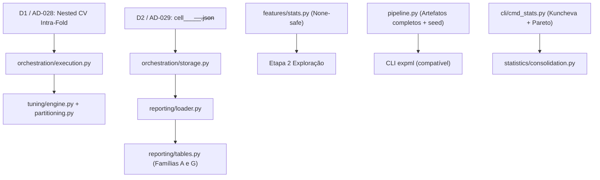

# M8 — Estabilização do MVP e Alinhamento Contratual Design

**Spec**: `.specs/features/m8-mvp-stabilization-contract-alignment/spec.md`
**Status**: Approved (baseado em `spec.md` aprovado e decisões `AD-028` / `AD-029`)

---

## Architecture Overview

O Marco `M8` realiza correções cirúrgicas e alinhamentos contratuais em sete pontos do pipeline Onda 1 sem introduzir dependências externas (`XCUT-02`) e sem alterar assinaturas públicas incompatíveis:

---

## Code Reuse Analysis

### Existing Components to Leverage

| Component | Location | How to Use |
| :--- | :--- | :--- |
| `select_features_in_fold`, `apply_feature_selection` | `src/experimental_ml/features/selection.py` | Reutilizar diretamente dentro do loop interno de `run_nested_tuning` (via callback ou parâmetro opcional de seleção dinâmica). |
| `fit_two_layer_preprocessing`, `apply_two_layer_preprocessing` | `src/experimental_ml/models/preprocessing/pipeline.py` | Executar Camada 1 antes da seleção dinâmica e Camada 2 após a seleção em cada sub-fold interno e no refit externo. |
| `save_preparation_artifacts`, `save_partition_artifacts`, `compute_pareto_frontier` | `src/experimental_ml/data/preparation.py`, `validation/persistence.py`, `statistics/pareto.py` | Reutilizar na fachada `run_experiment` (`pipeline.py`) para garantir paridade completa de artefatos com a CLI. |
| `load_cell_artifacts`, `LoadedExperimentData` | `src/experimental_ml/orchestration/storage.py`, `reporting/loader.py` | Reutilizar para carregar `diagnostics` das células concluídas na Tabela G. |

### Integration Points

| System | Integration Method |
| :--- | :--- |
| `orchestration/execution.py` ↔ `tuning/engine.py` | Passar contexto de seleção dinâmica (`ScenarioSpec` + `candidate_feature_cols` / `X_train_cand`) e metadados de partição (`task_type`, `groups`, `temporal_order`) para `run_nested_tuning`. |
| `orchestration/storage.py` ↔ `reporting/loader.py` | Padronizar gravação e leitura exclusiva em `runs/cells/cell_<m>__<s>__<f>.json` e `runs/predictions/pred_<m>__<s>__<f>.json` (`AD-029`). |
| `reporting/loader.py` ↔ `reporting/tables.py` | Expor diagnósticos agregados por `(model_id, scenario_id)` no `LoadedExperimentData` para povoar `tbl_family_g`. |

---

## Components

### 1. Tabelas A e G (`reporting/loader.py`, `reporting/tables.py`)
- **Purpose**: Povoar as Tabelas A (`A_DATA_CHARACTERIZATION`) e G (`G_MODEL_SPECIFIC_ARTIFACTS`) com dados reais de experimentos.
- **Location**: `src/experimental_ml/reporting/loader.py`, `src/experimental_ml/reporting/tables.py`
- **Interfaces**:
  - `build_table_model(ReportFamily.A_DATA_CHARACTERIZATION, loaded_data, selection)` — extrai de `dataset_profile.get("summary", dataset_profile)` métricas escalares (`n_rows`, `n_cols`, `memory_bytes`, `n_findings`, contagens de tipos semânticos), mantendo compatibilidade com dicionários planos de testes existentes.
  - `load_experiment_artifacts_readonly(exp_dir)` — carrega registros `runs/cells/cell_*.json` (somente leitura) agregando `diagnostics` por `(model_id, scenario_id)`.
  - `build_table_model(ReportFamily.G_MODEL_SPECIFIC_ARTIFACTS, loaded_data, selection)` — consome os diagnósticos carregados das células (com fallback para `models_catalog` apenas se não houver células).

### 2. Estatísticas Categóricas Seguras (`features/stats.py`)
- **Purpose**: Evitar `TypeError` quando arrays categóricos (`dtype=object`) contêm `None`, `np.nan` ou marcadores ausentes.
- **Location**: `src/experimental_ml/features/stats.py`
- **Interfaces**:
  - `_is_missing_categorical(val: Any) -> bool` — helper compartilhado para detectar `None` e `float` `NaN`.
  - `compute_correlation_ratio(categories, continuous)` e `compute_cramers_v(cat_x, cat_y)` — filtram pairwise linhas válidas antes de `np.unique`, retornando `(float("nan"), MetricStatus.UNDEFINED_NAN)` quando restarem `< 2` observações válidas ou `< 2` categorias distintas.

### 3. Nested CV Alinhado ao `ADR-003` (`tuning/partitioning.py`, `tuning/engine.py`, `orchestration/execution.py`)
- **Purpose**: Cumprir estritamente o `ADR-003` e a Decisão `D1` (`AD-028`).
- **Location**: `src/experimental_ml/tuning/partitioning.py`, `src/experimental_ml/tuning/engine.py`, `src/experimental_ml/orchestration/execution.py`
- **Interfaces**:
  - `split_inner_folds(n_samples, n_folds, seed=None, shuffle=False, y=None, groups=None, strategy=None)` — propaga estratificação (`STRATIFIED_KFOLD`), agrupamento (`GROUP_KFOLD`, `STRATIFIED_GROUP_KFOLD`) e ordem temporal (`TEMPORAL`), mantendo compatibilidade com chamadas existentes sem os parâmetros opcionais.
  - `run_nested_tuning(...)` — aceita opcionalmente `X_train_cand: Mapping[str, np.ndarray] | None`, `scenario: FeatureScenario | None`, `partition_strategy: str | None`, `groups: np.ndarray | None`. Quando `scenario` é `DYNAMIC`, aplica Camada 1 (`layer1_steps`) + `select_features_in_fold` exclusivamente em `inner_train`, depois Camada 2 (`layer2_steps`) e `fit_model`/`predict_model` em `inner_val`.
  - `execute_single_cell(...)` — quando `search_spec` está ativo e `scenario.mode == ScenarioMode.DYNAMIC`, delega a seleção intra-subfold ao `run_nested_tuning` e em seguida reajusta Camada 1, seleção dinâmica, Camada 2 e modelo no `outer_train` completo.

### 4. Fachada `run_experiment` (`pipeline.py`)
- **Purpose**: Garantir paridade integral de artefatos com a CLI e determinismo em instâncias clonadas.
- **Location**: `src/experimental_ml/pipeline.py`
- **Interfaces**:
  - `run_experiment(...)` — persiste `data/dataset_descriptor.json` completo (`raw_source_path`, `schema_path`, `dataset_hash`), `data/sanitized_view.json`, `partitions/splits.csv.gz`, `partitions/splits.schema.json`, `reports/exploratory_features.{json,md}`, passa `n_total_candidates_per_config` para `consolidate_descriptive` e executa `compute_pareto_frontier` antes de `save_statistics_artifacts`.
  - `_make_inst_factory` — quando `hasattr(cloned, "random_state") and getattr(cloned, "random_state") is None and seed is not None`, injeta `cloned.random_state = seed` (ou via `set_params(random_state=seed)`).

### 5. Estatística CLI, Inicialização e Concorrência (`cli/cmd_stats.py`, `cli/cmd_init.py`, `models/execution.py`)
- **Purpose**: Habilitar Kuncheva e Pareto multiobjetivo na CLI, 2 modelos no template de classificação de `expml init` e lock thread-safe.
- **Location**: `src/experimental_ml/cli/cmd_stats.py`, `src/experimental_ml/cli/cmd_init.py`, `src/experimental_ml/models/execution.py`
- **Interfaces**:
  - `cmd_stats.py` — lê `scenarios.json` para preencher `n_total_candidates_per_config` em `consolidate_descriptive` e lê `"pareto_objectives"` em `stats_config.json` (fallback para `(primary_metric, "mean_total_cell_time_s")` ou `[primary_metric]`).
  - `cmd_init.py` — adiciona um segundo baseline nativo em classificação (`baseline_aleatorio_estratificado` ou `DUMMY_BASELINE_PRIOR` / segundo modelo compatível) para permitir comparações no `quickrun`.
  - `_ActiveInstancesRegistry` em `models/execution.py` — protege mutações com `threading.Lock()`.

### 6. Retomada, Nomenclatura de Células e Script TLC (`orchestration/state.py`, `orchestration/storage.py`, `orchestration/engine.py`, `.agent*/validate_verification.py`)
- **Purpose**: Cumprir `D2` (`AD-029`), validar `scenarios_hash`/`models_hash` na retomada e corrigir caminho no script TLC.
- **Location**: `src/experimental_ml/orchestration/state.py`, `storage.py`, `engine.py`, `.agent/skills/tlc-spec-driven/scripts/validate_verification.py` (e `.agents/`).
- **Interfaces**:
  - `MatrixExecutionState` — campos opcionais `scenarios_hash: str = ""` e `models_hash: str = ""` validados em `resume=True` quando não vazios.
  - `save_cell_artifacts` / `load_cell_artifacts` — usam `f"{cell_id}.json"` quando `str(cell_id).startswith("cell_")` (gravando `cell_<m>__<s>__<f>.json`) e `f"pred_{str(cell_id).removeprefix('cell_')}.json"` (gravando `pred_<m>__<s>__<f>.json`), sem fallback para `cell_cell_`.

---

## Risks & Concerns

- **Retrocompatibilidade de testes existentes para `cell_cell_`:** testes unitários em `tests/unit/test_orchestration_*.py` ou `tests/integration/` que façam assert literal no caminho `"cell_cell_..."` deverão ser atualizados na mesma tarefa para `"cell_..."`, conforme a Decisão `D2`.
- **Assinatura de `run_nested_tuning`:** manter todos os novos argumentos com valor padrão `None` para preservar 100% dos chamadores unitários existentes.
- **Execução concorrente com `ThreadPoolExecutor`:** proteger `_ACTIVE_INSTANCES` com `threading.Lock()` elimina condição de corrida em `outer_n_jobs > 1`.
