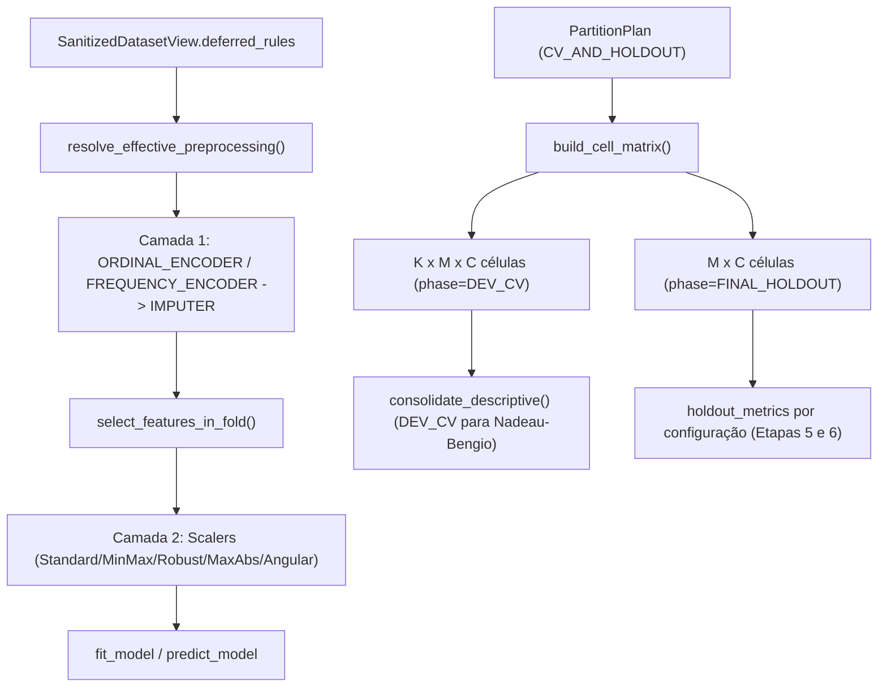

# M9 — Imputação e Codificação Categórica Intra-Fold e Execução de Holdout Final Design

**Spec**: `.specs/features/m9-intra-fold-imputation-encoding-holdout/spec.md`
**Status**: Approved (baseado em `spec.md` e decisões `AD-030`, `AD-031`, `AD-032`)

---

## Architecture Overview

O Marco `M9` completa a execução intra-fold de regras diferidas (`DEFER_INTRA_FOLD`) e o fluxo de avaliação `FINAL_HOLDOUT` sob `CV_AND_HOLDOUT`, mantendo 100% do código em Python >= 3.11 + NumPy (`XCUT-02`):

---

## Code Reuse Analysis

### Existing Components to Leverage

| Component | Location | How to Use |
| :--- | :--- | :--- |
| `StandardScaler` .. `AngularScaler` | `src/experimental_ml/models/preprocessing/scalers.py` | Seguir exatamente o mesmo padrão `fit(X_train)` / `transform(X)` stateless para `SimpleImputer`, `OrdinalEncoder` e `FrequencyEncoder`. |
| `validate_two_layer_preprocessing`, `fit_two_layer_preprocessing` | `src/experimental_ml/models/preprocessing/pipeline.py` | Registrar `ORDINAL_ENCODER`, `FREQUENCY_ENCODER` e `IMPUTER` em `_KNOWN_TRANSFORMER_TYPES` e `_instantiate_step_transformer`, liberando `NaN`/`object` antes da Camada 1 quando houver `IMPUTER`/encoder na Camada 1. |
| `SanitizedDatasetView.deferred_rules` | `src/experimental_ml/data/preparation.py` | Ler regras `DEFER_INTRA_FOLD` na Etapa 4B para construir o `TwoLayerPreprocessingSpec` efetivo por modelo (`AD-031`). |
| `CellDescriptor`, `CellResultRecord.phase` | `src/experimental_ml/orchestration/{matrix.py,types.py}` | Adicionar `phase: str = "DEV_CV"` em `CellDescriptor` e gerar células `FINAL_HOLDOUT` quando `regime == CV_AND_HOLDOUT`. |

---

## Components

### 1. Transformadores `SimpleImputer` e Encoders 1:1 (`models/preprocessing/imputers.py`, `encoders.py`, `pipeline.py`)
- **Purpose**: Imputação e codificação categórica intra-fold sem vazamento de `X_val` e preservando dimensionalidade 1:1 com `feature_names` (`AD-030`).
- **Location**: `src/experimental_ml/models/preprocessing/imputers.py`, `src/experimental_ml/models/preprocessing/encoders.py`, `src/experimental_ml/models/preprocessing/pipeline.py`
- **Interfaces**:
  - `SimpleImputer(strategy="MEAN" | "MEDIAN" | "MODE", column_indices=None)`: `fit(X_train)` calcula estatística por coluna ignorando `NaN`/`None` (lança `DataIntegrityError` se coluna for 100% ausente em `X_train`), `transform(X)` preenche ausentes e preserva colunas sem `NaN`.
  - `OrdinalCategoryEncoder(column_indices=None)` / `FrequencyCategoryEncoder(column_indices=None)`: `fit(X_train)` aprende mapeamento exclusivamente sobre valores não-ausentes de `X_train` (ordem lexicográfica para ordinal `0..C-1`, proporção para frequência); `transform(X)` retorna `float64` mantendo `NaN` para ausentes (a serem imputados pelo `SimpleImputer` seguinte) e mapeando categorias inéditas em `X_val` para `-1.0` (`Ordinal`) ou `0.0` (`Frequency`).
  - `_instantiate_step_transformer(step_spec)` em `pipeline.py`: instancia `"IMPUTER"`, `"ORDINAL_ENCODER"` e `"FREQUENCY_ENCODER"`.
  - `fit_two_layer_preprocessing` / `apply_two_layer_preprocessing`: se `spec.layer1_steps` contiver encoder/imputer, aceita `dtype=object` e `NaN` na entrada da Camada 1 e valida `np.isfinite` após a Camada 1 (antes da Camada 2).

### 2. Resolução Automática de `deferred_rules` e Execução com `NaN`/Categóricos (`orchestration/execution.py`, `tuning/engine.py`)
- **Purpose**: Converter `SanitizedDatasetView.deferred_rules` em passos de pré-processamento efetivos quando o `ModelSpec` não declarar equivalente (`AD-031`), garantindo ordem `Encoder -> Imputer -> Seleção Dinâmica -> Scaler` tanto no fold externo quanto nos sub-folds internos do Nested CV.
- **Location**: `src/experimental_ml/orchestration/execution.py`, `src/experimental_ml/tuning/engine.py`
- **Interfaces**:
  - `resolve_deferred_preprocessing(model_spec, deferred_rules, candidate_cols) -> ModelSpec`: injeta passos `DEFER_INTRA_FOLD` (`E1_CATEGORICAL_UNENCODED` -> `ORDINAL_ENCODER`/`FREQUENCY_ENCODER`, `E1_FEATURE_MISSING` -> `IMPUTER`, `E1_SCALE_DISPARITY` -> scaler na Camada 2) respeitando precedência do `ModelSpec`.
  - `execute_single_cell`: quando `X_train_cand` contém colunas não-numéricas ou `NaN` e há `layer1_steps` (`IMPUTER`/encoders), aplica Camada 1 sobre `X_train_cand`/`X_val_cand` no fold externo (e dentro de `run_nested_tuning` nos sub-folds internos) antes de `select_features_in_fold`, evitando `np.column_stack` prematuro com `dtype=object`.

### 3. Células `FINAL_HOLDOUT` sob `CV_AND_HOLDOUT` (`orchestration/matrix.py`, `orchestration/execution.py`, `stages/stage_gates.py`)
- **Purpose**: Executar e persistir células `FINAL_HOLDOUT` sobre `(development_ids, holdout_ids)` quando `regime == CV_AND_HOLDOUT` (`AD-032`).
- **Location**: `src/experimental_ml/orchestration/matrix.py`, `src/experimental_ml/orchestration/execution.py`, `src/experimental_ml/stages/stage_gates.py`
- **Interfaces**:
  - `CellDescriptor` recebe `phase: str = "DEV_CV"`.
  - `build_cell_matrix`: após os folds de `DEV_CV`, se `partition_plan.regime == EvaluationRegime.CV_AND_HOLDOUT` e `partition_plan.holdout_ids`, cria um `FoldPartition(fold_index=len(sorted_folds), train_ids=partition_plan.development_ids, val_ids=partition_plan.holdout_ids)` com `fold_id="final_holdout"`, `phase="FINAL_HOLDOUT"` e `cell_id=f"cell_{m}__{s}__final_holdout"`.
  - `execute_single_cell`: propaga `descriptor.phase` (ou parâmetro `phase`) para `CellResultRecord(..., phase=phase)` e executa `run_nested_tuning` sobre `development_ids` quando `search_spec` estiver ativo (`AD-032`).
  - `verify_runs_gate`: valida células `FINAL_HOLDOUT` e exclui `FINAL_HOLDOUT` da consolidação OOF dos folds de desenvolvimento (ou consolida apenas células `DEV_CV` no OOF).

### 4. Consolidação Separada na Etapa 5 e Exposição na Etapa 6 (`statistics/`, `reporting/tables.py`)
- **Purpose**: Manter `DEV_CV` isolado para Nadeau-Bengio/testes pareados/Kuncheva e reportar métricas de `FINAL_HOLDOUT` separadamente.
- **Location**: `src/experimental_ml/statistics/types.py`, `statistics/consolidation.py`, `statistics/storage.py`, `reporting/tables.py`
- **Interfaces**:
  - `ConfigurationSummary` recebe campo opcional `holdout_metrics: Mapping[str, MetricValue] = MappingProxyType({})` (retrocompatível).
  - `consolidate_descriptive`: separa `dev_cells = [c for c in completed_cells if c.phase != "FINAL_HOLDOUT"]` e `holdout_cells = [c for c in completed_cells if c.phase == "FINAL_HOLDOUT"]`. Calcula todas as agregações de CV (`mean`, `std`, `ci_lower`, `ci_upper`, `feature_stability`) usando estritamente `dev_cells`, e armazena as métricas de `holdout_cells[0]` em `holdout_metrics`.
  - `statistics/storage.py` (`codecs`): serializa e desserializa `holdout_metrics` quando presente.
  - `reporting/tables.py`: em `D_PREDICTIVE_PERFORMANCE`, inclui coluna ou linhas/nota de `Holdout Final` quando `holdout_metrics` estiver preenchido.

---

## Risks & Concerns

- **Consolidação OOF sob `CV_AND_HOLDOUT`:** Como `final_holdout` avalia `holdout_ids` (disjunto de `development_ids`), `consolidate_matrix_oof` deve filtrar apenas células `DEV_CV` ao montar predições OOF de desenvolvimento (ou aceitar ambos sem duplicar IDs). Filtrar `phase != "FINAL_HOLDOUT"` para OOF de desenvolvimento garante invariante `len(oof) == len(development_ids)`.
- **Regressão em `fit_two_layer_preprocessing` sem `IMPUTER`:** Quando `layer1_steps` não contém `IMPUTER` nem encoders, `fit_two_layer_preprocessing` continua rejeitando imediatamente `NaN`/`Inf` com `ContractViolationError`, preservando 100% dos testes existentes.
