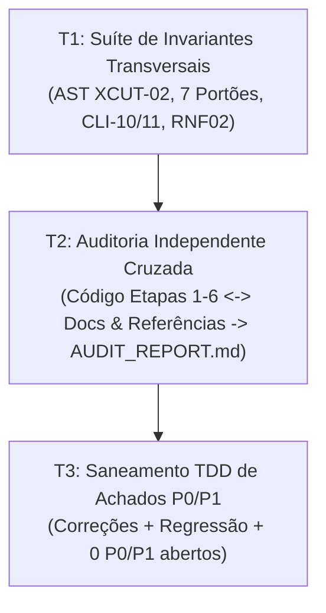

# POS-1 — Mega Auditoria Técnica Transversal do MVP Design

**Spec**: `.specs/features/pos-1-mega-auditoria-mvp/spec.md`  
**Status**: Pending Approval  

---

## 1. Visão Geral

A auditoria transversal `TA-POS.1` combina **provas automatizadas transversais** (AST `XCUT-02`, portões 1–6, invariantes `RNF02`/`CLI-10`/`CLI-11`) com **inspeção independente direta** de código, testes e documentação (`engenharia_software/*.md`, `README.md`, `REFERENCIAS_E_FUNDAMENTACAO.md`, `pyproject.toml`, `.specs/STATE.md`, `.specs/features/m1..m7/`).

---

## 2. Estratégia de Verificação

- **Pureza AST (`XCUT-02`)**: Percorrer `src/experimental_ml/**/*.py` com `ast.walk`, coletando `ast.Import`, `ast.ImportFrom` (ignorando apenas blocos `if TYPE_CHECKING:`) e chamadas `importlib.import_module`/`__import__`. Permitir exclusivamente módulos de `sys.stdlib_module_names`, `experimental_ml` e `numpy`.
- **Auditoria Cruzada**: Comparar requisitos (`RF1.1`–`RF6.4`, `RNF01`–`RNF03`, `CA-*`), contratos (`ARQUITETURA_E_CONTRATOS.md`), referências (`REFERENCIAS_E_FUNDAMENTACAO.md`), `README.md` e `ETAPA_ATUAL_ENGENHARIA.md` diretamente contra o código e testes reais.
- **Saneamento Obrigatório**: Todo achado `P0` ou `P1` registrado em `AUDIT_REPORT.md` é corrigido via TDD com teste de regressão antes do fechamento.
