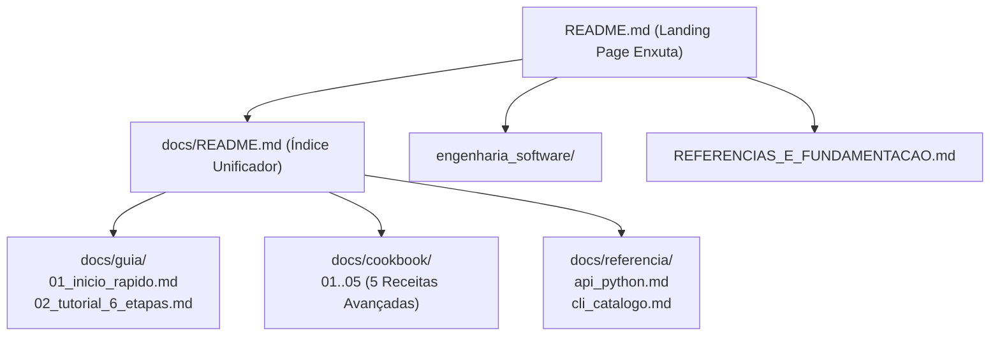

# POS-2 — Guia do Pesquisador, Scientific Cookbook, Referências e Limpeza do README Design

**Spec**: `.specs/features/pos-2-guia-pesquisador-cookbook/spec.md`  
**Status**: Approved  
**Approved**: 2026-11-16 - user: "aprovado"  

---

## 1. Visão Geral

O sub-marco `TA-POS.2` organiza a camada pedagógica e de referência do `experimental-ml` em uma estrutura modular em português sob `docs/`, acompanhada do enxugamento do `README.md` na raiz e de uma suíte automatizada de integridade documental em 5 níveis.



---

## 2. Arquitetura da Documentação

### 2.1 Índice e Guia do Pesquisador (`docs/README.md`, `docs/guia/`)
- **`docs/README.md`**: Hub central explicando a trilha de aprendizado em 4 níveis (Início Rápido -> Tutorial das 6 Etapas -> Scientific Cookbook -> Catálogo de Referência) com mapa de navegação.
- **`docs/guia/01_inicio_rapido.md`**: Guia operacional em 5 passos (Instalação, Preparação, Particionamento, Execução e Relatório) utilizando comandos CLI de 1 linha e um script Python completo executável de ponta a ponta (validado via smoke test).
- **`docs/guia/02_tutorial_6_etapas.md`**: Tutorial teórico-prático das **6 etapas metodológicas oficiais** da Seção 3 de `ARQUITETURA_E_CONTRATOS.md`:
  - **Etapa 1**: Entrada, Triagem e Diagnóstico Estrutural (`data`, `stages.data_stage`);
  - **Etapa 2**: Exploração de Relações e Cenários de Features (`features`, `stages.features_stage`);
  - **Etapa 3**: Registro de Modelos, Pré-processamento em 2 Camadas e Nested Tuning (`models`, `tuning`, `stages.models_stage`);
  - **Etapa 4**: Particionamento Compartilhado (4A) e Execução Matricial Tolerante a Falhas (4B) (`validation`, `orchestration`, `stages.partition_stage`, `stages.run_stage`);
  - **Etapa 5**: Consolidação dos Resultados e Comparação Estatística Rigorosa com Nadeau-Bengio e Wilcoxon (`statistics`, `stages.stats_stage`);
  - **Etapa 6**: Relatórios Científicos, Visualizações e Pacote de Reprodutibilidade (`reporting`, `stages.report_stage`).

### 2.2 Scientific Cookbook (`docs/cookbook/`)
Cinco receitas autocontidas com motivação científica, invariantes anti-vazamento e fluxos completos em Python/CLI:
1. **`01_modelos_analiticos_vs_treinados.md`**: Modelos sem ajuste (`requires_fit=False`, `AnalyticalBiometricModel`) vs estimadores treinados, persistência de parâmetros em `ModelSpec.parameters` e garantia de isolamento via `instantiate_fresh_model`.
2. **`02_metricas_quanticas_e_probabilisticas.md`**: Kernels pré-computados (`PrecomputedKernelAdapter`, `PRECOMPUTED_KERNEL`) e métrica `kta` (`requires_kernel_matrix=True`), além de métricas probabilísticas `roc_auc` e `log_loss` (`requires_probabilities=True`, fornecimento de `y_proba` na execução celular).
3. **`03_validacao_cruzada_agrupada_holdout.md`**: `GroupKFold` com `group_col` e regime `CV_AND_HOLDOUT`, garantindo partição disjunta de grupos entre desenvolvimento e holdout e entre treino e validação em cada fold (`validate_partition_plan`).
4. **`04_otimizacao_pareto_multiobjetivo.md`**: `compute_pareto_frontier` combinando objetivos de `AGGREGATED_METRIC`, `TIMING_MEAN` (`predict_time_s`) e `FEATURE_STABILITY` (`mean_jaccard`), com exclusão explícita de configurações sem `CoverageStatus.VALID`.
5. **`05_pacotes_reprodutibilidade_conferencias.md`**: Empacotamento com `build_reproducibility_package` nos modos `FULL_PACKAGE` (inclui `data/`) e `REDUCED_NO_RAW_DATA` (exclui `data/`), auditoria de checksums relativos em `reproducibility/checksums.sha256` e verificação via `sha256sum -c` e `expml report verify`.

### 2.3 Catálogos de Referência (`docs/referencia/`)
- **`docs/referencia/api_python.md`**: Delimitada estritamente às exportações públicas de nível superior (`__init__.py` e `__all__`) dos **11 pacotes**: `core`, `data`, `metrics`, `features`, `models`, `tuning`, `validation`, `orchestration`, `statistics`, `reporting`, `stages`. Módulos internos (`codecs`, helpers privados `_...`) são explicitamente excluídos da API pública estável.
- **`docs/referencia/cli_catalogo.md`**: Referência completa dos comandos `expml` (`data`, `partition`, `features`, `models`, `run`, `stats`, `report`), opções, contratos e convenção real de códigos de saída:
  - `0`: Sucesso na execução;
  - `1`: Erro inesperado de sistema (`Exception` não tratada);
  - `2`: Erro semântico/validação, violação de contrato/dados (`ExperimentalMLError`, `ValueError`, argumentos inválidos) ou reprovação em portão de estágio (`verify_*_gate`).

### 2.4 Limpeza do `README.md`
Reestruturação equilibrada mantendo apenas badges, proposta de valor concisa, comando de instalação em 1 linha, fluxo CLI resumido em 1 linha por etapa e tabela completa de links para `docs/`, `engenharia_software/` e `REFERENCIAS_E_FUNDAMENTACAO.md`.

---

## 3. Estratégia de Validação Documental em 5 Níveis

A suíte `tests/unit/test_documentation_integrity.py` validará todos os arquivos Markdown em `README.md` e `docs/`:
1. **Nível 1 (Links e Âncoras)**: Existência de arquivos alvo para links relativos e correspondência de âncoras `#`.
2. **Nível 2 (Sintaxe AST)**: `ast.parse` em blocos ```` ```python ```` (ignorando apenas blocos marcados com `# conceptual`).
3. **Nível 3 (Resolução Estática de Imports)**: Verificação AST de que todos os imports `from experimental_ml...` nos exemplos correspondem a pacotes e símbolos reais exportados na API pública.
4. **Nível 4 (Validação Léxica de CLI)**: Verificação de que comandos `expml <cmd> <subcmd>` em blocos ```` ```bash ```` pertencem ao conjunto real de comandos e subcomandos registrados em `cli/main.py`.
5. **Nível 5 (Smoke Test Executável)**: Extração e execução real em `tmp_path` do script de exemplo completo do Início Rápido (`01_inicio_rapido.md`).
