# Experimental ML Framework

Framework experimental agnóstico para pesquisa científica em Aprendizado de Máquina (*Machine Learning* — ML), voltado a tarefas de regressão e classificação sobre dados tabulares.

O projeto fornece infraestrutura modular, determinística e pedagógica para condução, auditoria e publicação de experimentos científicos, priorizando a integridade metodológica, a prevenção ativa de vazamento de dados (*data leakage*) e a reprodutibilidade integral dos resultados.

---

## Sumário Executivo

| Atributo | Estado e Especificação |
| :--- | :--- |
| **Versão Atual** | `0.1.0.dev0` (Hatchling / PEP 517 / PEP 621) |
| **Compatibilidade** | Python `>= 3.10` (testado e verificado em Python 3.12) |
| **Dependência Única de Runtime** | `numpy >= 1.24.0` |
| **Fase Atual do Projeto** | **Fase 4: Implementação TDD do MVP** (Marcos M1 e M2 concluídos e consolidados; Sub-marcos M3.1 e M3.2 concluídos e aceitos) |
| **Suíte de Testes** | **218 verificações automatizadas** com 100% de aprovação via `pytest` |
| **Governança Técnica** | TLC Spec-Driven Development (`spec.md`, `design.md`, `tasks.md`, `proofs.md`, `verification.md`) |

---

## 1. Sobre o Projeto

### O Problema Abordado

A pesquisa experimental em Aprendizado de Máquina frequentemente enfrenta desafios metodológicos que comprometem a validade, a auditoria e a comparabilidade dos resultados publicados:

- **Vazamento de dados (*data leakage*):** ajuste acidental de transformações de pré-processamento, imputações ou seleção de atributos fora do laço interno de treino de cada partição.
- **Mutações silenciosas:** alterações não declaradas ou automáticas nos dados brutos de entrada (como descarte de linhas com valores ausentes ou coerção arbitrária de tipos).
- **Viés de seleção de hiperparâmetros:** ausência de validação cruzada aninhada (*Nested CV*), resultando em estimativas de erro superotimistas.
- **Inferência estatística frágil:** declaração de modelos vencedores baseada em médias simples, sem testes pareados adequados, sem correção de comparações múltiplas ou confundindo ausência de significância estatística ($p \ge \alpha$) com equivalência entre algoritmos.
- **Acoplamento entre execução e apresentação:** necessidade de reexecutar experimentos onerosos apenas para reformatar tabelas ou recalcular testes estatísticos.

### Princípios Arquiteturais Centrais

O `experimental-ml-framework` aborda esses problemas através de decisões arquiteturais fundamentadas (**ADRs**):

1. **Arquitetura Agnóstica sem Estimadores Próprios ([ADR-001](REFERENCIAS_E_FUNDAMENTACAO.md)):** O framework não reescreve algoritmos de ML internamente; recebe modelos e funções externas (Scikit-Learn, XGBoost, modelos analíticos sem `fit`, funções customizadas e circuitos quânticos) através de contratos funcionais uniformes.
2. **Prevenção Estrutural de Vazamento ([ADR-002](REFERENCIAS_E_FUNDAMENTACAO.md)):** Todo ajuste de parâmetros (pré-processamento, seleção de atributos e calibração de modelos) ocorre estritamente nos dados de treino de cada partição externa.
3. **Semântica Estrita de `UNDEFINED_NAN` ([ADR-005](REFERENCIAS_E_FUNDAMENTACAO.md)):** Casos matematicamente degenerados retornam `NaN` com status explícito `MetricStatus.UNDEFINED_NAN`, sendo estritamente proibida a coerção silenciosa para zero.
4. **Determinismo e Hashing Canônico SHA-256 ([ADR-007](REFERENCIAS_E_FUNDAMENTACAO.md)):** Derivação hierárquica de sementes via `numpy.random.SeedSequence` e hashing estrutural tripartite (`dataset_hash`, `raw_source_hash`, `schema_hash`) sensível à ordem, colunas e `observation_ids`.
5. **Paradigma Puramente Modular sem Classes de Negócio ([ADR-008](REFERENCIAS_E_FUNDAMENTACAO.md)):** Código interno baseado em funções explícitas e estruturas de dados imutáveis com `slots`, evitando estados ocultos e prevenindo vazamentos acidentais por reutilização de instâncias.

### O Ciclo Operacional em 6 Etapas

```mermaid
flowchart LR
    E1["Etapa 1<br/>Ingestão, Triagem e<br/>Diagnóstico da Base"] -->|"DatasetBundle<br/>DatasetProfile<br/>PreparationPlan"| E2["Etapa 2<br/>Exploração e<br/>Cenários de Features"]
    E2 -->|"ExploratoryReport<br/>ScenariosCatalog"| E3["Etapa 3<br/>Modelos, Circuitos<br/>e Nested Tuning"]
    E3 -->|"ModelsCatalog<br/>SearchSpecs"| E4A["Etapa 4A<br/>Particionamento<br/>Compartilhado"]
    E4A -->|"PartitionPlan"| E4B["Etapa 4B<br/>Execução Matricial<br/>e Persistência"]
    E4B -->|"runs/ & predictions/"| E5["Etapa 5<br/>Consolidação e<br/>Comparação Estatística"]
    E5 -->|"StatisticalReport<br/>ParetoFrontier"| E6["Etapa 6<br/>Relatórios Científicos<br/>e Reprodutibilidade"]
```



---

## 2. Instalação

### Pré-requisitos

- **Python:** Versão `>= 3.10` instalada no sistema operacional.
- **Git:** Para clonar o repositório.

### Passo a Passo

```bash
# 1. Clonar o repositório
git clone https://github.com/alexandrerangel/experimental-ml-framework.git
cd experimental-ml-framework

# 2. Criar e ativar o ambiente virtual isolado (.venv)
python3 -m venv .venv
source .venv/bin/activate
# No Windows: .venv\Scripts\activate

# 3. Atualizar o pip e instalar em modo editável com dependências de desenvolvimento
pip install --upgrade pip
pip install -e ".[dev]"
```

Após a instalação, o executável de linha de comando `expml` estará disponível diretamente no ambiente ativo.

---

## 3. Como Utilizar

### Interface de Linha de Comando (`expml`)

```bash
# 1. Informações básicas e ajuda
expml --version
expml --help

# 2. Perfilamento estatístico e diagnóstico da base de dados
expml data profile \
  --data caminho/para/dados.csv \
  --schema caminho/para/schema.json \
  --output-dir experimentos/meu_ensaio

# 3. Saneamento determinístico aplicando regras de preparação
expml data sanitize \
  --experiment-dir experimentos/meu_ensaio \
  --rules caminho/para/regras.json

# 4. Geração de particionamento compartilhado e matriz de divisões
expml partition build \
  --experiment-dir experimentos/meu_ensaio \
  --config caminho/para/partition_config.json \
  --seed 42

# 5. Verificação de portões de etapa e integridade matemática das partições
expml partition verify \
  --experiment-dir experimentos/meu_ensaio
```

### Exemplos Programáticos em Python

#### 1. Versão e Verificação de Ambiente
```python
import experimental_ml

print(experimental_ml.__version__)
# Saída: 0.1.0.dev0
```

#### 2. Ingestão e Esquemas Tabulares (`experimental_ml.data`)
```python
from experimental_ml.core import TaskType
from experimental_ml.data import (
    DatasetSchemaSpec,
    ColumnSemanticType,
    load_dataset,
    get_column_array,
    slice_bundle_by_observation_ids,
)

# 1. Declaração imutável do esquema estrutural
schema = DatasetSchemaSpec(
    target_col="y",
    task_type=TaskType.REGRESSION,
    group_col="parcela",
    column_semantic_types={
        "y": ColumnSemanticType.NUMERIC_CONTINUOUS,
        "parcela": ColumnSemanticType.CATEGORICAL,
    },
)

# 2. Ingestão com posse exclusiva e buffers imutáveis em nível C
data_source = {"feat1": [1.5, 2.5, 3.5], "parcela": ["A", "A", "B"], "y": [10.0, 20.0, 30.0]}
bundle = load_dataset(data_source, schema)

# 3. Consulta de coluna como view somente-leitura
arr = get_column_array(bundle, "feat1", copy=False)

# 4. Fatiamento imutável preservando a ordenação solicitada
sub_bundle = slice_bundle_by_observation_ids(bundle, ["obs_000002", "obs_000000"])
```

#### 3. Triagem Estatística e Diagnóstico Estrutural (`experimental_ml.data.profile_dataset`)
```python
from experimental_ml.core import TaskType
from experimental_ml.data import (
    DatasetSchemaSpec,
    ColumnSemanticType,
    ProfileConfig,
    load_dataset,
    profile_dataset,
)

# 1. Esquema e carga dos dados tabulares
schema = DatasetSchemaSpec(
    target_col="y",
    task_type=TaskType.REGRESSION,
    column_semantic_types={
        "x": ColumnSemanticType.NUMERIC_CONTINUOUS,
        "y": ColumnSemanticType.NUMERIC_CONTINUOUS,
    },
)
bundle = load_dataset({"x": [10.0, 20.0, 30.0, 40.0], "y": [1.0, 2.0, 3.0, 4.0]}, schema)

# 2. Configuração de limiares heurísticos de triagem
config = ProfileConfig(rare_class_proportion=0.05, small_group_size=5)

# 3. Execução da triagem estatística sem mutação da base
profile = profile_dataset(bundle, config)
assert profile.n_rows == 4
assert profile.columns["x"].numeric_stats.mean == 25.0
```

#### 4. Motor de Métricas e Avaliação (`experimental_ml.metrics`)
```python
import numpy as np
from experimental_ml.core import MetricDirection
from experimental_ml.metrics import (
    compute_metric,
    get_metric_spec,
    is_better,
    aggregate_fold_metrics,
)

# 1. Cálculo de métricas puras vetorizadas em float64
y_true = np.array([10.0, 20.0, 30.0], dtype=np.float64)
y_pred = np.array([11.0, 19.0, 32.0], dtype=np.float64)
rmse_val = compute_metric("rmse", y_true, y_pred)

# 2. Consulta de metadados de direção e tolerância
spec = get_metric_spec("rmse")

# 3. Comparação de candidatos com semântica estrita de tolerância (rtol)
melhor = is_better(cand_a=rmse_val, cand_b=rmse_val, direction=spec.direction)

# 4. Agregação entre partições com controle de cobertura
agg = aggregate_fold_metrics([rmse_val, rmse_val])
```

#### 5. Núcleo de Domínio e Reprodutibilidade (`experimental_ml.core`)
```python
from experimental_ml.core import (
    ExperimentId,
    TaskType,
    derive_seeds,
    config_hash,
    dataset_hash,
    make_finding,
)

# 1. Identificadores de domínio imutáveis e tipados
exp_id = ExperimentId("exp_baseline_01")

# 2. Derivação hierárquica e determinística de sementes (ADR-007)
seeds = derive_seeds(master_seed=42, count=3)

# 3. Hashing canônico de configurações (ADR-007)
h_config = config_hash({"task": TaskType.REGRESSION, "alpha": 0.01})

# 4. Hashing estrutural canônico de dados tabulares
data = {"feature1": [1.0, 2.0], "feature2": [10, 20]}
h_data = dataset_hash(data)

# 5. Construtores de diagnósticos estruturados
finding = make_finding(code="E1_ZERO_VARIANCE", message="Coluna com variância nula.")
```

#### 6. Saneamento e Particionamento Compartilhado (`experimental_ml.data` e `experimental_ml.validation`)
```python
from experimental_ml.core import TaskType
from experimental_ml.data import (
    DatasetSchemaSpec,
    ColumnSemanticType,
    load_dataset,
    profile_dataset,
    create_preparation_plan,
    sanitize_dataset,
    PreparationRule,
)
from experimental_ml.validation import (
    PartitionConfig,
    PartitionStrategy,
    EvaluationRegime,
    build_partition_plan,
    validate_partition_plan,
)

# 1. Esquema e carregamento de dataset tabular
schema = DatasetSchemaSpec(
    target_col="target",
    task_type=TaskType.BINARY_CLASSIFICATION,
    column_semantic_types={
        "feat1": ColumnSemanticType.NUMERIC_CONTINUOUS,
        "feat2": ColumnSemanticType.CATEGORICAL,
    },
)
raw_data = {
    "feat1": [10.0, 20.0, 30.0, 40.0, 50.0, 60.0],
    "feat2": ["A", "B", "A", "B", "A", "B"],
    "target": [0, 1, 0, 1, 0, 1],
}
bundle = load_dataset(raw_data, schema)

# 2. Perfilamento estrutural e plano de preparação determinístico
profile = profile_dataset(bundle)
rule = PreparationRule(
    finding_code="E1_CATEGORICAL_UNENCODED",
    column="feat2",
    kind="ACCEPT_AS_IS",
)
plan = create_preparation_plan(profile, rules=[rule])
assert plan.status == "READY"

# 3. Saneamento determinístico e visão saneada imutável
view = sanitize_dataset(bundle, profile, plan)
assert len(view.observation_ids) == 6

# 4. Construção e validação matemática de particionamento compartilhado
config = PartitionConfig(
    strategy=PartitionStrategy.KFOLD,
    regime=EvaluationRegime.CV_ONLY,
    n_splits=3,
    master_seed=42,
)
part_plan = build_partition_plan(view, config)
validate_partition_plan(part_plan, view)
assert len(part_plan.folds) == 3
```

---

## 4. Módulos e Funcionalidades Disponíveis

O framework organiza-se em camadas modulares com níveis estritos de dependência:

### Camada 1: Ingestão, Esquemas, Diagnósticos e Saneamento (`experimental_ml.data` — Nível 1)
- **Ingestão Imutável (`load_dataset`):** Suporte a CSV, TXT, TSV (com sniffer RFC 4180 de delimitadores `,`, `;`, `\t`, `|` e múltiplos espaços) e fontes em memória (`dict`, `ndarray` 2D, registros, duck-typed `DataFrame`).
- **Buffers Imutáveis em C:** Colunas numéricas e booleanas respaldadas por buffers `bytes` imutáveis que recusam `setflags(write=True)` com `ValueError`. Colunas `object` restritas a escalares imutáveis com `writeable=False`.
- **Esquema Semântico (`DatasetSchemaSpec`):** Validação de papéis de variáveis (`target_col`, `group_col`, `observation_id_col`, `time_col`, `ignore_cols`), normalização Unicode NFC e bloqueio de vazamento da Onda 2.
- **Identificadores Estáveis (`ObservationId`):** Atribuição determinística posicional `obs_000000` ou validação estrita de unicidade e não-nulidade na fonte.
- **Hashes Tripartites:** `dataset_hash` (digest de memória invariante a quebras de linha e sensível à ordem das colunas e aos IDs), `raw_source_hash` (digest do arquivo em disco) e `schema_hash` (`config_hash` determinístico do esquema).
- **Triagem Estatística (`profile_dataset` — Sub-marco M2.1):**
  - Perfis estruturais `DatasetProfile` e por coluna `ColumnProfile` configuráveis via `ProfileConfig`.
  - Distribuições numéricas completas (média, mediana, desvio padrão, min, max, quartis, IQR, skewness, outliers $1.5 \times \text{IQR}$) e categóricas (frequências e proporções).
  - Análise especializada do alvo (variância zero, contagem de classes, desbalanceamento e mapeamento binário para $\{0,1\}$ com emissão de `E1_TARGET_BINARY_UNMAPPED`).
  - Análise de agrupamento (`group_col`) com detecção de grupos com poucas amostras ou valores ausentes.
  - Detecção determinística de linhas duplicadas (excluindo apenas `observation_id`).
  - Catálogo canônico fechado de 15 achados diagnósticos (8 `CONFIRMED_ISSUE` + 7 `HEURISTIC_WARNING`) com severidade imutável e ordenação canônica determinística.
- **Plano de Preparação e Saneamento Determinístico (`create_preparation_plan`, `sanitize_dataset` — Sub-marco M2.2):**
  - Associação explícita de regras (`PreparationRule`: `DROP_ROWS`, `EXCLUDE_COLUMN`, `MAP_BINARY_TARGET`, `DEFER_INTRA_FOLD`, `ACCEPT_AS_IS`) para cada achado confirmado.
  - Bloqueio de planos `INCOMPLETE` com `ContractViolationError` caso haja achados confirmados sem regras admissíveis.
  - Emissão da visão saneada imutável `SanitizedDatasetView` com conjunto final de `candidate_feature_cols`.
- **Codecs Lossless e Descritores (`codecs.py`, `descriptors.py` — Sub-marco M2.4):**
  - Serialização e desserialização bidirecional de `DatasetDescriptor`, `SanitizedViewDescriptor`, `DatasetProfile` e `PreparationPlan` sem perda de precisão e em conformidade estrita com a RFC 8259.

### Camada 2: Particionamento Compartilhado e Validação (`experimental_ml.validation` — Nível 2)
- **Estratégias de Validação Cruzada e Holdout:** Suporte a `KFOLD`, `STRATIFIED_KFOLD`, `GROUP_KFOLD`, `BOOTSTRAP`, `TEMPORAL` e `HOLDOUT`.
- **Regimes de Avaliação:** `CV_ONLY`, `HOLDOUT_ONLY` e `CV_AND_HOLDOUT`.
- **Geração Determinística de Planos (`build_partition_plan` — Sub-marco M2.3):**
  - Criação de `PartitionPlan` imutável consumindo contratos de `SanitizedDatasetView` sem acoplamento a rotinas de saneamento.
  - Identificador canônico `plan_id` SHA-256 de 64 caracteres sensível à configuração, semente e conjuntos exatos de treino/validação/holdout.
- **Validação Matemática de Invariantes (`validate_partition_plan`):**
  - Verificação de disjunção $(\text{Treino}_k \cap \text{Val}_k = \emptyset)$, separação de holdout, ausência de vazamento de grupos em `GROUP_KFOLD` e ordenação temporal monotônica em `TEMPORAL`.
- **Armazenamento Determinístico de Splits (`write_splits_csv_gz`, `read_splits_csv_gz` — Sub-marco M2.4):**
  - Gravação de matriz tabular `splits.csv.gz` compactada com `gzip.GzipFile(mtime=0.0)`, garantindo determinismo binário bit a bit entre execuções repetidas com os mesmos parâmetros, acompanhada de `splits.schema.json`.

### Camada de Portões de Etapa (`experimental_ml.stages` — Nível 3)
- **Verificação de Portão de Preparação (`verify_preparation_gate`):** Garante a existência e o alinhamento de hashes entre `dataset_descriptor.json`, `dataset_profile.json` e `preparation_plan.json`, bloqueando planos `INCOMPLETE`.
- **Verificação de Portão de Partição (`verify_partition_gate`):** Assegura compatibilidade estrita entre `sanitized_view.json`, `partition_plan.json` e as linhas efetivas de `splits.csv.gz`.

### Persistência Atômica de Artefatos (`experimental_ml.core.storage` — Nível 0)
- **Escrita Atômica Transacional (`write_json_atomic`):** Gravação via arquivo temporário com `fsync` e substituição atômica (`os.replace`), com remoção limpa de temporários em caso de falha.
- **Proteção contra Sobrescrita Acidental:** Bloqueio com `ConfigurationError` caso o arquivo de destino já exista e `overwrite=False`.

### Motor de Métricas de Avaliação (`experimental_ml.metrics` — Nível 1)
- **Catálogo Canônico Centralizado (`METRICS_CATALOG`):** 15 especificações formais de métricas (`MetricSpec`) com metadados de direção, famílias e tolerâncias rigorosas.
- **Métricas de Regressão e Alinhamento:** Implementação vetorizada em dupla precisão `float64` de `mae`, `rmse`, `mbe` (preservando o viés assinado e comparando por magnitude absoluta), `r2`, `rmse_rel_pct`, `mape`, `pearson` e `kta` (com suporte a centralização $HKH$).
- **Métricas de Classificação:** Métricas discretas `accuracy`, `balanced_accuracy`, `precision`, `recall` e `f1` (com avaliação pelo próprio denominador $2TP + FP + FN$), além de probabilísticas `roc_auc` (empates exatos via postos médios e OVR) e `log_loss` (com validação estrita de distribuições e clipping $\epsilon = 10^{-15}$).
- **Semântica de Casos Degenerados ([ADR-005](REFERENCIAS_E_FUNDAMENTACAO.md)):** Retorno de `MetricStatus.UNDEFINED_NAN` sem coerção silenciosa para zero.
- **Agregação e Ranqueamento:** `aggregate_fold_metrics` com controle de cobertura (`VALID`, `PARTIAL_COVERAGE`, `UNDEFINED_NAN`) e `rank_configurations` com ordenação lexicográfica e precedência estrita de cobertura.

### Fundação Transversal (`experimental_ml.core` — Nível 0)
- **Tipos de Identificadores Imutáveis:** `ExperimentId`, `PartitionPlanId`, `ScenarioId`, `ModelId`, `CellId`, `ComparisonId`, `ArtifactId` e `ObservationId`.
- **Enumerações Canônicas:** `TaskType`, `ExecutionStatus`, `FindingSeverity`, `MetricDirection`, `AggregationScope`, `MetricStatus` e `ErrorPolicy`.
- **Derivação Determinística de Sementes:** `derive_seeds` e `spawn_child_seeds` baseadas em `numpy.random.SeedSequence` (RNF01, ADR-007).
- **Hashing Canônico SHA-256 ([ADR-007](REFERENCIAS_E_FUNDAMENTACAO.md)):** `config_hash` e `dataset_hash` com normalização Unicode NFC, ordenação lexicográfica de chaves e tratamento estrito de tipos e valores especiais (`-0.0`, `NaN`, `+/-Inf`).
- **Diagnósticos Estruturados:** Estrutura imutável `Finding`, construtores `make_finding` e `make_warning`, e hierarquia de exceções de integridade.

### Interface de Linha de Comando (`experimental_ml.cli` — Nível 7)
- Ponto de entrada executável `expml` estruturado em despachantes hierárquicos (`data profile`, `data sanitize`, `partition build`, `partition verify`).
- **Pureza Arquitetural:** Zero importações de `numpy` ou `hashlib` na camada CLI, delegando operações aos módulos de negócio.
- **Códigos de Saída Padronizados:** Código `0` para sucesso/ajuda, código `2` para erros de domínio e precondições sem traceback, e código `1` para falhas inesperadas.
- **Higiene de Saída:** Ocultação rigorosa de hashes criptográficos em `stdout` e `stderr`.

---

## 5. Testes e Garantia de Qualidade

O projeto utiliza o **Pytest** para automação e validação contínua de integridade.

### Execução da Suíte

```bash
# Executar a suíte completa de testes (176 testes)
pytest tests/ -v

# Executar suítes especializadas
pytest tests/unit/ -v
pytest tests/integration/ -v
pytest tests/test_smoke.py -v
```

### Comportamento Verificado (218 Verificações com 100% de Sucesso)

- **12 testes de fumaça (`tests/test_smoke.py`):** Configuração de build, metadados em `pyproject.toml`, versão pública `0.1.0.dev0` e códigos de saída da CLI (`--version`, `--help`, flags inválidas com código `2`).
- **22 testes de núcleo (`tests/unit/test_core.py`):** Imutabilidade de identificadores, determinismo de sementes (`SeedSequence`), regras de hashing do ADR-007 e detecção centralizada de ausentes (`is_nan_scalar`, `is_missing_scalar`).
- **3 testes de armazenamento atômico (`tests/unit/core/test_storage.py`):** Escrita atômica transacional, limpeza de temporários em falha e proteção de sobrescrita com `ConfigurationError`.
- **22 testes de métricas (`tests/unit/test_metrics.py`):** Exatidão numérica das 15 métricas vetorizadas em `float64` sob tolerâncias rigorosas por família (`rtol`/`atol`), mitigação de overflow quadrático intermediário, semântica `UNDEFINED_NAN` e ranqueamento lexicográfico.
- **36 testes de esquemas e dados (`tests/unit/test_data_schemas.py`):** Imutabilidade de buffers C (`setflags(write=True)` levanta `ValueError`), integridade RFC 4180, identificadores `ObservationId`, hashes tripartites e fatiamento ordenado.
- **13 testes de profiling e achados (`tests/unit/data/test_profiling.py`):** Distribuições numéricas e categóricas, análise do alvo e grupos, catálogo de 15 achados, emissão de `E1_TARGET_ZERO_VARIANCE` e ordenação canônica determinística.
- **16 testes de preparação e saneamento (`tests/unit/data/test_preparation.py`):** Regras de saneamento, plano determinístico `READY` vs `INCOMPLETE` e emissão de `SanitizedDatasetView`.
- **16 testes de particionamento e validação (`tests/unit/validation/`):** Estratégias K-Fold, Stratified, Group, Bootstrap, Temporal e Holdout, validação matemática de disjunção e determinismo de `splits.csv.gz`.
- **17 testes de hardening pós-auditoria (`tests/unit/test_m2_hardening_regression.py`):** Cobertura dedicada dos achados `REV-M2-01` a `REV-M2-11` (compatibilidade profiling/preparation, prevenção de folds vazios, rejeição de missing/NaN em tempos, fidelidade de tipos JSON, integridade de digests no partition gate, validação integral de papéis em splits, pureza de tempo de execução da CLI e API pública `slice_view_by_observation_ids`).
- **25 testes de features (`tests/unit/features/`, `tests/integration/features/`):** Modelos de relatório exploratório (`ExploratoryFeatureReport`, `AssociationMeasure`, `RedundancyPair`), algoritmos estatísticos em NumPy puro (Pearson, Spearman com postos médios para empates, Razão de Correlação $\eta$, V de Cramér), matriz de redundância preditor-preditor, modelos declarativos de cenários (`FeatureScenario`, `ScenariosCatalog`), validação estrita contra visão saneada, salvaguarda anti-leakage para cenários dinâmicos, persistência atômica (`save_scenarios`, `load_scenarios`), portão de etapa `verify_scenarios_gate` e pureza em runtime (`XCUT-02`).
- **4 testes de codecs e descritores (`tests/unit/data/test_codecs.py`, `tests/unit/validation/test_splits_storage.py`):** Serialização e desserialização sem perda de descritores e planos.
- **2 testes de portões de etapa (`tests/unit/stages/test_stage_gates.py`):** Bloqueio por divergência de hashes e rejeição de matrizes de splits adulteradas.
- **13 testes unitários de CLI (`tests/unit/cli/`):** Despachante hierárquico, supressão de tracebacks em código 2, pureza arquitetural sem `numpy`/`hashlib`, ocultação de hashes e subcomandos de dados e partições.
- **18 testes de integração transversal (`tests/integration/`):** Fluxos integrados ponta a ponta de M1, M2 e M3.1, invariância cross-process de hashes, execução de todos os blocos Python documentados no `README.md`, layout canônico de diretórios e homologação fim a fim por subprocesso com prova de equivalência binária bit a bit.

---

## 6. Estrutura do Repositório

```
experimental-ml-framework/
├── .specs/                          # Governança TLC Spec-Driven
│   ├── STATE.md                     # Decisões arquiteturais ativas e registro de handoff
│   └── features/                    # Artefatos por marco (spec, design, tasks, proofs, verification)
│       ├── m1-1-setup-cli-smoke/    # Marco M1.1
│       ├── m1-2-core/               # Marco M1.2
│       ├── m1-3-metrics/            # Marco M1.3
│       ├── m1-4-datasets-schemas/   # Marco M1.4
│       ├── m1-5-foundation-hardening/ # Marco M1.5 Hardening
│       ├── m2-diagnostics-partitioning/ # Sub-marco M2.1 Profiling
│       ├── m2-2-preparation-plan-sanitization/ # Sub-marco M2.2 Saneamento
│       ├── m2-3-partitioning-engine/ # Sub-marco M2.3 Particionamento
│       ├── m2-4-artifacts-stage-gates/ # Sub-marco M2.4 Persistência e Portões
│       └── m2-5-cli-end-to-end/     # Sub-marco M2.5 CLI e Aceite Fim a Fim
├── engenharia_software/             # Documentação técnica central
│   ├── ESPECIFICACAO_REQUISITOS.md  # Especificação formal de requisitos (SRS v2.0)
│   ├── ARQUITETURA_E_CONTRATOS.md   # Arquitetura em camadas, contratos e modelo de dados
│   ├── PROCESSO_DE_ACEITE_DE_MARCOS.md # Governança de aceite formal de entregas
│   └── ETAPA_ATUAL_ENGENHARIA.md    # Registro detalhado de estado e roadmap
├── src/
│   └── experimental_ml/             # Código-fonte da biblioteca (layout src/)
│       ├── __init__.py              # Raiz do pacote (exposição de __version__)
│       ├── cli/                     # Interface de linha de comando (Nível 7)
│       │   ├── __init__.py
│       │   ├── cmd_data.py          # Subcomandos expml data profile e sanitize
│       │   ├── cmd_partition.py     # Subcomandos expml partition build e verify
│       │   └── main.py              # Ponto de entrada expml e despachante
│       ├── core/                    # Núcleo transversal de domínio (Nível 0)
│       │   ├── enums.py             # Enumerações canônicas
│       │   ├── findings.py          # Diagnósticos Finding e exceções formais
│       │   ├── hashing.py           # config_hash, dataset_hash, is_nan_scalar (ADR-007)
│       │   ├── seeds.py             # Derivação SeedSequence (RNF01)
│       │   ├── storage.py           # write_json_atomic e read_json
│       │   └── types.py             # Identificadores imutáveis (ObservationId, etc.)
│       ├── data/                    # Ingestão, esquemas, diagnóstico e preparação (Nível 1)
│       │   ├── codecs.py            # Codecs lossless de descritores e perfis
│       │   ├── descriptors.py       # DatasetDescriptor e SanitizedViewDescriptor
│       │   ├── loader.py            # Ingestão load_dataset com buffers imutáveis
│       │   ├── parsing.py           # Parser RFC 4180 com sniffer automático
│       │   ├── preparation.py       # create_preparation_plan e sanitize_dataset
│       │   ├── profiling.py         # profile_dataset, DatasetProfile, 15 achados
│       │   ├── query.py             # get_column_array, slice_bundle_by_observation_ids, slice_view_by_observation_ids
│       │   ├── schema.py            # DatasetSchemaSpec, load_schema_spec e validação de papéis
│       │   ├── types.py             # ColumnSemanticType, ColumnDescriptor, DatasetBundle
│       │   └── validation.py        # Validação estrutural e integridade de IDs
│       ├── features/                # Exploração de relações e cenários de features (Nível 2)
│       │   ├── __init__.py          # explore_features, ExploratoryFeatureReport, SCOPE_EXPLORATORY_FULL_DATA
│       │   ├── exploration.py       # explore_features, associações com alvo e redundância de preditores
│       │   ├── stats.py             # Métricas em NumPy puro (Pearson, Spearman com postos médios, Eta, Cramér's V)
│       │   └── types.py             # ExploratoryFeatureReport, AssociationMeasure, RedundancyPair
│       ├── metrics/                 # Camada de métricas e alinhamento (Nível 1)
│       │   ├── aggregation.py       # is_better, aggregate_fold_metrics, rank_configurations
│       │   ├── catalog.py           # METRICS_CATALOG e despacho compute_metric
│       │   ├── classification.py    # 7 métricas de classificação
│       │   ├── regression.py        # 8 métricas de regressão e alinhamento
│       │   ├── types.py             # MetricValue, MetricSpec, RankedCandidate
│       │   └── validation.py        # Validações numéricas e scaled_quadratic_sum
│       ├── stages/                  # Portões de validação entre etapas (Nível 3)
│       │   ├── __init__.py          # verify_preparation_gate, verify_partition_gate, reconstruct_sanitized_view
│       │   └── stage_gates.py       # Verificações de integridade cruzada, digests e layout
│       └── validation/              # Particionamento compartilhado e validação (Nível 2)
│           ├── codecs.py            # Codecs de PartitionPlan
│           ├── engine.py            # build_partition_plan e derivação de plan_id
│           ├── splitters.py         # Divisões puras (kfold, stratified, group, etc.)
│           ├── storage.py           # write_splits_csv_gz determinístico e schema
│           ├── types.py             # PartitionConfig, PartitionPlan, FoldPartition
│           └── validators.py        # validate_partition_plan e invariantes matemáticos
├── tests/                           # Suíte de testes automatizados (208 testes)
│   ├── integration/                 # Testes de integração transversal
│   ├── test_smoke.py                # Testes de fumaça da CLI e empacotamento
│   └── unit/                        # Testes unitários (core, metrics, data, validation, cli, stages, features, hardening)
├── pyproject.toml                   # Metadados do projeto e dependências declaradas
├── README.md                        # Porta de entrada do repositório
└── REFERENCIAS_E_FUNDAMENTACAO.md   # Justificativas científicas e normativas (ADRs)
```

---

## 7. Roadmap e Estado dos Marcos

O desenvolvimento do MVP é organizado em marcos progressivos guiados por testes (TDD). A tabela a seguir distingue o que já foi implementado do que está planejado:

| Marco | Escopo e Responsabilidade | Estado |
| :--- | :--- | :---: |
| **M1.1** | **Configuração e CLI Base:** `pyproject.toml`, layout `src/experimental_ml/`, comando `expml` (`--version`, `--help`) e suíte de fumaça. | **Concluído e Aceito** |
| **M1.2** | **Contratos e Funções de Core:** Tipos de IDs imutáveis, enums, derivação `derive_seeds` (`SeedSequence`), `config_hash`/`dataset_hash` (ADR-007) e `Finding`. | **Concluído e Aceito** |
| **M1.3** | **Motor de Métricas:** Catálogo `METRICS_CATALOG`, regras para `MetricStatus.UNDEFINED_NAN` (ADR-005) e 15 métricas vetorizadas em `float64`. | **Concluído e Aceito** |
| **M1.4** | **Datasets & Schemas:** Ingestão tabular imutável (`load_dataset`, `DatasetBundle`), buffers `bytes` imutáveis recusando escrita, parser RFC 4180 e tipagem semântica. | **Concluído e Aceito** |
| **M1.5** | **Foundation Hardening:** Saneamento transversal dos 10 achados de auditoria, framing binário de `dataset_hash`, detecção centralizada de `NaN` e testes de integração. | **Concluído e Aceito** |
| **M2** | **Diagnóstico, Saneamento e Particionamento:** Pipeline de dados da Etapa 1 e Etapa 4A completo (**M2.1 a M2.5 Concluídos e Aceitos**): triagem (`profile_dataset`), plano e saneamento (`create_preparation_plan`, `sanitize_dataset`), particionamento compartilhado (`build_partition_plan`), persistência atômica e portões de etapa (`stage_gates`), e CLI unificada com homologação fim a fim. **Hardening pós-auditoria consolidado (REV-M2-01 a REV-M2-11) com 193 testes aprovados.** | **Concluído e Aceito** |
| **M3** | **Cenários de Features:** **M3.1 e M3.2 Concluídos e Aceitos:** Análise exploratória univariada/bivariada (`explore_features`), matriz de redundância preditor-preditor, rotulagem mandatória `EXPLORATORY_FULL_DATA`, modelagem declarativa de cenários fixos e dinâmicos (`FeatureScenario`), validação estrita contra visão saneada (`validate_scenarios`), persistência atômica (`save_scenarios`, `load_scenarios`) e portão de validação de etapa `verify_scenarios_gate`. **M3.3 e M3.4 em andamento/planejados** (seleção intra-fold e CLI). | **Em Andamento (M3.1 e M3.2 Concluídos)** |
| **M4** | **Modelos e Tuning:** Registro de modelos (`models`), pré-processamento em duas camadas e busca aninhada de hiperparâmetros (`tuning`). | Planejado |
| **M5** | **Execução Matricial:** Orquestração da matriz $M \times C \times F$ (`orchestration`), tolerância a falhas, persistência e retomada (*Checkpoint & Resume*). | Planejado |
| **M6** | **Estatística:** Consolidação descritiva, teste $t$ corrigido de Nadeau-Bengio, Wilcoxon pareado, controle de FWER/FDR (Holm/BH) e Fronteira de Pareto (`statistics`). | Planejado |
| **M7** | **Relatórios e Reprodutibilidade:** Relatórios em Markdown/HTML, 7 famílias de tabelas/figuras, manifesto `ArtifactProvenance` e reprodução do experimento de referência `prognose_florestal`. | Planejado |

---

## 8. Documentação Técnica e Referências

### Documentação Central de Engenharia

| Documento | Descrição |
| :--- | :--- |
| [`engenharia_software/PROCESSO_DE_ACEITE_DE_MARCOS.md`](engenharia_software/PROCESSO_DE_ACEITE_DE_MARCOS.md) | **Processo de Aceite de Marcos:** Regras de governança, tríade documental (`SPEC.md`, `ACCEPTANCE.md`, `RESULTS.md`) e critérios objetivos de aprovação. |
| [`engenharia_software/ESPECIFICACAO_REQUISITOS.md`](engenharia_software/ESPECIFICACAO_REQUISITOS.md) | **Especificação de Requisitos de Software (SRS v2.0):** Requisitos funcionais das 6 etapas, requisitos não-funcionais e critérios de aceitação. |
| [`engenharia_software/ARQUITETURA_E_CONTRATOS.md`](engenharia_software/ARQUITETURA_E_CONTRATOS.md) | **Arquitetura, Contratos e Modelo de Dados:** Camadas, pipeline de 6 etapas, contratos de módulos, modelo de dados e pacote de reprodutibilidade. |
| [`engenharia_software/ETAPA_ATUAL_ENGENHARIA.md`](engenharia_software/ETAPA_ATUAL_ENGENHARIA.md) | **Registro de Estado da Engenharia:** Situação atual no ciclo de vida e roadmap detalhado de implementação. |
| [`REFERENCIAS_E_FUNDAMENTACAO.md`](REFERENCIAS_E_FUNDAMENTACAO.md) | **Fundamentação Teórico-Técnica e Bibliografia:** Justificativas científicas e normativas para as decisões de projeto (ADRs), com 25 referências. |


---

## Licença

Este projeto é distribuído sob os termos da licença MIT (consulte o arquivo [`LICENSE`](LICENSE) e [`pyproject.toml`](pyproject.toml)).
