# Experimental ML Framework

Framework agnóstico para pesquisa científica em Aprendizado de Máquina (*Machine Learning* — ML), projetado para condução, auditoria e publicação de experimentos rigorosos sobre dados tabulares (regressão e classificação).

O projeto prioriza a integridade metodológica, a prevenção estrutural de vazamento de dados (*data leakage*), o determinismo numérico e a reprodutibilidade integral de resultados científicos.

---

## Sumário Executivo

| Atributo | Especificação e Estado |
| :--- | :--- |
| **Versão** | `0.1.0.dev0` (Hatchling / PEP 517 / PEP 621) |
| **Compatibilidade** | Python `>= 3.10` (testado e homologado em Python 3.12) |
| **Dependência Única de Runtime** | `numpy >= 1.24.0` |
| **Estado Atual** | **Fase 4: Implementação TDD do MVP** (Marcos M1 a M5 concluídos, auditados e aceitos) |
| **Garantia de Qualidade** | **471 testes automatizados** com 100% de aprovação via `pytest` |
| **Governança Técnica** | TLC Spec-Driven Development (`spec.md`, `design.md`, `tasks.md`, `proofs.md`, `verification.md`) |

---

## 1. Visão Geral e Princípios Arquiteturais

### Motivação Científica

A pesquisa experimental em ML frequentemente padece de vulnerabilidades metodológicas sutis:
- **Vazamento de dados (*data leakage*):** pré-processamento, imputação ou seleção de atributos ajustados fora da partição de treino.
- **Mutações silenciosas:** alterações implícitas na base bruta (remoção de linhas ou coerção de tipos) sem registro auditável.
- **Otimismo em hiperparâmetros:** ausência de validação cruzada aninhada (*Nested CV*), inflando métricas reportadas.
- **Inferência estatística frágil:** comparações baseadas em médias simples sem testes de hipótese adequados, sem correção para múltiplos testes ou confundindo ausência de significância com equivalência prática.
- **Acoplamento entre execução e relato:** necessidade de reexecutar rotinas onerosas apenas para ajustar tabelas ou figuras de artigos.

### Decisões Arquiteturais Centrais (ADRs)

1. **Arquitetura Agnóstica sem Estimadores Próprios ([ADR-001](REFERENCIAS_E_FUNDAMENTACAO.md)):** O framework atua como infraestrutura de protocolo; recebe modelos e funções externas (Scikit-Learn, XGBoost, modelos analíticos sem `fit`, funções customizadas ou circuitos quânticos) através de contratos funcionais desacoplados.
2. **Prevenção Estrutural de Vazamento ([ADR-002](REFERENCIAS_E_FUNDAMENTACAO.md)):** Toda operação parametrizada (pré-processamento, seleção de atributos e calibração de modelos) ocorre estritamente dentro dos dados de treino de cada partição externa.
3. **Semântica Estrita de Casos Degenerados ([ADR-005](REFERENCIAS_E_FUNDAMENTACAO.md)):** Situações matematicamente indefinidas retornam `NaN` com status formal `MetricStatus.UNDEFINED_NAN`, proibindo coerções silenciosas para zero.
4. **Determinismo e Hashing Canônico SHA-256 ([ADR-007](REFERENCIAS_E_FUNDAMENTACAO.md)):** Sementes derivadas hierarquicamente via `numpy.random.SeedSequence` e hashing estrutural tripartite (`dataset_hash`, `raw_source_hash`, `schema_hash`) sensível à ordem, colunas e `observation_ids`.
5. **Paradigma Puramente Modular e Imutável ([ADR-008](REFERENCIAS_E_FUNDAMENTACAO.md)):** Subsistemas organizados em funções puras e estruturas de dados imutáveis (`slots`), eliminando estados ocultos e prevenindo vazamentos acidentais por reutilização de instâncias.

### O Ciclo Operacional em 6 Etapas

```mermaid
flowchart LR
    E1["Etapa 1<br/>Ingestão, Triagem e<br/>Saneamento"] -->|"SanitizedDatasetView<br/>PreparationPlan"| E2["Etapa 2<br/>Exploração e<br/>Cenários de Features"]
    E2 -->|"ExploratoryReport<br/>ScenariosCatalog"| E3["Etapa 3<br/>Modelos, Circuitos<br/>e Tuning Aninhado"]
    E3 -->|"ModelsCatalog<br/>SearchSpecs"| E4A["Etapa 4A<br/>Particionamento<br/>Compartilhado"]
    E4A -->|"PartitionPlan"| E4B["Etapa 4B<br/>Execução Matricial<br/>e Persistência"]
    E4B -->|"runs/ & predictions/"| E5["Etapa 5<br/>Consolidação e<br/>Comparação Estatística"]
    E5 -->|"StatisticalReport<br/>ParetoFrontier"| E6["Etapa 6<br/>Relatórios Científicos<br/>e Reprodutibilidade"]
```



---

## 2. Instalação

### Pré-requisitos
- Python `>= 3.10`
- Git

### Instalação no Ambiente Local

```bash
# 1. Clonar o repositório
git clone https://github.com/alexandrerangel/experimental-ml-framework.git
cd experimental-ml-framework

# 2. Criar e ativar o ambiente virtual isolado (.venv)
python3 -m venv .venv
source .venv/bin/activate
# No Windows: .venv\Scripts\activate

# 3. Instalar o pacote em modo editável com dependências de desenvolvimento
pip install --upgrade pip
pip install -e ".[dev]"
```

Após a instalação, o comando `expml` estará acessível diretamente no terminal.

---

## 3. Como Utilizar

### Interface de Linha de Comando (`expml`)

```bash
# Informações e ajuda geral
expml --version
expml --help

# 1. Etapa 1: Triagem estatística e diagnóstico da base
expml data profile \
  --data caminho/para/dados.csv \
  --schema caminho/para/schema.json \
  --output-dir experimentos/meu_ensaio

# 2. Etapa 1: Saneamento determinístico via plano de preparação
expml data sanitize \
  --experiment-dir experimentos/meu_ensaio \
  --rules caminho/para/regras.json

# 3. Etapa 2: Exploração de correlações e redundâncias de atributos
expml features explore \
  --experiment-dir experimentos/meu_ensaio

# 4. Etapa 2: Validação e persistência de cenários de atributos
expml features scenarios \
  --experiment-dir experimentos/meu_ensaio \
  --scenarios caminho/para/scenarios.json

# 5. Etapa 2: Verificação do portão de validação de cenários
expml features verify \
  --experiment-dir experimentos/meu_ensaio

# 6. Etapa 3: Validação e persistência do catálogo de modelos
expml models validate \
  --experiment-dir experimentos/meu_ensaio \
  --models caminho/para/models.json

# 7. Etapa 3: Verificação do portão de validação de modelos
expml models verify \
  --experiment-dir experimentos/meu_ensaio

# 8. Etapa 4A: Geração de particionamento compartilhado e matriz de divisões
expml partition build \
  --experiment-dir experimentos/meu_ensaio \
  --config caminho/para/partition_config.json \
  --seed 42

# 9. Etapa 4A: Verificação do portão de particionamento e disjunção de folds
expml partition verify \
  --experiment-dir experimentos/meu_ensaio

# 10. Etapa 4B: Início da execução matricial (Modelos x Cenários x Folds)
expml run start \
  --experiment-dir experimentos/meu_ensaio \
  --parallel 4 \
  --error-policy FAULT_TOLERANT

# 11. Etapa 4B: Retomada incremental de execução interrompida
expml run resume \
  --experiment-dir experimentos/meu_ensaio \
  --retry-failed

# 12. Etapa 4B: Consulta do progresso e status da matriz
expml run status \
  --experiment-dir experimentos/meu_ensaio

# 13. Etapa 4B: Verificação do portão de integridade de execução Stage 4
expml run verify \
  --experiment-dir experimentos/meu_ensaio
```

---

### Exemplos Programáticos em Python

#### 1. Versão e Ponto de Entrada
```python
import experimental_ml

print(experimental_ml.__version__)
# Saída esperada: 0.1.0.dev0
```

#### 2. Ingestão Imutável e Esquemas Tabulares (`experimental_ml.data`)
```python
from experimental_ml.core import TaskType
from experimental_ml.data import (
    DatasetSchemaSpec,
    ColumnSemanticType,
    load_dataset,
    get_column_array,
    slice_bundle_by_observation_ids,
)

# Declaração do esquema estrutural com normalização NFC
schema = DatasetSchemaSpec(
    target_col="y",
    task_type=TaskType.REGRESSION,
    group_col="parcela",
    column_semantic_types={
        "y": ColumnSemanticType.NUMERIC_CONTINUOUS,
        "parcela": ColumnSemanticType.CATEGORICAL,
    },
)

# Ingestão com posse exclusiva e buffers protegidos contra escrita em C
data = {"feat1": [1.5, 2.5, 3.5], "parcela": ["A", "A", "B"], "y": [10.0, 20.0, 30.0]}
bundle = load_dataset(data, schema)

# Consulta como view somente-leitura e fatiamento ordenado
arr = get_column_array(bundle, "feat1", copy=False)
sub_bundle = slice_bundle_by_observation_ids(bundle, ["obs_000002", "obs_000000"])
assert len(sub_bundle.observation_ids) == 2
```

#### 3. Triagem Estatística e Diagnóstico Estrutural (`experimental_ml.data.profile_dataset`)
```python
from experimental_ml.core import TaskType
from experimental_ml.data import (
    DatasetSchemaSpec,
    ColumnSemanticType,
    ProfileConfig,
    load_dataset,
    profile_dataset,
)

schema = DatasetSchemaSpec(
    target_col="y",
    task_type=TaskType.REGRESSION,
    column_semantic_types={
        "x": ColumnSemanticType.NUMERIC_CONTINUOUS,
        "y": ColumnSemanticType.NUMERIC_CONTINUOUS,
    },
)
bundle = load_dataset({"x": [10.0, 20.0, 30.0, 40.0], "y": [1.0, 2.0, 3.0, 4.0]}, schema)

# Perfilamento sem mutação na base (preserva o dataset_hash)
config = ProfileConfig(rare_class_proportion=0.05, small_group_size=5)
profile = profile_dataset(bundle, config)
assert profile.n_rows == 4
assert profile.columns["x"].numeric_stats.mean == 25.0
```

#### 4. Saneamento e Particionamento Compartilhado (`experimental_ml.data` e `experimental_ml.validation`)
```python
from experimental_ml.core import TaskType
from experimental_ml.data import (
    DatasetSchemaSpec,
    ColumnSemanticType,
    load_dataset,
    profile_dataset,
    create_preparation_plan,
    sanitize_dataset,
    PreparationRule,
)
from experimental_ml.validation import (
    PartitionConfig,
    PartitionStrategy,
    EvaluationRegime,
    build_partition_plan,
    validate_partition_plan,
)

schema = DatasetSchemaSpec(
    target_col="target",
    task_type=TaskType.BINARY_CLASSIFICATION,
    column_semantic_types={
        "feat1": ColumnSemanticType.NUMERIC_CONTINUOUS,
        "feat2": ColumnSemanticType.CATEGORICAL,
    },
)
raw_data = {
    "feat1": [10.0, 20.0, 30.0, 40.0, 50.0, 60.0],
    "feat2": ["A", "B", "A", "B", "A", "B"],
    "target": [0, 1, 0, 1, 0, 1],
}
bundle = load_dataset(raw_data, schema)
profile = profile_dataset(bundle)

# Plano de preparação formalizado e saneamento determinístico
rule = PreparationRule(finding_code="E1_CATEGORICAL_UNENCODED", column="feat2", kind="ACCEPT_AS_IS")
plan = create_preparation_plan(profile, rules=[rule])
view = sanitize_dataset(bundle, profile, plan)

# Particionamento imutável compartilhado entre todas as configurações
config = PartitionConfig(
    strategy=PartitionStrategy.KFOLD,
    regime=EvaluationRegime.CV_ONLY,
    n_splits=3,
    master_seed=42,
)
part_plan = build_partition_plan(view, config)
validate_partition_plan(part_plan, view)
assert len(part_plan.folds) == 3
```

#### 5. Exploração de Features e Cenários Experimentais (`experimental_ml.features`)
```python
from experimental_ml.core import TaskType
from experimental_ml.data import (
    DatasetSchemaSpec,
    ColumnSemanticType,
    load_dataset,
    profile_dataset,
    create_preparation_plan,
    sanitize_dataset,
)
from experimental_ml.features import (
    FeatureScenario,
    explore_features,
    validate_scenarios,
)

schema = DatasetSchemaSpec(
    target_col="y",
    task_type=TaskType.REGRESSION,
    column_semantic_types={
        "f1": ColumnSemanticType.NUMERIC_CONTINUOUS,
        "f2": ColumnSemanticType.NUMERIC_CONTINUOUS,
        "y": ColumnSemanticType.NUMERIC_CONTINUOUS,
    },
)
bundle = load_dataset({"f1": [1.0, 2.0, 3.0, 4.0], "f2": [2.0, 4.0, 6.0, 8.0], "y": [10.0, 20.0, 30.0, 40.0]}, schema)
profile = profile_dataset(bundle)
plan = create_preparation_plan(profile, rules=[])
view = sanitize_dataset(bundle, profile, plan)

# Análise exploratória rotulada preventivamente contra data leakage
report = explore_features(view)
assert report.scope == "EXPLORATORY_FULL_DATA"

# Definição e validação estrita de cenários contra a visão saneada
scenario = FeatureScenario(
    scenario_id="sc_subset",
    name="Subset Feature 1",
    description="Subconjunto restrito à primeira feature",
    scientific_justification="Redução de dimensionalidade por hipótese de domínio",
    mode="FIXED",
    selected_features=("f1",),
)
validated_catalog = validate_scenarios([scenario], view)
assert len(validated_catalog.scenarios) == 1
```

#### 6. Avaliação e Catálogo de Métricas (`experimental_ml.metrics`)
```python
import numpy as np
from experimental_ml.core import MetricDirection
from experimental_ml.metrics import (
    compute_metric,
    get_metric_spec,
    is_better,
    aggregate_fold_metrics,
)

y_true = np.array([10.0, 20.0, 30.0], dtype=np.float64)
y_pred = np.array([11.0, 19.0, 32.0], dtype=np.float64)

# Métricas puras em float64 sem coerção silenciosa de NaNs
rmse_val = compute_metric("rmse", y_true, y_pred)
spec = get_metric_spec("rmse")

# Comparação com semântica estrita de tolerância (rtol)
melhor = is_better(cand_a=rmse_val, cand_b=rmse_val, direction=spec.direction)
agg = aggregate_fold_metrics([rmse_val, rmse_val])
assert agg.mean > 0.0
```

#### 7. Núcleo Determinístico, Hashing e Sementes (`experimental_ml.core`)
```python
from experimental_ml.core import (
    ExperimentId,
    TaskType,
    derive_seeds,
    config_hash,
    dataset_hash,
    make_finding,
)

# Identificadores tipados e imutáveis
exp_id = ExperimentId("exp_baseline_01")

# Derivação determinística de sementes (ADR-007)
seeds = derive_seeds(master_seed=42, count=3)

# Hashing estrutural imutável e sensível ao conteúdo
h_config = config_hash({"task": TaskType.REGRESSION, "alpha": 0.01})
h_data = dataset_hash({"f1": [1.0, 2.0], "f2": [10, 20]})

# Diagnóstico padronizado
finding = make_finding(code="E1_ZERO_VARIANCE", message="Coluna com variância nula.")
assert finding.severity.value == "CONFIRMED_ISSUE"
```

#### 8. Contratos de Modelos, Baselines e Ciclo Funcional (`experimental_ml.models`)
```python
import numpy as np
from experimental_ml.models import (
    ModelCapabilities,
    ModelFamily,
    ModelSpec,
    fit_model,
    instantiate_fresh_model,
    predict_model,
    resolve_estimator_factory,
)

# Especificação declarativa do modelo e resolução de factory canônica
spec = ModelSpec(
    model_id="baseline_mean",
    display_name="Dummy Mean Baseline",
    family=ModelFamily.BASELINE,
    capabilities=ModelCapabilities(requires_fit=True, supports_predict=True),
    estimator_factory=resolve_estimator_factory("DUMMY_BASELINE_MEAN"),
    description="Baseline ingênuo que prediz a média do conjunto de treino",
    scientific_justification="Ponto de partida metodológico para calibrar o ganho real de modelos complexos",
)

# Ciclo funcional: instanciação com isolamento estrito, ajuste e predição
model = instantiate_fresh_model(spec)
X_train = np.array([[1.0], [2.0], [3.0]], dtype=np.float64)
y_train = np.array([10.0, 20.0, 30.0], dtype=np.float64)
fitted_model, diagnostics = fit_model(model, spec, X_train, y_train)

X_test = np.array([[4.0], [5.0]], dtype=np.float64)
outputs = predict_model(fitted_model, spec, X_test)
assert np.allclose(outputs["y_pred"], [20.0, 20.0])
```

#### 9. Validação Cruzada Aninhada e Tuning de Hiperparâmetros (`experimental_ml.tuning`)
```python
import numpy as np
from experimental_ml.core import MetricDirection
from experimental_ml.models import (
    ModelCapabilities,
    ModelFamily,
    ModelSpec,
    resolve_estimator_factory,
)
from experimental_ml.tuning import (
    HyperparameterSearchSpec,
    SearchStrategy,
    run_nested_tuning,
)

model_spec = ModelSpec(
    model_id="baseline_mean",
    display_name="Dummy Mean Baseline",
    family=ModelFamily.BASELINE,
    capabilities=ModelCapabilities(requires_fit=True, supports_predict=True),
    estimator_factory=resolve_estimator_factory("DUMMY_BASELINE_MEAN"),
    description="Baseline ingênuo que prediz a média",
    scientific_justification="Ponto de partida metodológico",
)

# Espaço de busca declarativo e particionamento interno anti-leakage
search_spec = HyperparameterSearchSpec(
    search_strategy=SearchStrategy.FIXED,
    param_grid={},
    optimization_metric="rmse",
    direction=MetricDirection.MINIMIZE,
    inner_cv_folds=2,
    seed=42,
)

X_train = np.array([[1.0], [2.0], [3.0], [4.0]], dtype=np.float64)
y_train = np.array([10.0, 20.0, 30.0, 40.0], dtype=np.float64)

# Execução de Nested CV confinado estritamente ao treino externo
result = run_nested_tuning(search_spec, model_spec, X_train, y_train)
assert result.best_score is not None
assert len(result.trials) == 1
```

#### 10. Orquestração Matricial, Sementes por Célula e Estado de Execução (`experimental_ml.orchestration`)
```python
from experimental_ml.core import (
    CellId,
    ExecutionStatus,
    ExperimentId,
)
from experimental_ml.orchestration import (
    MatrixExecutionState,
    derive_cell_seed,
)

# Derivação determinística de semente isolada por célula (ADR-007)
cell_seed = derive_cell_seed(
    master_seed=42,
    model_id="baseline_mean",
    scenario_id="sc_subset",
    fold_id="fold_00",
)
assert isinstance(cell_seed, int)
assert 0 <= cell_seed < 2147483647

# Estado imutável de execução da matriz com integridade de hashes
state = MatrixExecutionState(
    experiment_id=ExperimentId("exp_demo"),
    run_id="run_01",
    created_at="2026-11-12T00:00:00Z",
    updated_at="2026-11-12T00:00:00Z",
    master_seed=42,
    total_cells=2,
    cell_statuses={
        CellId("cell_01"): ExecutionStatus.COMPLETED,
        CellId("cell_02"): ExecutionStatus.PENDING,
    },
    source_dataset_hash="abc" * 21 + "a",
    partition_plan_id="plan_01",
)
assert state.completed_cells == 1
assert state.total_cells == 2
```

---

## 4. Arquitetura em Camadas e Módulos

O framework organiza-se em camadas modulares com níveis estritos de dependência:

| Camada Arquitetural | Nível | Módulo | Responsabilidade Central |
| :--- | :---: | :--- | :--- |
| **Fundação Transversal** | Nível 0 | `experimental_ml.core` | Tipos identificadores imutáveis, enums canônicas, derivação de sementes (`SeedSequence`), hashing canônico SHA-256 (`ADR-007`), diagnósticos estruturados (`Finding`) e persistência atômica (`storage.py`). |
| **Ingestão e Saneamento** | Nível 1 | `experimental_ml.data` | Ingestão com buffers imutáveis em C (`load_dataset`), parser RFC 4180 com sniffer, esquemas declarativos (`DatasetSchemaSpec`), triagem estatística (`profile_dataset`), catálogo de 15 achados, plano de preparação (`create_preparation_plan`) e visão saneada (`SanitizedDatasetView`). |
| **Métricas e Avaliação** | Nível 1 | `experimental_ml.metrics` | Catálogo canônico de 15 métricas (`METRICS_CATALOG`), implementações puras em `float64` (regressão, classificação, alinhamento KTA), tratamento formal `UNDEFINED_NAN` (`ADR-005`), agregação inter-dobras e ranqueamento lexicográfico. |
| **Cenários de Features** | Nível 2 | `experimental_ml.features` | Análise exploratória univariada/redundâncias (`explore_features`) com rotulagem `EXPLORATORY_FULL_DATA`, modelagem de cenários fixos e dinâmicos (`FeatureScenario`), validação contra visão saneada, seleção intra-fold (`select_features_in_fold`) e estabilidade inter-dobras (Jaccard e Kuncheva). |
| **Particionamento** | Nível 2 | `experimental_ml.validation` | Estratégias de particionamento (K-Fold, Stratified, Group, Bootstrap, Temporal, Holdout), geração determinística do `PartitionPlan`, validação matemática de invariantes e disjunção de folds, e matriz `splits.csv.gz` compactada com `mtime=0.0`. |
| **Portões de Validação** | Nível 3 | `experimental_ml.stages` | Portões de integridade entre etapas (`verify_preparation_gate`, `verify_partition_gate`, `verify_scenarios_gate`, `verify_models_gate`, `verify_runs_gate`) com checagem de hashes e layout canônico. |
| **Modelos e Pré-processamento** | Nível 4 | `experimental_ml.models` | Contratos agnósticos de modelo (`ModelSpec`, `ModelCapabilities`), ciclo funcional (`instantiate_fresh_model`, `fit_model`, `predict_model`), isolamento estrito de instâncias (`_ActiveInstancesRegistry`), baselines canônicos, pré-processamento em 2 camadas (scalers e kernels pré-computados) e catálogo auditado. |
| **Tuning e Otimização Aninhada** | Nível 4 | `experimental_ml.tuning` | Particionamento interno puro em NumPy, geração determinística de candidatos (`Grid`, `Random`, `Fixed`), validação declarativa de espaços e busca aninhada (*Nested CV*) com isolamento estrito anti-leakage e desqualificação por `UNDEFINED_NAN`. |
| **Execução Matricial** | Nível 5 | `experimental_ml.orchestration` | Orquestração matricial (Modelos × Cenários × Partições), máquina de estados de célula (`CellResultRecord`), tempos desagregados (`TimingBreakdown`), paralelismo controlado (`outer_n_jobs`), tolerância a falhas (`FAULT_TOLERANT` / `FAIL_FAST`), checkpointing incremental e consolidação out-of-fold com estatísticas de comitê (`ConsolidatedOofPredictions`). |
| **Estatística Comparativa** | Nível 5 | `experimental_ml.statistics` | *(Planejado — Marco M6)* Nadeau-Bengio, Wilcoxon pareado, controle FWER/FDR (Holm/BH), Fronteira de Pareto e síntese estruturada de conclusões. |
| **Relatórios e Pacote** | Nível 6 | `experimental_ml.reporting` | *(Planejado — Marco M7)* Relatórios completos (Markdown/HTML), tabelas (CSV/LaTeX `booktabs`), figuras e pacote de reprodutibilidade com manifesto `ArtifactProvenance`. |
| **Interface de Linha de Comando** | Nível 7 | `experimental_ml.cli` | Ponto de entrada modularizado `expml` (`data`, `features`, `models`, `partition`, `run` implementados; `stats`, `report` planejados), com pura delegação funcional, códigos de saída padronizados e sem dependências pesadas no topo (`CLI-10`). |

---

## 5. Estrutura do Repositório

```
experimental-ml-framework/
├── .specs/                          # Governança TLC Spec-Driven
│   ├── STATE.md                     # Decisões arquiteturais ativas e registro de handoff
│   └── features/                    # Especificações, tarefas, provas e verificações por submarco
├── engenharia_software/             # Documentação de Engenharia de Software
│   ├── ESPECIFICACAO_REQUISITOS.md  # Especificação formal de requisitos (SRS v2.1)
│   ├── ARQUITETURA_E_CONTRATOS.md   # Arquitetura em camadas, contratos e modelo de dados
│   ├── PROCESSO_DE_ACEITE_DE_MARCOS.md # Governança e critérios formais de aceite
│   └── ETAPA_ATUAL_ENGENHARIA.md    # Estado atual e roadmap detalhado
├── src/
│   └── experimental_ml/             # Pacote da biblioteca (layout src/)
│       ├── cli/                     # Interface de linha de comando (Nível 7)
│       ├── core/                    # Núcleo transversal de domínio, hashes e sementes (Nível 0)
│       ├── data/                    # Ingestão, esquemas, diagnóstico e saneamento (Nível 1)
│       ├── features/                # Exploração, cenários e seleção de features (Nível 2)
│       ├── metrics/                 # Catálogo e cálculo de métricas vetorizadas (Nível 1)
│       ├── models/                  # Contratos de modelos, pré-processamento em 2 camadas e catálogo (Nível 4)
│       ├── orchestration/           # Execução matricial, checkpoint e consolidação OOF (Nível 5)
│       ├── stages/                  # Portões de validação e integridade de etapas (Nível 3)
│       ├── tuning/                  # Particionamento interno e otimização aninhada - Nested CV (Nível 4)
│       └── validation/              # Particionamento compartilhado e validação matemática (Nível 2)
├── tests/                           # Suíte de testes automatizados (471 verificações)
│   ├── integration/                 # Testes de integração transversal e subprocessos
│   ├── test_smoke.py                # Testes de fumaça da CLI e metadados de empacotamento
│   └── unit/                        # Testes unitários modulares
├── pyproject.toml                   # Configuração de build (Hatchling) e dependências
├── README.md                        # Documento de apresentação e guia rápido
└── REFERENCIAS_E_FUNDAMENTACAO.md   # Fundamentação teórica, bibliografia e ADRs
```

---

## 6. Testes e Garantia de Qualidade

A integridade do framework é assegurada de forma contínua pelo **Pytest**.

### Execução da Suíte

```bash
# Executar a suíte completa de testes (471 verificações automatizadas)
pytest tests/ -v

# Executar suítes específicas
pytest tests/unit/ -v
pytest tests/integration/ -v
pytest tests/test_smoke.py -v
```

### Cobertura por Domínio

- **Smoke & Empacotamento (12 testes):** Ponto de entrada CLI, metadados PEP 621, `--version`, `--help` e códigos de saída sem traceback.
- **Núcleo & Fundações (25 testes):** Imutabilidade de tipos (`ObservationId`), derivação hierárquica determinística de sementes (`SeedSequence`), regras de hashing tripartite do ADR-007 e persistência atômica com `fsync`.
- **Métricas de Avaliação (22 testes):** Exatidão das 15 métricas em `float64`, tolerâncias numéricas rígidas, mitigação de overflow quadrático intermediário, tratamento formal `UNDEFINED_NAN` e ordenação lexicográfica.
- **Ingestão, Esquemas e Diagnóstico (66 testes):** Buffers imutáveis em C (`ValueError` em tentativa de escrita), conformidade RFC 4180, identificadores estáveis, catálogo canônico de 15 achados diagnósticos, planos de preparação determinísticos e emissão de `SanitizedDatasetView`.
- **Particionamento Compartilhado (21 testes):** Estratégias K-Fold, Stratified, Group, Bootstrap, Temporal e Holdout, validação matemática de disjunção $(\text{Train} \cap \text{Val} = \emptyset)$ e determinismo de `splits.csv.gz` com `mtime=0.0`.
- **Cenários e Seleção de Features (36 testes):** Exploração de relações atributo-alvo e atributo-atributo, rotulagem mandatória `EXPLORATORY_FULL_DATA`, modelagem declarativa de cenários fixos e dinâmicos, seleção intra-fold livre de data leakage e métricas de estabilidade (Jaccard e Kuncheva).
- **Modelos e Pré-processamento em 2 Camadas (78 testes):** Contratos agnósticos (`ModelSpec`, `ModelCapabilities`), ciclo funcional (`instantiate_fresh_model`, `fit_model`, `predict_model`), isolamento estrito de instâncias por identidade (`_ActiveInstancesRegistry`), baselines canônicos, escalonadores puros em NumPy, adaptadores de kernel pré-computado sem vazamento e persistência atômica com resolução `module:qualname`.
- **Tuning e Otimização Aninhada (25 testes):** Particionamento interno em NumPy sem vazamento, geração determinística de candidatos (Grid, Random e Fixed), validação declarativa de espaços, motor de *Nested Cross-Validation* com pré-processamento intra-fold e desqualificação rigorosa por `UNDEFINED_NAN`.
- **Execução Matricial e Célula Unitária (38 testes):** Contratos de célula, ciclo completo de ajuste/predição intra-fold, isolamento estrito de instâncias e registro de tempos desagregados.
- **Orquestração, Paralelismo e Checkpointing (42 testes):** Grade cartesiana, modos `FAULT_TOLERANT` e `FAIL_FAST`, isolamento de falhas, escritas atômicas e retomada verificada por integridade de hashes do dataset e partition plan.
- **Consolidação Out-of-Fold e Portão Stage 4 (25 testes):** Ordenação lexicográfica canônica por `ObservationId`, estatísticas de comitê sem dispersão artificial ($k=1$), métricas pooled vs inter-folds e portão de passagem `verify_runs_gate`.
- **Hardening de Auditoria e Portões de Etapa (38 testes):** Regressões dedicadas dos achados das auditorias M2, M4 e M5 (`REV-M2`, `AUD-M4`, `ACH-M5-01` a `ACH-M5-03`), validação nos portões de etapa (`verify_preparation_gate`, `verify_partition_gate`, `verify_scenarios_gate`, `verify_models_gate`, `verify_runs_gate`) e isolamento de runtime.
- **CLI e Integração Ponta a Ponta (43 testes):** Subcomandos `data`, `features`, `partition`, `models` e `run` com pureza arquitetural CLI-10 (sem dependências pesadas no topo), verificação de contratos via subprocessos, crash recovery e validação de blocos de documentação.

---

## 7. Roadmap de Implementação TDD (Marcos M1 a M7)

O ciclo de vida do framework segue o processo de aceite estabelecido em [`PROCESSO_DE_ACEITE_DE_MARCOS.md`](engenharia_software/PROCESSO_DE_ACEITE_DE_MARCOS.md):

| Marco | Escopo e Responsabilidade Principal | Estado |
| :--- | :--- | :---: |
| **M1** | **Fundações Transversais:** CLI base, tipos imutáveis, derivação de sementes, hashing canônico, motor de métricas com 15 especificações, esquemas tabulares e ingestão imutável em C. | **Concluído e Aceito** |
| **M2** | **Diagnóstico e Particionamento:** Triagem estatística da base, plano formal de preparação, saneamento determinístico, particionamento compartilhado (CV e Holdout), persistência atômica, portões de etapa e CLI unificada. | **Concluído e Aceito** |
| **M3** | **Cenários e Seleção de Features:** Análise exploratória univariada/redundâncias, modelagem declarativa de cenários fixos/dinâmicos, seleção intra-fold anti-leakage, estabilidade inter-dobras (Jaccard e Kuncheva) e CLI de features. | **Concluído e Aceito** |
| **M4** | **Modelos e Hiperparâmetros:** Contratos agnósticos de modelos (`ModelSpec`, `ModelCapabilities`), ciclo funcional (`instantiate_fresh_model`, `fit_model`, `predict_model`), pré-processamento em 2 camadas, busca aninhada (*Nested CV*), catálogo persistível e CLI de modelos. | **Concluído e Aceito** |
| **M5** | **Execução Matricial:** Orquestração da matriz $(\text{Modelos} \times \text{Cenários} \times \text{Partições})$, paralelismo, tolerância a falhas, checkpoint/resume, consolidação OOF e CLI de execução `expml run`. | **Concluído e Aceito** |
| **M6** | **Estatística Comparativa:** Teste $t$ de Nadeau-Bengio, Wilcoxon pareado, controle FWER/FDR (Holm-Bonferroni, Benjamini-Hochberg) e Fronteira de Pareto multi-critério. | **Próximo Marco (Planejado)** |
| **M7** | **Relatórios, Reprodutibilidade e Guia:** Relatórios completos (Markdown/HTML), 7 famílias de tabelas e figuras, manifesto de proveniência (`ArtifactProvenance`), pacote portável de replicação e Guia do Pesquisador (Quickstart e Cookbook). | Planejado |

---

## 8. Documentação Técnica e Referências

- **Engenharia de Requisitos:** [`engenharia_software/ESPECIFICACAO_REQUISITOS.md`](engenharia_software/ESPECIFICACAO_REQUISITOS.md)
- **Arquitetura, Contratos e Modelo de Dados:** [`engenharia_software/ARQUITETURA_E_CONTRATOS.md`](engenharia_software/ARQUITETURA_E_CONTRATOS.md)
- **Governança de Aceite de Marcos:** [`engenharia_software/PROCESSO_DE_ACEITE_DE_MARCOS.md`](engenharia_software/PROCESSO_DE_ACEITE_DE_MARCOS.md)
- **Estado Atual da Engenharia e Roadmap:** [`engenharia_software/ETAPA_ATUAL_ENGENHARIA.md`](engenharia_software/ETAPA_ATUAL_ENGENHARIA.md)
- **Fundamentação Científica e ADRs:** [`REFERENCIAS_E_FUNDAMENTACAO.md`](REFERENCIAS_E_FUNDAMENTACAO.md)

---

## Licença

Este projeto é software livre distribuído sob os termos da licença MIT. Para detalhes, consulte o arquivo [`LICENSE`](LICENSE).
