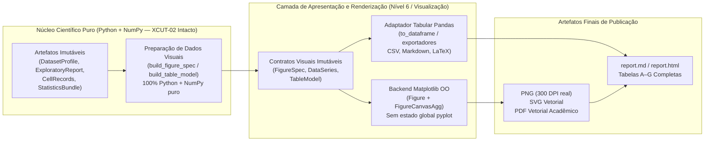
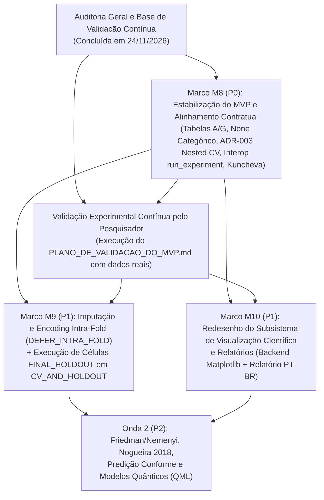

# Roadmap de Evolução e Avaliação Arquitetural — Experimental ML Framework

**Data:** 24 de Novembro de 2026  
**Estado:** Planejamento Pós-Auditoria do MVP (Etapa V)  
**Documentos correlatos:** [AUDITORIA_TECNICA_DO_MVP.md](./AUDITORIA_TECNICA_DO_MVP.md) | [REGISTRO_DE_VALIDACAO_DO_MVP.md](./REGISTRO_DE_VALIDACAO_DO_MVP.md) | [PLANO_DE_VALIDACAO_DO_MVP.md](./PLANO_DE_VALIDACAO_DO_MVP.md)

---

## 1. Visão Geral e Premissas de Evolução

Com a conclusão da implementação inicial dos marcos `M1` a `M7` e das entregas pós-MVP (`TA-POS.1` a `TA-POS.3` e 4 features incrementais, totalizando 611 testes automatizados), a evolução do `experimental-ml-framework` passa a ser guiada por duas diretrizes:

1. **Rastreabilidade à Validação Empírica:** Nenhuma evolução é implementada de forma ad-hoc. Toda oportunidade de melhoria ou lacuna identificada em [AUDITORIA_TECNICA_DO_MVP.md](./AUDITORIA_TECNICA_DO_MVP.md) e [REGISTRO_DE_VALIDACAO_DO_MVP.md](./REGISTRO_DE_VALIDACAO_DO_MVP.md) é convertida em marco formal sob a metodologia TLC Spec-Driven (`Specify → Design → Tasks → Execute → Verify → Acceptance`).
2. **Preservação do Núcleo Científico e Decisão pelo Desenvolvedor:** O núcleo de particionamento, execução isolada, métricas e inferência estatística (Nadeau-Bengio, Wilcoxon, Holm-Bonferroni, Kuncheva, Pareto) permanece determinístico e livre de vazamento de dados (`XCUT-01`, `XCUT-03`). Revisões arquiteturais (como a evolução do subsistema de visualização científica avaliada na Seção 3) são apresentadas com análise de trade-offs para decisão explícita do desenvolvedor.

---

## 2. Categorização Completa das Evoluções Identificadas (Etapa V)

Conforme exigido pelo processo de engenharia, as evoluções mapeadas dividem-se em oito categorias distintas:

### 2.1. Categoria 1 — Funcionalidades Originalmente Planejadas e Ainda Pendentes
1. **Imputação (`IMPUTER`) e Codificação Categórica Intra-Fold conectadas a `DEFER_INTRA_FOLD` (`RF1.4`, `RF3.3` — `VAL-BUG-001`, `VAL-ENH-002`):** A Etapa 1 já valida e grava regras `DEFER_INTRA_FOLD` em `SanitizedDatasetView.deferred_rules`, mas a Etapa 3/4B ainda não instancia o transformador `IMPUTER` nem aplica codificação categórica dentro dos folds.
2. **Execução e Consolidação de Células `FINAL_HOLDOUT` no Regime `CV_AND_HOLDOUT` (`RF4.1`, `RF4.3` — `VAL-BUG-008`, `VAL-ENH-003`):** A Etapa 4A separa `holdout_ids` disjuntos de `development_ids`, mas a Etapa 4B executa apenas os $K$ folds de desenvolvimento.
3. **Controle de `inner_model_threads` no Paralelismo em Dois Níveis (`RF4.4` — `VAL-BUG-010`):** O paralelismo externo (`outer_n_jobs`) está ativo, mas a limitação explícita de threads internas por estimador (`n_jobs` do scikit-learn / variáveis BLAS) ainda não é injetada automaticamente.
4. **Métodos Estatísticos e Quânticos da Onda 2 (`ESPECIFICACAO_REQUISITOS.md` / `REFERENCIAS_E_FUNDAMENTACAO.md`):**
   - Teste global de Friedman + post-hoc de Nemenyi e Diagramas de Diferença Crítica (Demšar, 2006);
   - Intervalos de confiança via Bootstrap BCa, $g$ de Hedges, $\delta$ de Cliff e estimador de estabilidade de Nogueira et al. (2018);
   - Predição Conforme (*Split/Cross-Conformal Prediction*);
   - Adaptadores concretos para circuitos quânticos variacionais (VQC/QNN), kernels quânticos projetados e resolvedores híbridos (HHL).

### 2.2. Categoria 2 — Melhorias de Funcionalidades Já Implementadas
1. **Preenchimento Integral das Tabelas A e G na Etapa 6 (`VAL-BUG-002`, `VAL-BUG-003`):** Conectar `build_table_model` ao sub-dicionário `"summary"` de `dataset_profile.json` (Família A) e aos diagnósticos persistidos em `runs/cells/cell_*.json` (Família G).
2. **Tratamento Pairwise de `None` em Colunas Categóricas na Etapa 2 (`VAL-BUG-004`):** Filtrar valores ausentes em arrays `dtype=object` antes de `np.unique` em `compute_correlation_ratio` e `compute_cramers_v`.
3. **Cálculo de `n_total_candidates_per_config` para o Índice de Kuncheva na CLI e Fachada (`VAL-BUG-009`):** Passar a cardinalidade real do conjunto candidato de atributos de cada cenário para `consolidate_descriptive`, evitando `mean_kuncheva = None` quando a seleção é estável.
4. **Persistência Completa de Artefatos e Propagação de Semente em `run_experiment` (`VAL-BUG-007`):** Gravar `sanitized_view.json`, `splits.csv.gz` e `pareto_summary.json` na fachada Python e injetar `random_state=seed` ao clonar instâncias prontas de estimadores.

### 2.3. Categoria 3 — Refatorações Necessárias
1. **Alinhamento Intra-Fold entre Camada 1, Seleção Dinâmica e Nested CV (`ADR-003` — `VAL-BUG-005`):** Refatorar a fronteira entre `orchestration/execution.py` e `tuning/engine.py` para que a Camada 1 de pré-processamento e `select_features_in_fold` rodem dentro de cada sub-fold interno durante a busca de hiperparâmetros e, ao final, sejam reajustadas no fold externo completo.
2. **Propagação de Estratégia de Particionamento para `split_inner_folds` (`VAL-BUG-005`):** Permitir que os folds internos do Nested CV respeitem agrupamento (`group_col`), estratificação de classes ou ordenação temporal.
3. **Verificação de `scenarios_hash` e `models_hash` no `resume` e Lock em `_ACTIVE_INSTANCES` (`VAL-BUG-010`):** Completar a verificação de integridade de estado na retomada e proteger o conjunto global de isolamento de instâncias com `threading.Lock`.

### 2.4. Categoria 4 — Novas Funcionalidades
1. **Exportação Automática de Tabelas e Figuras no `expml quickrun` e `run_experiment` (`VAL-QUAL-003`):** Opção integrada para exportar `reports/tables/*.{csv,md,tex}` e `reports/figures/*.{png,svg,pdf}` ao final da execução rápida.
2. **Especificação Declarativa de Múltiplos Objetivos de Pareto em `stats_config.json` (`VAL-ENH-004`):** Permitir ao usuário configurar 2 ou mais objetivos (ex.: erro preditivo vs. tempo de treino vs. número de atributos) diretamente na CLI.
3. **Teste Kolmogorov-Smirnov (1 e 2 amostras / Lilliefors), Detecção de *Dataset Shift* e Q-Q Plot (`VAL-ENH-006`):** Implementação em NumPy puro (`XCUT-02`) do teste KS de 2 amostras (Kolmogorov 1933; Smirnov 1948; Quiñonero-Candela et al. 2009) para detectar *covariate/target shift* entre `DEV` e `HOLDOUT`/splits temporais, teste de aderência com correção de Lilliefors (1967) / Stephens (1974) e gráficos de resíduos + Q-Q Plot na Etapa 6 (`M11`).

### 2.5. Categoria 5 — Melhorias de Desempenho
1. **Cache Intra-Célula de Pré-processamento de Camada 1 no Nested CV:** Ao executar `GRID_SEARCH` com dezenas de candidatos de hiperparâmetros do modelo sobre os mesmos folds internos, reutilizar a matriz transformada pela Camada 1 e pela seleção dinâmica em cada sub-fold interno sem recalculá-la para cada ponto da grade de hiperparâmetros do estimador.
2. **Paralelismo Multi-Processo Opcional (`ProcessPoolExecutor`):** Complementar o `ThreadPoolExecutor` atual em `orchestration/engine.py` com suporte opcional a processos para modelos intensivos em Python puro que retenham o GIL.

### 2.6. Categoria 6 — Melhorias de Experiência de Uso (CLI e API)
1. **Template de Classificação com 2 Modelos em `expml init` (`VAL-QUAL-003`):** Incluir um segundo modelo comparativo ao inicializar experimentos de classificação binária ou multiclasse, garantindo que o primeiro `expml quickrun` já demonstre comparações estatísticas pareadas.
2. **Enriquecimento das Tabelas B e C e Glossário Estatístico em Português no Relatório (`VAL-QUAL-002`):** Exibir estratégia, parâmetros e justificativa científica na Tabela B; hiperparâmetros, pré-processamento e tuning na Tabela C; e padronizar `report.md`/`report.html` em português com guia de leitura estatística.

### 2.7. Categoria 7 — Melhorias de Visualização e Relatórios
1. **Redesenho do Subsistema de Visualização Científica das Etapas 2 e 6 (`VAL-BUG-006`, `VAL-QUAL-001`, `VAL-ENH-001`):** Substituição dos renderizadores manuais de pixels/bytes por uma arquitetura desacoplada com suporte a `matplotlib` (e `pandas` na camada de apresentação tabular), detalhada na Seção 3 abaixo.
2. **Visualização e Comparação de Erro de Treino vs. Teste (`VAL-ENH-005`):** Instrumentação diagnóstica opcional de `train_metrics` pós-`fit_model` em `CellResultRecord` (estritamente isolada da inferência estatística) e gráfico comparativo Treino vs. Teste (gap de generalização / diagnóstico de *overfitting*) na Etapa 6 (`M10`).

### 2.8. Categoria 8 — Melhorias de Documentação e Ferramentas de Desenvolvimento
1. **Correção do Caminho de `PROCESSO_DE_ACEITE_DE_MARCOS.md` em `validate_verification.py` (`VAL-BUG-011`):** Ajustar a linha 370 do script TLC em `.agent/` e `.agents/` para incluir o prefixo `docs/`.
2. **Sincronização de Nomenclatura em `ARQUITETURA_E_CONTRATOS.md` e Expansão de `cli_schemas_json.md` (`VAL-QUAL-004`):** Alinhar nomes de códigos de achados (§3.1) e enums (§3.4) com o código implementado após autorização do desenvolvedor.

---

## 3. Avaliação Técnica Aprofundada — Subsistema de Visualização Científica e Relatórios (Etapa V — Seção 7.1)

### 3.1. Diagnóstico das Limitações Atuais (`features/visualization.py` e `reporting/figures.py`)

Atualmente, em razão de uma interpretação restritiva original do requisito transversal `XCUT-02` (*"núcleo implementado exclusivamente com biblioteca padrão do Python e NumPy"*), o framework construiu dois motores gráficos artesanais em Python/NumPy puro que apresentam limitações severas:

1. **Na Etapa 6 (`src/experimental_ml/reporting/figures.py` — `VAL-BUG-006`):**
   - **PNG (`_render_png_300dpi`):** Desenha apenas retângulos preenchidos sobre duas linhas cinzas usando `zlib` e `struct`. **Não possui renderização de texto**: o PNG final de 300 DPI não tem título, não tem nomes de modelos/cenários, não tem rótulos nos eixos X/Y e não tem números de escala.
   - **PDF (`_render_pdf`):** Emite operadores PDF 1.4 crus (`re f`), ignorando `spec.plot_type` e `s.y_err`. Todos os gráficos (inclusive dispersão de Pareto `PARETO_TRADEOFF` e intervalos de diferença pareada `PAIRED_DIFF_CI`) viram gráficos de barras verticais azuis sem barras de erro e sem rótulos.
   - **SVG (`_render_svg`):** Em `PARETO_TRADEOFF` (`L220`), posiciona a coordenada X pelo índice da lista `i` em vez do valor numérico `s.x_values[i]`, colapsando pontos dominados e Pareto-ótimos na mesma abscissa; não possui escala numérica no eixo Y, não desenha a linha de equivalência $\Delta = 0$ na Família E e não possui legenda.
   - **Cobertura de Famílias:** As Famílias A, B, C e G geram apenas um gráfico placeholder de 1 barra (`"total_configs"`), e os tipos `SCATTER_PARITY`, `HEATMAP` e `LINE_LEARNING` (`RF6.2`) não estão implementados.
2. **Na Etapa 2 (`src/experimental_ml/features/visualization.py` — `VAL-QUAL-001`):**
   - Utiliza uma fonte bitmap 5×7 (`_FONT_5X7`) codificada manualmente em dicionário Python.
   - Remove toda a acentuação da língua portuguesa (`_to_ascii_label`: `"Correlação"` → `"Correlacao"`, `"Informação Mútua"` → `"Informacao Mutua"`).
   - Trunca nomes de variáveis longos (`> 25` caracteres) na margem esquerda (`left_margin` travado em `320 px`) e sobrepõe cabeçalhos verticais longos sobre a barra de cores no topo do heatmap (`top_margin` travado em `220 px`).

### 3.2. Análise Comparativa das Alternativas Tecnológicas

| Critério de Avaliação | Alternativa A: Manter/Expandir Rasterizador NumPy + SVG/PDF Manual | Alternativa B (Recomendada): Arquitetura Desacoplada com `Matplotlib` (+ `Pandas` opcional na borda) | Alternativa C: `Plotly` / `Altair` (Baseados em Web/JS) |
| :--- | :--- | :--- | :--- |
| **Qualidade visual e tipográfica (padrão de publicação científica)** | **Baixa.** Fontes bitmap serrilhadas no PNG, ausência de kerning/UTF-8 completo, dificuldade extrema para posicionar legendas, caixas de texto e escalas logarítmicas/científicas. | **Excelente (Padrão Ouro Acadêmico).** Tipografia vetorial TrueType/OpenType com anti-aliasing, suporte nativo a UTF-8/português e notação matemática LaTeX (`$R^2$`, $\Delta$, $\eta$), layout automático (`constrained_layout`). | **Boa para web, ruim para LaTeX/PDF.** Foco em HTML interativo; exportação estática para PDF/PNG 300 DPI exige motor headless Chromium (`kaleido`), pesado e frágil em servidores/CI. |
| **Consistência entre formatos (`PNG 300 DPI`, `SVG`, `PDF`)** | **Muito Baixa.** Exige manter 3 motores de código completamente separados (`_render_svg`, `_render_png_300dpi`, `_render_pdf`), que hoje produzem geometrias incompatíveis entre si. | **Total (100%).** Um único código de construção da figura (`matplotlib.figure.Figure` via interface orientada a objetos `Figure()` + `FigureCanvasAgg`) exporta simultaneamente `.png` (`dpi=300`), `.svg` e `.pdf` vetoriais idênticos. | **Baixa sem navegador headless.** |
| **Impacto nas dependências e no requisito `XCUT-02`** | Zero dependências novas, mas viola o objetivo científico de `RF6.2` e `CA-E6-02` (figuras prontas para artigos). | Adiciona apenas `matplotlib` (que já compartilha a base `numpy`) restrito à camada de visualização, mantendo os pacotes de núcleo (`core`, `metrics`, `data`, `features/stats`, `models`, `tuning`, `validation`, `orchestration`, `statistics`) **100% puros em Python + NumPy**. | Dependências pesadas (`plotly`, `kaleido`/Chromium). |
| **Papel do `pandas` na organização de tabelas e dados visuais** | Formatação manual de listas de strings. | `pandas` pode ser utilizado na camada de apresentação (`reporting/tables.py`, `.to_dataframe()` e preparação de matrizes rotuladas para plotagem/exportação CSV/LaTeX/Markdown), sem substituir os `@dataclass(frozen=True)` imutáveis do domínio. | Geralmente exige `pandas.DataFrame` como entrada obrigatória. |
| **Manutenibilidade e Testabilidade** | **Ruim.** Centenas de linhas de manipulação de slices de pixels `[y0:y1, x0:x1]` e offsets binários PDF difíceis de manter e testar. | **Alta.** Como a preparação dos dados visuais (`FigureSpec` / `VisualDataModel`) fica separada do renderizador (`MatplotlibRenderer`), os testes unitários validam 100% das coordenadas e séries no `FigureSpec` e inspecionam os objetos `Axes` (`ax.get_title()`, `ax.lines`, `ax.collections`) deterministicamente. | Difícil de testar a saída estática sem browser. |

### 3.3. Arquitetura Desacoplada Proposta para o Subsistema de Visualização (`M10`)

Para preservar rigorosamente a pureza metodológica do núcleo (`XCUT-02`) e ao mesmo tempo alcançar qualidade visual de publicação acadêmica, recomenda-se a seguinte arquitetura em três camadas dentro de `reporting/` e `features/`:

#### Garantias Arquiteturais desta Proposta:
1. **Núcleo Matemático 100% Intacto:** Nenhum módulo de cálculo estatístico (`statistics/`), métrica (`metrics/`), particionamento (`validation/`), seleção de atributos (`features/selection.py`, `features/stats.py`) ou orquestração (`orchestration/`) importa `matplotlib` ou `pandas`.
2. **Uso Determinístico e Headless do `matplotlib`:** O renderizador utiliza exclusivamente a API Orientada a Objetos (`from matplotlib.figure import Figure; from matplotlib.backends.backend_agg import FigureCanvasAgg`) sem `plt.show()` e sem estado global `pyplot`, garantindo thread-safety, determinismo e execução em servidores sem display X11.
3. **Revisão Formal e Controlada do `XCUT-02` (`ADR-008` proposto):** Atualiza-se a redação de `XCUT-02` para distinguir explicitamente:
   - **Núcleo Metodológico e Estatístico (Níveis 0 a 5):** Estritamente Python padrão + `numpy` (e `scikit-learn` isolado nos adaptadores de modelos da Etapa 3);
   - **Camada de Apresentação e Relatórios (Visualização da Etapa 2 e Etapa 6):** Autorizada a utilizar `matplotlib` para renderização gráfica (`PNG 300 DPI`, `SVG`, `PDF`) e `pandas` para interoperabilidade tabular (`to_dataframe()`).

---

## 4. Planejamento Estruturado dos Próximos Marcos (`M8`, `M9`, `M10` e `Onda 2`)

As evoluções priorizadas foram organizadas em quatro marcos coesos e sequenciais.

### 4.1. Marco `M8` — Estabilização do MVP e Alinhamento Contratual

| Campo | Definição |
| :--- | :--- |
| **Identificador** | `M8` (`.specs/features/m8-mvp-stabilization-contract-alignment/`) |
| **Nome** | Estabilização do MVP e Alinhamento Contratual |
| **Problema que resolve** | Corrige os defeitos `P0` e `P1` de integração já identificados na auditoria em funcionalidades da Onda 1: Tabelas A e G vazias (`VAL-BUG-002`, `VAL-BUG-003`), `TypeError` com `None` em variáveis categóricas na Etapa 2 (`VAL-BUG-004`), seleção dinâmica fora do loop interno do Nested CV (`VAL-BUG-005`), artefatos incompletos e semente ignorada em `run_experiment` (`VAL-BUG-007`), `mean_kuncheva = None` e Pareto 1D na CLI (`VAL-BUG-009`, `VAL-ENH-004`), hashes de retomada e lock de instâncias (`VAL-BUG-010`), template de classificação em `expml init` (`VAL-QUAL-003`) e caminho do script TLC (`VAL-BUG-011`). |
| **Objetivo** | Garantir que todo o escopo já implementado no MVP funcione sem falhas silenciosas, sem tabelas vazias e com 100% de interoperabilidade entre API Python e CLI `expml`. |
| **Escopo preliminar** | `reporting/tables.py`, `reporting/loader.py`, `features/stats.py`, `orchestration/execution.py`, `tuning/engine.py`, `tuning/partitioning.py`, `pipeline.py`, `cli/cmd_stats.py`, `cli/cmd_init.py`, `orchestration/state.py`, `models/execution.py` e `validate_verification.py`. |
| **Dependências** | Resposta do desenvolvedor às decisões `D1` (`ADR-003`) e `D2` (prefixo `cell_`) na `spec.md` do `M8`. |
| **Impacto arquitetural** | **Baixo/Alinhamento.** Não introduz novas dependências externas nem altera contratos aprovados; apenas faz o código cumprir integralmente os contratos existentes (`ADR-003`, `CA-E4B-02`, `RF6.1`). |
| **Complexidade estimada** | Média (6 a 8 tarefas atômicas TLC). |
| **Prioridade** | **`P0` (Imediata — Primeiro marco a executar)**. |
| **Critérios preliminares de aceitação** | `AC-M8-01` a `AC-M8-06` documentados em `.specs/features/m8-mvp-stabilization-contract-alignment/spec.md`. |
| **Marcos relacionados** | Consolida entregas de `M2`, `M3`, `M4`, `M5`, `M6`, `M7` e `TA-POS.3`. |

---

### 4.2. Marco `M9` — Imputação e Codificação Categórica Intra-Fold e Execução de Holdout Final

| Campo | Definição |
| :--- | :--- |
| **Identificador** | `M9` (`.specs/features/m9-intra-fold-imputation-encoding-holdout/`) |
| **Nome** | Imputação e Codificação Categórica Intra-Fold e Execução de Holdout Final |
| **Problema que resolve** | Conecta as regras `DEFER_INTRA_FOLD` da Etapa 1 ao motor de execução da Etapa 4B, implementa o transformador `IMPUTER` (`MEAN`, `MEDIAN`, `MODE`) e codificação categórica intra-fold na Camada 1 (`VAL-BUG-001`, `VAL-ENH-002`), e executa/consolida as células `FINAL_HOLDOUT` no regime `CV_AND_HOLDOUT` (`VAL-BUG-008`, `VAL-ENH-003`). |
| **Objetivo** | Permitir que o pesquisador execute experimentos diretamente sobre datasets reais contendo valores faltantes e variáveis categóricas com tratamento intra-fold à prova de vazamento, além de suportar o protocolo completo `CV_AND_HOLDOUT`. |
| **Escopo preliminar** | `models/preprocessing/imputers.py` (novo), `models/preprocessing/encoders.py` (novo), `models/preprocessing/pipeline.py`, `orchestration/matrix.py`, `orchestration/execution.py`, `statistics/consolidation.py` e `reporting/tables.py`. |
| **Dependências** | Conclusão do Marco `M8` e decisões `AD-030`, `AD-031` e `AD-032` (já deliberadas — marco implementado e verificado em `feat/m9-intra-fold-holdout`, aguardando aceite). |
| **Impacto arquitetural** | **Médio.** Estende a Camada 1 de pré-processamento e adiciona separação explícita entre células `DEVELOPMENT_CV` e `FINAL_HOLDOUT` na consolidação estatística da Etapa 5. |
| **Complexidade estimada** | Média-Alta (6 a 8 tarefas atômicas TLC). |
| **Prioridade** | **`P1` (Logo após a estabilização de `M8`)**. |
| **Critérios preliminares de aceitação** | Execução E2E bem-sucedida de dataset com `NaN` e variáveis categóricas via `DEFER_INTRA_FOLD` sem leakage; geração e consolidação separada de células `FINAL_HOLDOUT` sob `CV_AND_HOLDOUT`. |
| **Marcos relacionados** | Completa requisitos residuais de `M2` (`RF1.4`), `M4` (`RF3.3`) e `M5` (`RF4.1`, `RF4.3`). |

---

### 4.3. Marco `M10` — Redesenho do Subsistema de Visualização Científica e Relatórios

| Campo | Definição |
| :--- | :--- |
| **Identificador** | `M10` (`.specs/features/m10-scientific-visualization-reporting-redesign/`) |
| **Nome** | Redesenho do Subsistema de Visualização Científica e Relatórios |
| **Problema que resolve** | Elimina os defeitos visuais e geométricos das figuras da Etapa 6 (`VAL-BUG-006`), supera as limitações da fonte bitmap 5×7 sem acentos da Etapa 2 (`VAL-QUAL-001`) e completa as Tabelas B e C e o relatório consolidado em português com glossário estatístico (`VAL-QUAL-002`, `VAL-ENH-001`). |
| **Objetivo** | Entregar figuras (`PNG 300 DPI`, `SVG`, `PDF`) e relatórios (`report.md`, `report.html`, tabelas LaTeX/CSV/MD) com qualidade de publicação científica. |
| **Escopo preliminar** | `features/visualization.py`, `reporting/figures.py`, `reporting/tables.py`, `reporting/report.py`, `pyproject.toml` e adição de ADR específico sobre a camada de apresentação (`XCUT-02`). |
| **Dependências** | Aprovação de `AD-033`–`AD-036` e conclusão de `M8`/`M9` (já deliberadas — marco implementado e verificado em `feat/m10-visualization-reporting`, aguardando aceite). |
| **Impacto arquitetural** | **Médio-Alto (Camada de Apresentação).** Introduz `matplotlib` na camada de renderização visual (Níveis 2-viz e 6), mantendo os módulos matemáticos e estatísticos 100% puros em Python + NumPy. |
| **Complexidade estimada** | Média-Alta (7 a 9 tarefas atômicas TLC). |
| **Prioridade** | **`P1`**. |
| **Critérios preliminares de aceitação** | Figuras das Etapas 2 e 6 com textos UTF-8 acentuados, escalas numéricas exatas, barras de erro de IC 95%, linha $\Delta = 0$, fronteira de Pareto em coordenadas reais nos 3 formatos (`PNG`, `SVG`, `PDF`) e relatório completo em português. |
| **Marcos relacionados** | Evolui `M3` (`exploratory-visual-redesign`) e `M7` (`m7-1`, `m7-2`, `m7-3`). |

---

### 4.4. Horizonte `Onda 2` — Expansão Estatística Multi-Comparação, Predição Conforme e QML

| Campo | Definição |
| :--- | :--- |
| **Identificador** | `Onda 2` (`M11+` — Planejamento Futuro Pós-Homologação do MVP Clássico) |
| **Nome** | Expansão Estatística Avançada, Predição Conforme e Aprendizado de Máquina Quântico (QML) |
| **Problema que resolve** | Implementa as capacidades científicas planejadas desde a concepção para a Onda 2 em `ESPECIFICACAO_REQUISITOS.md` e `REFERENCIAS_E_FUNDAMENTACAO.md`. |
| **Escopo modular previsto** | 1. **Marco `M11` (Estatística Onda 2):** Teste omnibus de Friedman, post-hoc de Nemenyi, Diagramas de Diferença Crítica (CD Diagrams), Bootstrap BCa, $g$ de Hedges, $\delta$ de Cliff e estabilidade de Nogueira et al. (2018). 2. **Marco `M12` (Quantificação de Incerteza):** Predição Conforme (*Split Conformal* e *Cross-Conformal / CV+*) com garantia de cobertura empírica $1 - \alpha$. 3. **Marco `M13` (QML — Aprendizado de Máquina Quântico e Híbrido):** Adaptadores concretos para Kernels Quânticos, Circuitos Variacionais (VQC) e resolvedores lineares quânticos (HHL) consumindo o `AngularScaler` e os metadados quânticos já preparados na Onda 1. |
| **Prioridade** | **`P2` (Iniciar apenas após a homologação completa do MVP clássico nos marcos `M8` a `M10`)**. |

---

## 5. Sequência Recomendada de Execução no Roadmap

