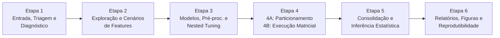

# Tutorial Metodológico das 6 Etapas *(Nível 2)*

O `experimental-ml` organiza todo experimento científico em **6 etapas metodológicas oficiais**.  
- No **Modo Básico** (`run_experiment(...)` em Python ou `expml quickrun` na CLI), o framework executa todas as 6 etapas automaticamente com configurações seguras.  
- No **Modo Avançado** (APIs modulares ou subcomandos individuais da CLI), você pode customizar cada etapa detalhadamente.

> [!TIP]
> Para acompanhar todas as 6 etapas executando passo a passo em código vivo, abra o [Notebook 03 — Tour Completo pelas 6 Etapas](../../notebooks/03_tour_6_etapas.ipynb).



---

## Etapa 1: Entrada, Triagem e Diagnóstico Estrutural

**Por que esta etapa existe?** Antes de treinar qualquer modelo, é preciso garantir que os dados brutos não sejam alterados silenciosamente e que problemas estruturais (como coluna alvo ausente ou colunas inválidas) sejam detectados com registro auditável.

| Nível | O Que Você Faz |
| :--- | :--- |
| **Mínimo Obrigatório (Básico)** | Informar `data`, `target` e `task` no `run_experiment` (ou gerar `schema.json` com `expml init`). Se não houver achados críticos, `rules` fica vazio automaticamente. |
| **O Que Você Pode Customizar (Avançado)** | Configurar formatação do CSV (`CsvFormatSpec`: `delimiter`, `decimal` `"."`/`","`/`"auto"`, `encoding`, `has_header`, `column_names`, `quotechar`), ignorar colunas (`ignore_cols`), declarar coluna de grupo (`group_col`) ou tempo (`time_col`), e definir regras determinísticas explícitas de saneamento em `PreparationRule` / `rules.json`. |

**Módulos:** `experimental_ml.data`, `experimental_ml.stages` (`verify_preparation_gate`)
- `load_dataset` ingere a base em um `DatasetBundle` imutável com hashes SHA-256 tripartites (`raw_source_hash`, `schema_hash`, `dataset_hash`).
- `profile_dataset` audita tipos semânticos, nulos e inconsistências; `create_preparation_plan` e `sanitize_dataset` aplicam regras determinísticas pré-partição gerando uma `SanitizedDatasetView`.

**Comandos CLI (Etapa 1):**
```bash
expml data profile --data dados.csv --schema schema.json --output-dir exp_dir --force
expml data sanitize --experiment-dir exp_dir --force
```

---

## Etapa 2: Exploração de Relações e Cenários de Features

**Por que esta etapa existe?** Escolher variáveis olhando para todo o conjunto de dados antes de dividir treino e teste causa *data leakage* e infla artificialmente os resultados. Esta etapa separa análise exploratória de seleção dentro de cada dobra.

| Nível | O Que Você Faz |
| :--- | :--- |
| **Mínimo Obrigatório (Básico)** | Nada extra: o modo básico usa automaticamente todas as colunas preditoras válidas (`todas_features` em modo `FIXED`). |
| **O Que Você Pode Customizar (Avançado)** | Comparar múltiplos `FeatureScenario` (`FIXED` vs. `DYNAMIC` com `TOP_K_RELEVANCE` ou `VARIANCE_THRESHOLD` ajustados estritamente dentro do treino) e medir estabilidade inter-dobras (`Jaccard` e `Kuncheva`). |

**Módulos:** `experimental_ml.features`, `experimental_ml.stages` (`verify_scenarios_gate`)
- `explore_features` rotula obrigatoriamente a análise exploratória global como `EXPLORATORY_FULL_DATA`, oferece `.summary()` (ranking único por atributo via média das magnitudes `mean(|valor|)`) em Python e gera relatórios limpos (`exploratory_features.md`/`.html` pronto para impressão/PDF), tabelas CSV (`exploratory_target_associations.csv`, `exploratory_redundancy_matrix.csv`) e gráficos PNG rotulados (`exploratory_target_associations.png`, `exploratory_redundancy_heatmap.png`).
- `validate_scenarios` impede que atributos pré-calculados entrem em cenários dinâmicos.

**Comandos CLI (Etapa 2):**
```bash
expml features explore --experiment-dir exp_dir
expml features scenarios --experiment-dir exp_dir --scenarios scenarios.json
expml features verify --experiment-dir exp_dir
```

---

## Etapa 3: Registro de Modelos, Pré-processamento em 2 Camadas e Nested Tuning

**Por que esta etapa existe?** Reutilizar o mesmo objeto de modelo entre dobras vaza pesos aprendidos, e ajustar hiperparâmetros olhando para a dobra de validação externa gera otimismo falso.

| Nível | O Que Você Faz |
| :--- | :--- |
| **Mínimo Obrigatório (Básico)** | Passar seus modelos em um dicionário `models={"Nome": modelo}` no `run_experiment` (ou escolher baselines no `models.json` do `expml init`). |
| **O Que Você Pode Customizar (Avançado)** | Declarar `ModelSpec` e `ModelCapabilities` (`requires_fit=False` para modelos analíticos, `supports_precomputed_kernel=True`), configurar pré-processamento em 2 camadas sem duplicação (`validate_two_layer_preprocessing`) e busca aninhada *Nested CV* (`HyperparameterSearchSpec` com `grid_search` ou `random_search`). |

**Módulos:** `experimental_ml.models`, `experimental_ml.tuning`, `experimental_ml.stages` (`verify_models_gate`)

**Comandos CLI (Etapa 3):**
```bash
expml models validate --experiment-dir exp_dir --models models.json
expml models verify --experiment-dir exp_dir
```

---

## Etapa 4: Particionamento Compartilhado (4A) e Execução Matricial (4B)

**Por que esta etapa existe?** Para comparar modelos com justiça, todos devem ser avaliados exatamente nas mesmas divisões de dados (`PartitionPlan`). Além disso, experimentos longos não podem perder tudo se uma célula falhar ou for interrompida.

| Nível | O Que Você Faz |
| :--- | :--- |
| **Mínimo Obrigatório (Básico)** | Informar `cv_folds=5` (ou `group_col` se houver amostras do mesmo sujeito/parcela) no `run_experiment`. |
| **O Que Você Pode Customizar (Avançado)** | Escolher regime (`CV_ONLY`, `HOLDOUT_ONLY`, `CV_AND_HOLDOUT`), paralelismo (`-j`), política de falhas (`fault_tolerant` vs. `fail_fast`), seleção de métricas (`--metrics`) e retomada por checkpoint (`expml run resume --retry-failed`). |

### Guia Rápido de Escolha da Validação (Subetapa 4A)

| Tipo de Dados do Seu Estudo | Estratégia Recomendada | Por Quê? |
| :--- | :--- | :--- |
| Amostras independentes (regressão) | `KFOLD` | Divide aleatoriamente em $K$ dobras iguais. |
| Classes desbalanceadas (classificação) | `STRATIFIED_KFOLD` | Preserva a proporção de cada classe em todas as dobras. |
| Múltiplas medições pertencentes à mesma unidade ou grupo | `GROUP_KFOLD` (`group_col=...`) | Impede que observações do mesmo grupo apareçam no treino e na validação/holdout. |
| Série temporal / ordem cronológica | `TEMPORAL` (`time_col=...`) | Garante que o modelo nunca treine no futuro para prever o passado. |

**Módulos:** `experimental_ml.validation`, `experimental_ml.orchestration`, `experimental_ml.stages` (`verify_partition_gate`, `verify_runs_gate`)
- Em modo `FAULT_TOLERANT`, falhas isoladas marcam a célula como `FAILED` sem converter métricas indefinidas para zero (`MetricStatus.UNDEFINED_NAN`).

**Comandos CLI (Etapa 4):**
```bash
expml partition build --experiment-dir exp_dir --config partition.json --seed 42
expml partition verify --experiment-dir exp_dir
expml run start --experiment-dir exp_dir -j 4 --error-policy fault_tolerant --metrics rmse r2
expml run status --experiment-dir exp_dir
expml run verify --experiment-dir exp_dir
```

---

## Etapa 5: Consolidação e Comparação Estatística Rigorosa

**Por que esta etapa existe?** Olhar apenas a média entre dobras engana quando há variância alta, dobras falhas ou múltiplas comparações simultâneas.

| Nível | O Que Você Faz |
| :--- | :--- |
| **Mínimo Obrigatório (Básico)** | Ler o resumo `resultado.summary()` ou `reports/report.md`, que já exibem médias, desvios-padrão, cobertura e líder observado. |
| **O Que Você Pode Customizar (Avançado)** | Configurar `ComparisonSpec` (`alpha`, pares planejados, `Holm-Bonferroni` vs. `Benjamini-Hochberg`), analisar `paired_nadeau_bengio_test` / `paired_wilcoxon_test`, tamanho de efeito ($d$ de Cohen) e otimização multiobjetivo na Fronteira de Pareto (`compute_pareto_frontier`). |

**Módulos:** `experimental_ml.statistics`, `experimental_ml.stages` (`verify_statistics_gate`)

$$
t_{\text{NB}} = \frac{\bar{d}}{\sqrt{\left(\frac{1}{K} + \frac{n_{\text{test}}}{n_{\text{train}}}\right) s_d^2}}
$$

**Comandos CLI (Etapa 5):**
```bash
expml stats run --experiment-dir exp_dir --config stats_config.json
expml stats status --experiment-dir exp_dir
expml stats verify --experiment-dir exp_dir
```

---

## Etapa 6: Relatórios Científicos, Figuras e Pacote de Reprodutibilidade

**Por que esta etapa existe?** Separar a execução pesada da geração de relatórios permite ajustar tabelas, gráficos e formatos de artigo em segundos sem retreinar nenhum modelo.

| Nível | O Que Você Faz |
| :--- | :--- |
| **Mínimo Obrigatório (Básico)** | Abrir `reports/report.md` ou `reports/report.html` gerados automaticamente ao fim do `run_experiment` / `expml quickrun`. |
| **O Que Você Pode Customizar (Avançado)** | Filtrar conteúdo (`ARTICLE_COMPACT` vs. `FULL_LAB` vs. `CUSTOM`), exportar 7 famílias de tabelas (`CSV`, `Markdown`, `LaTeX booktabs`), renderizar figuras (`SVG`, `PNG` 300 DPI, `PDF`) e empacotar para conferências (`full_package` ou `reduced_no_raw_data`) com `checksums.sha256`. |

**Módulos:** `experimental_ml.reporting`, `experimental_ml.stages` (`verify_report_gate`)

**Comandos CLI (Etapa 6):**
```bash
expml report generate --experiment-dir exp_dir --format both --audience FULL_LAB
expml report export --experiment-dir exp_dir --mode reduced_no_raw_data --output-dir pacote_submissao
expml report verify --experiment-dir pacote_submissao
```
