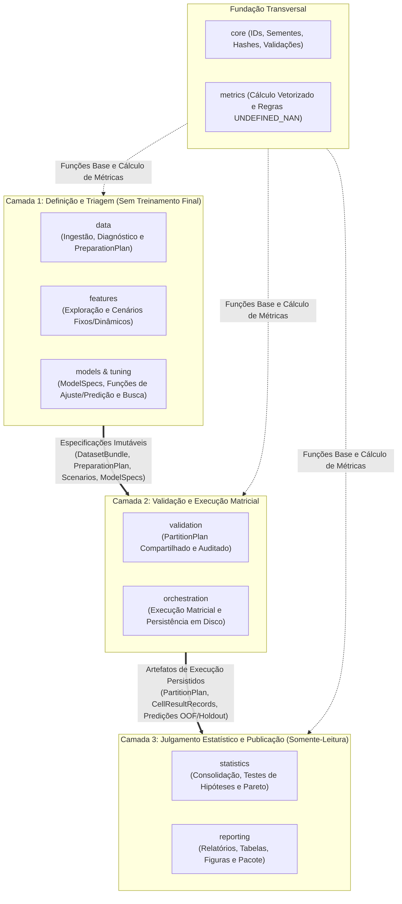
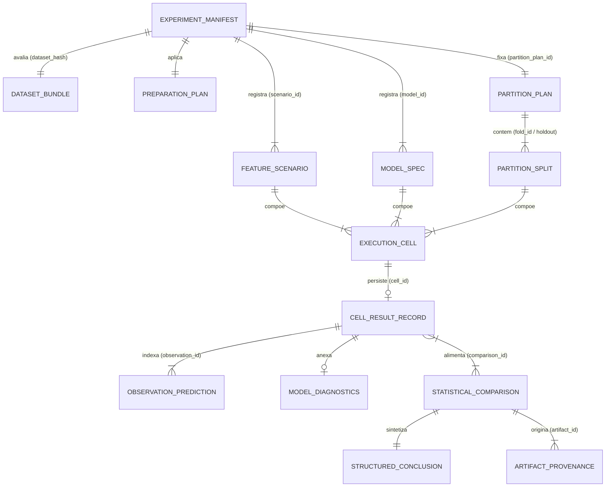

# Especificação Arquitetural, Contratos Conceituais e Modelo de Dados — `experimental-ml-framework`

> **Documento:** Arquitetura de Software, Contratos de Módulos, Modelo de Dados e Recorte de MVP  
> **Versão:** 1.0.0  
> **Data:** 27 de Outubro de 2026  
> **Status:** Consolidado e Aprovado (Fases 2 e 3)  
> **Documentos Relacionados:** [`ESPECIFICACAO_REQUISITOS.md`](./ESPECIFICACAO_REQUISITOS.md) | [`ETAPA_ATUAL_ENGENHARIA.md`](./ETAPA_ATUAL_ENGENHARIA.md)

---

## Sumário

1. [Visão Geral da Arquitetura e Princípios Diretores](#1-visão-geral-da-arquitetura-e-princípios-diretores)
2. [Arquitetura em Camadas, Pipeline Operacional e Dependências entre Módulos](#2-arquitetura-em-camadas-pipeline-operacional-e-dependências-entre-módulos)
   - [2.1 Arquitetura em Três Camadas](#21-arquitetura-em-três-camadas)
   - [2.2 Pipeline Operacional de Dados (As 6 Etapas)](#22-pipeline-operacional-de-dados-as-6-etapas)
   - [2.3 Dependências entre Módulos e Layout Físico (`src/experimental_ml/`)](#23-dependências-entre-módulos-e-layout-físico-srcexperimental_ml)
   - [2.4 Arquitetura da CLI Modularizada (`src/experimental_ml/cli/`)](#24-arquitetura-da-cli-modularizada-srcexperimental_mlcli)
3. [Especificação Detalhada dos Contratos por Etapa](#3-especificação-detalhada-dos-contratos-por-etapa)
   - [3.1 Etapa 1: Entrada, Triagem e Diagnóstico Estrutural da Base](#31-etapa-1-entrada-triagem-e-diagnóstico-estrutural-da-base)
   - [3.2 Etapa 2: Exploração de Relações e Cenários de Features](#32-etapa-2-exploração-de-relações-e-cenários-de-features)
   - [3.3 Etapa 3: Registro de Modelos, Circuitos, Pré-processamento e Hiperparâmetros](#33-etapa-3-registro-de-modelos-circuitos-pré-processamento-e-hiperparâmetros)
   - [3.4 Etapa 4: Particionamento, Validação e Execução Matricial](#34-etapa-4-particionamento-validação-e-execução-matricial)
   - [3.5 Etapa 5: Consolidação dos Resultados e Julgamento Estatístico](#35-etapa-5-consolidação-dos-resultados-e-julgamento-estatístico)
   - [3.6 Etapa 6: Relatórios Científicos, Visualizações e Pacote de Reprodutibilidade](#36-etapa-6-relatórios-científicos-visualizações-e-pacote-de-reprodutibilidade)
4. [Modelo de Dados do Experimento e Rastreabilidade](#4-modelo-de-dados-do-experimento-e-rastreabilidade)
5. [Estrutura do Pacote de Reprodutibilidade em Disco](#5-estrutura-do-pacote-de-reprodutibilidade-em-disco)
6. [Recorte Estratégico: MVP Essencial vs. Evoluções Posteriores](#6-recorte-estratégico-mvp-essencial-vs-evoluções-posteriores)
7. [Ordem de Implementação (Marcos M1–M7) e Testes de Aceitação](#7-ordem-de-implementação-marcos-m1m7-e-testes-de-aceitação)
8. [Protocolo de Reprodução Agnóstica do Experimento de Referência (`prognose_florestal`)](#8-protocolo-de-reprodução-agnóstica-do-experimento-de-referência-prognose_florestal)

---

## 1. Visão Geral da Arquitetura e Princípios Diretores

O `experimental-ml-framework` é projetado como um **harness científico agnóstico** voltado à experimentação controlada em Aprendizado de Máquina (regressão e classificação). Sua arquitetura obedece a sete princípios estruturantes:

1. **Agnosticismo de Modelos e Bibliotecas (ADR-001):** O núcleo do framework não implementa algoritmos preditivos próprios; ele orquestra modelos externos (clássicos, redes neurais, circuitos/resolvedores quânticos, equações analíticas e biométricas) por meio de contratos e adaptadores padronizados.
2. **Imutabilidade dos Dados de Origem e Zero Transformação Silenciosa:** A base original nunca é alterada durante a triagem ou exploração. Nenhuma imputação, codificação, remoção ou escalonamento ocorre sem configuração explícita ou ciência documentada do pesquisador.
3. **Prevenção Estrutural contra Vazamento de Dados (*Zero Data Leakage by Design*):** Qualquer operação que aprenda parâmetros a partir dos dados (imputação, escalonamento, codificação baseada em frequência, seleção dinâmica de atributos e otimização de hiperparâmetros) é ajustada exclusivamente dentro dos dados de treinamento de cada partição (*fold*) externa.
4. **Orientação Pedagógica e Transparência Metodológica:** Problemas estruturais confirmados são separados de alertas heurísticos. Limitações do desenho experimental, pressupostos estatísticos não atendidos e falhas parciais são reportados explicitamente, sem mascarar erros nem fabricar conclusões não sustentadas pelas evidências.
5. **Desacoplamento entre Execução, Julgamento Estatístico e Apresentação:** Os resultados brutos da execução matricial (Etapa 4) são persistidos de modo que análises estatísticas (Etapa 5) e relatórios/gráficos (Etapa 6) possam ser reexecutados, reconfigurados ou reestilizados sem retreinar modelos.
6. **Extensibilidade Aberta/Fechada (*Open/Closed Principle*):** Novos leitores de dados, estratégias de seleção de atributos, adaptadores de modelos, métodos de busca de hiperparâmetros, esquemas de particionamento, testes estatísticos e exportadores de relatórios podem ser adicionados via protocolos sem alterar o núcleo experimental.
7. **Rastreabilidade e Linhagem Ponta a Ponta:** Cada métrica agregada, resultado estatístico, tabela ou figura mantém referência explícita aos identificadores do experimento, do plano de particionamento, das células de execução e das observações que lhe deram origem.

---

## 2. Arquitetura em Camadas, Pipeline Operacional e Dependências entre Módulos

A documentação arquitetural distingue três visões complementares do sistema:
1. **Arquitetura em Três Camadas:** como o framework está estruturado internamente segundo as responsabilidades e o isolamento entre definição, execução e análise pós-execução.
2. **Pipeline Operacional de Dados (6 Etapas):** a sequência de processamento pela qual os dados e objetos experimentais passam desde a leitura da base até a geração de relatórios e artefatos.
3. **Dependências entre Módulos (`src/experimental_ml/`):** as relações de importação entre os pacotes Python que compõem o sistema.

---

### 2.1 Arquitetura em Três Camadas

A organização interna do framework divide-se em **três camadas arquiteturais** que se relacionam de forma unidirecional (cada camada consome exclusivamente os contratos e artefatos produzidos pela camada anterior), apoiadas por dois pacotes fundacionais transversais (`core` e `metrics`):

1. **Camada 1 — Camada de Definição e Triagem (Etapas 1, 2 e 3):**
   * **Responsabilidade:** Ingerir a base de dados em modo somente-leitura, executar o diagnóstico estrutural, definir o plano explícito de preparação, explorar relações entre variáveis, configurar cenários de atributos (fixos e dinâmicos) e registrar especificações de modelos, pré-processamento e espaços de busca de hiperparâmetros.
   * **Restrição Arquitetural:** Opera sem executar o treinamento de modelos finais nem dividir as observações de avaliação.
   * **Módulos principais:** `data`, `features`, `models`, `tuning`.
2. **Camada 2 — Camada de Validação e Execução Matricial (Etapa 4):**
   * **Responsabilidade:** Receber as especificações declaradas na Camada 1, gerar e validar matematicamente o plano de particionamento compartilhado (`PartitionPlan`) e executar a matriz experimental $(\text{Modelos} \times \text{Cenários} \times \text{Partições})$ com isolamento de instâncias, aplicação estrita de transformações dentro do treino de cada partição, controle de paralelismo, tolerância a falhas e persistência incremental em disco (`MatrixRunStore`).
   * **Módulos principais:** `validation`, `orchestration`.
3. **Camada 3 — Camada de Julgamento Estatístico e Publicação (Etapas 5 e 6):**
   * **Responsabilidade:** Consumir em modo somente-leitura os resultados, predições e metadados persistidos pela Camada 2 para consolidar métricas, realizar testes de hipóteses estatísticas, avaliar compromissos multiobjetivo (Fronteira de Pareto e funções de aquisição) e gerar relatórios científicos, tabelas, figuras e o pacote portável de reprodutibilidade.
   * **Restrição Arquitetural:** Nunca reexecuta treinamento de modelos; qualquer reanálise estatística ou regeneração visual ocorre diretamente sobre os artefatos persistidos.
   * **Módulos principais:** `statistics`, `reporting`.
* **Módulos Fundacionais Transversais (`core` e `metrics`):**
   * Fornecem identificadores tipados, controle determinístico de sementes, serialização/hashing canônico (`core`) e o cálculo vetorizado de métricas com semântica explícita para valores indefinidos (`metrics`), servindo às três camadas sem depender delas.



---

### 2.2 Pipeline Operacional de Dados (As 6 Etapas)

Do ponto de vista operacional, o processamento de um experimento segue um **pipeline de dados sequencial de seis etapas**. Cada etapa é implementada por **funções modulares** que recebem estruturas de dados imutáveis/validadas das etapas anteriores e produzem contratos de saída bem definidos para a etapa seguinte:


#### Resumo do Fluxo de Entradas e Saídas no Pipeline Operacional

| Etapa do Pipeline | Camada Arquitetural | Entradas Principais | Processamento Realizado (Funções de Módulo) | Saídas Principais (Estruturas de Dados / Arquivos) |
| :--- | :--- | :--- | :--- | :--- |
| **Etapa 1:** Entrada, Triagem e Diagnóstico | Camada 1 (Definição e Triagem) | Arquivos `.csv`/`.txt` ou `DataFrame`, `DatasetSchemaSpec` (`target_col`, `group_col`, `time_col`, `unlabeled_pool`) | Leitura imutável (`load_dataset`), cálculo de `dataset_hash`, diagnóstico estrutural (`profile_dataset`) e declaração de tratamento (`create_preparation_plan`, `sanitize_dataset`) | `DatasetBundle`, `DatasetProfile` (`CONFIRMED_ISSUE` vs. `HEURISTIC_WARNING`), `PreparationPlan`, `SanitizedDatasetView` |
| **Etapa 2:** Exploração e Cenários de Features | Camada 1 (Definição e Triagem) | `DatasetBundle`, `DatasetProfile`, `PreparationPlan` e especificações de cenários | Análise exploratória rotulada (`explore_features` com `EXPLORATORY_FULL_DATA`) e validação de cenários fixos e dinâmicos (`validate_scenarios`) | `ExploratoryFeatureReport`, catálogo `scenarios` (`mode="FIXED" \| "DYNAMIC"`) |
| **Etapa 3:** Registro de Modelos e Tuning | Camada 1 (Definição e Triagem) | Especificações de modelos, funções/estimadores, regras de pré-processamento e espaços de busca | Validação de capacidades (`validate_model_spec`), validação do pipeline em 2 camadas (`validate_two_layer_preprocessing`) e especificação de *Nested CV* (`validate_search_spec`) | Catálogo `models` (`ModelSpec`, `ModelCapabilities`, `PreprocessingSpec`, `HyperparameterSearchSpec`) |
| **Etapa 4:** Particionamento e Execução Matricial | Camada 2 (Validação e Execução) | `SanitizedDatasetView`, `PreparationPlan`, `scenarios`, `models`, `ValidationConfig` | **4A:** Geração e validação matemática de partições (`build_partition_plan`, `validate_partition_plan`).<br/>**4B:** Execução de cada célula $(m, c, f)$ (`run_experiment_matrix`, `resume_experiment_matrix`) com ajuste estrito no treino, *tuning* interno e persistência atômica | `PartitionPlan`, diretório de execução (`execution_state.json`, `CellResultRecord`, `TimingBreakdown`, `ModelDiagnostics`, `PredictionRecord` OOF e Holdout) |
| **Etapa 5:** Consolidação e Julgamento Estatístico | Camada 3 (Julgamento e Publicação) | Artefatos de `runs/` e `predictions/`, `PartitionPlan`, `ComparisonSpec` | Consolidação descritiva (`consolidate_descriptive`), verificação de pressupostos (`evaluate_method_suitability`), testes pareados (`run_statistical_comparisons`), Pareto/aquisição (`analyze_multi_objective`) e síntese textual (`synthesize_conclusions`) | `DescriptiveConsolidation`, `StatisticalJudgmentReport`, `MultiObjectiveSummary`, `StructuredConclusion` |
| **Etapa 6:** Relatórios, Figuras e Reprodutibilidade | Camada 3 (Julgamento e Publicação) | Artefatos persistidos das Etapas 1 a 5 (`dataset_profile.json`, `scenarios.json`, `models.json`, `partition_plan.json`, `runs/`, `statistics/`) | Seleção de conteúdo (`select_report_content`), geração de tabelas (`build_tables`) e figuras (`render_figures`) nas 7 famílias, linhagem e empacotamento (`build_reproducibility_package`) | Relatórios (`MD`/`HTML`), Tabelas (`CSV`/`MD`/`LaTeX`), Figuras (`PNG`/`SVG`/`PDF`), `ArtifactProvenance`, `ReproducibilityPackage` |

---

### 2.3 Dependências entre Módulos e Layout Físico (`src/experimental_ml/`)

Separadamente do pipeline operacional, as relações de importação entre os pacotes Python em `src/experimental_ml/` seguem níveis de dependência estritos para evitar dependências circulares (especialmente porque o cálculo de métricas em `metrics` é necessário tanto no *tuning* da Etapa 3 quanto na avaliação da Etapa 4 e na consolidação da Etapa 5):

1. **`core` (Nível 0 — Fundação Transversal):** Tipos de identificadores, constantes/enumerações, derivação determinística de sementes (`derive_seeds` sobre `SeedSequence`), utilitários de hash (`config_hash` e `dataset_hash` via `SHA-256`), serialização JSON determinística e funções de validação/erros. Não depende de nenhum outro pacote do framework.
2. **`metrics` (Nível 1 — Motor de Métricas Transversal):** Funções puras vetorizadas de métricas de regressão, classificação e alinhamento (incluindo KTA), catálogo `METRICS_CATALOG`, metadados de direção (`MAXIMIZE` / `MINIMIZE`), escopo (`PER_FOLD`, `FOLD_AGGREGATION`, `POOLED_OOF`, `FINAL_HOLDOUT`) e funções de comparação/agregação (`is_better`, `aggregate_fold_metrics`). Depende apenas de `core`.
3. **`data` (Nível 1 — Camada 1 / Etapa 1):** Funções `load_dataset`, `profile_dataset`, `create_preparation_plan`, `sanitize_dataset` e `fit_apply_target_transform`, operando sobre estruturas de dados imutáveis (`DatasetBundle`, `DatasetProfile`, `PreparationPlan`, `SanitizedDatasetView`). Depende apenas de `core`.
4. **`validation` (Nível 2 — Camada 2 / Etapa 4A):** Funções `build_partition_plan` e `validate_partition_plan`, implementando as estratégias de divisão (`kfold_split`, `stratified_kfold_split`, `group_kfold_split`, `bootstrap_split`, `temporal_split`, `holdout_split`). Depende de `core` e `data`.
5. **`features` (Nível 2 — Camada 1 / Etapa 2):** Funções `explore_features`, `validate_scenarios`, `select_features_in_fold` (despachando para funções de filtro de colinearidade, Top-$K$ univariado, ranking ponderado multi-critério e redução `PCA`) e `compute_selection_stability`. Depende de `core`, `data` e `metrics`.
6. **`models` (Nível 2 — Camada 1 / Etapa 3A):** Estruturas declarativas `ModelSpec` e `ModelCapabilities`, e funções de execução isolada `instantiate_fresh_model`, `fit_model`, `predict_model`, `extract_model_diagnostics` e `fit_apply_two_layer_preprocessing` (incluindo o roteamento sem vazamento de $(\mathbf{X}_{\text{train}}, \mathbf{X}_{\text{train}})$ e $(\mathbf{X}_{\text{eval}}, \mathbf{X}_{\text{train}})$ para funções externas de kernel pré-computado). Depende de `core`.
7. **`tuning` (Nível 3 — Camada 1 / Etapa 3B):** Estrutura `HyperparameterSearchSpec` e funções executoras de busca aninhada (`run_nested_tuning`: fixa, `grid_search`, `random_search`) operando estritamente sobre partições internas do conjunto de treino externo. Depende de `core`, `metrics`, `validation`, `features` e `models`.
8. **`orchestration` (Nível 4 — Camada 2 / Etapa 4B):** Funções `run_experiment_matrix`, `resume_experiment_matrix`, `execute_single_cell`, gerenciamento de estados (`PENDING`, `RUNNING`, `COMPLETED`, `FAILED`, `CANCELLED`), isolamento de falhas (`FAULT_TOLERANT` / `FAIL_FAST`), paralelismo em dois níveis e leitura/escrita atômica em disco (`save_cell_result`, `load_matrix_run`). Depende de `core`, `metrics`, `data`, `validation`, `features`, `models` e `tuning`.
9. **`statistics` (Nível 5 — Camada 3 / Etapa 5):** Funções `consolidate_descriptive`, `evaluate_method_suitability`, testes de hipóteses (`paired_nadeau_bengio_test`, `paired_wilcoxon_test`, ajustes `holm_bonferroni`, `benjamini_hochberg`), tamanho de efeito, relevância prática, `compute_pareto_frontier`, `score_candidate_acquisition` e `synthesize_conclusions`. Depende de `core`, `metrics`, `validation` e `orchestration`.
10. **`reporting` (Nível 6 — Camada 3 / Etapa 6):** Funções `select_report_content`, `build_table_model`, `build_figure_spec`, renderizadores (`render_table_csv`, `render_table_markdown`, `render_table_latex`, `render_figure`, `render_full_report`) e `build_reproducibility_package`. Consome em modo somente-leitura os artefatos produzidos pelos pacotes anteriores.
11. **`cli` (Nível 7 — Interface de Linha de Comando Modularizada):** Subcomandos de terminal organizados por etapa operacional que validam argumentos de entrada, invocam as funções públicas dos módulos de Nível 1 a 6 e retornam códigos de saída padronizados.

---

### 2.4 Arquitetura da CLI Modularizada (`src/experimental_ml/cli/`)

A interface principal de operação do framework pelo terminal é estruturada como uma **CLI modularizada** baseada na biblioteca padrão (`argparse`), mantendo separação estrita entre a camada de interface (leitura de flags/caminhos de arquivos e impressão de resumos) e a lógica científica dos módulos:

```text
src/experimental_ml/cli/
├── __init__.py
├── main.py              # Ponto de entrada (`expml`) e registro modular dos subparsers
├── cmd_data.py          # Etapa 1: `expml data profile`, `expml data sanitize`
├── cmd_features.py      # Etapa 2: `expml features explore`, `expml features validate-scenarios`
├── cmd_models.py        # Etapa 3: `expml models validate`
├── cmd_partition.py     # Etapa 4A: `expml partition build`, `expml partition verify`
├── cmd_run.py           # Etapa 4B: `expml run start`, `expml run resume`, `expml run status`
├── cmd_stats.py         # Etapa 5: `expml stats compare`, `expml stats pareto`, `expml stats acquire`
└── cmd_report.py        # Etapa 6: `expml report generate`, `expml report package`, `expml report verify`
```

* **Regras Arquiteturais da CLI:**
  1. **Zero lógica de negócio nos módulos `cmd_*.py`:** Cada subcomando apenas converte os argumentos da linha de comando em estruturas de dados simples, chama a função pública correspondente do módulo da etapa (`data`, `features`, `models`, `validation`, `orchestration`, `statistics`, `reporting`) e grava os artefatos de saída no diretório do experimento.
  2. **Execução passo a passo ou completa:** O pesquisador pode executar cada subcomando individualmente (inspecionando os arquivos JSON gerados entre uma etapa e outra) ou executar o pipeline a partir de um arquivo declarativo do experimento (`manifest.json`).
  3. **Códigos de saída explícitos (`Exit Codes`):** `0` para execução concluída com sucesso; `1` para falha de execução ou interrupção por `FAIL_FAST`; `2` para erro de validação de entrada, `CONFIRMED_ISSUE` não tratado ou incompatibilidade de hash no `resume`.

---

### Decisões Arquiteturais Complementares (ADRs 002 a 008)

* **ADR-002 (Separação entre Saneamento Estrutural Pré-Partição e Transformação Parametrizada Intra-Fold):**
  * Operações determinísticas que definem o universo amostral válido sem estimar parâmetros da distribuição (ex.: remoção de linhas com `target` ausente, exclusão de colunas proibidas/constantes e coerção básica de tipos declarada no `PreparationPlan`) geram uma `SanitizedDatasetView` com `observation_ids` imutáveis *antes* do `PartitionPlan`.
  * Operações parametrizadas que aprendem estatísticas dos dados (imputação por média/mediana/moda, codificação de categorias, seleção dinâmica de atributos e escalonamento) são organizadas em exatamente **duas camadas intra-fold**: **Camada 1 (Cenário)** e **Camada 2 (Específica do Modelo)**, ajustadas exclusivamente no treino de cada partição.
* **ADR-003 (Ordem Canônica Intra-Célula e Prevenção de Vazamento no Nested Tuning):**
  * Quando uma célula combina `DynamicFeatureScenario` e `HyperparameterSearchSpec` (`GRID_SEARCH` ou `RANDOM_SEARCH`), a transformação e a seleção dinâmica de atributos são ajustadas **dentro de cada fold interno** da validação cruzada de hiperparâmetros para avaliar os candidatos sem vazamento interno. Após selecionar $\theta^*$, o pipeline `(Camada 1 -> Seleção Dinâmica -> Camada 2 -> Modelo(\theta^*))` é reajustado sobre o conjunto de treino externo completo daquele *fold*, registrando os atributos finais selecionados, e avaliado uma única vez sobre o conjunto de validação externo.
* **ADR-004 (Regras Matemáticas e Condições de Contorno para Testes Estatísticos):**
  * **Nadeau-Bengio (2003):** Exige $J \ge 2$ partições de validação cruzada pareadas. Quando a razão $n_{\text{val}, j} / n_{\text{train}, j}$ variar entre *folds* (ex.: `GroupKFold`), utiliza a razão média efetiva $\overline{(n_{\text{val}} / n_{\text{train}})}$ sobre os *folds* válidos e emite alerta metodológico caso o coeficiente de variação do tamanho dos *folds* supere $20\%$. Se a variância das diferenças for nula ($s^2_d = 0$), retorna diferença nula sem divisão por zero.
  * **Wilcoxon Pareado:** Trata diferenças nulas ($d_j = 0$) explicitamente (método de Pratt/Wilcoxon) e emite alerta obrigatório de baixo poder estatístico quando $J < 6$ (dado que o menor $p$-valor bicaudal atingível para $J=5$ é $0.0625 > 0.05$).
* **ADR-005 (Desacoplamento do Motor de Métricas e Semântica Estrita de `UNDEFINED_NAN`):**
  * O pacote `metrics` situa-se no Nível 1 da arquitetura para atender simultaneamente ao `tuning` (Etapa 3), ao fechamento de cada `ExecutionCell` (Etapa 4) e à consolidação estatística (Etapa 5) sem dependências circulares.
  * **Semântica de `MetricStatus.UNDEFINED_NAN`:**
    1. *Proibição de Coerção para Zero:* Um `MetricValue` indefinido possui `value = float("nan")` e `status = MetricStatus.UNDEFINED_NAN`. É proibido convertê-lo silenciosamente em `0.0`.
    2. *No Tuning (`tuning`):* Se um candidato $\theta_i$ produzir `UNDEFINED_NAN` na métrica de otimização em qualquer *fold* interno, sua agregação recebe `UNDEFINED_NAN` e ele jamais pode vencer um candidato `VALID`. Se todos os candidatos do espaço de busca produzirem `UNDEFINED_NAN`, o *tuner* lança `TuningOptimizationError`, marcando a célula como `FAILED`.
    3. *Na Agregação entre Folds (`FOLD_AGGREGATION`):* Reporta `coverage = valid_folds / total_folds`. Se `valid_folds == total_folds`, retorna `VALID`; se $0 < \text{valid\_folds} < \text{total\_folds}$, retorna `PARTIAL_COVERAGE` (calculando estatísticas condicionais sobre os *folds* válidos com `MethodologicalWarning` obrigatório); se `valid_folds == 0`, retorna `UNDEFINED_NAN`.
    4. *Em Rankings, Comparações e Pareto (`statistics`):* Configurações com `UNDEFINED_NAN` na métrica analisada recebem status `UNRANKABLE`, são excluídas da Fronteira de Pareto e listadas separadamente como não avaliáveis.
* **ADR-006 (Persistência Escalável com Fallback Determinístico):**
  * O armazenamento de partições e predições individuais (`splits` e `predictions`) suporta Parquet quando motores colunares (`pyarrow`/`fastparquet`) estiverem presentes no ambiente e provê *fallback* automático e transparente para formato tabular nativo comprimido (`.csv.gz` / `.npz` acompanhado de metadados de esquema em `.json`), garantindo operação 100% autônoma.
* **ADR-007 (Contrato Formal de Serialização Canônica e Distinção entre `config_hash` e `dataset_hash`):**
  * **`config_hash(obj) -> str` (Objetos de Configuração e Metadados):** Produz digest `SHA-256` hexadecimal minúsculo (64 caracteres) sobre bytes UTF-8 de uma representação JSON canônica determinística:
    1. *Strings e Unicode:* Normalização obrigatória **Unicode NFC** (`unicodedata.normalize("NFC", s)`) antes da codificação UTF-8 (`ensure_ascii=False`).
    2. *Tipos Escalares:* Booleanos (`bool`, `np.bool_`) são verificados antes de `int` e serializados como `true`/`false`; inteiros (`int`, `np.integer`) em base 10; flutuantes (`float`, `np.floating`) convertidos para IEEE 754 `float64`, com `-0.0` normalizado para `0.0` e finitos formatados via `repr(float(x))`.
    3. *Valores Especiais:* `None` $\rightarrow$ `null`; `NaN`, `+Inf` e `-Inf` (incluindo quaisquer variantes de *payload* de `NaN`) são normalizados para objetos canônicos `{"__float_special__": "NaN" | "+Inf" | "-Inf"}`.
    4. *Coleções e Estruturas Aninhadas:* `Mapping` com chaves NFC ordenadas lexicograficamente por *code points* UTF-8 e separadores compactos `(",", ":")`; `tuple`/`NamedTuple` $\rightarrow$ `{"__type__": "tuple", "items": [...]}`; `set`/`frozenset` $\rightarrow$ `{"__type__": "set", "items": [...]}` ordenado pelos hashes canônicos de seus itens; `Enum` com qualificador explícito `{"__type__": Cls.__qualname__, "value": ...}`.
  * **`dataset_hash(data_or_path, schema) -> str` (Arquivos de Entrada e Dados Tabulares em Memória):**
    1. *Entrada via Arquivo em Disco (`.csv` / `.txt`):* Combina diretamente o `SHA-256` dos bytes do arquivo bruto (`compute_file_sha256(path)`) com o `config_hash` do `DatasetSchemaSpec`, evitando sobrecarga desnecessária de serialização coluna a coluna na leitura inicial.
    2. *Entrada via `DataFrame` em Memória ou `SanitizedDatasetView`:* Calcula `SHA-256` em fluxo binário sem materializar JSON gigante, concatenando o `config_hash` do esquema ordenado de colunas e `observation_ids` com os buffers binários por coluna em *little-endian* (`<f8` para flutuantes com `-0.0 -> +0.0` e `NaN` normalizado para quiet NaN `0x7ff8000000000000`; `<i8` para inteiros; `|u1` para booleanos; marcador de nulo `\x00` vs `\x01` + tamanho `<Q` + UTF-8 NFC para texto/categorias).
  * **Separação entre Auditoria Interna e Apresentação Científica (Visibilidade de Hashes):**
    * Hashes (`dataset_hash`, `config_hash`, `checksums.sha256`) são **metadados técnicos de integridade** (distintos de proveniência científica e sem implicar autenticidade criptográfica de autoria). Eles são gravados nos arquivos internos (`data/dataset_descriptor.json`, `runs/execution_state.json`, `reproducibility/checksums.sha256`) para bloquear automaticamente retomadas inconsistentes (`expml run resume`) e permitir verificação sob demanda (`expml report verify`).
    * Por padrão, **strings de hash nunca são exibidas na saída principal da CLI, nas tabelas de publicação nem no corpo do Relatório Científico**, apresentando-se ao usuário apenas identificadores semânticos legíveis (nome da base, dimensões, estratégia de partição, semente) e mensagens claras em linguagem natural caso uma alteração de arquivo seja detectada.
  * *Escopo e Limitação Declarada:* O contrato garante detecção de alterações acidentais nos arquivos/dados sob IEEE 754, mas não substitui assinaturas digitais caso tanto os dados quanto os manifestos sejam editados intencionalmente, nem elimina diferenças numéricas a montante geradas por bibliotecas externas não-determinísticas (ex.: reduções paralelas em GPU/BLAS).
* **ADR-008 (Paradigma Modular Baseado em Funções, Estruturas de Dados Simples e CLI Modularizada — Sem Orientação a Objetos):**
  * **Decisão:** O código interno do framework não utiliza orientação a objetos (classes de serviço, herança, polimorfismo de classes ou objetos com estado mutável). Cada módulo de `src/experimental_ml/` expõe **funções explícitas** com entradas, saídas, pré-condições e pós-condições bem definidas, trocando **estruturas de dados simples e imutáveis** (`dict` validados por esquema e `NamedTuple`).
  * **Justificativa:** Como o framework opera como um pipeline de transformação de dados e auditoria científica, funções puras que retornam explicitamente os parâmetros ajustados no treino (`fitted_params`) eliminam estados ocultos em instâncias e previnem vazamento de dados por reuso acidental de objetos entre *folds*.
  * **Integração com Estimadores Externos:** Quando uma biblioteca externa (ex.: `scikit-learn` ou `xgboost`) exigir uma instância de estimador, o módulo `models` manipula esse objeto externo exclusivamente por meio de funções modulares (`instantiate_fresh_model`, `fit_model`, `predict_model`, `extract_model_diagnostics`), sem criar hierarquias de classes *wrapper* no framework.

---

## 3. Especificação Detalhada dos Contratos por Etapa

---

### 3.1 Etapa 1: Entrada, Triagem e Diagnóstico Estrutural da Base

#### Responsabilidade
Carregar a base de dados preservando sua integridade original, mapear papéis das variáveis (`target`, `group`, `observation_id`, `time_index`, `ignore_cols`), executar um diagnóstico exploratório completo e registrar o plano explícito de preparação.

#### Entradas Conceituais
* Fonte de dados (`.csv`, `.txt` com delimitadores configuráveis/detectáveis, incluindo múltiplos espaços em branco, com ou sem cabeçalho via `has_header=True|False`, ou `DataFrame` em memória).
* Conjunto opcional de candidatos não rotulados (`unlabeled_pool`) para inferência prospectiva e descoberta sequencial.
* Especificação de papéis de colunas (`DatasetSchemaSpec`):
  * `target_col`: `str | Sequence[str]` — variável resposta única ou múltiplas variáveis resposta simultâneas (contínua para regressão simples/multi-alvo; discreta/categórica para classificação).
  * `task_type`: `REGRESSION` | `MULTI_TARGET_REGRESSION` | `BINARY_CLASSIFICATION` | `MULTICLASS_CLASSIFICATION`.
  * `group_col` *(opcional)*: variável de agrupamento hierárquico/espacial/indivíduo.
  * `observation_id_col` *(opcional)*: identificador único estável por observação (gerado de forma determinística caso omitido).
  * `time_col` *(opcional)*: variável de ordenação cronológica.
  * `ignore_cols` *(opcional)*: colunas informativas ou proibidas que não devem entrar como preditores.
  * `target_transform_spec` *(opcional)*: especificação de transformação reversível na variável-alvo (`transform` / `inverse_transform`, como deslocamento/escalonamento afim ou transformação monotônica ajustada apenas no treino).

#### Saídas Conceituais (Contratos)
1. **`DatasetBundle`:**
   * Referência somente-leitura aos dados originais.
   * Hash criptográfico (`SHA-256`) da fonte de dados e esquema de colunas.
   * Vetor de identificadores estáveis de observação (`observation_ids`).
2. **`DatasetProfile`:**
   * **Resumo Estrutural:** número de linhas, número de colunas, tamanho em bytes e estimativa de memória RAM.
   * **Tipagem Semântica por Coluna:** distinção entre numérica contínua, numérica discreta, categórica nominal/ordinal, booleana, temporal e identificador.
   * **Qualidade e Completude:** contagem e proporção de valores ausentes por coluna; quantidade e índices de linhas duplicadas; identificação de colunas constantes (variância zero) ou quase-constantes; detecção heurística de possíveis identificadores (cardinalidade próxima a $N$).
   * **Estatísticas Descritivas Numéricas:** média, mediana, desvio-padrão, mínimo, máximo, quartis ($Q_1, Q_2, Q_3$), amplitude e intervalo interquartil (IQR).
   * **Diagnóstico de Escala e Amplitude:** comparação de ordens de grandeza entre atributos numéricos para sinalizar disparidades de escala.
   * **Estatísticas Categóricas:** cardinalidade, frequências absolutas e proporções relativas de cada categoria.
   * **Perfil da Variável-Alvo:**
     * *Regressão:* distribuição empírica, assimetria, valores extremos e presença de nulos.
     * *Classificação:* frequências absolutas e relativas por classe, razão de desbalanceamento e alerta para classes raras.
   * **Perfil da Variável de Agrupamento (quando presente):** número total de grupos, distribuição de observações por grupo (mínimo, mediana, máximo) e identificação de grupos com número reduzido de amostras.
   * **Lista Classificada de Achados (`DiagnosticFinding`):** separação estrita entre:
     * `CONFIRMED_ISSUE`: problema estrutural objetivo (ex.: valores ausentes no `target`, atributo constante, coluna categórica sem codificação para modelo numérico).
     * `HEURISTIC_WARNING`: alerta metodológico ou estatístico que requer avaliação do pesquisador, sem impor correção obrigatória (ex.: possível coluna de ID, desbalanceamento moderado, grupos pequenos, diferença de escala).
3. **`PreparationPlan`:**
   * Declaração explícita das decisões de pré-processamento tomadas pelo pesquisador (imputação de ausentes, codificação de variáveis categóricas, exclusão de colunas ou observações inválidas).
   * Documenta qualquer estratégia padrão adotada, garantindo que nenhuma transformação que aprenda parâmetros seja executada na Etapa 1.

---

### 3.2 Etapa 2: Exploração de Relações e Cenários de Features

#### Responsabilidade
Oferecer análises exploratórias sobre as relações entre os atributos e com a variável-alvo, e permitir a definição, inspeção e versionamento de **Cenários de Features** (fixos e dinâmicos), assegurando a distinção entre exploração e seleção experimental formal.

#### Entradas Conceituais
* `DatasetBundle`, `DatasetProfile` e `PreparationPlan`.
* Definições manuais de cenários ou regras parametrizadas de seleção de atributos.

#### Saídas Conceituais (Contratos)
1. **`ExploratoryFeatureReport`:**
   * Explicitamente marcado com o metadado `scope = EXPLORATORY_FULL_DATA`.
   * **Relações Atributo-Alvo:** correlações lineares (Pearson), monotônicas (Spearman), dependências não lineares (Informação Mútua compatível com regressão ou classificação) e medidas de associação compatíveis com o tipo de variável.
   * **Relações Atributo-Atributo (Redundância):** matrizes de correlação/associação entre preditores e pares que excedem limiares configuráveis de multicolinearidade.
   * **Avisos Metodológicos Integrados:** registro explícito de que (a) correlação não implica causalidade, (b) baixa correlação univariada não descarta relevância em interações multivariadas, e (c) estatísticas calculadas sobre a base completa não devem ser usadas para selecionar atributos de forma enviesada antes da divisão treino/validação.
2. **`FeatureScenario` (Estrutura Declarativa de Cenário — Sem Herança):**
   * Estrutura de dados contendo os campos comuns obrigatórios: `scenario_id`, `name`, `description`, `scientific_justification`, `mode` (`"FIXED"` | `"DYNAMIC"`), `preprocessing_config` (pré-processamento geral associado ao cenário):
   * **Modo Fixo (`mode = "FIXED"`, ou `FixedFeatureScenario`):**
     * Define uma lista estática e explícita de atributos (`selected_features: list[str]`), escolhida *a priori* por conhecimento de domínio ou baseline. Permanece idêntica em todas as partições.
   * **Modo Dinâmico (`mode = "DYNAMIC"`, ou `DynamicFeatureScenario`):**
     * Define uma regra parametrizada de seleção ou redução de dimensionalidade (`strategy_name: str`, `strategy_params: dict`) — como redução de multicolinearidade, seleção por relevância, Top-$K$ ou extração de componentes (ex.: `PCA`).
     * **Garantia Invariante:** Não produz uma lista única global na Etapa 2; sua função de seleção é executada exclusivamente sobre os dados de treino de cada *fold* durante a Etapa 4.
3. **Catálogo Validado de Cenários (`scenarios`):**
   * Coleção imutável (`tuple`/`list` de dicionários validados pela função `validate_scenarios(scenarios)`) registrada para o experimento, permitindo inspeção pré-execução e serialização direta em `configuration/scenarios.json`.

#### Ponto de Extensão Funcional (`select_features_in_fold`)
* Contrato funcional `select_features_in_fold(X_train, y_train, scenario_spec, random_state) -> SelectionResult`, despachando para funções puras registráveis e retornando a lista ordenada de atributos selecionados (ou parâmetros da projeção reduzida ajustada no treino), os escores/estatísticas calculados no treino e os parâmetros aplicados para posterior aplicação em `X_eval` via `apply_feature_selection(X_eval, selection_result)`.

---

### 3.3 Etapa 3: Registro de Modelos, Circuitos, Pré-processamento e Hiperparâmetros

#### Responsabilidade
Registrar especificações de modelos heterogêneos sob estruturas de dados padronizadas e funções modulares de ajuste/predição, configurar o pré-processamento específico de cada família algorítmica, definir espaços de busca de hiperparâmetros e especificar a coleta de metadados e diagnósticos internos.

#### Entradas Conceituais
* Função construtora (`callable` / fábrica) ou configuração do modelo/algoritmo, metadados descritivos, requisitos de pré-processamento específico e especificação opcional de busca de hiperparâmetros.

#### Saídas e Funções Modulares (Contratos)
1. **`ModelSpec` (Estrutura Declarativa):**
   * `model_id`: identificador único e estável no experimento.
   * `display_name`: nome de apresentação para tabelas e gráficos.
   * `family`: categoria metodológica (`CLASSICAL_ML`, `NEURAL_NETWORK`, `QUANTUM_CIRCUIT`, `QUANTUM_KERNEL`, `QUANTUM_SOLVER`, `ANALYTICAL_EQUATION`, `BIOMETRIC_MODEL`, `BASELINE`, `CUSTOM`).
   * `description` e `scientific_justification`.
   * `technology_info`: biblioteca principal, versão, backend de execução (CPU, GPU, simulador quântico, QPU).
   * `random_seed_policy`: como a semente é propagada ou indicação de algoritmo determinístico/estocástico.
   * `capabilities` (`ModelCapabilities`):
     * `requires_fit: bool` (permite `False` para equações analíticas prontas).
     * `supports_predict: bool`.
     * `supports_uncertainty: bool` (indica suporte a retorno conjunto de predição e desvio-padrão por observação $(\hat{y}_i, \hat{\sigma}_i)$, como `return_std=True` em Processos Gaussianos ou comitês).
     * `supports_predict_proba: bool` (para classificação).
     * `supports_decision_function: bool`.
     * `supports_sample_weight: bool`.
     * `supports_precomputed_kernel: bool` (indica se o modelo espera matrizes de Gram pré-computadas).
     * `supports_internal_parallelism_control: bool`.
     * `expected_input_types`: restrições de tipo, escala, ausência de nulos ou dimensionalidade.
2. **Funções Modulares de Execução e Isolamento de Modelos (`experimental_ml.models`):**
   * `instantiate_fresh_model(model_spec, seed) -> model_instance`: cria uma instância nova e limpa (ou função pura configurada) para cada execução, impedindo contaminação de pesos, estados internos ou parâmetros entre *folds*, repetições de *bootstrap*, cenários ou tentativas de *tuning*.
   * `fit_model(model_instance, X_train, y_train, model_spec, **fit_kwargs) -> (fitted_model, fit_diagnostics)` (no-op transparente quando `requires_fit == False`).
   * `predict_model(fitted_model, X_eval, model_spec) -> dict`: retorna dicionário padronizado contendo predição pontual `y_pred` (`ndarray`), incerteza preditiva individual `y_std` (`ndarray | None`, quando `supports_uncertainty == True`) e probabilidades/escores `y_proba` (`ndarray | None`, quando aplicável).
   * `extract_model_diagnostics(fitted_model, model_spec, phase) -> ModelDiagnostics`: função que extrai um dicionário estruturado de metadados internos específicos da família algorítmica:
     * *Quânticos / Kernels / HHL:* tipo de mapa de atributos (*Feature Map*), tipo de kernel quântico, número de qubits, profundidade do circuito, contagem de portas, número de *shots*, backend, fidelidade de estado, número de condição, diagnósticos do resolvedor.
     * *Redes Neurais:* épocas executadas, curvas de perda de treino/validação interna, critério de parada atingido.
     * *Analíticos / Biométricos:* equação funcional, coeficientes ajustados ou fixos, parâmetros calibrados.
     * *Clássicos:* importância de atributos, suporte de vetores, profundidade de árvores, número de iterações até convergência.
3. **Funções de Pré-processamento em Duas Camadas (`fit_two_layer_preprocessing` e `apply_two_layer_preprocessing`):**
   * Em vez de objetos mutáveis, o pré-processamento opera com funções que retornam um dicionário explícito `fitted_preproc_state` ajustado apenas em `X_train`:
   * **Camada 1 (Cenário):** transformações vinculadas aos atributos do cenário (imputação, codificação, seleção/redução `PCA`).
   * **Camada 2 (Específica do Modelo):** transformações exigidas pela tecnologia do modelo, incluindo:
     * Escalonadores de atributos (`standard_scale`, `minmax_scale`, `maxabs_scale`, normalização angular para portas de rotação quântica, conversão para `ndarray` numérico denso);
     * **Orquestração de Funções Externas de Kernel Pré-computado:** quando o pesquisador fornece uma função/biblioteca externa de kernel (`supports_precomputed_kernel=True`), o framework não implementa o algoritmo de kernel (ADR-001), mas orquestra a passagem dos dados do *fold* para a função externa: envia $(\mathbf{X}_{\text{train}}, \mathbf{X}_{\text{train}})$ na etapa de ajuste (mantendo a referência a $\mathbf{X}_{\text{train}}$ no dicionário `fitted_preproc_state` da partição) e envia $(\mathbf{X}_{\text{eval}}, \mathbf{X}_{\text{train}})$ na etapa de avaliação/teste, evitando vazamento de dados.
   * **Função Validadora (`validate_two_layer_preprocessing`):**
     * Garante que ambas as camadas recebam apenas `X_train` na etapa `fit`.
     * Detecta e impede duplicação acidental de transformações equivalentes entre a Camada 1 e a Camada 2 (salvo quando explicitamente forçada).
     * Verifica compatibilidade entre a saída da Camada 2 e `expected_input_types` do `ModelSpec`, emitindo mensagens claras em caso de incompatibilidade.
4. **`HyperparameterSearchSpec`:**
   * `search_type`: `FIXED` (sem busca), `GRID_SEARCH`, `RANDOM_SEARCH` ou `CUSTOM_TUNER`.
   * `param_space`: grade discreta ou distribuições parametrizadas.
   * `budget`: número máximo de avaliações/amostras e política de amostragem.
   * `optimization_metric`: métrica explícita definida pelo pesquisador.
   * `direction`: `MAXIMIZE` | `MINIMIZE`.
   * `inner_cv_strategy`: esquema de validação cruzada interna restrita exclusivamente ao conjunto de treinamento da partição externa (*Nested Cross-Validation*).

---

### 3.4 Etapa 4: Particionamento, Validação e Execução Matricial

#### Responsabilidade
Gerar e validar o plano de particionamento independente, garantir que todas as configurações comparadas compartilhem exatamente as mesmas partições, orquestrar a execução da matriz $(\text{Modelos} \times \text{Cenários} \times \text{Partições})$ com tolerância a falhas, controle de paralelismo e persistência com retomada (*resume*), e coletar predições, incertezas por observação, tempos e diagnósticos granulares.

#### Entradas Conceituais
* `DatasetBundle`, `PreparationPlan`, catálogos validados `scenarios` e `models`.
* `ValidationConfig`: estratégia de particionamento externo, configuração opcional de *Holdout Final*, conjunto opcional de candidatos não rotulados (`unlabeled_pool`) e parâmetros de execução (política de erro, paralelismo, diretório de persistência).

#### Saídas e Funções Modulares (Contratos)
1. **`PartitionPlan` (`build_partition_plan` e `validate_partition_plan`):**
   * `partition_plan_id` e hash criptográfico das divisões.
   * `evaluation_regime`:
     * `CROSS_VALIDATION_ONLY`
     * `HOLDOUT_ONLY`
     * `DEVELOPMENT_CV_PLUS_FINAL_HOLDOUT`
   * `cv_strategy`: `K_FOLD`, `STRATIFIED_K_FOLD`, `GROUP_K_FOLD`, `STRATIFIED_GROUP_K_FOLD`, `BOOTSTRAP` ($B$ reamostragens com reposição sobre o treino para estimativa de métricas e barras de erro preditivas $\hat{\sigma}_i$), `TEMPORAL_SPLIT`, etc.
   * `folds`: lista de partições contendo os `observation_id` exatos de `train` e `val` para cada `fold_id`.
   * `holdout_ids` *(quando aplicável)*: conjunto de `observation_id` estritamente isolado durante toda a exploração, seleção de atributos e ajuste de hiperparâmetros.
   * **Função Validadora Pré-Execução (`validate_partition_plan`):** verifica matematicamente antes de qualquer treino:
     * Interseção nula entre treino e validação em cada *fold* ($\text{Train}_k \cap \text{Val}_k = \emptyset$, considerando *out-of-bag* / avaliação externa no caso de `BOOTSTRAP`).
     * Interseção nula entre base de desenvolvimento e *Holdout Final*.
     * Isolamento estrito de grupos quando `group_col` for utilizado ($\text{Grupos}(\text{Train}_k) \cap \text{Grupos}(\text{Val}_k) = \emptyset$).
     * Ordem cronológica estrita em estratégias temporais ($\max(t_{\text{train}}) < \min(t_{\text{val}})$).
2. **Funções de Orquestração (`run_experiment_matrix`, `resume_experiment_matrix`) e Máquina de Estados por Célula (`ExecutionCell`):**
   * Cada combinação $(m, c, f)$ recebe um `cell_id` único e transita pelos estados:
     ```mermaid
     stateDiagram-v2
         [*] --> PENDING
         PENDING --> RUNNING : Início da execução
         RUNNING --> COMPLETED : Sucesso e persistência validada
         RUNNING --> FAILED : Exceção / Falha de convergência / Memória
         PENDING --> CANCELLED : Interrupção pelo usuário / Fail-fast
         RUNNING --> CANCELLED : Interrupção externa
         FAILED --> PENDING : Reexecução seletiva solicitada
         CANCELLED --> PENDING : Retomada (Resume)
     ```
   * **Política de Tratamento de Falhas (`ErrorPolicy`):**
     * `FAULT_TOLERANT` (padrão para matrizes experimentais): captura a exceção, registra `error_type`, `error_message`, `traceback` e fase em que ocorreu (`PREPROCESSING`, `FEATURE_SELECTION`, `HYPERPARAMETER_TUNING`, `MODEL_FIT`, `PREDICTION`, `METRIC_COMPUTATION`), marca a célula como `FAILED` (jamais convertendo para métrica zero) e prossegue com as demais células independentes.
     * `FAIL_FAST` (modo depuração): interrompe imediatamente a bateria ao encontrar a primeira falha.
   * **Controle de Paralelismo em Dois Níveis (`ParallelismConfig`):**
     * `outer_n_jobs`: número de células executadas simultaneamente pelo módulo `orchestration`.
     * `inner_model_threads`: limite de threads internas por modelo (evitando *oversubscription* de CPU quando bibliotecas já paralelizam internamente).
   * **Pausa, Persistência Incremental e Retomada (`Checkpoint & Resume`):**
     * Ao concluir cada célula, a função `save_cell_result` persiste atomicamente em disco (via escrita temporária + substituição atômica) o registro da célula e suas predições.
     * Na retomada (`resume_experiment_matrix`), valida-se a compatibilidade do `dataset_hash`, do `partition_plan_id`, das configurações de cenários/modelos e das versões relevantes, pulando as células `COMPLETED` e executando apenas as `PENDING`, `FAILED` (se solicitado) ou `CANCELLED`.
3. **`CellResultRecord`:**
   * Identificadores: `experiment_id`, `partition_plan_id`, `model_id`, `scenario_id`, `fold_id`, `target_id` (para múltiplos alvos), `phase` (`DEV_CV` ou `FINAL_HOLDOUT`).
   * Estado final (`status`), avisos e informações de erro (se `FAILED`).
   * Lista exata de `selected_features` utilizadas naquela célula (fundamental para auditar cenários dinâmicos).
   * Configuração efetiva de hiperparâmetros selecionada e resumo das tentativas da busca interna.
   * **Tempos Desagregados (`TimingBreakdown`):**
     * `preprocessing_time_s`
     * `feature_selection_time_s`
     * `tuning_time_s`
     * `circuit_or_kernel_time_s` *(quando aplicável e reportado pelo adaptador/transformador)*
     * `fit_time_s` (treinamento final do modelo selecionado)
     * `predict_time_s` (inferência sobre a partição de avaliação e candidatos)
     * `evaluation_time_s` (cálculo de métricas)
   * **Métricas da Célula:** dicionário tipado com o valor de cada métrica calculada sobre aquela partição específica (tanto na escala transformada quanto na escala original quando `TargetTransformSpec` estiver ativo).
   * **Diagnósticos do Modelo (`ModelDiagnostics`):** metadados internos exportados pelo adaptador naquela execução.
   * **Referência para Predições Individuais (`PredictionArtifactRef`):** ponteiro para o armazenamento estruturado sob demanda (*lazy loading*), contendo para cada `observation_id` avaliado (e opcionalmente para os candidatos de `unlabeled_pool`):
     * *Regressão:* `observation_id`, `y_true`, `y_pred`, `y_std` (incerteza preditiva individual $\hat{\sigma}_i$, quando disponível), `residual` ($y_{\text{true}} - y_{\text{pred}}$), além dos valores revertidos para a unidade original (`y_true_orig`, `y_pred_orig`, `y_std_orig`) quando houver `TargetTransformSpec`.
     * *Classificação:* `observation_id`, `y_true`, `y_pred_class`, e, quando disponíveis, `class_probabilities` ou `decision_scores`.
4. **Consolidação Out-of-Fold e Estatísticas de Comitê (`OOFconsolidationPolicy`):**
   * Quando a estratégia de particionamento garante que cada observação seja avaliada exatamente uma vez fora do treino (ex.: $K$-Fold convencional), o sistema permite consolidar o vetor completo *out-of-fold* indexado por `observation_id`.
   * Quando múltiplos submodelos de *K-Fold* ou *Bootstrap* avaliam um conjunto de teste comum (`FINAL_HOLDOUT`) ou um conjunto de candidatos não rotulados (`unlabeled_pool`), o sistema consolida para cada observação $i$ a predição média do comitê ($\hat{\mu}_i$) e o desvio-padrão empírico entre as partições ($\hat{\sigma}_i$).
   * Em esquemas com janelas sobrepostas ou múltiplas avaliações por observação, cada predição mantém seu vínculo estrito com `fold_id` sem fusão implícita indevida.
   * Toda métrica distingue explicitamente seu escopo de agregação:
     * `PER_FOLD`: valor individual na partição $k$.
     * `FOLD_AGGREGATION`: estatística agregada (média, desvio-padrão, mediana, IQR) calculada sobre os $K$ valores `PER_FOLD`.
     * `POOLED_OOF`: métrica calculada globalmente sobre o conjunto consolidado de predições *out-of-fold*.
     * `FINAL_HOLDOUT`: métrica calculada sobre o conjunto de *holdout* isolado.

---

### 3.5 Etapa 5: Consolidação dos Resultados e Julgamento Estatístico

#### Responsabilidade
Consolidar descritivamente os resultados da Etapa 4 e realizar comparações estatísticas, análises de tamanho de efeito, relevância prática, compromissos multiobjetivo (desempenho preditivo, estabilidade, custo computacional e múltiplos alvos $y_1, \dots, y_M$) e ordenação prospectiva de candidatos, produzindo conclusões estruturadas e auditáveis sem declarar vencedores arbitrários.

#### Organização Funcional em Três Submódulos Independentes (`experimental_ml.statistics`)
1. **Submódulo 5A — Consolidação Descritiva e Cobertura (`consolidate_descriptive`):**
   * Reúne resultados por configuração `(model_id, scenario_id)`, verifica a completude dos *folds*, calcula estatísticas descritivas de desempenho, estabilidade de seleção de atributos e custos de tempo/recursos.
2. **Submódulo 5B — Funções de Inferência Estatística, Efeito, Multiobjetivo e Aquisição (`run_statistical_comparisons`, `compute_pareto_frontier`, `score_candidate_acquisition`):**
   * Recomenda e executa métodos estatísticos compatíveis com o desenho experimental, verifica pressupostos, calcula tamanhos de efeito, intervalos de incerteza, correções para múltiplas comparações, avaliações de relevância prática, **Fronteiras de Pareto** (tanto entre métricas de avaliação quanto no espaço de múltiplos objetivos preditos $y_1, \dots, y_M$) e funções de aquisição para candidatos com incerteza $(\hat{\mu}_i, \hat{\sigma}_i)$ (*Expected Improvement* — EI, *Confidence Bound* — UCB/LCB, *Exploitation* $\hat{\mu}$ e *Exploration* $\hat{\sigma}$).
3. **Submódulo 5C — Síntese de Conclusões Estruturadas e Rastreáveis (`synthesize_conclusions`):**
   * Traduz os dicionários/estruturas tipadas de 5A e 5B em conclusões estruturadas e texto explicativo em linguagem natural, vinculado estritamente aos números e limitações registradas.

#### Entradas Conceituais
* Artefatos persistidos em `runs/` e `predictions/` (`load_matrix_run`) e `PartitionPlan`.
* **`ComparisonSpec` (Plano de Comparações definido pelo pesquisador):**
  * `comparison_scope`:
    * `MODELS_WITHIN_SCENARIO`: compara modelos fixando um cenário.
    * `SCENARIOS_WITHIN_MODEL`: compara cenários fixando um modelo.
    * `FULL_CONFIGURATIONS`: compara pares específicos `(Modelo, Cenário)`.
    * `AGAINST_BASELINE`: compara configurações elegíveis contra uma referência explícita `(baseline_model_id, baseline_scenario_id)`.
    * `ALL_PAIRWISE`: todas as combinações elegíveis par a par.
    * `PLANNED_HYPOTHESES`: contrastes planejados pelo pesquisador (ex.: ganho de incluir determinado grupo de variáveis).
  * `metrics_of_interest`: lista de métricas com direção explícita (`MINIMIZE` para RMSE/MAE/LogLoss; `MAXIMIZE` para $R^2$/Acurácia/F1/AUC).
  * `practical_relevance_thresholds` *(opcional)*: diferença mínima de relevância prática ($\Delta_{\text{min}}$) ou margem de equivalência/não-inferioridade definida pelo pesquisador para cada métrica.
  * `hypothesis_family_spec`: definição de quais comparações compõem uma mesma família de hipóteses para ajuste de multiplicidade.
  * `multi_objective_criteria` *(opcional)*: dimensões a equilibrar (ex.: erro preditivo vs. tempo de inferência/treino vs. estabilidade) e regra explícita de decisão (se o pesquisador desejar um ranking composto).

#### Regras de Adequação Metodológica e Incompletude
* **Função Avaliadora de Adequação de Métodos Estatísticos (`evaluate_method_suitability`):**
  * Avalia o regime de particionamento (`CROSS_VALIDATION` vs `SINGLE_HOLDOUT`), o número de partições efetivas ($J$), a estrutura de dependência entre partições (sobreposição dos conjuntos de treino na validação cruzada) e o pareamento das observações/partições.
  * Apresenta os métodos candidatos aplicáveis (ex.: teste $t$ corrigido de Nadeau-Bengio para validação cruzada, Wilcoxon pareado, testes em nível de predição para *holdout* único, testes globais para múltiplas configurações e procedimentos de correção como Holm-Bonferroni ou Benjamini-Hochberg), explicando:
    * Por que o método é adequado àquela estrutura;
    * Quais pressupostos foram verificados nos dados (ex.: simetria das diferenças, tamanho mínimo de amostra/partições, poder estatístico para $J \le 5$);
    * Quais pressupostos não são verificáveis automaticamente.
  * Proíbe tratar *folds* de validação cruzada como amostras independentes sem considerar a correlação induzida pela sobreposição de treino, e proíbe inventar variabilidade entre *folds* quando houver apenas um *holdout*.
* **Política para Resultados Incompletos (`IncompleteComparisonPolicy`):**
  * Nunca descarta silenciosamente *folds* falhos nem substitui falhas por valores numéricos arbitrários.
  * Registra explicitamente quais configurações e *folds* falharam, diferenciando falha de execução (`FAILED`), ausência de dado e indefinição matemática (ex.: divisão por zero em métrica).
  * Caso exista um subconjunto comum de partições válidas onde o pareamento seja preservado, pode apresentar a análise restrita a esse subconjunto **exclusivamente como análise condicional/alternativa**, documentando a perda de cobertura e o risco de viés caso a falha não seja aleatória.

#### Saídas Conceituais (Contratos)
1. **`StatisticalJudgmentReport`:**
   * **Contexto Experimental:** `comparison_id`, `experiment_id`, `partition_plan_id`, configurações comparadas, métrica e direção de otimização.
   * **Resumo Descritivo Pareado:** valores por *fold*, médias, desvios-padrão, medianas, IQRs, métricas *pooled OOF* e cobertura de execução (`completed_folds / total_folds`).
   * **Resultado Inferencial:**
     * Hipótese nula ($H_0$) e alternativa ($H_1$) testadas.
     * Método estatístico aplicado e parâmetros.
     * Diferença observada ($\Delta$) e identificação de qual configuração obteve melhor valor observado (respeitando a direção da métrica).
     * Estatística do teste (quando aplicável), $p$-valor original e $p$-valor ajustado (com identificação da família de hipóteses e método de correção).
     * Tamanho de efeito padronizado e em unidades originais da métrica.
     * Intervalo de confiança ou medida de incerteza compatível com o método.
   * **Validade Metodológica:** pressupostos verificados, pressupostos assumidos, alertas de baixo poder amostral, status de completude e limitações.
   * **Avaliação de Relevância Prática:** comparação da diferença observada e de seu intervalo de incerteza frente ao limiar $\Delta_{\text{min}}$ configurado pelo pesquisador (distinguindo claramente: *diferença estatisticamente significativa*, *diferença praticamente relevante*, *inconclusivo* e *evidência de equivalência quando testada formalmente*).
   * **Estabilidade e Custo Computacional:** variabilidade entre *folds*, estabilidade dos atributos selecionados (para cenários dinâmicos) e comparação dos tempos desagregados.
   * **Análise Multiobjetivo (`MultiObjectiveSummary`):** relação de dominância entre configurações e identificação das configurações pertencentes à **Fronteira de Pareto** (ex.: precisão vs. tempo de execução vs. parcimônia de atributos).
   * **Conclusão Estruturada (`StructuredConclusion`):** objeto tipado contendo `observed_leader`, `statistical_evidence_status`, `effect_magnitude_summary`, `practical_relevance_status`, `cost_tradeoff_summary`, `methodological_caveats` e `narrative_text` (texto explicativo auditável em que cada sentença referencia os campos numéricos correspondentes).

---

### 3.6 Etapa 6: Relatórios Científicos, Visualizações e Pacote de Reprodutibilidade

#### Responsabilidade
Consumir em modo somente-leitura os artefatos estruturados das Etapas 1 a 5 para construir tabelas, figuras, relatórios científicos completos e pacotes portáveis de reprodutibilidade e auditoria, sem recalcular silenciosamente resultados experimentais.

#### Organização Funcional em Quatro Etapas Desacopladas (`experimental_ml.reporting`)
1. **Seleção de Conteúdo (`select_report_content`):** filtra quais etapas, cenários, modelos, métricas, comparações e diagnósticos farão parte da exportação (ex.: visão completa de laboratório vs. recorte enxuto para artigo ou relatório de IC).
2. **Construção de Estruturas de Artefatos (`build_table_model` & `build_figure_spec`):** funções puras que transformam os dicionários/registros das Etapas 1–5 em representações intermediárias independentes de formato (`TableModel` e `PlotSpecification`), acopladas ao seu manifesto de proveniência (`ArtifactProvenance`).
3. **Funções de Renderização (`render_table_csv`, `render_table_markdown`, `render_table_latex`, `render_figure`, `render_full_report`):** exportam `TableModel` para CSV, Markdown e LaTeX (`booktabs`), `PlotSpecification` para PNG (300 DPI), SVG e PDF, e compõem o Relatório Científico Completo em Markdown e HTML (extensível para LaTeX/PDF).
4. **Empacotamento e Auditoria (`build_reproducibility_package`):** organiza a árvore de diretórios do experimento, calcula hashes de integridade, valida referências relativas e gera pacotes compartilháveis (completos ou reduzidos/sem dados sensíveis).

#### Catálogo das 7 Famílias de Tabelas e Visualizações Suportadas
* **Família A — Caracterização e Qualidade dos Dados (Etapa 1):**
  * *Tabelas:* resumo estrutural; tipos, ausentes e duplicatas; estatísticas descritivas numéricas; frequências categóricas e balanço de classes; alertas confirmados vs. heurísticos e plano de preparação.
  * *Visualizações:* histogramas/distribuições; frequências de classes/categorias; matrizes de correlação/associação; mapa de valores ausentes; distribuição de observações por grupo.
* **Família B — Cenários de Atributos (Etapa 2):**
  * *Tabelas:* composição e justificativa de cada cenário; métodos e parâmetros de seleção; contagem e diferenças de atributos; atributos selecionados por *fold* e índices de estabilidade.
  * *Visualizações:* matriz de presença/ausência de atributos por cenário; frequência de seleção de cada atributo ao longo dos *folds*; relações atributo-alvo (com selo explícito quando exploratórias).
* **Família C — Modelos, Circuitos e Configurações (Etapa 3):**
  * *Tabelas:* catálogo de modelos registrados, famílias, tecnologias e versões; espaços de busca e hiperparâmetros selecionados por *fold*; camadas de pré-processamento; diagnósticos internos.
  * *Visualizações:* superfície/histórico de otimização de hiperparâmetros; curvas de aprendizado de redes neurais; comparações entre configurações.
* **Família D — Desempenho Preditivo (Etapa 4 e 5A):**
  * *Tabelas:* métricas por modelo e cenário (por *fold*, agregadas e *pooled OOF*); comparação com *baselines*; resultados separados de validação cruzada vs. *holdout* final; mapa de cobertura e execuções incompletas.
  * *Visualizações:* comparação de métricas com barras de dispersão/incerteza; dispersão Observado vs. Predito (1:1) e distribuição/diagnóstico de resíduos (regressão); curvas ROC, Precisão-Revocação, matrizes de confusão e calibração (classificação).
* **Família E — Comparações Estatísticas e Relevância Prática (Etapa 5B):**
  * *Tabelas:* diferenças observadas ($\Delta$), estatísticas de teste, $p$-valores originais e ajustados, tamanhos de efeito, intervalos de incerteza, avaliação de relevância prática/equivalência e limitações metodológicas.
  * *Visualizações:* gráficos de diferenças pareadas com intervalos de confiança; matrizes de comparação entre configurações; gráficos de tamanho de efeito.
* **Família F — Estabilidade e Custo Computacional (Etapa 4 e 5):**
  * *Tabelas:* tempos desagregados (preparação, busca, compilação, treino, inferência, avaliação); uso de recursos; variabilidade entre partições; taxa de sucesso/falha.
  * *Visualizações:* *trade-off* desempenho vs. tempo de execução; **Fronteira de Pareto** para objetivos definidos; variação das métricas ao longo dos *folds*.
* **Família G — Artefatos Específicos de Famílias de Modelos (Extensível via Adaptadores):**
  * Tabelas, diagramas e arquivos próprios exportados opcionalmente pelos adaptadores (métricas e estrutura de circuitos quânticos/HHL, equações e coeficientes biométricos, importância de variáveis de modelos clássicos, histórico de épocas de redes neurais).

#### Distinção Epistemológica no Relatório Completo e Ocultação de Metadados Técnicos Brutos
O relatório separa explicitamente três naturezas de informação (mantendo strings técnicas de hash `SHA-256` ocultas por padrão e restritas aos arquivos internos de auditoria em `reproducibility/`):
1. **Declarações do Pesquisador (Proveniência Declarada):** objetivo científico, origem declarada dos dados, justificativas de cenários, escolhas de métricas e limiares de relevância prática.
2. **Fatos Computacionais Registrados:** dimensões da base, versões de bibliotecas, sementes, partições, hiperparâmetros selecionados, métricas calculadas, tempos medidos, estatísticas de teste e falhas ocorridas.
3. **Interpretações Derivadas e Condicionadas:** conclusões explicativas geradas a partir dos testes estatísticos e das regras configuradas, sempre acompanhadas de suas condições de validade e limitações.

---

## 4. Modelo de Dados do Experimento e Rastreabilidade

O modelo de dados garante que qualquer resultado ou figura possa ser rastreado até as observações e configurações que o produziram.



### Garantias de Rastreabilidade (`ArtifactProvenance`)
Cada tabela exportada (`.csv`, `.md`, `.tex`) e cada figura (`.png`, `.svg`, `.pdf`) possui um registro de proveniência associado no manifesto contendo:
* `artifact_id` e hash `SHA-256` do arquivo gerado.
* `experiment_id` e `partition_plan_id`.
* Lista de `model_ids`, `scenario_ids`, `fold_ids`, `cell_ids` e `comparison_ids` utilizados.
* Métrica, escopo de agregação (`PER_FOLD`, `FOLD_AGGREGATION`, `POOLED_OOF`, `FINAL_HOLDOUT`) e teste estatístico aplicado.
* Parâmetros visuais/formatação e versão do gerador.

Isso permite regenerar qualquer figura ou tabela com novo estilo visual ou formato documental a partir dos dados já persistidos, distinguindo claramente no histórico do pacote uma **regeneração de apresentação** de uma **reexecução experimental**.

---

## 5. Estrutura do Pacote de Reprodutibilidade em Disco

Cada experimento é organizado em um diretório autocontido com referências exclusivamente relativas (portável entre máquinas e sistemas operacionais):

```text
experiments/run_<experiment_id>/
├── manifest.json                 # Identificação do experimento, objetivo, autor, timestamps e nível de reprodutibilidade
├── data/
│   ├── dataset_descriptor.json   # Esquema, papéis das colunas, hash SHA-256, procedência e política de licença/privacidade
│   └── dataset_profile.json      # Resultado completo do diagnóstico exploratório da Etapa 1
├── configuration/
│   ├── preparation_plan.json     # Regras explícitas de pré-processamento geral
│   ├── scenarios.json            # Cenários fixos e regras de cenários dinâmicos + justificativas científicas
│   ├── models.json               # Modelos registrados, famílias, capacidades, pré-processamento específico e espaços de busca
│   └── exploratory_features.json # Relatório exploratório da Etapa 2 (marcado como exploratório)
├── partitions/
│   ├── partition_plan.json       # Estratégia, parâmetros, semente e validação de integridade das partições
│   └── splits.parquet            # Mapeamento observation_id -> fold_id / train / val / holdout
├── runs/
│   ├── execution_state.json      # Estado global da matriz (COMPLETED, FAILED, PENDING, CANCELLED) para checkpoint/resume
│   └── cells/
│       └── cell_<m>_<c>_<f>.json # CellResultRecord: features selecionadas no fold, hiperparâmetros, métricas, tempos, erros
├── predictions/
│   └── pred_<m>_<c>_<f>.parquet  # Predições individuais por observation_id, valores reais, resíduos e probabilidades
├── artifacts/
│   └── model_<m>_<c>_<f>/        # Diagnósticos e artefatos específicos exportados pelo adaptador (quântico, biométrico, neural)
├── statistics/
│   ├── descriptive_summary.json  # Consolidações por fold, agregadas e pooled OOF + cobertura
│   ├── comparisons.json          # Resultados dos testes estatísticos, tamanhos de efeito, incerteza e relevância prática
│   ├── multi_objective.json      # Análise de custo vs desempenho e Fronteira de Pareto
│   └── conclusions.json          # Objetos StructuredConclusion auditáveis
├── tables/                       # Tabelas exportadas (.csv, .md, .tex)
├── figures/                      # Figuras exportadas (.png, .svg, .pdf) + configurações de geração
├── reports/                      # Relatórios científicos consolidados (report.md, report.html)
└── reproducibility/
    ├── environment.json          # Versão do Python, SO, CPU/GPU, versões exatas das bibliotecas e backends
    ├── seeds.json                # Registro hierárquico de todas as sementes aleatórias utilizadas
    ├── artifact_provenance.json  # Linhagem de cada tabela e figura até os registros de origem
    ├── checksums.sha256          # Hashes de integridade de todos os arquivos do pacote
    └── REPRODUCE.md              # Instruções automáticas de reprodução e declaração de dependências externas/dados privados
```

### Níveis Explícitos de Reprodutibilidade Suportados
1. **Nível 1 — Reprodução de Apresentação e Relatório (`REPORT_REGENERATION`):** Regenera tabelas, figuras e relatórios a partir de `statistics/`, `runs/` e `predictions/` sem reexecutar modelos nem testes.
2. **Nível 2 — Reprodução Analítica e Estatística (`STATISTICAL_REANALYSIS`):** Recalcula a Etapa 5 (novas comparações, métricas ou limiares de relevância prática) e a Etapa 6 a partir das predições e células já persistidas na Etapa 4.
3. **Nível 3 — Reexecução Experimental Compatível (`EXPERIMENTAL_REEXECUTION`):** Reexecuta o treinamento e avaliação da matriz na Etapa 4 usando o mesmo `PartitionPlan`, configurações e sementes, documentando eventuais fontes de não-determinismo de hardware ou backends externos.

---

## 6. Recorte Estratégico: MVP Essencial vs. Evoluções Posteriores

A construção será guiada por TDD (Fase 4), priorizando um **MVP Essencial** que implemente os contratos definitivos das 6 etapas ponta a ponta, permitindo adicionar as extensões posteriores como *plugins* sem refatoração arquitetural.

### 6.1 Escopo do MVP Essencial (Primeira Entrega Funcional Completa)

| Etapa | Componentes Essenciais do MVP |
| :--- | :--- |
| **Etapa 1**<br/>(`data`) | • Ingestão de `.csv`, `.txt` (delimitadores configuráveis/detectáveis, `has_header=True\|False`) e `DataFrame` com cálculo de hash `SHA-256` e geração/validação de `observation_id`.<br/>• Suporte a alvo único ou multivariado (`target_col: str \| Sequence[str]`) e `unlabeled_pool` opcional para inferência prospectiva.<br/>• `DatasetProfile` completo: dimensões, uso de memória, tipos de colunas, ausentes, duplicatas, constantes, possíveis IDs, estatísticas descritivas numéricas, frequências categóricas, diagnóstico de escala/amplitude, perfil do `target` (regressão e classificação) e perfil de `group`.<br/>• Separação entre `CONFIRMED_ISSUE` e `HEURISTIC_WARNING`.<br/>• `PreparationPlan` explícito (imputação por média/mediana/moda/constante, codificação *One-Hot* e *Ordinal*, escalonamento *Standard*, *MinMax* e *MaxAbs*, `TargetTransformSpec` reversível ajustado por *fold* e remoção explícita de colunas/linhas). |
| **Etapa 2**<br/>(`features`) | • `ExploratoryFeatureReport` (`explore_features`) com Pearson, Spearman, Informação Mútua (regressão e classificação) e detecção de pares colineares.<br/>• Cenário fixo (`mode="FIXED"`, lista manual com nome, descrição e justificativa científica).<br/>• Cenário dinâmico (`mode="DYNAMIC"`, função `select_features_in_fold` executada exclusivamente no treino de cada *fold*: filtro de multicolinearidade, seleção Top-$K$ por correlação/informação mútua, ranking ponderado multi-critério em percentis e redução de dimensionalidade como `PCA`).<br/>• Registro dos atributos/componentes por *fold* e cálculo de estabilidade da seleção entre partições (`compute_selection_stability`). |
| **Etapa 3**<br/>(`models` & `tuning`) | • Estruturas declarativas `ModelSpec` e `ModelCapabilities` (`requires_fit`, `supports_uncertainty`, `supports_predict_proba`, `supports_precomputed_kernel`) e funções modulares de execução (`instantiate_fresh_model`, `fit_model`, `predict_model`, `extract_model_diagnostics`).<br/>• Suporte funcional inicial:<br/>  1. **Estimadores padrão Scikit-Learn / XGBoost / GPR** (regressão, classificação e incerteza preditiva $\hat{y}_i \pm \hat{\sigma}_i$);<br/>  2. **Modelos Analíticos / Equações Biométricas** (`requires_fit=False` ou funções com calibração customizada);<br/>  3. **Funções Customizadas / Quânticas / Kernels / HHL** com suporte à exportação de `ModelDiagnostics` estruturados.<br/>• Funções de pré-processamento em 2 camadas (`fit_two_layer_preprocessing` e `apply_two_layer_preprocessing`: Cenário + Modelo, incluindo escalonadores `Standard`/`MinMax`/`MaxAbs`, `PCA` e roteamento de $(\mathbf{X}_{\text{train}}, \mathbf{X}_{\text{train}})$ / $(\mathbf{X}_{\text{eval}}, \mathbf{X}_{\text{train}})$ para funções externas de kernel pré-computado) com bloqueio de duplicação acidental.<br/>• Busca de hiperparâmetros aninhada (`run_nested_tuning` no treino externo): configuração fixa, **Grid Search** e **Random Search** com métrica e direção explícitas. |
| **Etapa 4**<br/>(`validation` & `orchestration`) | • `PartitionPlan` imutável gerado por `build_partition_plan` e validado por `validate_partition_plan` antes da execução.<br/>• Estratégias iniciais: **K-Fold**, **Stratified K-Fold**, **Group K-Fold**, **Bootstrap** (comitê de $B$ reamostragens com reposição e validação *Out-of-Bag*), **Temporal Split** (corte cronológico / janela expansiva sem vazamento futuro) e **Holdout Simples**, operando nos 3 regimes (somente CV/Bootstrap, somente Holdout, ou CV na base de desenvolvimento + Holdout Final isolado).<br/>• Funções `run_experiment_matrix` e `resume_experiment_matrix` com máquina de estados por célula, modos `FAULT_TOLERANT` e `FAIL_FAST`, paralelismo multi-core (`outer_n_jobs`) e controle de threads internas (`inner_model_threads`).<br/>• Persistência incremental em disco (`save_cell_result`) e retomada verificada (*Checkpoint & Resume*).<br/>• Registro de tempos desagregados, diagnósticos do modelo e armazenamento de predições/resíduos/incertezas (`y_std` e incerteza de comitê $\hat{\mu}_i, \hat{\sigma}_i$ sobre teste e `unlabeled_pool`) indexados por `observation_id`. |
| **Etapa 5**<br/>(`metrics` & `statistics`) | • **Métricas de Regressão e Alinhamento:** $R^2$, RMSE, RMSE relativo (%), MAE, MAPE, correlação de Pearson, Viés Médio (*Mean Bias Error*) e KTA (*Kernel Target Alignment* para avaliação de kernels/matrizes).<br/>• **Métricas de Classificação:** Acurácia, Acurácia Balanceada, Precisão, Revocação, F1-Score (macro/weighted), ROC-AUC e Log-Loss.<br/>• Escopos explícitos: `PER_FOLD`, `FOLD_AGGREGATION`, `POOLED_OOF` e `FINAL_HOLDOUT`.<br/>• Escopos de comparação: modelos em um cenário, cenários em um modelo, combinações completas, contra *baseline*, par a par e hipóteses planejadas.<br/>• Verificador de adequação metodológica e tratamento transparente de *folds* incompletos.<br/>• Métodos estatísticos iniciais: **Teste $t$ corrigido de Nadeau-Bengio**, **Teste pareado de Wilcoxon** (com verificação de pressupostos e alerta para $J \le 5$), correções de **Holm-Bonferroni** e **Benjamini-Hochberg**.<br/>• Cálculo de tamanho de efeito, intervalos de incerteza, avaliação de limiares de relevância prática, **Fronteira de Pareto** (desempenho vs. tempo/estabilidade e múltiplos alvos $\hat{\mathbf{y}}_i$), **funções de aquisição sequencial** (`EI`, `UCB`/`LCB`, `Exploitation`, `Exploration`) e gerador de `StructuredConclusion` auditável. |
| **Etapa 6**<br/>(`reporting` & `packaging`) | • Geração do pacote estruturado completo do experimento com manifesto, somas de verificação (`SHA-256`) e linhagem (`ArtifactProvenance`).<br/>• Relatório Científico Completo em **Markdown** e **HTML**.<br/>• Exportação modular de todas as famílias essenciais de tabelas em **CSV, Markdown e LaTeX (`booktabs`)**.<br/>• Exportação modular dos gráficos essenciais das Famílias A–G em **PNG (300 DPI), SVG e PDF**.<br/>• Regeneração de relatórios, tabelas e figuras a partir dos resultados persistidos sem retreino, e exportação de pacote reduzido/compartilhável sem caminhos absolutos. |

---

### 6.2 Evoluções Posteriores (Pós-MVP, Plugáveis via Contratos Existentes)

1. **Dados e Pré-processamento:** Leitores nativos para bancos SQL/Parquet de grande volume; imputadores multivariados iterativos/KNN; codificadores baseados em estatísticas regularizadas do alvo (*Target Encoding* aninhado por *fold*).
2. **Seleção de Atributos:** Seletores *Wrapper* (RFE), *Embedded* ($L_1$/Lasso) e importância por permutação (*Permutation Importance*) integrados ao protocolo `FeatureSelectionStrategy`.
3. **Modelos e Otimização:** Adaptadores especializados com gerenciamento nativo de GPU/épocas para PyTorch/TensorFlow; otimização Bayesiana (Optuna) via protocolo `TunerStrategy`.
4. **Particionamento e Execução:** Estratégias avançadas de séries temporais com *gap/purge* (*PurgedWindowSplit*), *StratifiedGroupKFold* e execução distribuída em clusters.
5. **Estatística Avançada:** Testes globais multi-configuração (Friedman + pós-testes de Nemenyi/Dunn), testes formais de equivalência (TOST) e testes específicos para comparação em *holdout* único (McNemar e *bootstrap* pareado de predições).
6. **Publicação:** Compilação direta de relatórios completos para PDF via motor LaTeX local e templates pré-configurados para normas de periódicos específicos.

---

## 7. Ordem de Implementação (Marcos M1–M7) e Testes de Aceitação

A ordem de implementação respeita as dependências entre os módulos de `src/experimental_ml/` (Seção 2.3), avança pelas camadas arquiteturais e prioriza a mitigação precoce dos **maiores riscos científicos** (vazamento de dados, mutação silenciosa, contaminação de estado entre modelos, perda de pareamento entre *folds* e inferência estatística inválida).

| Marco | Módulos Incluídos | Riscos Científicos Mitigados | Testes de Aceitação Objetivos (Critérios de Aprovação) |
| :--- | :--- | :--- | :--- |
| **M1 — Fundação, Contratos Base, Motor de Métricas e Esqueleto da CLI** | `core`, `metrics`, `cli` (base) | • Indefinição de direção de otimização;<br/>• Distorções numéricas em métricas (ex.: arredondamentos indevidos);<br/>• Falta de determinismo em sementes e hashes;<br/>• Coerção indevida de `NaN` para `0.0`. | • **TA-M1.1 (`M1.1`):** Ambiente virtual instalado, compatibilidade de versões verificada empiricamente, ponto de entrada da CLI modularizada (`expml --version` / `--help`) e *smoke tests* aprovados.<br/>• **TA-M1.2 (`M1.2`):** Determinismo da função `derive_seeds`, distinção formal e testes de `config_hash` e `dataset_hash` (Unicode NFC, `-0.0`, `NaN`/`Inf`, coleções aninhadas).<br/>• **TA-M1.3 (`M1.3`):** Exatidão das 15 funções de métricas com tolerâncias específicas (`rtol`/`atol`) por família, casos degenerados retornando `MetricStatus.UNDEFINED_NAN` e bloqueio de seleção/ranking para `UNDEFINED_NAN`. |
| **M2 — Ingestão Imutável, Diagnóstico e Particionamento Auditado** | `data`, `validation`, `cli` (`data`, `partition`) | • Mutação silenciosa da base original;<br/>• Vazamento de grupos ou futuro temporal;<br/>• Inconsistência de partições entre modelos. | • **TA-M2.1 (Imutabilidade):** Verificar via hash `SHA-256` e inspeção de memória que o `DataFrame` original permanece bit a bit inalterado após `profile_dataset` e `create_preparation_plan`.<br/>• **TA-M2.2 (Diagnóstico):** Detecção exata de nulos no alvo (`CONFIRMED_ISSUE`) separada de alertas heurísticos (`HEURISTIC_WARNING` como colunas de alta cardinalidade, grupos pequenos e disparidade de escala).<br/>• **TA-M2.3 (Zero Leakage de Partição):** Asserção matemática em `kfold_split`, `stratified_kfold_split`, `group_kfold_split`, `bootstrap_split`, `temporal_split` e `holdout_split` provando: $\text{Train}_k \cap \text{Val}_k = \emptyset$, $\text{Grupos}(\text{Train}_k) \cap \text{Grupos}(\text{Val}_k) = \emptyset$, $\max(t_{\text{train}}) < \min(t_{\text{val}})$ e isolamento total do `holdout_ids`. |
| **M3 — Exploração e Cenários de Features sem Vazamento** | `features`, `cli` (`features`) | • Seleção de atributos contaminada por dados de validação/teste;<br/>• Instabilidade oculta de cenários dinâmicos. | • **TA-M3.1 (Rótulo Exploratório):** Garantir que `ExploratoryFeatureReport` carregue `scope = EXPLORATORY_FULL_DATA` e não possa ser convertido silenciosamente em seleção pré-partição.<br/>• **TA-M3.2 (Prova de Zero Leakage na Seleção Dinâmica):** Inserir observações sintéticas extremas exclusivamente no conjunto de validação de um *fold* e provar que o resultado de `select_features_in_fold(X_train, y_train, scenario_spec)` é **idêntico** com ou sem a presença dessas observações na validação.<br/>• **TA-M3.3:** Registro exato das colunas selecionadas por *fold* e cálculo do índice de estabilidade de seleção entre *folds*. |
| **M4 — Funções de Modelos, Pré-processamento em 2 Camadas e Nested Tuning** | `models`, `tuning`, `cli` (`models`) | • Contaminação de pesos/estado entre *folds*;<br/>• Transformação estatística ajustada fora do treino;<br/>• Duplicação acidental de escalonamento;<br/>• Vazamento da validação externa na escolha de hiperparâmetros. | • **TA-M4.1 (Isolamento de Instância):** Treinar um modelo com estado mutável em um *fold*, instanciar um novo para o próximo *fold* via `instantiate_fresh_model` e provar que nenhum peso/atributo ajustado anterior persiste.<br/>• **TA-M4.2 (Modelos Analíticos):** Executar função biométrica/analítica com `requires_fit=False` sem invocar etapa de ajuste artificial.<br/>• **TA-M4.3 (Zero Leakage em 2 Camadas e Bloqueio de Duplicação):** Provar que média/desvio calculados por `fit_two_layer_preprocessing` correspondem estritamente a `X_train`, e que configurar padronização idêntica nas duas camadas dispara erro/bloqueio de duplicação.<br/>• **TA-M4.4 (Nested Tuning Estrito):** Provar que `run_nested_tuning` (`grid_search` e `random_search`) subdivide apenas `X_train, y_train` do *fold* externo e nunca acessa `X_val, y_val` durante a escolha de $\theta^*$. |
| **M5 — Execução Matricial, Tolerância a Falhas e Checkpoint/Resume** | `orchestration`, `cli` (`run`) | • Aborto completo de experimento longo por falha em uma célula;<br/>• Conversão silenciosa de falha em métrica zero;<br/>• Retomada inconsistente após alteração de dados/configuração. | • **TA-M5.1 (Sincronia de Partições):** Provar que todas as células $(m, c, f)$ executadas referenciam o mesmo `partition_plan_id` e avaliam exatamente os mesmos `observation_id` em cada *fold* $f$.<br/>• **TA-M5.2 (Isolamento de Falha):** Injetar um modelo que lança exceção no *fold* 2; verificar que em modo `FAULT_TOLERANT` a célula $(m, c, 2)$ fica com estado `FAILED` e metadados do erro, sem valor numérico zero nas métricas, enquanto as demais células concluem com `COMPLETED`.<br/>• **TA-M5.3 (Persistência e Resume Verificado):** Interromper uma matriz com 50% das células concluídas, retomar via `resume_experiment_matrix` a partir do disco e provar que apenas os 50% restantes são executados, produzindo resultado final idêntico a uma execução ininterrupta; tentar retomar após alterar o dataset ou `PartitionPlan` e verificar bloqueio de incompatibilidade. |
| **M6 — Consolidação e Julgamento Estatístico Rigoroso** | `statistics`, `cli` (`stats`) | • Subestimação de variância em validação cruzada;<br/>• Descarte silencioso de *folds* falhos;<br/>• Confusão entre $p \ge \alpha$ e equivalência;<br/>• Afirmações textuais não sustentadas pelos números. | • **TA-M6.1 (Exatidão Estatística):** Validar as funções `paired_nadeau_bengio_test`, `paired_wilcoxon_test`, `holm_bonferroni` e `benjamini_hochberg` contra vetores analíticos de referência.<br/>• **TA-M6.2 (Cobertura Incompleta):** Avaliar comparação onde um modelo falhou em 1 *fold*; verificar que a comparação principal reporta incompletude e que qualquer análise em subconjunto comum aparece marcada como condicional.<br/>• **TA-M6.3 (Pareto e Conclusões Rastreáveis):** Validar a identificação da Fronteira de Pareto (`compute_pareto_frontier`) e verificar que toda afirmação em `StructuredConclusion` referencia campos numéricos existentes sem declarar equivalência a partir de $p \ge 0.05$. |
| **M7 — Relatórios Científicos, Proveniência e Reprodução de Referência** | `reporting`, `cli` (`report`), integração ponta a ponta | • Recálculo oculto na camada de visualização;<br/>• Perda de linhagem entre tabela/gráfico e execução;<br/>• Caminhos absolutos quebrando portabilidade. | • **TA-M7.1 (Somente-Leitura e Regeneração Nível 1):** Gerar relatórios (Markdown/HTML), tabelas (CSV/MD/LaTeX `booktabs`) e figuras (PNG/SVG/PDF) a partir de um diretório persistido na Etapa 4/5 sem carregar modelos em memória, provando que nenhum modelo é retreinado.<br/>• **TA-M7.2 (Linhagem e Portabilidade):** Verificar que cada arquivo gerado possui entrada válida em `artifact_provenance.json` e `checksums.sha256`, e que mover o diretório do experimento para outro caminho mantém todas as referências internas válidas.<br/>• **TA-M7.3 (Reprodução `prognose_florestal`):** Cumprimento integral do protocolo da Seção 8. |

---

### 7.1 Especificação Refinada do Marco M1 (Sub-entregas `M1.1`, `M1.2` e `M1.3`)

O Marco M1 é dividido em **três entregas sequenciais e independentemente verificáveis**. Nenhuma entrega seguinte inicia antes que todos os testes da entrega anterior estejam passando.

#### Entrega M1.1 — Configuração do Projeto, Verificação de Compatibilidade e *Smoke Tests*
* **Diagnóstico Real do Ambiente Hospedeiro:**
  * A inspeção direta do sistema confirmou dois interpretadores instalados: `/usr/bin/python3.14` (`Python 3.14.8`, com `pip 26.0.1` e `venv`) e `/usr/bin/python3.12` (`Python 3.12.15`, com `venv`).
  * Nenhum pacote científico (`numpy`, `scipy`, `pandas`, `scikit-learn`, `pytest`, `matplotlib`) está instalado no Python global do sistema operacional, e não há `.venv` pré-existente no diretório do projeto.
* **Regra de Compatibilidade:**
  * O `pyproject.toml` declarará `requires-python = ">=3.10"` (garantindo compatibilidade tanto com ambientes científicos Python 3.10–3.12 quanto com Python 3.14 presente na máquina), mas **uma versão de Python e de dependência só será registrada como efetivamente suportada após a instalação real no `.venv` local e aprovação da suíte de testes**.
* **Escopo da Entrega M1.1:**
  * Criação do `.venv`, arquivo `pyproject.toml` (com script de entrada `expml = "experimental_ml.cli.main:main"`), estrutura modular `src/experimental_ml/` (incluindo esqueleto da CLI modularizada em `src/experimental_ml/cli/`) e `tests/test_smoke.py` validando importação, execução da CLI (`--version` e `--help`) e disponibilidade real de `numpy`, `scipy` e `pytest`.

#### Entrega M1.2 — Contratos, Implementação e Testes de `experimental_ml.core`
* **Escopo (Modular e Sem Orientação a Objetos):**
  * Tipos e validadores de identificadores imutáveis (`ExperimentId`, `PartitionPlanId`, `ScenarioId`, `ModelId`, `CellId`, `ComparisonId`, `ArtifactId`, `ObservationId`).
  * Constantes e enumerações fundamentais (`TaskType`, `ExecutionStatus`, `FindingSeverity`, `MetricDirection`, `AggregationScope`, `MetricStatus`, `ErrorPolicy`).
  * Funções puras de derivação hierárquica determinística de sementes (`derive_seeds`, `spawn_child_seeds`) baseadas em `numpy.random.SeedSequence`.
  * Funções `config_hash` e `dataset_hash` seguindo estritamente o contrato de serialização canônica do **ADR-007**.
  * Funções construtoras de registros de erro/alerta estruturados (`make_finding`, `make_warning`) e sinalizadores de violação de contrato.
* **Testes Obrigatórios (`tests/unit/test_core.py`):**
  * Invariância de `config_hash` à ordem de chaves de dicionários e à ordem de inserção em `set`/`frozenset`.
  * Equivalência de `config_hash` entre strings Unicode em forma decomposta (NFD) e composta (NFC).
  * Distinção estrita de `config_hash` entre `True` e `1`, `False` e `0`, `1` (`int`) e `1.0` (`float`), e `[1, 2]` (`list`) vs. `(1, 2)` (`tuple`).
  * Equivalência de `config_hash` e `dataset_hash` entre `-0.0` e `+0.0`, e entre diferentes *payloads* binários de `NaN`, mantendo distinção entre `NaN`, `+Inf`, `-Inf` e `None`.
  * Distinção de `dataset_hash` quando dois arrays possuem mesmos bytes brutos mas nomes de colunas, `dtypes` ou `observation_ids` distintos.

#### Entrega M1.3 — Contratos, Implementação e Testes de `experimental_ml.metrics`
* **Escopo (Modular e Sem Orientação a Objetos):**
  * Estruturas imutáveis `MetricValue`, `AggregatedMetricValue`, `MetricSpec` e catálogo modular `METRICS_CATALOG` (mapeando identificadores de métricas às respectivas funções puras e metadados).
  * Implementação funcional das regras de propagação, agregação (`aggregate_fold_metrics`) e comparação (`is_better`, `rank_configurations`) para `MetricStatus.UNDEFINED_NAN` (**ADR-005**).
  * Implementação vetorizada das 15 funções de métricas do MVP (8 de regressão/alinhamento e 7 de classificação).
* **Critérios de Tolerância Numérica Específicos por Família (`tests/unit/test_metrics.py`):**

| Família de Métricas | Métricas Incluídas | Tolerância Relativa (`rtol`) | Tolerância Absoluta (`atol`) | Casos de Teste e Degenerescências Obrigatórias |
| :--- | :--- | :---: | :---: | :--- |
| **Erros em Escala Direta (Regressão)** | `MAE`, `RMSE`, `MBE` (Viés Médio) | `1e-12` | `1e-12` | Vetores analíticos conhecidos; erro nulo ($\hat{y} = y \Rightarrow 0.0$); propriedade de homocedasticidade de escala ($\text{RMSE}(c y, c \hat{y}) = \|c\| \text{RMSE}(y, \hat{y})$ com `atol=0.0`). |
| **Razões Adimensionais e Alinhamento** | `R2`, `RMSE_rel_pct`, `MAPE`, `Pearson`, `KTA` | `1e-10` | `1e-12` | Predição perfeita ($R^2=1, \text{Pearson}=1, \text{KTA}=1$); modelo constante igual à média ($R^2=0$); **casos degenerados:** variância zero em $y$ ou $\hat{y}$ (`R2`, `Pearson`), média nula $\bar{y}=0$ (`RMSE_rel_pct`), $y_i=0$ (`MAPE`), matriz de Gram nula $\|K\|_F=0$ (`KTA`) $\rightarrow$ todos devem retornar `MetricStatus.UNDEFINED_NAN` e `isnan(value)`. |
| **Proporções Discretas (Classificação)** | `Accuracy`, `Balanced_Accuracy`, `Precision`, `Recall`, `F1` (macro/weighted) | `1e-14` | `1e-15` | Matrizes de confusão analíticas conhecidas (binária e multiclasse); **casos degenerados:** classe sem predições positivas ($TP+FP=0$ em `Precision`) ou classe ausente no conjunto avaliado ($TP+FN=0$ em `Recall` / `Balanced_Accuracy`) $\rightarrow$ retorno explícito de `MetricStatus.UNDEFINED_NAN` com alerta metodológico, sem coerção silenciosa para `0.0`. |
| **Probabilísticas e Ordenação (Classificação)** | `ROC_AUC`, `Log_Loss` | `1e-9` | `1e-11` | Probabilidades bem calibradas, uniformes e invertidas; tratamento de probabilidades extremas $\{0, 1\}$ com *clipping* numérico documentado ($\epsilon = 10^{-15}$) no `Log_Loss`; **casos degenerados:** apenas uma classe presente em `y_true` para `ROC_AUC` ou probabilidades fora de $[0, 1]$ / não somando $1$ $\rightarrow$ `UNDEFINED_NAN` ou `DataIntegrityError` conforme o contrato. |

* **Testes de Propagação de `UNDEFINED_NAN`:**
  * Verificar que o comparador de candidatos (`is_better(cand_a, cand_b, direction)`) jamais seleciona um `MetricValue` com `UNDEFINED_NAN` sobre um `VALID`, independentemente de `direction` ser `MAXIMIZE` ou `MINIMIZE`.
  * Verificar que `aggregate_fold_metrics` produz `VALID` quando $K/K$ *folds* são válidos, `PARTIAL_COVERAGE` (com `MethodologicalWarning`) quando $0 < k < K$ são válidos, e `UNDEFINED_NAN` quando $0/K$ são válidos.
  * Verificar que o ordenador de ranking marca configurações `UNDEFINED_NAN` como `UNRANKABLE`, separadas das configurações válidas.

#### Comandos Reprodutíveis de Instalação, Execução de Testes e Qualidade (Critério de Conclusão do M1)
```bash
# 1. Criação do ambiente virtual e instalação em modo editável com dependências de teste
python3 -m venv .venv
.venv/bin/python -m pip install --upgrade pip
.venv/bin/python -m pip install -e ".[dev]"

# 2. Verificação empírica das versões instaladas no ambiente
.venv/bin/python -c "import sys, numpy, scipy, pytest; print(sys.version); print('numpy:', numpy.__version__, 'scipy:', scipy.__version__, 'pytest:', pytest.__version__)"

# 3. Gate da Entrega M1.1 (Smoke tests)
.venv/bin/pytest tests/test_smoke.py -v

# 4. Gate da Entrega M1.2 (Testes unitários do core)
.venv/bin/pytest tests/unit/test_core.py -v

# 5. Gate da Entrega M1.3 e Conclusão do Marco M1 (Suíte completa M1)
.venv/bin/pytest tests/ -v --tb=short
```
*(Nota: O avanço para o Marco M2 é bloqueado até que os gates 3, 4 e 5 executem com 100% de aprovação e zero falhas).*

---

## 8. Protocolo de Reprodução Agnóstica do Experimento de Referência (`prognose_florestal`)

Para comprovar o critério de aceitação **CA02**, o experimento original de prognose florestal será reproduzido **sem que nenhuma linha do núcleo do `experimental-ml-framework` contenha termos, colunas ou regras de engenharia florestal**. Toda a especificidade do domínio será fornecida externamente pelo script do pesquisador usando exclusivamente os contratos públicos das 6 etapas:

1. **Etapa 1 (Ingestão e Diagnóstico):**
   * O comando da CLI (`expml data profile`) ou script de verificação carrega a base tabular do inventário via função `load_dataset`, declarando genericamente `target_col`, `group_col` (identificador da parcela/unidade amostral para evitar vazamento espacial/longitudinal) e `ignore_cols` (identificadores administrativos).
   * A função `profile_dataset` audita a base e `create_preparation_plan` registra explicitamente as regras de saneamento.
2. **Etapa 2 (Exploração e Cenários de Atributos):**
   * A função `explore_features` calcula as correlações de Pearson, Spearman, Informação Mútua e matriz de colinearidade.
   * Os cenários experimentais do estudo original (atributos completos, subconjuntos biométricos de domínio e subconjuntos selecionados por ranking multi-critério / redução de colinearidade) são validados via `validate_scenarios` como estruturas declarativas `mode="FIXED"` e `mode="DYNAMIC"`.
3. **Etapa 3 (Modelos Clássicos, Equação Biométrica de Clutter e Resolvedor Quântico HHL):**
   * **Modelos Clássicos:** Regressores Scikit-Learn e XGBoost declarados em `ModelSpec` com seus respectivos espaços de busca (`HyperparameterSearchSpec`) ou configurações de referência, executados pelas funções `instantiate_fresh_model`, `fit_model` e `predict_model`.
   * **Modelo Biométrico (Clutter):** Registrado como função analítica/biométrica externa (`requires_fit=False` ou calibração explícita, corrigindo a falha histórica onde `clutter.py` duplicava código do XGBoost), exportando seus coeficientes ajustados em `ModelDiagnostics`.
   * **Modelo Quântico / Resolvedor HHL:** Registrado via função externa que encapsula o circuito/resolvedor linear quântico, declarando na Camada 2 de pré-processamento a normalização/condicionamento matricial exigido e exportando em `ModelDiagnostics` a fidelidade de estado (referência de $1.000000000000$), número de condição ($\kappa$), profundidade do circuito e número de qubits.
4. **Etapa 4 (Particionamento Agrupado e Execução Matricial):**
   * O `PartitionPlan` é gerado por `build_partition_plan` com `group_kfold_split` sobre a coluna de grupo declarada, provando matematicamente interseção nula de parcelas entre treino e validação ($\text{Grupos}(\text{Train}_k) \cap \text{Grupos}(\text{Val}_k) = \emptyset$).
   * A função `run_experiment_matrix` executa todas as combinações $(\text{Modelos} \times \text{Cenários} \times \text{Folds})$, salvando predições *out-of-fold*, resíduos e diagnósticos quânticos/biométricos.
5. **Etapa 5 (Métricas Sem Distorção e Julgamento Estatístico):**
   * O motor `metrics` calcula $R^2$, RMSE, RMSE (%), MAE, MAPE, Pearson, Viés Médio e KTA em ponto flutuante de dupla precisão (eliminando distorções como `math.ceil` identificadas na auditoria da Fase 1).
   * O módulo `statistics` executa as comparações formais entre os modelos clássicos, biométrico e quântico (Nadeau-Bengio, Wilcoxon, Holm-Bonferroni e Benjamini-Hochberg), avaliando também o compromisso entre erro preditivo e tempo de execução.
6. **Etapa 6 (Relatório e Artefatos de Publicação):**
   * O módulo `reporting` exporta automaticamente as tabelas LaTeX (`booktabs`), Markdown e CSV, os gráficos de dispersão 1:1, resíduos com bandas $\pm 2\sigma$, comparativos de métricas e diagnósticos HHL, além do pacote completo de reprodutibilidade com `checksums.sha256`.


