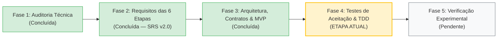

# Engenharia de Software — `experimental-ml-framework`

> **Documento de Registro de Estado da Engenharia**  
> **Data:** 27 de Outubro de 2026  
> **Repositório de Origem (Referência Científica):** `prognose_florestal`  
> **Novo Repositório (Framework Científico Agnóstico):** `experimental-ml-framework`  
> **Especificação de Requisitos (SRS v2.0):** [`ESPECIFICACAO_REQUISITOS.md`](./ESPECIFICACAO_REQUISITOS.md)  
> **Arquitetura, Contratos e Modelo de Dados:** [`ARQUITETURA_E_CONTRATOS.md`](./ARQUITETURA_E_CONTRATOS.md)

---

## 1. Etapa Atual no Ciclo de Vida da Engenharia

Concluímos a **Fase 2 (Engenharia de Requisitos das 6 Etapas)** e a **Fase 3 (Concepção Arquitetural, Contratos Conceituais, Modelo de Dados e Recorte de MVP)**. Estamos prontos para iniciar a especificação dos testes de aceitação e a **Fase 4: Implementação Guiada por Testes (TDD) do MVP**.

### O que já foi realizado:
1. **Fase 1 — Auditoria Técnica e Baseline (`prognose_florestal`):**
   * Mapeamento integral de dados, scripts, algoritmos clássicos, modelos biométricos e resolvedores quânticos (HHL).
   * Catalogação das métricas validadas de referência e identificação de vulnerabilidades metodológicas.
2. **Fase 2 — Engenharia de Requisitos Ponta a Ponta ([`ESPECIFICACAO_REQUISITOS.md`](./ESPECIFICACAO_REQUISITOS.md)):**
   * Especificação detalhada das **6 etapas operacionais** do ciclo experimental:
     * **Etapa 1:** Entrada, triagem exploratória somente-leitura, separação entre problemas confirmados e alertas heurísticos, e plano explícito de preparação.
     * **Etapa 2:** Exploração de relações rotulada como exploratória, criação manual (`FixedScenario`) e guiada/dinâmica (`DynamicScenario` ajustado por *fold*) com rastreabilidade de estabilidade.
     * **Etapa 3:** Registro de modelos heterogêneos via adaptadores (`ModelAdapter`), suporte a modelos analíticos sem `fit` artificial, pré-processamento em duas camadas auditadas, *tuning* aninhado (*Nested CV*) e coleta extensível de diagnósticos internos.
     * **Etapa 4:** `PartitionPlan` imutável e compartilhado (CV, Holdout e CV + Holdout Final), orquestrador com máquina de estados, tolerância a falhas sem mascaramento, controle de paralelismo em dois níveis, *checkpoint/resume*, tempos desagregados e predições *out-of-fold* indexadas por `observation_id`.
     * **Etapa 5:** Consolidação descritiva e julgamento estatístico separando desempenho observado, incerteza, significância estatística, tamanho de efeito, relevância prática e custo computacional (Fronteira de Pareto), com síntese textual estritamente auditável.
     * **Etapa 6:** Geração desacoplada de Relatórios Científicos Completos (Markdown/HTML) e artefatos modulares das 7 famílias de tabelas e figuras, com manifesto de proveniência (`ArtifactProvenance`) e pacote portável de reprodutibilidade.
3. **Fase 3 — Arquitetura Geral, Contratos e Recorte de MVP ([`ARQUITETURA_E_CONTRATOS.md`](./ARQUITETURA_E_CONTRATOS.md)):**
   * Definição da arquitetura em três camadas (Definição e Triagem, Validação e Execução Matricial, Julgamento Estatístico e Publicação), do pipeline operacional de dados em seis etapas e das dependências entre os módulos de `src/experimental_ml/`.
   * Formalização das entradas, saídas, invariantes e pontos de extensão de cada etapa e módulo.
   * Modelagem de dados completa do experimento e estrutura de diretórios do pacote de reprodutibilidade.
   * Definição explícita do **MVP Essencial** vs. **Evoluções Posteriores Plugáveis**.

---

## 2. Síntese da Arquitetura em Camadas, Pipeline de Etapas e Módulos (`src/experimental_ml/`)

| Camada Arquitetural | Nível de Dependência | Módulo (`src/experimental_ml/`) | Etapa no Pipeline Operacional | Funções e Estruturas Principais de Saída (Sem OOP) |
| :--- | :--- | :--- | :--- | :--- |
| **Fundação Transversal** | Nível 0 | `core` | Transversal (Etapas 1–6) | Tipos de IDs, `derive_seeds` (`SeedSequence`), `config_hash`, `dataset_hash` e funções de validação/alertas |
| **Fundação Transversal** | Nível 1 | `metrics` | Transversal (Etapas 2, 3, 4 e 5) | `METRICS_CATALOG`, `MetricValue`, `AggregatedMetricValue`, `aggregate_fold_metrics`, `is_better` e 15 funções de métricas vetorizadas |
| **Camada 1: Definição e Triagem** | Nível 1 | `data` | Etapa 1 | `load_dataset`, `profile_dataset`, `create_preparation_plan`, `sanitize_dataset` $\rightarrow$ `DatasetBundle`, `DatasetProfile`, `PreparationPlan`, `SanitizedDatasetView` |
| **Camada 1: Definição e Triagem** | Nível 2 | `features` | Etapa 2 | `explore_features`, `validate_scenarios`, `select_features_in_fold` (seletores e `PCA`) $\rightarrow$ `ExploratoryFeatureReport`, catálogo `scenarios` (`FIXED`/`DYNAMIC`) |
| **Camada 1: Definição e Triagem** | Nível 2 | `models` | Etapa 3A | `instantiate_fresh_model`, `fit_model`, `predict_model`, `extract_model_diagnostics`, `fit_two_layer_preprocessing` (incluindo roteamento para kernels externos) $\rightarrow$ `ModelSpec`, `ModelDiagnostics` |
| **Camada 1: Definição e Triagem** | Nível 3 | `tuning` | Etapa 3B | `run_nested_tuning` (`fixed`, `grid_search`, `random_search`) $\rightarrow$ `HyperparameterSearchSpec`, histórico de tentativas |
| **Camada 2: Validação e Execução Matricial** | Nível 2 | `validation` | Etapa 4A | `build_partition_plan`, `validate_partition_plan` (`kfold_split`, `stratified_kfold_split`, `group_kfold_split`, `bootstrap_split`, `temporal_split`, `holdout_split`) $\rightarrow$ `PartitionPlan` |
| **Camada 2: Validação e Execução Matricial** | Nível 4 | `orchestration` | Etapa 4B | `run_experiment_matrix`, `resume_experiment_matrix`, `save_cell_result` $\rightarrow$ `CellResultRecord`, `PredictionRecord` (com `y_std` e comitê $\hat{\mu}_i, \hat{\sigma}_i$), `TimingBreakdown` |
| **Camada 3: Julgamento Estatístico e Publicação** | Nível 5 | `statistics` | Etapa 5 | `consolidate_descriptive`, `evaluate_method_suitability`, `run_statistical_comparisons`, `compute_pareto_frontier`, `score_candidate_acquisition`, `synthesize_conclusions` $\rightarrow$ `StatisticalJudgmentReport`, `StructuredConclusion` |
| **Camada 3: Julgamento Estatístico e Publicação** | Nível 6 | `reporting` | Etapa 6 | `select_report_content`, `build_table_model`, `build_figure_spec`, `render_full_report`, `build_reproducibility_package` $\rightarrow$ `TableModel`, `PlotSpecification`, `ArtifactProvenance` |
| **Interface de Terminal** | Nível 7 | `cli` | Subcomandos por Etapa | CLI modularizada (`expml data`, `features`, `models`, `partition`, `run`, `stats`, `report`) separada da lógica de negócio |

---

## 3. Roadmap Incremental de Implementação TDD (Marcos M1 a M7)

1. **Marco M1 (`core` + `metrics` + esqueleto `cli`) — Subdividido em 3 Entregas Verificáveis:**
   * **M1.1 (Configuração, `.venv`, Esqueleto da CLI e *Smoke Tests*):** Criação do `.venv`, `pyproject.toml` (com entrypoint `expml`), verificação empírica de versões (`Python 3.14` / `3.12`, `numpy`, `scipy`, `pytest`), esqueleto modular em `src/experimental_ml/cli/` e aprovação de `tests/test_smoke.py`.
   * **M1.2 (Contratos, Implementação Funcional e Testes de `core`):** Identificadores imutáveis, constantes/enums, função `derive_seeds`, `config_hash` e `dataset_hash` (ADR-007: Unicode NFC, `-0.0`, `NaN`/`Inf`, coleções aninhadas) e construtores de erros/alertas, com aprovação de `tests/unit/test_core.py`.
   * **M1.3 (Contratos, Implementação Funcional e Testes de `metrics`):** `MetricValue`, `METRICS_CATALOG`, regras funcionais de propagação para `MetricStatus.UNDEFINED_NAN` (`is_better`, `aggregate_fold_metrics`, `rank_configurations` — ADR-005), e as 15 funções de métricas vetorizadas testadas com tolerâncias específicas (`rtol`/`atol`) por família (`tests/unit/test_metrics.py`).
2. **Marco M2 (`data` + `validation` + CLI `data`/`partition`):** Funções `load_dataset`, `profile_dataset` (problemas confirmados vs. alertas heurísticos), `create_preparation_plan` e geração/validação matemática do `PartitionPlan` (`build_partition_plan`, `validate_partition_plan`).
3. **Marco M3 (`features` + CLI `features`):** Função `explore_features` rotulada, validação de cenários (`FIXED` e `DYNAMIC`) e seleção dinâmica ajustada estritamente no treino de cada *fold* (`select_features_in_fold`), com medição de estabilidade de seleção.
4. **Marco M4 (`models` + `tuning` + CLI `models`):** Funções `instantiate_fresh_model`, `fit_model`, `predict_model` (clássicos, analíticos com `requires_fit=False` e quânticos/customizados), pré-processamento funcional em 2 camadas (`fit_two_layer_preprocessing`, `apply_two_layer_preprocessing`) com bloqueio de duplicação e *Nested Tuning* (`run_nested_tuning`).
5. **Marco M5 (`orchestration` + CLI `run`):** Funções `run_experiment_matrix` e `resume_experiment_matrix` com máquina de estados, modos `FAULT_TOLERANT` / `FAIL_FAST`, paralelismo em dois níveis, persistência atômica (`save_cell_result`) e retomada verificada (*Checkpoint & Resume*).
6. **Marco M6 (`statistics` + CLI `stats`):** Funções de consolidação descritiva, adequação metodológica, tratamento de *folds* incompletos, Nadeau-Bengio, Wilcoxon, Holm-Bonferroni, Benjamini-Hochberg, tamanho de efeito, relevância prática, Fronteira de Pareto, funções de aquisição e `synthesize_conclusions`.
7. **Marco M7 (`reporting` + CLI `report` + Verificação `prognose_florestal`):** Funções de geração de relatórios completos (MD/HTML), 7 famílias de tabelas (CSV/MD/LaTeX `booktabs`) e figuras (PNG/SVG/PDF), manifesto de proveniência (`ArtifactProvenance`), pacote de reprodutibilidade e reprodução agnóstica do experimento de referência `prognose_florestal`.
