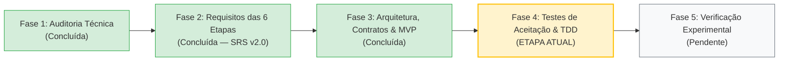

# Engenharia de Software — `experimental-ml-framework`

> **Documento de Registro de Estado da Engenharia**  
> **Data:** 27 de Outubro de 2026  
> **Repositório de Origem (Referência Científica):** `prognose_florestal`  
> **Novo Repositório (Framework Científico Agnóstico):** `experimental-ml-framework`  
> **Especificação de Requisitos (SRS v2.0):** [`ESPECIFICACAO_REQUISITOS.md`](./ESPECIFICACAO_REQUISITOS.md)  
> **Arquitetura, Contratos e Modelo de Dados:** [`ARQUITETURA_E_CONTRATOS.md`](./ARQUITETURA_E_CONTRATOS.md)

---

## 1. Etapa Atual no Ciclo de Vida da Engenharia

Concluímos a **Fase 2 (Engenharia de Requisitos das 6 Etapas)** e a **Fase 3 (Concepção Arquitetural, Contratos Conceituais, Modelo de Dados e Recorte de MVP)**. Estamos prontos para iniciar a especificação dos testes de aceitação e a **Fase 4: Implementação Guiada por Testes (TDD) do MVP**.

### O que já foi realizado:
1. **Fase 1 — Auditoria Técnica e Baseline (`prognose_florestal`):**
   * Mapeamento integral de dados, scripts, algoritmos clássicos, modelos biométricos e resolvedores quânticos (HHL).
   * Catalogação das métricas validadas de referência e identificação de vulnerabilidades metodológicas.
2. **Fase 2 — Engenharia de Requisitos Ponta a Ponta ([`ESPECIFICACAO_REQUISITOS.md`](./ESPECIFICACAO_REQUISITOS.md)):**
   * Especificação detalhada das **6 etapas operacionais** do ciclo experimental:
     * **Etapa 1:** Entrada, triagem exploratória somente-leitura, separação entre problemas confirmados e alertas heurísticos, e plano explícito de preparação.
     * **Etapa 2:** Exploração de relações rotulada como exploratória, criação manual (`FixedScenario`) e guiada/dinâmica (`DynamicScenario` ajustado por *fold*) com rastreabilidade de estabilidade.
     * **Etapa 3:** Registro de modelos heterogêneos via adaptadores (`ModelAdapter`), suporte a modelos analíticos sem `fit` artificial, pré-processamento em duas camadas auditadas, *tuning* aninhado (*Nested CV*) e coleta extensível de diagnósticos internos.
     * **Etapa 4:** `PartitionPlan` imutável e compartilhado (CV, Holdout e CV + Holdout Final), orquestrador com máquina de estados, tolerância a falhas sem mascaramento, controle de paralelismo em dois níveis, *checkpoint/resume*, tempos desagregados e predições *out-of-fold* indexadas por `observation_id`.
     * **Etapa 5:** Consolidação descritiva e julgamento estatístico separando desempenho observado, incerteza, significância estatística, tamanho de efeito, relevância prática e custo computacional (Fronteira de Pareto), com síntese textual estritamente auditável.
     * **Etapa 6:** Geração desacoplada de Relatórios Científicos Completos (Markdown/HTML) e artefatos modulares das 7 famílias de tabelas e figuras, com manifesto de proveniência (`ArtifactProvenance`) e pacote portável de reprodutibilidade.
3. **Fase 3 — Arquitetura Geral, Contratos e Recorte de MVP ([`ARQUITETURA_E_CONTRATOS.md`](./ARQUITETURA_E_CONTRATOS.md)):**
   * Definição do Grafo Direcionado Acíclico (DAG) de dependências entre módulos.
   * Formalização das entradas, saídas, invariantes e pontos de extensão de cada módulo.
   * Modelagem de dados completa do experimento e estrutura de diretórios do pacote de reprodutibilidade.
   * Definição explícita do **MVP Essencial** vs. **Evoluções Posteriores Plugáveis**.

---

## 2. Síntese da Arquitetura por Etapa e Módulos (`src/experimental_ml/`)

| Nível Topológico | Módulo | Etapa Principal | Contratos Principais de Saída |
| :--- | :--- | :--- | :--- |
| **Nível 0 (Fundação)** | `core` | Transversal | Identificadores tipados, `SeedSequence`, hashing `SHA-256`, serialização determinística e exceções/alertas |
| **Nível 1 (Base)** | `metrics` | Transversal (3, 4 e 5) | `MetricSpec`, `MetricResult`, cálculo vetorizado ($R^2$, RMSE, MAE, MAPE, Pearson, Viés, KTA, Acc, F1, AUC, LogLoss) |
| **Nível 1 (Base)** | `data` | Etapa 1 | `DatasetBundle`, `DatasetProfile`, `DiagnosticFinding`, `PreparationPlan`, `SanitizedDatasetView` |
| **Nível 2** | `validation` | Etapa 4A | `PartitionPlan`, `KFold`, `StratifiedKFold`, `GroupKFold`, `TemporalSplit`, `Holdout`, validador de invariantes |
| **Nível 2** | `features` | Etapa 2 | `ExploratoryFeatureReport`, `FixedFeatureScenario`, `DynamicFeatureScenario`, `ScenarioRegistry` |
| **Nível 2** | `models` | Etapa 3A | `ModelSpec`, `ModelCapabilities`, `ModelAdapter`, `ModelDiagnostics`, `TwoLayerPreprocessingPipeline` |
| **Nível 3** | `tuning` | Etapa 3B | `HyperparameterSearchSpec`, executores *Nested CV* (`Fixed`, `GridSearch`, `RandomSearch`) |
| **Nível 4** | `orchestration` | Etapa 4B | `MatrixOrchestrator`, `ExecutionCell`, `CellResultRecord`, `TimingBreakdown`, `MatrixRunStore` (*checkpoint/resume*) |
| **Nível 5** | `statistics` | Etapa 5 | `DescriptiveConsolidation`, `MethodSuitabilityEvaluator`, `StatisticalJudgmentReport`, `MultiObjectiveSummary`, `StructuredConclusion` |
| **Nível 6** | `reporting` | Etapa 6 | `TableModel`, `PlotSpecification`, `ArtifactProvenance`, `ReproducibilityPackage` |

---

## 3. Roadmap Incremental de Implementação TDD (Marcos M1 a M7)

1. **Marco M1 (`core` + `metrics`) — Subdividido em 3 Entregas Verificáveis:**
   * **M1.1 (Configuração, `.venv` e *Smoke Tests*):** Criação do `.venv`, `pyproject.toml`, verificação empírica de versões (`Python 3.14` / `3.12`, `numpy`, `scipy`, `pytest`) e aprovação de `tests/test_smoke.py`.
   * **M1.2 (Contratos, Implementação e Testes de `core`):** Identificadores imutáveis, enums, `SeedManager`, `config_hash` e `dataset_hash` (ADR-007: Unicode NFC, `-0.0`, `NaN`/`Inf`, coleções aninhadas) e exceções/alertas, com aprovação de `tests/unit/test_core.py`.
   * **M1.3 (Contratos, Implementação e Testes de `metrics`):** `MetricValue`, `MetricStatus.UNDEFINED_NAN` com regras de propagação para *tuning*, agregação e rankings (ADR-005), e as 15 métricas vetorizadas testadas com tolerâncias específicas (`rtol`/`atol`) por família (`tests/unit/test_metrics.py`).
2. **Marco M2 (`data` + `validation`):** Ingestão somente-leitura, `DatasetProfile` (problemas confirmados vs. alertas heurísticos), `PreparationPlan` e geração/validação matemática do `PartitionPlan` (`KFold`, `StratifiedKFold`, `GroupKFold`, `TemporalSplit`, `Holdout`).
3. **Marco M3 (`features`):** `ExploratoryFeatureReport` rotulado, `FixedFeatureScenario` e `DynamicFeatureScenario` ajustado estritamente no treino de cada *fold*, com medição de estabilidade de seleção.
4. **Marco M4 (`models` + `tuning`):** Contrato `ModelAdapter` com `clone_fresh` (clássicos, analíticos com `requires_fit=False` e quânticos/customizados), pipeline de pré-processamento em 2 camadas com bloqueio de duplicação e *Nested Tuning* (`Fixed`, `GridSearch`, `RandomSearch`).
5. **Marco M5 (`orchestration`):** `MatrixOrchestrator` com máquina de estados, modos `FAULT_TOLERANT` / `FAIL_FAST`, paralelismo em dois níveis, persistência incremental e retomada verificada (*Checkpoint & Resume*).
6. **Marco M6 (`statistics`):** Consolidação descritiva, adequação metodológica, tratamento de *folds* incompletos, Nadeau-Bengio, Wilcoxon, Holm-Bonferroni, Benjamini-Hochberg, tamanho de efeito, relevância prática, Fronteira de Pareto e `StructuredConclusion`.
7. **Marco M7 (`reporting` + Verificação `prognose_florestal`):** Relatórios completos (MD/HTML), 7 famílias de tabelas (CSV/MD/LaTeX `booktabs`) e figuras (PNG/SVG/PDF), manifesto de proveniência (`ArtifactProvenance`), pacote de reprodutibilidade e reprodução agnóstica do experimento de referência `prognose_florestal`.
