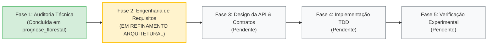

# Engenharia de Software — `experimental-ml-framework`

> **Documento de Registro de Estado da Engenharia**  
> **Data:** 26 de Outubro de 2026  
> **Repositório de Origem (Referência Científica):** `prognose_florestal`  
> **Novo Repositório (Framework Científico Agnóstico):** `experimental-ml-framework`  
> **Documento de Requisitos Formal:** [`ESPECIFICACAO_REQUISITOS.md`](./ESPECIFICACAO_REQUISITOS.md)

---

## 1. Etapa Atual no Ciclo de Vida da Engenharia

Estamos formalmente na **Fase 2: Engenharia de Requisitos e Concepção Arquitetural**.

### O que já foi realizado:
1. **Auditoria Técnica Completa (Fase 1):** Mapeamento integral de dados, scripts, algoritmos clássicos, quânticos e resolvedores HHL no repositório de origem.
2. **Catalogação de Métricas de Referência:** Extração de todos os resultados validados ($R^2$, RMSE, MAE, KTA, fidelidade de estado HHL de $1.000000000000$).
3. **Entrevista de Requisitos e Consolidação de Escopo (Fase 2):**
   * Definição da persona (estudantes de IC e pesquisadores com foco pedagógico).
   * Expansão do escopo para suportar tanto **Regressão** quanto **Classificação** (binária e multiclasse).
   * Inclusão de suporte a arquivos `.csv` e `.txt` com delimitadores flexíveis.
   * Contrato para modelos agnósticos (Scikit-Learn, PyTorch, algoritmos quânticos e equações analíticas) com `predict` e `predict_proba`.
   * Módulo de otimização de hiperparâmetros (Grid Search / Random Search livre de vazamento de dados).
   * Política de avisos pedagógicos visíveis (terminal e relatório) sem abortar execução desnecessariamente.
   * Geração de relatórios com interpretação em linguagem natural e matrizes estatísticas formais.
   * Operação 100% offline e autossuficiente com suporte a execução paralela multi-core (`n_jobs`).
   * Formalização da Especificação de Requisitos no arquivo [`ESPECIFICACAO_REQUISITOS.md`](./ESPECIFICACAO_REQUISITOS.md).

### O que estamos fazendo agora:
- Fechamento da especificação de requisitos e desenho preliminar dos contratos de API (Fase 3).
- **Regra de Ouro:** Nenhuma linha de código de implementação antes do fechamento do design arquitetural e especificação de testes.

---

## 2. Decisão Arquitetural Fundamental (ADR-001)

### Contexto
O projeto original mesclava engenharia de atributos de dados florestais, equações biométricas (Clutter 1963), algoritmos de Machine Learning (Sklearn, XGBoost) e circuitos quânticos em scripts monolíticos acoplados.

### Decisão
A biblioteca `experimental-ml-framework` **NÃO implementará nem conterá nenhum algoritmo ou modelo de Machine Learning internamente**.

A ferramenta atua estritamente como um **harness científico agnóstico e pedagógico para pesquisadores**, fornecendo:
1. Ingestão e validação estrutural de dados tabulares genéricos (`.csv`, `.txt`, `DataFrame`).
2. Análise exploratória e seleção de atributos (correlações, informação mútua, detecção de multicolinearidade).
3. Gerenciamento e geração declarativa de cenários experimentais de features (`ScenarioManager`).
4. Particionamento e controle estrito de validação cruzada simples e agrupada (*zero data leakage*).
5. Auxílio na busca de hiperparâmetros (*nested cross-validation* seguro).
6. Inferência estatística científica rigorosa (Nadeau-Bengio 2003, Wilcoxon, Holm-Bonferroni, Benjamini-Hochberg) com síntese em linguagem natural.
7. Motor de cálculo de métricas para regressão e classificação, e exportação de artefatos para publicação científica (LaTeX, Markdown, PNG 300 DPI).
8. Execução local concorrente multi-core (`n_jobs`).

### Contrato de Modelos
Qualquer modelo externo (Scikit-Learn, PyTorch, XGBoost, Qiskit, PennyLane ou código proprietário do pesquisador) é aceito desde que respeite o contrato mínimo de interface via *Duck Typing* / `Protocol`:
- `fit(X, y)`
- `predict(X) -> ndarray`
- `predict_proba(X) -> ndarray` (opcional para classificação com fallback gracioso)

---

## 3. Resumo da Matriz de Requisitos (RF01 a RF24)

| ID | Módulo | Requisito Funcional |
| :--- | :--- | :--- |
| **RF01** | `data` | Ingestão tabular via `.csv`, `.txt` (delimitadores flexíveis) e `pandas.DataFrame`. |
| **RF02** | `data` | Definição de alvos, identificadores de grupo e colunas ignoradas/proibidas. |
| **RF03** | `data` | Validação estrutural de integridade (nulos no alvo, colunas constantes). |
| **RF04** | `data` | Emissão de alertas pedagógicos visíveis em console e relatório sem travar o usuário. |
| **RF05** | `features` | Correlações lineares e monotônicas (Pearson, Spearman) com a variável resposta. |
| **RF06** | `features` | Avaliação de dependências não lineares via Informação Mútua (regressão e classificação). |
| **RF07** | `features` | Detecção automática de multicolinearidade excessiva ($|r| \ge \text{limiar}$). |
| **RF08** | `features` | Gerenciador declarativo de cenários (`ScenarioManager`): registrar, nomear e versionar features. |
| **RF09** | `validation` | Estratégias de particionamento: K-Fold, StratifiedKFold, GroupKFold, StratifiedGroupKFold, GroupShuffleSplit, TimeSeriesSplit. |
| **RF10** | `validation` | Asserção matemática obrigatória de interseção nula de grupos (garantia de zero vazamento). |
| **RF11** | `validation` | Pré-processamento e transformações estritamente dentro de cada fold de treino. |
| **RF12** | `models` | Contrato agnóstico via Protocol (`fit`, `predict`, `predict_proba` com fallback). |
| **RF13** | `tuning` | Auxílio na busca de hiperparâmetros (Grid/Random Search) livre de vazamento de dados. |
| **RF14** | `benchmark` | Orquestração da matriz experimental: $\text{Modelos} \times \text{Cenários} \times \text{Folds}$. |
| **RF15** | `benchmark` | Suporte nativo à execução concorrente multi-core (`n_jobs`). |
| **RF16** | `metrics` | Métricas de regressão: $R^2$, RMSE, RMSE (%), MAE, MAPE, Pearson, Viés Médio. |
| **RF17** | `metrics` | Métricas de classificação: Acurácia, Balanced Acc, Precision, Recall, F1, ROC-AUC, Log-Loss. |
| **RF18** | `statistics` | Teste t corrigido de **Nadeau & Bengio (2003)** para dependência de folds em CV. |
| **RF19** | `statistics` | Teste pareado de **Wilcoxon** com alerta formal de poder quando $J \le 5$. |
| **RF20** | `statistics` | Ajuste de multiplicidade para controle de FWER (**Holm-Bonferroni**) e FDR (**Benjamini-Hochberg**). |
| **RF21** | `statistics` | Interpretação dupla: matrizes numéricas formais + síntese textual em linguagem natural. |
| **RF22** | `reporting` | Tabelas formatadas em múltiplos formatos: console rico, CSV, Markdown e LaTeX (`booktabs`). |
| **RF23** | `reporting` | Geração de gráficos científicos diagnósticos em alta resolução (300 DPI). |
| **RF24** | `reporting` | Estrutura de diretório de experimentos versionada por execução (`experiments/run_<timestamp>/`). |

---

## 4. Requisitos Não Funcionais (RNF)

- **RNF01 (Determinismo):** Semente pseudoaleatória controlada (`random_state`) em todas as amostragens e splits.
- **RNF02 (Independência de Domínio):** Zero referências hardcoded ou acoplamento com domínios específicos no núcleo.
- **RNF03 (Autossuficiência 100% Offline):** Funcionamento integral local, sem dependência de serviços externos ou nuvem.
- **RNF04 (Eficiência e Vetorização):** Cálculos matriciais vetorizados via NumPy/SciPy sem laços `for` interpretados no motor numérico.
- **RNF05 (Testabilidade):** Cobertura abrangente com `pytest` cobrindo formulações matemáticas e testes estatísticos.
- **RNF06 (Compatibilidade):** Suporte nativo a Python $\ge 3.10$.
- **RNF07 (Ergonomia Pedagógica):** Nomes expressivos, APIs fluentes e alertas claros e instrutivos.

---

## 5. Próximos Passos Imediatos

1. Formalizar a especificação do design da API e contratos de classes/interfaces (`ESPECIFICACAO_ARQUITETURA.md`).
2. Estruturar a matriz de casos de teste de aceitação (`TESTES_ACEITACAO.md`).
3. Inicializar a estrutura do pacote (`pyproject.toml` e layout `src/`).
