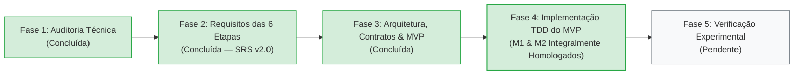

# Engenharia de Software — `experimental-ml-framework`

> **Documento de Registro de Estado da Engenharia** 
> **Data:** 10 de Novembro de 2026 
> **Repositório:** `experimental-ml-framework` 
> **Especificação de Requisitos (SRS v2.1):** [`ESPECIFICACAO_REQUISITOS.md`](./ESPECIFICACAO_REQUISITOS.md) 
> **Arquitetura, Contratos e Modelo de Dados:** [`ARQUITETURA_E_CONTRATOS.md`](./ARQUITETURA_E_CONTRATOS.md) 
> **Governança de Validação e Aceite:** [`PROCESSO_DE_ACEITE_DE_MARCOS.md`](./PROCESSO_DE_ACEITE_DE_MARCOS.md)

---

## 1. Etapa Atual no Ciclo de Vida da Engenharia

O projeto encontra-se na **Fase 4: Implementação Guiada por Testes (TDD) do MVP**, seguindo o processo de aceite de marcos ([`PROCESSO_DE_ACEITE_DE_MARCOS.md`](./PROCESSO_DE_ACEITE_DE_MARCOS.md)) integrado à skill `tlc-spec-driven`.

As entregas do **Marco M1 (`m1-1` a `m1-5`)**, do **Marco M2 (`m2-1` a `m2-5`)** com hardening completo (`REV-M2-01` a `REV-M2-11`), e do **Marco M3 (`m3-1` a `m3-4`)** foram formalmente aceitas com aprovação em **236 testes automatizados**, verificação independente e homologação manual. As Fundações Transversais (M1), o Pipeline de Dados (M2) e a Engenharia e Cenários de Features (M3) estão integralmente consolidados, determinísticos e integrados. O próximo passo de desenvolvimento é o **Marco M4 (Modelos e Tuning — `instantiate_fresh_model`, `fit_model`, `predict_model`, pré-processamento em 2 camadas e busca aninhada de hiperparâmetros)**.

### O que já foi realizado:
1. **Fase 1 — Auditoria Técnica e Baseline:**
   * Mapeamento integral de dados, scripts, algoritmos clássicos, modelos biométricos e resolvedores quânticos (HHL).
   * Catalogação das métricas validadas de referência e identificação de vulnerabilidades metodológicas.
2. **Fase 2 — Engenharia de Requisitos das 6 Etapas ([`ESPECIFICACAO_REQUISITOS.md`](./ESPECIFICACAO_REQUISITOS.md)):**
   * Especificação detalhada das **6 etapas operacionais** do ciclo experimental:
     * **Etapa 1:** Entrada, triagem exploratória somente-leitura, separação entre problemas confirmados e alertas heurísticos, e plano explícito de preparação.
     * **Etapa 2:** Exploração de relações rotulada como exploratória, criação manual (`mode="FIXED"`) e guiada/dinâmica (`mode="DYNAMIC"` ajustado por *fold*) com rastreabilidade de estabilidade.
     * **Etapa 3:** Registro de modelos heterogêneos (`ModelSpec`), suporte a modelos analíticos sem `fit` artificial, pré-processamento em duas camadas auditadas, *tuning* aninhado (*Nested CV*) e coleta extensível de diagnósticos internos.
     * **Etapa 4:** `PartitionPlan` imutável e compartilhado (CV, Holdout e CV + Holdout Final), módulo de orquestração com máquina de estados por célula, tolerância a falhas sem mascaramento, controle de paralelismo em dois níveis, *checkpoint/resume*, tempos desagregados e predições *out-of-fold* indexadas por `observation_id`.
     * **Etapa 5:** Consolidação descritiva e comparação estatística separando desempenho observado, incerteza, significância estatística, tamanho de efeito, relevância prática e custo computacional (Fronteira de Pareto), com síntese textual estritamente auditável.
     * **Etapa 6:** Geração desacoplada de Relatórios Científicos Completos (Markdown/HTML) e artefatos modulares das 7 famílias de tabelas e figuras, com manifesto de proveniência (`ArtifactProvenance`) e pacote portável de reprodutibilidade.
3. **Fase 3 — Arquitetura Geral, Contratos e Recorte de MVP ([`ARQUITETURA_E_CONTRATOS.md`](./ARQUITETURA_E_CONTRATOS.md)):**
   * Definição da arquitetura em três camadas (Definição e Triagem, Validação e Execução Matricial, Comparação Estatística e Publicação), do pipeline operacional de dados em seis etapas e das dependências entre os módulos de `src/experimental_ml/`.
   * Formalização das entradas, saídas, invariantes e pontos de extensão de cada etapa e módulo.
   * Modelagem de dados completa do experimento e estrutura de diretórios do pacote de reprodutibilidade.
   * Definição explícita do **MVP Essencial** vs. **Evoluções Posteriores**.
4. **Fase 4 — Marco M1.1 Concluído (`m1-1-setup-cli-smoke`):**
   * Configuração de empacotamento com `pyproject.toml` baseada no backend Hatchling (`hatchling.build`) e declaração `requires-python = ">=3.10"`.
   * Inicialização do layout `src/experimental_ml/` expondo `__version__ = "0.1.0.dev0"`.
   * Implementação do ponto de entrada da CLI modularizada em `src/experimental_ml/cli/main.py` com `argparse` da biblioteca padrão, suportando `--version`, `--help` e código de saída 2 para argumentos inválidos.
   * Criação e aprovação integral da suíte de fumaça automatizada em `tests/test_smoke.py` (12 testes aprovados via `pytest`).
   * Validação da instalação editável (`pip install -e ".[dev]"`) no ambiente virtual `.venv` local (Python 3.12), com o executável `expml` disponível diretamente no PATH.
5. **Fase 4 — Marco M1.2 Concluído (`m1-2-core`):**
   * Adição da dependência `numpy>=1.24.0` ao `pyproject.toml`.
   * Implementação do módulo `src/experimental_ml/core/` (Nível 0 transversal, sem OOP para lógica de negócio conforme **ADR-008**):
     * `types.py`: tipos de identificadores de domínio imutáveis (`ExperimentId`, `PartitionPlanId`, `ScenarioId`, `ModelId`, `CellId`, `ComparisonId`, `ArtifactId`, `ObservationId`) com validação de preenchimento e rejeição de strings inválidas.
     * `enums.py`: enumerações canônicas baseadas em `str, Enum` (`TaskType`, `ExecutionStatus`, `FindingSeverity`, `MetricDirection`, `AggregationScope`, `MetricStatus`, `ErrorPolicy`).
     * `findings.py`: estrutura imutável `Finding`, construtores `make_finding` e `make_warning` e hierarquia de exceções de integridade (`ExperimentalMLError`, `ContractViolationError`, `DataIntegrityError`, `ConfigurationError`).
     * `seeds.py`: geradores determinísticos puros `derive_seeds` e `spawn_child_seeds` baseados em `numpy.random.SeedSequence` (RNF01, ADR-007).
     * `hashing.py`: implementação de `config_hash` e `dataset_hash` cumprindo 100% das regras canônicas do **ADR-007** (NFC, ordenação estável por code points UTF-8, distinção de tipos escalares e coleções, normalização de `-0.0 -> 0.0`, `NaN` e `+/-Inf`).
     * `__init__.py`: re-exportação pública via `__all__`.
   * Implementação da suíte de testes unitários `tests/unit/test_core.py` com 18 testes automatizados aprovados (totalizando 30 testes aprovados na suíte geral).
   * Execução do portão de verificação independente da skill `tlc-spec-driven` (`proofs.md` e `verification.md` com veredito `PASS`, 18/18 checks aprovados).
6. **Fase 4 — Marco M1.3 Concluído (`m1-3-metrics`):**
   * Implementação do módulo `src/experimental_ml/metrics/` (Nível 1 transversal, sem lógica de negócio em OOP):
     * `types.py`: estruturas imutáveis de avaliação (`MetricValue`, `AggregatedMetricValue`, `MetricSpec`, `RankedCandidate`) e enumeração canônica fechada `MetricEvaluationScope` com validação estrita.
     * `validation.py`: validações numéricas puras em `float64`, integridade dimensional e mitigação de overflow quadrático intermediário via `scaled_quadratic_sum`.
     * `regression.py`: funções puramente vetorizadas em `float64` de erros em escala direta (`mae`, `rmse`, `mbe` preservando viés assinado), razões adimensionais (`r2`, `rmse_rel_pct`, `mape`, `pearson`) e alinhamento de Gram (`kta` uncentered e centered $HKH$), tratando casos degenerados com `MetricStatus.UNDEFINED_NAN`.
     * `classification.py`: métricas discretas (`accuracy`, `balanced_accuracy`, `precision`, `recall`, `f1` avaliado diretamente pelo próprio denominador $2TP + FP + FN$) e probabilísticas (`roc_auc` com empates exatos via postos médios e OVR, `log_loss` com validação estrita de distribuições e clipping $\epsilon = 10^{-15}$).
     * `catalog.py`: registro imutável centralizado `METRICS_CATALOG` com as 15 especificações canônicas (`compare_by_abs=True` exclusivamente em `mbe`), funções de consulta `get_metric_spec`, `list_metrics` e despacho `compute_metric`.
     * `aggregation.py`: comparador `is_better` compatível com `compare_by_abs`, agregador inter-dobras `aggregate_fold_metrics` gerando `VALID`, `PARTIAL_COVERAGE` e `UNDEFINED_NAN`, e ranqueador lexicográfico `rank_configurations` (ADR-005) com precedência estrita de cobertura.
     * `__init__.py`: re-exportação de 27 símbolos públicos com `__all__`.
   * Aprovação integral da suíte de testes unitários `tests/unit/test_metrics.py` com 22/22 checks automatizados aprovados (totalizando 52 testes aprovados na suíte geral).
   * Verificação independente TLC (`proofs.md` e `verification.md` com veredito `PASS`, 0 findings e 0 erros em `validate_verification.py`).
   * Execução e aprovação completa do roteiro de aceitação do consumidor (`ACCEPTANCE.md`) e cenário integrado registrado em `RESULTS.md`.
7. **Fase 4 — Marco M1.4 Concluído (`m1-4-datasets-schemas`):**
   * Implementação do módulo `src/experimental_ml/data/` (Nível 1, Camada 1 / Etapa 1, sem lógica de negócio em OOP):
     * `schema.py`: estrutura declarativa `DatasetSchemaSpec` com normalização Unicode NFC nos nomes de colunas, disjunção estrita de papéis (`target_col`, `group_col`, `observation_id_col`, `time_col`, `ignore_cols`), imutabilidade via tuplas, dicionários encapsulados com `MappingProxyType` e bloqueio de funcionalidades da Onda 2.
     * `types.py`: enumeração canônica `ColumnSemanticType` (6 membros fechados) e estrutura `ColumnDescriptor` (frozen dataclass com `__slots__` e 8 atributos descritores de tipo físico, semântico e memória).
     * `parsing.py`: parser tabular em conformidade estrita com a RFC 4180; suporte a delimitadores `,`, `;`, `\t`, `|` e múltiplos espaços; sniffer automático com verificação de consistência em até 100 linhas ($M \ge 2$); sobrescrita por delimitador manual; e rejeição explícita de linhas irregulares (*ragged rows*), arquivos vazios ($N = 0$) e cabeçalhos duplicados/vazios.
     * `validation.py`: validações estruturais do esquema ($N > 0, M > 0, \ge 1$ preditor, presença das colunas declaradas no esquema) e regras de atribuição ou verificação de unicidade/não-nulidade de `ObservationId`.
     * `loader.py`: função pura `load_dataset` com posse exclusiva, cópias defensivas em memória, arrays numéricos e booleanos respaldados por buffers `bytes` imutáveis que recusam `setflags(write=True)` com `ValueError`, colunas `object` restritas a escalares imutáveis com `writeable=False` e cálculo formal dos hashes tripartites (`dataset_hash` canônico invariante a quebras de linha CRLF/LF, `raw_source_hash` e `schema_hash`).
     * `query.py`: utilitários de consulta imutável `get_column_array` (view somente-leitura ou cópia mutável) e `slice_bundle_by_observation_ids` (preservando estritamente a ordem requisitada com recálculo determinístico de hash).
     * `__init__.py`: re-exportação de 13 símbolos públicos com `__all__` (incluindo `ColumnSemanticType`, `DatasetSchemaSpec`, `ColumnDescriptor`, `DatasetBundle`, `load_dataset`, `get_column_array`, `slice_bundle_by_observation_ids` e parsers).
   * Aprovação integral da suíte de testes unitários `tests/unit/test_data_schemas.py` com 29/29 checks automatizados aprovados (totalizando 81 testes aprovados na suíte geral).
   * Verificação mecânica independente via TLC Spec-Driven (`proofs.md` e `verification.md` com veredito `PASS`, 0 findings e 0 erros em `validate_verification.py`).
   * Execução e aprovação completa do roteiro de aceitação do consumidor (`ACCEPTANCE.md`), cenário integrado registrado em `RESULTS.md` e homologação formal aprovada pelo usuário.
   * Pull Request #4 (`feat/m1-4-datasets-schemas`) integrado na branch `main` (commit `c3eb1e6`), concluindo 100% da Fase 1 (Setup e Fundações Transversais).
8. **Fase 4 — Marco M1.5 Concluído (`m1-5-foundation-hardening`):**
   * Resolução transversal dos 10 achados da Auditoria Geral de Integridade M1 (6 P0 e 4 P1 selecionados): framing binário inequívoco de `dataset_hash` sensível a `observation_ids` preservando a direção $L_1 \rightarrow L_0$; centralização de `is_nan_scalar` e `is_missing_scalar` cobrindo tipos nativos e `numpy.floating`; validação e preservação estrita de instâncias tipadas `ObservationId` em fatiamentos; whitelist de escalares em colunas `object` com semântica unificada de ausentes e captura de `OverflowError` em `int64`.
   * Criação e aprovação da suíte de testes de integração transversal `tests/integration/test_m1_foundation_integration.py` (4 testes), totalizando 96 testes aprovados no repositório.
   * Verificação independente TLC (`proofs.md`, `verification.md` com veredito `PASS`, 0 findings e 0 erros em `validate_verification.py`), com homologação formal aprovada.
9. **Fase 4 — Sub-marco M2.1 Concluído (`m2-1-dataset-profiling`):**
   * Implementação da triagem estatística e diagnóstico estrutural da base tabular (`src/experimental_ml/data/profiling.py`):
     * `ProfileConfig`: configuração imutável de limiares heurísticos com validação estrita no construtor.
     * `ColumnProfile`: estrutura de dados imutável com distribuições numéricas (média, mediana, desvio padrão, min, max, quartis, IQR, skewness, outliers $1.5 \times \text{IQR}$) e categóricas (cardinalidade, frequências absolutas e proporções relativas).
     * `DatasetProfile`: perfil agregado do dataset contendo metadados de memória, lista ordenada de achados e resumos especializados.
     * Análise da variável-alvo: verificação de variância zero, ausentes, contagem de classes e detecção de alvos binários não mapeados para $\{0,1\}$ (`E1_TARGET_BINARY_UNMAPPED`).
     * Análise de grupos (`group_col`): detecção de grupos com valores ausentes (`E1_GROUP_EMPTY_VALUES`) e grupos com poucas amostras (`W1_GROUP_TOO_FEW_SAMPLES`).
     * Detecção determinística de linhas duplicadas (excluindo apenas `observation_id`).
     * Catálogo canônico fechado de 15 achados diagnósticos (8 `CONFIRMED_ISSUE` + 7 `HEURISTIC_WARNING`) com severidade imutável e ordenação canônica lexicográfica por severidade, código e coluna.
     * Função pura `profile_dataset(bundle, config)` exposta em `experimental_ml.data` (17 símbolos exportados em `__all__`), mantendo estrita imutabilidade e invariância do `dataset_hash`.
   * Aprovação de 12 testes unitários em `tests/unit/test_profiling.py` e 6 testes de integração em `tests/integration/test_profiling_integration.py` (totalizando 114 testes aprovados na suíte geral).
   * Verificação mecânica independente via TLC Spec-Driven (`proofs.md` e `verification.md` com veredito `PASS`, 0 findings e 0 erros em `validate_verification.py`).
   * Roteiro de aceitação do consumidor (`ACCEPTANCE.md`) executado com sucesso e homologação formal aprovada sob `.specs/features/m2-diagnostics-partitioning/`.
10. **Fase 4 — Sub-marco M2.2 Concluído (`m2-2-preparation-plan-sanitization`):**
    * Implementação do plano determinístico de preparação e saneamento de dados (`src/experimental_ml/data/preparation.py`):
      * `PreparationRule`: regra imutável vinculada a achado diagnóstico (`DROP_ROWS`, `EXCLUDE_COLUMN`, `MAP_BINARY_TARGET`, `DEFER_INTRA_FOLD`, `ACCEPT_AS_IS`).
      * `create_preparation_plan`: exigência de cobertura integral de todos os `CONFIRMED_ISSUE` para emissão de status `READY`; achados confirmados pendentes geram `status = INCOMPLETE` com `UnresolvedFinding`.
      * `sanitize_dataset`: aplicação determinística e puramente funcional das regras de preparação, emitindo a visão saneada imutável `SanitizedDatasetView` com `candidate_feature_cols`.
    * Aprovado com 10/10 checks determinísticos, 16 testes unitários e 3 testes de integração.
11. **Fase 4 — Sub-marco M2.3 Concluído (`m2-3-partitioning-engine`):**
    * Implementação do motor de particionamento compartilhado (`src/experimental_ml/validation/`):
      * `splitters.py`: implementações funcionais puras de `kfold_split`, `stratified_kfold_split`, `group_kfold_split`, `temporal_split`, `bootstrap_split` e `holdout_split`.
      * `types.py` e `engine.py`: `PartitionConfig`, `FoldPartition`, `PartitionPlan` e cálculo canônico do digest SHA-256 `plan_id`.
      * `validators.py`: validação matemática rigorosa (`validate_partition_plan`) de disjunção $(\text{Treino}_k \cap \text{Val}_k = \emptyset)$, separação de holdout, ausência de vazamento de grupos e ordenação temporal.
    * Aprovado com 10/10 checks determinísticos e 16 testes na camada de validação.
12. **Fase 4 — Sub-marco M2.4 Concluído (`m2-4-artifacts-stage-gates`):**
    * Persistência atômica, codecs lossless e portões de etapa:
      * `src/experimental_ml/core/storage.py`: `write_json_atomic` (escrita transacional via temporário + `fsync` + `os.replace`) e proteção rigorosa contra sobrescrita (`ConfigurationError`).
      * `src/experimental_ml/data/codecs.py` e `src/experimental_ml/validation/codecs.py`: codecs sem perda de `DatasetDescriptor`, `SanitizedViewDescriptor`, `DatasetProfile`, `PreparationPlan` e `PartitionPlan`.
      * `src/experimental_ml/validation/storage.py`: gravação e leitura de `splits.csv.gz` com `gzip.GzipFile(mtime=0.0)` para reprodutibilidade determinística binária bit a bit.
      * `src/experimental_ml/stages/stage_gates.py`: portões `verify_preparation_gate` e `verify_partition_gate` com layout canônico de diretórios.
    * Aprovado com 7/7 checks determinísticos e 11 testes dedicados.
13. **Fase 4 — Sub-marco M2.5 Concluído (`m2-5-cli-end-to-end`):**
    * Despachante hierárquico e homologação fim a fim:
      * `src/experimental_ml/cli/main.py`: despachante hierárquico `expml` com subcomandos `data` e `partition`, preservação de M1.1, captura de erros de domínio sem traceback (código 2) e código 0 para sucesso.
      * `src/experimental_ml/cli/cmd_data.py`: subcomandos `profile` e `sanitize` com validação de pré-condições e bloqueio de planos incompletos.
      * `src/experimental_ml/cli/cmd_partition.py`: subcomandos `build` e `verify` com validação de portão upstream e invariantes matemáticos.
      * Pureza arquitetural (zero imports de `numpy` ou `hashlib` em `cli/`) e higiene de saída (zero digests de 64 caracteres em `stdout`/`stderr`).
      * Teste de integração por subprocesso em diretórios isolados comprovando equivalência bit a bit de artefatos.
    * Aprovado com 10/10 checks determinísticos, 13 testes de CLI e homologação ponta a ponta (totalizando 176 testes no repositório).
14. **Fase 4 — Hardening Pós-Auditoria de Integridade do Marco M2 Concluído (`REV-M2-01` a `REV-M2-11`):**
    * Auditoria técnica abrangente de integridade transversal e execução de rodada focada de hardening eliminando todos os achados P1 e P2, com tratamento proporcional dos itens P3:
      * **REV-M2-01:** Compatibilização formal de códigos entre `profiling.py` e `preparation.py` (`E1_FEATURE_CONSTANT`, `E1_SCALE_DISPARITY`, `W1_SCALE_DISPARITY`); marcação de `E1_TARGET_CONSTANT` em `IRRESOLVABLE_FINDING_CODES` impedindo exclusão genérica do target.
      * **REV-M2-02:** Prevenção de folds com treino ou validação vazios ($N \ge K$ em `stratified_kfold_split`, retentativa determinística de OOB não-vazio em `bootstrap_split`, $N \ge 2$ em `holdout_split`, rejeição de `HOLDOUT` com `CV_ONLY` em `PartitionConfig` e asserção de invariante formal $\text{len} > 0$ em `validate_partition_plan`).
      * **REV-M2-03:** Rejeição estrita de valores ausentes e `NaN` em variáveis temporais no `temporal_split` (`ConfigurationError`) e verificação matemática nos folds em `validate_partition_plan` (`DataIntegrityError`).
      * **REV-M2-04:** Fidelidade de tipos em `target_label_mapping` via serialização JSON estruturada preservando chaves `int`, `bool`, `float` e `str` no ciclo `to_dict`/`from_dict` sem coerção indevida para string.
      * **REV-M2-05:** Verificação estrita de correspondência entre `source_plan_digest` de `sanitized_view.json` e `plan_digest` do `preparation_plan.json` ativo em `verify_partition_gate`.
      * **REV-M2-06:** Validação integral dos três papéis em `splits.csv.gz` (`TRAIN`, `VAL` e `EXCLUDED`), detectando adulterações inclusive em linhas marcadas como excluídas.
      * **REV-M2-07:** Garantia da pureza de tempo de execução da CLI (`CLI-10`) via exportação sob demanda (PEP 562 `__getattr__`) em `core/__init__.py`, comprovando ausência de `numpy` e `hashlib` em `sys.modules` na invocação da CLI.
      * **REV-M2-08:** Disponibilização das APIs públicas de domínio `slice_view_by_observation_ids` em `data/query.py` (com preservação de ordem, imutabilidade e recálculo canônico de hash) e `reconstruct_sanitized_view` em `stages/stage_gates.py`, refatorando a CLI para não depender de helpers privados.
      * **REV-M2-09, REV-M2-10, REV-M2-11:** Emissão de `E1_TARGET_ZERO_VARIANCE` em regressão, documentação metodológica de empates temporais e acesso seguro a `Finding.context` quando nulo.
    * Aprovação de 17 testes de regressão dedicados em `tests/unit/test_m2_hardening_regression.py` (totalizando 193 testes aprovados no repositório com 100% de sucesso).
    * Verificação formal por subagente independente (*Independent Hardening Verifier*) com veredito `PASS` em 100% dos 11 achados.
15. **Fase 4 — Sub-marco M3.1 Concluído (`m3-1-exploratory-features`):**
    * Implementação do relatório exploratório univariado e bivariado em `src/experimental_ml/features/exploration.py`:
      * Função pura `explore_features(sanitized_view)` executada estritamente sobre `SanitizedDatasetView` com rotulagem compulsória `scope = "EXPLORATORY_FULL_DATA"` e 3 avisos metodológicos mandatórios (`CA-E2-01`).
      * Métricas univariadas de associação com o alvo: correlação linear de Pearson, correlação monotônica de Spearman com tratamento exato de empates por postos médios fracionários, Razão de Correlação $\eta$ para mistos e V de Cramér para pares categóricos.
      * Matriz simétrica de redundância preditor-preditor e catalogação de pares com multicolinearidade severa (`high_redundancy_pairs`).
    * Aprovação de 10/10 checks determinísticos e total de 208 testes aprovados sob `.specs/features/m3-1-exploratory-features/`.
16. **Fase 4 — Sub-marco M3.2 Concluído (`m3-2-feature-scenarios`):**
    * Modelagem declarativa e persistência de cenários em `src/experimental_ml/features/scenarios.py`:
      * Estrutura imutável `FeatureScenario` suportando modos `FIXED` e `DYNAMIC`.
      * Validação semântica e anti-leakage em `validate_scenarios`: comprovação de que atributos pertencem a `candidate_feature_cols` e são estritamente disjuntos de `{target, group, id, time} ∪ ignore_cols`, exigindo `strategy_name` não-vazio e proibindo atributos pré-calculados em dinâmicos (`selected_features == ()`).
      * Persistência atômica transacional `save_scenarios` e `load_scenarios` em `configuration/scenarios.json`.
      * Portão de integridade `verify_scenarios_gate` em `src/experimental_ml/stages/stage_gates.py`.
    * Aprovação de 8/8 checks determinísticos e total de 218 testes aprovados sob `.specs/features/m3-2-feature-scenarios/`.
17. **Fase 4 — Sub-marco M3.3 Concluído (`m3-3-intra-fold-selection`):**
    * Seleção dinâmica livre de vazamento e análise de estabilidade em `src/experimental_ml/features/`:
      * Contrato funcional puro `select_features_in_fold` com bypass imediato em modo `FIXED` e estratégias `VARIANCE_THRESHOLD` e `TOP_K_RELEVANCE` calculadas estritamente nos dados de treino de cada dobra.
      * Função de projeção pura `apply_feature_selection(X_eval, selection_result)` com rejeição de atributos ausentes (`ContractViolationError`).
      * Módulo de estabilidade `src/experimental_ml/features/stability.py`: cálculo da similaridade de Jaccard média inter-dobras e índice de consistência de Kuncheva corrigido pelo acaso (`SelectionStabilityReport`).
    * Aprovação de 8/8 checks determinísticos e total de 228 testes aprovados sob `.specs/features/m3-3-intra-fold-selection/`.
18. **Fase 4 — Sub-marco M3.4 Concluído (`m3-4-cli-end-to-end`):**
    * Interface de linha de comando da Etapa 2 em `src/experimental_ml/cli/cmd_features.py`:
      * Subcomandos `expml features explore`, `expml features scenarios` e `expml features verify`.
      * Cumprimento estrito do contrato `CLI-10`: zero importações de `numpy` ou `hashlib` na carga inicial da CLI.
      * Códigos de saída padronizados (0 para sucesso, 2 para erros de domínio sem tracebacks).
      * Homologação integrada multi-etapa via subprocessos independentes encadeando Etapas 1, 2 e 4A com total determinismo e sem exposição de hashes criptográficos em terminal.
    * Aprovação de 8/8 checks determinísticos e total de 236 testes aprovados sob `.specs/features/m3-4-cli-end-to-end/`.
19. **Fase 4 — Auditoria Independente e Saneamento do Marco M3 Concluídos:**
    * Auditoria técnica abrangente de encerramento do Marco M3 e saneamento formal dos achados:
      * **ACH-M3-01:** Remoção do alias não-implementado `"MUTUAL_INFO_TOP_K"` de `selection.py`, restringindo a seleção supervisionada da Onda 1 à estratégia formal `TOP_K_RELEVANCE`.
      * **ACH-M3-02:** Confirmação da invariância matemática do construtor de `DatasetSchemaSpec` contra alvos nulos na Onda 1.
      * **ACH-M3-03:** Sincronização e validação das provas TLC via `check_proofs.py` e `validate_verification.py` (0 erros, 0 avisos).
    * Parecer de encerramento aprovado com veredito `PASS` e merge da branch `feat/m3-4-cli-end-to-end` na `main`.
20. **Fase 4 — Marco M4 em Andamento (Modelos, Pré-processamento e Tuning):**
    * Início da Etapa 3 com a criação da branch `feat/m4-1-model-registry-contracts`.
    * Elaboração, revisão e validação formal da especificação de requisitos de `m4-1-model-registry-contracts` ([`.specs/features/m4-1-model-registry-contracts/spec.md`](../.specs/features/m4-1-model-registry-contracts/spec.md)):
      * 29 critérios de aceitação em formato EARS cobrindo enum `ModelFamily`, capacidades `ModelCapabilities`, isolamento de instâncias `instantiate_fresh_model`, ciclo de vida funcional (`fit_model`, `predict_model`, `extract_model_diagnostics`), validação declarativa de `ModelSpec` e de catálogo em memória (`validate_models_catalog`), e baselines canônicos de referência.
      * Validador `validate_spec.py` aprovado com 0 erros e 0 avisos.

---

## 2. Síntese da Arquitetura em Camadas, Pipeline de Etapas e Módulos (`src/experimental_ml/`)

| Camada Arquitetural | Nível de Dependência | Módulo (`src/experimental_ml/`) | Etapa no Pipeline Operacional | Funções e Estruturas Principais de Saída (Sem OOP) |
| :--- | :--- | :--- | :--- | :--- |
| **Fundação Transversal** | Nível 0 | `core` | Transversal (Etapas 1–6) | Tipos de IDs, `derive_seeds` (`SeedSequence`), `config_hash`, `dataset_hash`, `write_json_atomic`, `read_json` e exceções de contrato |
| **Fundação Transversal** | Nível 1 | `metrics` | Transversal (Etapas 2, 3, 4 e 5) | `METRICS_CATALOG`, `MetricValue`, `AggregatedMetricValue`, `aggregate_fold_metrics`, `is_better` e 15 funções de métricas vetorizadas |
| **Camada 1: Definição e Triagem** | Nível 1 | `data` | Etapa 1 | `load_dataset`, `profile_dataset`, `create_preparation_plan`, `sanitize_dataset`, `slice_view_by_observation_ids` $\rightarrow$ `DatasetBundle`, `DatasetProfile`, `PreparationPlan`, `SanitizedDatasetView` |
| **Camada 1: Definição e Triagem** | Nível 2 | `features` | Etapa 2 | `explore_features`, `validate_scenarios`, `select_features_in_fold` (`VARIANCE_THRESHOLD`, `TOP_K_RELEVANCE`), `apply_feature_selection`, `compute_selection_stability` $\rightarrow$ `ExploratoryFeatureReport`, `ScenariosCatalog` (`FIXED`/`DYNAMIC`), `SelectionResult`, `SelectionStabilityReport` |
| **Camada 1: Definição e Triagem** | Nível 2 | `models` | Etapa 3A | `instantiate_fresh_model`, `fit_model`, `predict_model`, `extract_model_diagnostics`, `fit_two_layer_preprocessing` (incluindo roteamento para kernels externos) $\rightarrow$ `ModelSpec`, `ModelDiagnostics` |
| **Camada 1: Definição e Triagem** | Nível 3 | `tuning` | Etapa 3B | `run_nested_tuning` (`fixed`, `grid_search`, `random_search`) $\rightarrow$ `HyperparameterSearchSpec`, histórico de tentativas |
| **Camada 2: Validação e Execução Matricial** | Nível 2 | `validation` | Etapa 4A | `build_partition_plan`, `validate_partition_plan`, `write_splits_csv_gz` $\rightarrow$ `PartitionPlan`, matriz `splits.csv.gz` |
| **Camada de Portões de Etapa** | Nível 3 | `stages` | Portões 1, 2 e 4A | `verify_preparation_gate`, `verify_partition_gate`, `verify_scenarios_gate`, `reconstruct_sanitized_view`, layout canônico de diretórios de experimento |
| **Camada 2: Validação e Execução Matricial** | Nível 4 | `orchestration` | Etapa 4B | `run_experiment_matrix`, `resume_experiment_matrix`, `save_cell_result` $\rightarrow$ `CellResultRecord`, `PredictionRecord` (com `y_std` e comitê $\hat{\mu}_i, \hat{\sigma}_i$), `TimingBreakdown` |
| **Camada 3: Comparação Estatística e Publicação** | Nível 5 | `statistics` | Etapa 5 | `consolidate_descriptive`, `evaluate_method_suitability`, `run_statistical_comparisons`, `compute_pareto_frontier`, `score_candidate_acquisition`, `synthesize_conclusions` $\rightarrow$ `StatisticalComparisonReport`, `StructuredConclusion` |
| **Camada 3: Comparação Estatística e Publicação** | Nível 6 | `reporting` | Etapa 6 | `select_report_content`, `build_table_model`, `build_figure_spec`, `render_full_report`, `build_reproducibility_package` $\rightarrow$ `TableModel`, `PlotSpecification`, `ArtifactProvenance` |
| **Interface de Terminal** | Nível 7 | `cli` | Subcomandos por Etapa | CLI modularizada (`expml data`, `features`, `models`, `partition`, `run`, `stats`, `report`) com pura delegação |

---

## 3. Roadmap Incremental de Implementação TDD (Marcos M1 a M7)

Todo marco segue o processo de governança estabelecido em [`PROCESSO_DE_ACEITE_DE_MARCOS.md`](./PROCESSO_DE_ACEITE_DE_MARCOS.md), estruturado em `SPEC.md`, `ACCEPTANCE.md` e `RESULTS.md`.

1. **Marco M1 (`core` + `metrics` + `datasets` + esqueleto `cli`) — Concluído e Aceito:**
   * M1.1 a M1.5 concluídos e consolidados com 96 testes e hardening de auditoria.
2. **Marco M2 (`diagnostics & partitioning`) — Concluído, Hardened e Aceito:**
   * **M2.1 (Concluído e Aceito — Triagem Estatística e Diagnóstico Estrutural de Datasets):** `profile_dataset`, 15 achados diagnósticos padronizados, distribuições e resumos.
   * **M2.2 (Concluído e Aceito — Plano de Preparação e Saneamento):** `create_preparation_plan`, `sanitize_dataset` e `SanitizedDatasetView`.
   * **M2.3 (Concluído e Aceito — Particionamento Compartilhado e Validação):** Estratégias K-Fold, Stratified, Group, Bootstrap, Temporal e Holdout, `build_partition_plan` e `validate_partition_plan`.
   * **M2.4 (Concluído e Aceito — Persistência Atômica e Portões de Validação):** `write_json_atomic`, `splits.csv.gz` com `mtime=0.0`, codecs lossless e portões `verify_preparation_gate` e `verify_partition_gate`.
   * **M2.5 (Concluído e Aceito — Interface de Linha de Comando e Homologação Fim a Fim):** Subcomandos `data` e `partition`, pureza arquitetural sem `numpy`/`hashlib`, códigos de saída padronizados e homologação com determinismo de bytes bit a bit.
   * **Hardening Pós-Auditoria M2 (`REV-M2-01` a `REV-M2-11`):** Resolução integral de todos os achados P1 e P2 da auditoria, ampliação da suíte para 193 testes automatizados (17 testes de regressão dedicados) e veredito PASS por auditoria independente.
3. **Marco M3 (`features` + CLI `features` — Concluído e Aceito):**
   * **M3.1 (Concluído e Aceito — Relatório Exploratório de Relações de Features):** Função pura `explore_features`, métricas univariadas (Pearson, Spearman com empates fracionários, Razão de Correlação $\eta$, V de Cramér), matriz simétrica de redundância preditor-preditor, rotulagem mandatória `scope = "EXPLORATORY_FULL_DATA"` e 3 avisos metodológicos mandatórios (`CA-E2-01`), com 208 testes aprovados.
   * **M3.2 (Concluído e Aceito — Definição e Validação de Cenários de Features):** Modelos declarativos imutáveis `FeatureScenario` (`FIXED` e `DYNAMIC`), catálogo validado contra esquema da `SanitizedDatasetView` (`validate_scenarios`), salvaguarda anti-leakage proibindo atributos pré-calculados em dinâmicos, persistência atômica (`save_scenarios`, `load_scenarios`) e portão de etapa `verify_scenarios_gate` em `stages`, totalizando 218 testes aprovados.
   * **M3.3 (Concluído e Aceito — Seleção Dinâmica Intra-fold e Estabilidade):** Modelo `SelectionResult`, contrato funcional puro `select_features_in_fold` com bypass imediato em modo `FIXED` e estratégias `VARIANCE_THRESHOLD` e `TOP_K_RELEVANCE` calculadas estritamente nos dados de treino do fold, projeção em avaliação `apply_feature_selection` com rejeição de ausências parciais (`ContractViolationError`), modelo `SelectionStabilityReport` e métricas de estabilidade inter-dobras `compute_selection_stability` (similaridade de Jaccard e índice de consistência de Kuncheva corrigido para o acaso), totalizando 228 testes aprovados.
   * **M3.4 (Concluído e Aceito — CLI de Features e Homologação Ponta a Ponta):** Subcomandos `expml features explore`, `expml features scenarios` e `expml features verify`, validação de pureza arquitetural sem NumPy/hashlib nos metadados da CLI (`CLI-10`), códigos de saída padronizados e homologação integrada da Etapa 2 via subprocessos independentes, totalizando 236 testes aprovados na suíte global.
4. **Marco M4 (`models` + `tuning` + CLI `models` — Em Andamento):**
   * **M4.1 (Em Especificação/Design — Registro de Modelos, Capacidades e Contratos Funcionais):** `ModelSpec`, `ModelCapabilities`, `ModelDiagnostics`, `instantiate_fresh_model`, `fit_model`, `predict_model`, `extract_model_diagnostics`, baselines canônicos (`DummyBaselineModel`, `AnalyticalBiometricModel`) e validação em memória de catálogo (`validate_models_catalog`).
   * **M4.2 (Planejado — Pré-processamento em Duas Camadas):** `fit_two_layer_preprocessing`, `apply_two_layer_preprocessing`, escalonadores de atributos e bloqueio de duplicação em `validate_two_layer_preprocessing`.
   * **M4.3 (Planejado — Otimização Aninhada de Hiperparâmetros):** `HyperparameterSearchSpec`, `run_nested_tuning` (*Nested CV* com Grid e Random Search livres de vazamento).
   * **M4.4 (Planejado — Persistência, Portão de Validação e CLI de Modelos):** Persistência de `models.json`, portão `verify_models_gate` e subcomandos `expml models`.
5. **Marco M5 (`orchestration` + CLI `run`):** Funções `run_experiment_matrix` e `resume_experiment_matrix` com máquina de estados, modos `FAULT_TOLERANT` / `FAIL_FAST`, paralelismo em dois níveis, persistência atômica (`save_cell_result`) e retomada verificada (*Checkpoint & Resume*).
6. **Marco M6 (`statistics` + CLI `stats`):** Funções de consolidação descritiva, adequação metodológica, tratamento de *folds* incompletos, Nadeau-Bengio, Wilcoxon, Holm-Bonferroni, Benjamini-Hochberg, tamanho de efeito, relevância prática, Fronteira de Pareto, funções de aquisição e `synthesize_conclusions`.
7. **Marco M7 (`reporting` + CLI `report` + Pacote de Reprodutibilidade):** Funções de geração de relatórios completos (MD/HTML), 7 famílias de tabelas (CSV/MD/LaTeX `booktabs`) e figuras (PNG/SVG/PDF), manifesto de proveniência (`ArtifactProvenance`) e pacote portável de reprodutibilidade e auditoria (a validação de referência externa `CA02` será conduzida exclusivamente pelo pesquisador fora do repositório).
