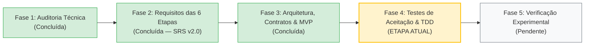

# Engenharia de Software — `experimental-ml-framework`

> **Documento de Registro de Estado da Engenharia**  
> **Data:** 27 de Outubro de 2026  
> **Repositório de Origem (Referência Científica):** `prognose_florestal`  
> **Novo Repositório (Framework Científico Agnóstico):** `experimental-ml-framework`  
> **Especificação de Requisitos (SRS v2.0):** [`ESPECIFICACAO_REQUISITOS.md`](./ESPECIFICACAO_REQUISITOS.md)  
> **Arquitetura, Contratos e Modelo de Dados:** [`ARQUITETURA_E_CONTRATOS.md`](./ARQUITETURA_E_CONTRATOS.md)

---

## 1. Etapa Atual no Ciclo de Vida da Engenharia

Concluímos a **Fase 2 (Engenharia de Requisitos das 6 Etapas)** e a **Fase 3 (Concepção Arquitetural, Contratos Conceituais, Modelo de Dados e Recorte de MVP)**. Estamos prontos para iniciar a especificação dos testes de aceitação e a **Fase 4: Implementação Guiada por Testes (TDD) do MVP**.

### O que já foi realizado:
1. **Fase 1 — Auditoria Técnica e Baseline (`prognose_florestal`):**
   * Mapeamento integral de dados, scripts, algoritmos clássicos, modelos biométricos e resolvedores quânticos (HHL).
   * Catalogação das métricas validadas de referência e identificação de vulnerabilidades metodológicas.
2. **Fase 2 — Engenharia de Requisitos Ponta a Ponta ([`ESPECIFICACAO_REQUISITOS.md`](./ESPECIFICACAO_REQUISITOS.md)):**
   * Especificação detalhada das **6 etapas operacionais** do ciclo experimental:
     * **Etapa 1:** Entrada, triagem exploratória somente-leitura, separação entre problemas confirmados e alertas heurísticos, e plano explícito de preparação.
     * **Etapa 2:** Exploração de relações rotulada como exploratória, criação manual (`FixedScenario`) e guiada/dinâmica (`DynamicScenario` ajustado por *fold*) com rastreabilidade de estabilidade.
     * **Etapa 3:** Registro de modelos heterogêneos via adaptadores (`ModelAdapter`), suporte a modelos analíticos sem `fit` artificial, pré-processamento em duas camadas auditadas, *tuning* aninhado (*Nested CV*) e coleta extensível de diagnósticos internos.
     * **Etapa 4:** `PartitionPlan` imutável e compartilhado (CV, Holdout e CV + Holdout Final), orquestrador com máquina de estados, tolerância a falhas sem mascaramento, controle de paralelismo em dois níveis, *checkpoint/resume*, tempos desagregados e predições *out-of-fold* indexadas por `observation_id`.
     * **Etapa 5:** Consolidação descritiva e julgamento estatístico separando desempenho observado, incerteza, significância estatística, tamanho de efeito, relevância prática e custo computacional (Fronteira de Pareto), com síntese textual estritamente auditável.
     * **Etapa 6:** Geração desacoplada de Relatórios Científicos Completos (Markdown/HTML) e artefatos modulares das 7 famílias de tabelas e figuras, com manifesto de proveniência (`ArtifactProvenance`) e pacote portável de reprodutibilidade.
3. **Fase 3 — Arquitetura Geral, Contratos e Recorte de MVP ([`ARQUITETURA_E_CONTRATOS.md`](./ARQUITETURA_E_CONTRATOS.md)):**
   * Definição do Grafo Direcionado Acíclico (DAG) de dependências entre módulos.
   * Formalização das entradas, saídas, invariantes e pontos de extensão de cada módulo.
   * Modelagem de dados completa do experimento e estrutura de diretórios do pacote de reprodutibilidade.
   * Definição explícita do **MVP Essencial** vs. **Evoluções Posteriores Plugáveis**.

---

## 2. Síntese da Arquitetura por Etapa e Módulos

| Etapa | Módulo(s) | Contratos Principais de Saída |
| :--- | :--- | :--- |
| **Etapa 1** | `data`, `diagnostics` | `DatasetBundle`, `DatasetProfile`, `DiagnosticFinding`, `PreparationPlan` |
| **Etapa 2** | `features`, `scenarios` | `ExploratoryFeatureReport`, `FixedFeatureScenario`, `DynamicFeatureScenario`, `ScenarioRegistry` |
| **Etapa 3** | `models`, `tuning` | `ModelSpec`, `ModelCapabilities`, `ModelAdapter`, `TwoLayerPreprocessingPipeline`, `HyperparameterSearchSpec` |
| **Etapa 4** | `validation`, `orchestration` | `PartitionPlan`, `ExecutionCell`, `CellResultRecord`, `TimingBreakdown`, `MatrixRunStore` |
| **Etapa 5** | `metrics`, `statistics` | `DescriptiveConsolidation`, `StatisticalJudgmentReport`, `MultiObjectiveSummary`, `StructuredConclusion` |
| **Etapa 6** | `reporting`, `packaging` | `TableModel`, `PlotSpecification`, `ArtifactProvenance`, `ReproducibilityPackage` |

---

## 3. Próximos Passos Imediatos (Transição para Fase 4)

1. Definir a estrutura de pacotes Python (`pyproject.toml`, layout `src/experimental_ml/` e `tests/`) respeitando estritamente as fronteiras modulares de [`ARQUITETURA_E_CONTRATOS.md`](./ARQUITETURA_E_CONTRATOS.md).
2. Implementar e testar com TDD cada etapa do **MVP Essencial** na ordem topológica do grafo de dependências:
   * **Passo 4.1:** Núcleo de tipos/identificadores e Etapa 1 (`data` & `diagnostics`).
   * **Passo 4.2:** Etapa 2 (`features` & `scenarios`) e Etapa 4A (`validation` / `PartitionPlan`).
   * **Passo 4.3:** Etapa 3 (`models` & `tuning`).
   * **Passo 4.4:** Etapa 4B (`orchestration` & `storage` com *checkpoint/resume* e `metrics`).
   * **Passo 4.5:** Etapa 5 (`statistics`, análise multiobjetivo e conclusões estruturadas).
   * **Passo 4.6:** Etapa 6 (`reporting` & `packaging`).
