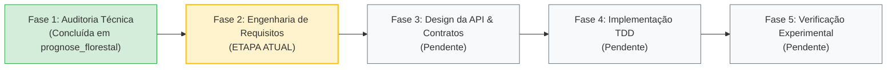

# Engenharia de Software — `experimental-ml-framework`

> **Documento de Registro de Estado da Engenharia**  
> **Data:** 26 de Outubro de 2026  
> **Repositório de Origem (Referência Científica):** `prognose_florestal`  
> **Novo Repositório (Framework Científico Agnóstico):** `experimental-ml-framework`  

---

## 1. Etapa Atual no Ciclo de Vida da Engenharia

Estamos formalmente na **Fase 2: Engenharia de Requisitos e Concepção Arquitetural**.

### O que já foi realizado (Fase 1 — Concluída):
1. **Auditoria Técnica Completa:** Mapeamento integral de dados, scripts, algoritmos clássicos, quânticos e resolvedores HHL no repositório de origem.
2. **Catalogação de Métricas de Referência:** Extração de todos os resultados validados ($R^2$, RMSE, MAE, KTA, fidelidade de estado HHL de $1.000000000000$).
3. **Identificação de Vulnerabilidades:** Detecção de duplicações (ex.: `clutter.py` sendo cópia do XGBoost), acoplamento a nomes fixos de colunas de inventário florestal e distorções métricas (`math.ceil`).

### O que estamos fazendo agora (Fase 2 — Em Andamento):
- Definição do escopo restrito do framework.
- Formalização dos requisitos funcionais (RF) e não funcionais (RNF).
- Estabelecimento do contrato de desacoplamento de modelos.
- **Regra de Ouro:** Nenhuma linha de código de implementação antes do fechamento do design arquitetural.

---

## 2. Decisão Arquitetural Fundamental (ADR-001)

### Contexto
O projeto original mesclava engenharia de atributos de dados florestais, equações biométricas (Clutter 1963), algoritmos de Machine Learning (Sklearn, XGBoost) e circuitos quânticos em scripts monolíticos acoplados.

### Decisão
A biblioteca `experimental-ml-framework` **NÃO implementará nem conterá nenhum algoritmo ou modelo de Machine Learning internamente**.

A ferramenta deve atuar estritamente como um **harness científico agnóstico para pesquisadores**, fornecendo:
1. Ingestão e validação estrutural de dados tabulares genéricos.
2. Análise exploratória e seleção de atributos (estatística e aprendizado de máquina de referência).
3. Gerenciamento e geração declarativa de cenários experimentais de features.
4. Particionamento e controle estrito de validação cruzada (*zero data leakage*).
5. Inferência estatística científica rigorosa (Nadeau-Bengio, Wilcoxon, Holm-Bonferroni, FDR).
6. Motor de cálculo de indicadores de predição, resíduos *out-of-fold* e exportação de artefatos para publicação científica (LaTeX, Markdown, PNG a 300 DPI).

### Contrato de Modelos
Qualquer modelo externo (Scikit-Learn, PyTorch, XGBoost, Qiskit, PennyLane ou código proprietário do pesquisador) é aceito desde que respeite o contrato mínimo de interface via *Duck Typing*:
- `fit(X, y)`
- `predict(X) -> ndarray`

---

## 3. Requisitos Funcionais Identificados

| ID | Módulo | Requisito Funcional |
| :--- | :--- | :--- |
| **RF01** | `data` | Aceitar qualquer dataset tabular (`DataFrame`, CSV, Parquet) definindo alvos, identificadores de grupo e colunas proibidas. |
| **RF02** | `data` | Validar a integridade estrutural (valores nulos no alvo, colunas constantes e vazamento de informação declarado). |
| **RF03** | `features` | Calcular correlações lineares e monotônicas (Pearson, Spearman) entre features candidatas e a variável resposta. |
| **RF04** | `features` | Avaliar dependências não lineares via Informação Mútua (Mutual Information Regression). |
| **RF05** | `features` | Detectar automaticamente multicolinearidade excessiva ($|r| \ge \text{limiar}$) entre pares de preditores. |
| **RF06** | `features` | Gerar ranking consolidado ponderado multi-critério (percentis normalizados). |
| **RF07** | `features` | Gerenciador declarativo de cenários (`ScenarioManager`): nomear, documentar e versionar grupos de features. |
| **RF08** | `validation` | Estratégias de particionamento: K-Fold, GroupKFold, GroupShuffleSplit, TimeSeriesSplit. |
| **RF09** | `validation` | Asserção matemática obrigatória de interseção nula de grupos entre treino e validação (garantia de zero vazamento). |
| **RF10** | `benchmark` | Orquestrar a execução matricial: $\text{Modelos} \times \text{Cenários} \times \text{Folds}$. |
| **RF11** | `metrics` | Calcular métricas de regressão não enviesadas: $R^2$, RMSE, RMSE (%), MAE, MAPE, Pearson, Viés Médio. |
| **RF12** | `statistics` | Teste t corrigido de **Nadeau & Bengio (2003)** para corrigir a subestimação de variância de folds correlacionados. |
| **RF13** | `statistics` | Teste pareado de **Wilcoxon** com alerta formal de poder quando $J \le 5$. |
| **RF14** | `statistics` | Ajuste de multiplicidade para controle de FWER (**Holm-Bonferroni**) e FDR (**Benjamini-Hochberg**). |
| **RF15** | `reporting` | Gerar tabelas formatadas em formato console, CSV, Markdown e LaTeX (`table` / `booktabs`). |
| **RF16** | `reporting` | Gerar gráficos diagnósticos: dispersão 1:1 (observado vs predito), resíduos vs predito com $\pm 2\sigma$, barras e heatmap de ganho. |

---

## 4. Requisitos Não Funcionais (RNF)

- **RNF01 (Determinismo):** Todas as rotinas que utilizem amostragem ou permutações devem receber semente aleatória (`random_state`) reprodutível.
- **RNF02 (Independência de Domínio):** Zero referências textuais, colunas hardcoded ou convenções de silvicultura ou biometria florestal no núcleo do framework.
- **RNF03 (Eficiência Computacional):** Vetorização integral com NumPy e SciPy; banimento de laços interpretados `for` em cálculos matriciais ou métricas.
- **RNF04 (Testabilidade):** Cobertura de testes unitários com `pytest` cobrindo todas as fórmulas matemáticas e testes de hipóteses estatísticas.
- **RNF05 (Compatibilidade):** Suporte a Python $\ge 3.10$.

---

## 5. Próximos Passos Imediatos

1. Abrir o diretório `experimental-ml-framework` no Antigravity IDE.
2. Validar o detalhamento dos requisitos funcionais e o desenho formal da API.
3. Desenhar a especificação dos testes de aceitação antes de iniciar qualquer código-fonte.

