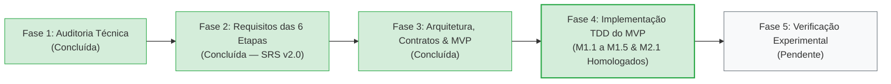

# Engenharia de Software — `experimental-ml-framework`

> **Documento de Registro de Estado da Engenharia**  
> **Data:** 04 de Novembro de 2026  
> **Repositório de Origem (Referência Científica):** `prognose_florestal`  
> **Novo Repositório (Framework Científico Agnóstico):** `experimental-ml-framework`  
> **Especificação de Requisitos (SRS v2.0):** [`ESPECIFICACAO_REQUISITOS.md`](./ESPECIFICACAO_REQUISITOS.md)  
> **Arquitetura, Contratos e Modelo de Dados:** [`ARQUITETURA_E_CONTRATOS.md`](./ARQUITETURA_E_CONTRATOS.md)  
> **Governança de Validação e Aceite:** [`PROCESSO_DE_ACEITE_DE_MARCOS.md`](./PROCESSO_DE_ACEITE_DE_MARCOS.md)

---

## 1. Etapa Atual no Ciclo de Vida da Engenharia

O projeto encontra-se na **Fase 4: Implementação Guiada por Testes (TDD) do MVP**, seguindo o processo de aceite de marcos ([`PROCESSO_DE_ACEITE_DE_MARCOS.md`](./PROCESSO_DE_ACEITE_DE_MARCOS.md)) integrado à skill `tlc-spec-driven`.

As entregas **Marco M1.1 (`m1-1-setup-cli-smoke`)**, **Marco M1.2 (`core`)**, **Marco M1.3 (`metrics`)**, **Marco M1.4 (`datasets-schemas`)** e **Marco M1.5 (`m1-5-foundation-hardening`)** foram concluídas e formalmente aceitas com aprovação em testes automatizados, auditoria transversal independente e homologação manual. A Fase 1 (Setup e Fundações Transversais) está integralmente consolidada e saneada. O **Marco M2 (`diagnostics & partitioning`)** encontra-se em andamento, com o **Sub-marco M2.1 (`m2-1-dataset-profiling`)** concluído e formalmente aceito. O próximo passo de desenvolvimento é o **Sub-marco M2.2 (`preparation-plan-sanitization`)**.

### O que já foi realizado:
1. **Fase 1 — Auditoria Técnica e Baseline (`prognose_florestal`):**
   * Mapeamento integral de dados, scripts, algoritmos clássicos, modelos biométricos e resolvedores quânticos (HHL).
   * Catalogação das métricas validadas de referência e identificação de vulnerabilidades metodológicas.
2. **Fase 2 — Engenharia de Requisitos das 6 Etapas ([`ESPECIFICACAO_REQUISITOS.md`](./ESPECIFICACAO_REQUISITOS.md)):**
   * Especificação detalhada das **6 etapas operacionais** do ciclo experimental:
     * **Etapa 1:** Entrada, triagem exploratória somente-leitura, separação entre problemas confirmados e alertas heurísticos, e plano explícito de preparação.
     * **Etapa 2:** Exploração de relações rotulada como exploratória, criação manual (`mode="FIXED"`) e guiada/dinâmica (`mode="DYNAMIC"` ajustado por *fold*) com rastreabilidade de estabilidade.
     * **Etapa 3:** Registro de modelos heterogêneos (`ModelSpec`), suporte a modelos analíticos sem `fit` artificial, pré-processamento em duas camadas auditadas, *tuning* aninhado (*Nested CV*) e coleta extensível de diagnósticos internos.
     * **Etapa 4:** `PartitionPlan` imutável e compartilhado (CV, Holdout e CV + Holdout Final), módulo de orquestração com máquina de estados por célula, tolerância a falhas sem mascaramento, controle de paralelismo em dois níveis, *checkpoint/resume*, tempos desagregados e predições *out-of-fold* indexadas por `observation_id`.
     * **Etapa 5:** Consolidação descritiva e comparação estatística separando desempenho observado, incerteza, significância estatística, tamanho de efeito, relevância prática e custo computacional (Fronteira de Pareto), com síntese textual estritamente auditável.
     * **Etapa 6:** Geração desacoplada de Relatórios Científicos Completos (Markdown/HTML) e artefatos modulares das 7 famílias de tabelas e figuras, com manifesto de proveniência (`ArtifactProvenance`) e pacote portável de reprodutibilidade.
3. **Fase 3 — Arquitetura Geral, Contratos e Recorte de MVP ([`ARQUITETURA_E_CONTRATOS.md`](./ARQUITETURA_E_CONTRATOS.md)):**
   * Definição da arquitetura em três camadas (Definição e Triagem, Validação e Execução Matricial, Comparação Estatística e Publicação), do pipeline operacional de dados em seis etapas e das dependências entre os módulos de `src/experimental_ml/`.
   * Formalização das entradas, saídas, invariantes e pontos de extensão de cada etapa e módulo.
   * Modelagem de dados completa do experimento e estrutura de diretórios do pacote de reprodutibilidade.
   * Definição explícita do **MVP Essencial** vs. **Evoluções Posteriores**.
4. **Fase 4 — Marco M1.1 Concluído (`m1-1-setup-cli-smoke`):**
   * Configuração de empacotamento com `pyproject.toml` baseada no backend Hatchling (`hatchling.build`) e declaração `requires-python = ">=3.10"`.
   * Inicialização do layout `src/experimental_ml/` expondo `__version__ = "0.1.0.dev0"`.
   * Implementação do ponto de entrada da CLI modularizada em `src/experimental_ml/cli/main.py` com `argparse` da biblioteca padrão, suportando `--version`, `--help` e código de saída 2 para argumentos inválidos.
   * Criação e aprovação integral da suíte de fumaça automatizada em `tests/test_smoke.py` (12 testes aprovados via `pytest`).
   * Validação da instalação editável (`pip install -e ".[dev]"`) no ambiente virtual `.venv` local (Python 3.12), com o executável `expml` disponível diretamente no PATH.
5. **Fase 4 — Marco M1.2 Concluído (`m1-2-core`):**
   * Adição da dependência `numpy>=1.24.0` ao `pyproject.toml`.
   * Implementação do módulo `src/experimental_ml/core/` (Nível 0 transversal, sem OOP para lógica de negócio conforme **ADR-008**):
     * `types.py`: tipos de identificadores de domínio imutáveis (`ExperimentId`, `PartitionPlanId`, `ScenarioId`, `ModelId`, `CellId`, `ComparisonId`, `ArtifactId`, `ObservationId`) com validação de preenchimento e rejeição de strings inválidas.
     * `enums.py`: enumerações canônicas baseadas em `str, Enum` (`TaskType`, `ExecutionStatus`, `FindingSeverity`, `MetricDirection`, `AggregationScope`, `MetricStatus`, `ErrorPolicy`).
     * `findings.py`: estrutura imutável `Finding`, construtores `make_finding` e `make_warning` e hierarquia de exceções de integridade (`ExperimentalMLError`, `ContractViolationError`, `DataIntegrityError`, `ConfigurationError`).
     * `seeds.py`: geradores determinísticos puros `derive_seeds` e `spawn_child_seeds` baseados em `numpy.random.SeedSequence` (RNF01, ADR-007).
     * `hashing.py`: implementação de `config_hash` e `dataset_hash` cumprindo 100% das regras canônicas do **ADR-007** (NFC, ordenação estável por code points UTF-8, distinção de tipos escalares e coleções, normalização de `-0.0 -> 0.0`, `NaN` e `+/-Inf`).
     * `__init__.py`: re-exportação pública via `__all__`.
   * Implementação da suíte de testes unitários `tests/unit/test_core.py` com 18 testes automatizados aprovados (totalizando 30 testes aprovados na suíte geral).
   * Execução do portão de verificação independente da skill `tlc-spec-driven` (`proofs.md` e `verification.md` com veredito `PASS`, 18/18 checks aprovados).
6. **Fase 4 — Marco M1.3 Concluído (`m1-3-metrics`):**
   * Implementação do módulo `src/experimental_ml/metrics/` (Nível 1 transversal, sem lógica de negócio em OOP):
     * `types.py`: estruturas imutáveis de avaliação (`MetricValue`, `AggregatedMetricValue`, `MetricSpec`, `RankedCandidate`) e enumeração canônica fechada `MetricEvaluationScope` com validação estrita.
     * `validation.py`: validações numéricas puras em `float64`, integridade dimensional e mitigação de overflow quadrático intermediário via `scaled_quadratic_sum`.
     * `regression.py`: funções puramente vetorizadas em `float64` de erros em escala direta (`mae`, `rmse`, `mbe` preservando viés assinado), razões adimensionais (`r2`, `rmse_rel_pct`, `mape`, `pearson`) e alinhamento de Gram (`kta` uncentered e centered $HKH$), tratando casos degenerados com `MetricStatus.UNDEFINED_NAN`.
     * `classification.py`: métricas discretas (`accuracy`, `balanced_accuracy`, `precision`, `recall`, `f1` avaliado diretamente pelo próprio denominador $2TP + FP + FN$) e probabilísticas (`roc_auc` com empates exatos via postos médios e OVR, `log_loss` com validação estrita de distribuições e clipping $\epsilon = 10^{-15}$).
     * `catalog.py`: registro imutável centralizado `METRICS_CATALOG` com as 15 especificações canônicas (`compare_by_abs=True` exclusivamente em `mbe`), funções de consulta `get_metric_spec`, `list_metrics` e despacho `compute_metric`.
     * `aggregation.py`: comparador `is_better` compatível com `compare_by_abs`, agregador inter-dobras `aggregate_fold_metrics` gerando `VALID`, `PARTIAL_COVERAGE` e `UNDEFINED_NAN`, e ranqueador lexicográfico `rank_configurations` (ADR-005) com precedência estrita de cobertura.
     * `__init__.py`: re-exportação de 27 símbolos públicos com `__all__`.
   * Aprovação integral da suíte de testes unitários `tests/unit/test_metrics.py` com 22/22 checks automatizados aprovados (totalizando 52 testes aprovados na suíte geral).
   * Verificação independente TLC (`proofs.md` e `verification.md` com veredito `PASS`, 0 findings e 0 erros em `validate_verification.py`).
   * Execução e aprovação completa do roteiro de aceitação do consumidor (`ACCEPTANCE.md`) e cenário integrado registrado em `RESULTS.md`.
7. **Fase 4 — Marco M1.4 Concluído (`m1-4-datasets-schemas`):**
   * Implementação do módulo `src/experimental_ml/data/` (Nível 1, Camada 1 / Etapa 1, sem lógica de negócio em OOP):
     * `schema.py`: estrutura declarativa `DatasetSchemaSpec` com normalização Unicode NFC nos nomes de colunas, disjunção estrita de papéis (`target_col`, `group_col`, `observation_id_col`, `time_col`, `ignore_cols`), imutabilidade via tuplas, dicionários encapsulados com `MappingProxyType` e bloqueio de funcionalidades da Onda 2.
     * `types.py`: enumeração canônica `ColumnSemanticType` (6 membros fechados) e estrutura `ColumnDescriptor` (frozen dataclass com `__slots__` e 8 atributos descritores de tipo físico, semântico e memória).
     * `parsing.py`: parser tabular em conformidade estrita com a RFC 4180; suporte a delimitadores `,`, `;`, `\t`, `|` e múltiplos espaços; sniffer automático com verificação de consistência em até 100 linhas ($M \ge 2$); sobrescrita por delimitador manual; e rejeição explícita de linhas irregulares (*ragged rows*), arquivos vazios ($N = 0$) e cabeçalhos duplicados/vazios.
     * `validation.py`: validações estruturais do esquema ($N > 0, M > 0, \ge 1$ preditor, presença das colunas declaradas no esquema) e regras de atribuição ou verificação de unicidade/não-nulidade de `ObservationId`.
     * `loader.py`: função pura `load_dataset` com posse exclusiva, cópias defensivas em memória, arrays numéricos e booleanos respaldados por buffers `bytes` imutáveis que recusam `setflags(write=True)` com `ValueError`, colunas `object` restritas a escalares imutáveis com `writeable=False` e cálculo formal dos hashes tripartites (`dataset_hash` canônico invariante a quebras de linha CRLF/LF, `raw_source_hash` e `schema_hash`).
     * `query.py`: utilitários de consulta imutável `get_column_array` (view somente-leitura ou cópia mutável) e `slice_bundle_by_observation_ids` (preservando estritamente a ordem requisitada com recálculo determinístico de hash).
     * `__init__.py`: re-exportação de 13 símbolos públicos com `__all__` (incluindo `ColumnSemanticType`, `DatasetSchemaSpec`, `ColumnDescriptor`, `DatasetBundle`, `load_dataset`, `get_column_array`, `slice_bundle_by_observation_ids` e parsers).
   * Aprovação integral da suíte de testes unitários `tests/unit/test_data_schemas.py` com 29/29 checks automatizados aprovados (totalizando 81 testes aprovados na suíte geral).
   * Verificação mecânica independente via TLC Spec-Driven (`proofs.md` e `verification.md` com veredito `PASS`, 0 findings e 0 erros em `validate_verification.py`).
   * Execução e aprovação completa do roteiro de aceitação do consumidor (`ACCEPTANCE.md`), cenário integrado registrado em `RESULTS.md` e homologação formal aprovada pelo usuário.
   * Pull Request #4 (`feat/m1-4-datasets-schemas`) integrado na branch `main` (commit `c3eb1e6`), concluindo 100% da Fase 1 (Setup e Fundações Transversais).
8. **Fase 4 — Marco M1.5 Concluído (`m1-5-foundation-hardening`):**
   * Resolução transversal dos 10 achados da Auditoria Geral de Integridade M1 (6 P0 e 4 P1 selecionados): framing binário inequívoco de `dataset_hash` sensível a `observation_ids` preservando a direção $L_1 \rightarrow L_0$; centralização de `is_nan_scalar` e `is_missing_scalar` cobrindo tipos nativos e `numpy.floating`; validação e preservação estrita de instâncias tipadas `ObservationId` em fatiamentos; whitelist de escalares em colunas `object` com semântica unificada de ausentes e captura de `OverflowError` em `int64`.
   * Criação e aprovação da suíte de testes de integração transversal `tests/integration/test_m1_foundation_integration.py` (4 testes), totalizando 96 testes aprovados no repositório.
   * Verificação independente TLC (`proofs.md`, `verification.md` com veredito `PASS`, 0 findings e 0 erros em `validate_verification.py`), com homologação formal aprovada.
9. **Fase 4 — Sub-marco M2.1 Concluído (`m2-1-dataset-profiling`):**
   * Implementação da triagem estatística e diagnóstico estrutural da base tabular (`src/experimental_ml/data/profiling.py`):
     * `ProfileConfig`: configuração imutável de limiares heurísticos com validação estrita no construtor.
     * `ColumnProfile`: estrutura de dados imutável com distribuições numéricas (média, mediana, desvio padrão, min, max, quartis, IQR, skewness, outliers $1.5 \times \text{IQR}$) e categóricas (cardinalidade, frequências absolutas e proporções relativas).
     * `DatasetProfile`: perfil agregado do dataset contendo metadados de memória, lista ordenada de achados e resumos especializados.
     * Análise da variável-alvo: verificação de variância zero, ausentes, contagem de classes e detecção de alvos binários não mapeados para $\{0,1\}$ (`E1_TARGET_BINARY_UNMAPPED`).
     * Análise de grupos (`group_col`): detecção de grupos com valores ausentes (`E1_GROUP_EMPTY_VALUES`) e grupos com poucas amostras (`W1_GROUP_TOO_FEW_SAMPLES`).
     * Detecção determinística de linhas duplicadas (excluindo apenas `observation_id`).
     * Catálogo canônico fechado de 15 achados diagnósticos (8 `CONFIRMED_ISSUE` + 7 `HEURISTIC_WARNING`) com severidade imutável e ordenação canônica lexicográfica por severidade, código e coluna.
     * Função pura `profile_dataset(bundle, config)` exposta em `experimental_ml.data` (17 símbolos exportados em `__all__`), mantendo estrita imutabilidade e invariância do `dataset_hash`.
   * Aprovação de 12 testes unitários em `tests/unit/test_profiling.py` e 6 testes de integração em `tests/integration/test_profiling_integration.py` (totalizando 114 testes aprovados na suíte geral).
   * Verificação mecânica independente via TLC Spec-Driven (`proofs.md` e `verification.md` com veredito `PASS`, 0 findings e 0 erros em `validate_verification.py`).
   * Roteiro de aceitação do consumidor (`ACCEPTANCE.md`) executado com sucesso e homologação formal aprovada sob `.specs/features/m2-diagnostics-partitioning/`.

---

## 2. Síntese da Arquitetura em Camadas, Pipeline de Etapas e Módulos (`src/experimental_ml/`)

| Camada Arquitetural | Nível de Dependência | Módulo (`src/experimental_ml/`) | Etapa no Pipeline Operacional | Funções e Estruturas Principais de Saída (Sem OOP) |
| :--- | :--- | :--- | :--- | :--- |
| **Fundação Transversal** | Nível 0 | `core` | Transversal (Etapas 1–6) | Tipos de IDs, `derive_seeds` (`SeedSequence`), `config_hash`, `dataset_hash` e funções de validação/alertas |
| **Fundação Transversal** | Nível 1 | `metrics` | Transversal (Etapas 2, 3, 4 e 5) | `METRICS_CATALOG`, `MetricValue`, `AggregatedMetricValue`, `aggregate_fold_metrics`, `is_better` e 15 funções de métricas vetorizadas |
| **Camada 1: Definição e Triagem** | Nível 1 | `data` | Etapa 1 | `load_dataset`, `profile_dataset`, `create_preparation_plan`, `sanitize_dataset` $\rightarrow$ `DatasetBundle`, `DatasetProfile`, `PreparationPlan`, `SanitizedDatasetView` |
| **Camada 1: Definição e Triagem** | Nível 2 | `features` | Etapa 2 | `explore_features`, `validate_scenarios`, `select_features_in_fold` (seletores e `PCA`) $\rightarrow$ `ExploratoryFeatureReport`, catálogo `scenarios` (`FIXED`/`DYNAMIC`) |
| **Camada 1: Definição e Triagem** | Nível 2 | `models` | Etapa 3A | `instantiate_fresh_model`, `fit_model`, `predict_model`, `extract_model_diagnostics`, `fit_two_layer_preprocessing` (incluindo roteamento para kernels externos) $\rightarrow$ `ModelSpec`, `ModelDiagnostics` |
| **Camada 1: Definição e Triagem** | Nível 3 | `tuning` | Etapa 3B | `run_nested_tuning` (`fixed`, `grid_search`, `random_search`) $\rightarrow$ `HyperparameterSearchSpec`, histórico de tentativas |
| **Camada 2: Validação e Execução Matricial** | Nível 2 | `validation` | Etapa 4A | `build_partition_plan`, `validate_partition_plan` (`kfold_split`, `stratified_kfold_split`, `group_kfold_split`, `bootstrap_split`, `temporal_split`, `holdout_split`) $\rightarrow$ `PartitionPlan` |
| **Camada 2: Validação e Execução Matricial** | Nível 4 | `orchestration` | Etapa 4B | `run_experiment_matrix`, `resume_experiment_matrix`, `save_cell_result` $\rightarrow$ `CellResultRecord`, `PredictionRecord` (com `y_std` e comitê $\hat{\mu}_i, \hat{\sigma}_i$), `TimingBreakdown` |
| **Camada 3: Comparação Estatística e Publicação** | Nível 5 | `statistics` | Etapa 5 | `consolidate_descriptive`, `evaluate_method_suitability`, `run_statistical_comparisons`, `compute_pareto_frontier`, `score_candidate_acquisition`, `synthesize_conclusions` $\rightarrow$ `StatisticalComparisonReport`, `StructuredConclusion` |
| **Camada 3: Comparação Estatística e Publicação** | Nível 6 | `reporting` | Etapa 6 | `select_report_content`, `build_table_model`, `build_figure_spec`, `render_full_report`, `build_reproducibility_package` $\rightarrow$ `TableModel`, `PlotSpecification`, `ArtifactProvenance` |
| **Interface de Terminal** | Nível 7 | `cli` | Subcomandos por Etapa | CLI modularizada (`expml data`, `features`, `models`, `partition`, `run`, `stats`, `report`) separada da lógica de negócio |

---

## 3. Roadmap Incremental de Implementação TDD (Marcos M1 a M7)

Todo marco segue o processo de governança estabelecido em [`PROCESSO_DE_ACEITE_DE_MARCOS.md`](./PROCESSO_DE_ACEITE_DE_MARCOS.md), estruturado em `SPEC.md`, `ACCEPTANCE.md` e `RESULTS.md`.

1. **Marco M1 (`core` + `metrics` + `datasets` + esqueleto `cli`) — Entregas Verificáveis:**
   * **M1.1 (Concluído e Aceito — Configuração, `.venv`, Esqueleto da CLI e *Smoke Tests*):** Criação do `.venv` (Python 3.12), `pyproject.toml` (Hatchling, declaração `requires-python = ">=3.10"`, entrypoint `expml`), esqueleto modular em `src/experimental_ml/cli/main.py`, aprovação de `tests/test_smoke.py` com 12/12 testes e homologação manual aprovada. Registrado com `SPEC.md`, `ACCEPTANCE.md` e `RESULTS.md` sob `.specs/features/m1-1-setup-cli-smoke/`.
   * **M1.2 (Concluído e Aceito — Contratos, Implementação Funcional e Testes de `core`):** Identificadores imutáveis, constantes/enums, função pura `derive_seeds` (`SeedSequence`), `config_hash` e `dataset_hash` (ADR-007: Unicode NFC, `-0.0`, `NaN`/`Inf`, coleções aninhadas), construtores de achados e exceções de contrato, com aprovação de `tests/unit/test_core.py` (18/18 testes), verificação independente TLC (`proofs.md`, `verification.md`) e homologação manual aprovada. Registrado com `SPEC.md`, `ACCEPTANCE.md` e `RESULTS.md` sob `.specs/features/m1-2-core/`.
   * **M1.3 (Concluído e Aceito — Contratos, Implementação Funcional e Testes de `metrics`):** `MetricValue`, `AggregatedMetricValue`, `MetricSpec`, `RankedCandidate`, catálogo `METRICS_CATALOG` com as 15 métricas, regras de propagação de `MetricStatus.UNDEFINED_NAN`, `is_better`, `aggregate_fold_metrics`, `rank_configurations` (ADR-005) e as 15 funções de métricas vetorizadas testadas com tolerâncias específicas (`rtol`/`atol`) por família (`tests/unit/test_metrics.py` com 22/22 checks aprovados), verificação independente TLC (`proofs.md`, `verification.md`) e roteiro `ACCEPTANCE.md` com evidências em `RESULTS.md`.
   * **M1.4 (Concluído e Aceito — Contratos, Ingestão Tabular, Imutabilidade e Esquemas de `data`):** `DatasetSchemaSpec`, `ColumnSemanticType`, `ColumnDescriptor`, `DatasetBundle` com buffers imutáveis em nível de C-API (recusando `setflags(write=True)` com `ValueError`), parser estrito RFC 4180 com sniffer de delimitadores e detecção de *ragged rows*, geração/validação de `ObservationId`, cópias defensivas na memória, cálculo dos hashes tripartites (`dataset_hash` canônico, `raw_source_hash` e `schema_hash`) e utilitários somente-leitura `get_column_array` e `slice_bundle_by_observation_ids`. Aprovado com 29/29 testes unitários em `tests/unit/test_data_schemas.py`, 81/81 testes na suíte geral, verificação independente TLC (`proofs.md`, `verification.md` com 0 findings) e homologação manual aprovada sob `.specs/features/m1-4-datasets-schemas/`.
   * **M1.5 (Concluído e Aceito — Saneamento e Hardening da Fundação M1):** Revisão e resolução transversal dos 6 achados `ALTO` (P0) e 4 achados `MODERADO` (P1) apontados na Auditoria Geral de Integridade (`m1-integrity-review`): enquadramento binário de `dataset_hash` sem ambiguidade com suporte explícito a `observation_ids` preservando a direção $L_1 \rightarrow L_0$; centralização de `is_nan_scalar` e `is_missing_scalar` cobrindo tipos nativos e `numpy.floating`; validação estrita e preservação de instâncias tipadas `ObservationId` em fatiamentos; whitelist estrita de escalares em colunas `object` com semântica unificada de ausentes e captura de `OverflowError` em `int64`; alinhamento de exemplos do `README.md` e criação de suíte de testes de integração transversal `tests/integration/test_m1_foundation_integration.py`. Aprovado com 15/15 checks determinísticos em `proofs.md`, 96/96 testes na suíte geral, verificação independente TLC (`verification.md` com veredito `PASS`, 0 findings) e atualização formal do parecer técnico para `APTO PARA INÍCIO DO MARCO M2`.
2. **Marco M2 (`diagnostics & partitioning` — Em Andamento):**
   * **M2.1 (Concluído e Aceito — Triagem Estatística e Diagnóstico Estrutural de Datasets):** `profile_dataset`, `DatasetProfile`, `ColumnProfile`, `ProfileConfig`, catálogo fechado de 15 achados diagnósticos padronizados (8 `CONFIRMED_ISSUE` + 7 `HEURISTIC_WARNING`) com severidade imutável e ordenação canônica determinística, distribuições numéricas e categóricas, análise da variável-alvo e grupos, detecção determinística de duplicatas e garantia estrita de imutabilidade. Aprovado com 12/12 checks determinísticos em `proofs.md`, 12 testes unitários (`test_profiling.py`), 6 testes de integração (`test_profiling_integration.py`), 114 testes gerais, verificação independente TLC (`verification.md` com veredito `PASS`, 0 findings) e homologação formal sob `.specs/features/m2-diagnostics-partitioning/`.
   * **M2.2 (Próximo Sub-marco — Saneamento e Visão Saneada):** Especificação e aplicação de plano de preparação (`create_preparation_plan`), resolução obrigatória de todos os `CONFIRMED_ISSUE` para `status = READY`, execução de regras determinísticas de saneamento (`sanitize_dataset`) e emissão da visão tabular imutável `SanitizedDatasetView` com `candidate_feature_cols`.
   * **M2.3 (Planejado — Particionamento Compartilhado e Validação):** Estratégias de partição (`kfold`, `stratified_kfold`, `group_kfold`, `holdout`), geração determinística (`build_partition_plan`) e validação matemática de disjunção e cobertura (`validate_partition_plan`), exportando splits em `.csv.gz`.
   * **M2.4 (Planejado — Interface de Linha de Comando de Dados e Partição):** Subcomandos `expml data profile`, `expml data prepare`, `expml data sanitize` e `expml partition plan`.
   * **M2.5 (Planejado — Integração e Hardening do Marco M2):** Testes de integração transversal, verificação ponta a ponta dos fluxos de dados e particionamento e auditoria independente.
3. **Marco M3 (`features` + CLI `features`):** Função `explore_features` rotulada, validação de cenários (`FIXED` e `DYNAMIC`) e seleção dinâmica ajustada estritamente no treino de cada *fold* (`select_features_in_fold`), com medição de estabilidade de seleção.
4. **Marco M4 (`models` + `tuning` + CLI `models`):** Funções `instantiate_fresh_model`, `fit_model`, `predict_model` (clássicos, analíticos com `requires_fit=False` e quânticos/customizados), pré-processamento funcional em 2 camadas (`fit_two_layer_preprocessing`, `apply_two_layer_preprocessing`) com bloqueio de duplicação e *Nested Tuning* (`run_nested_tuning`).
5. **Marco M5 (`orchestration` + CLI `run`):** Funções `run_experiment_matrix` e `resume_experiment_matrix` com máquina de estados, modos `FAULT_TOLERANT` / `FAIL_FAST`, paralelismo em dois níveis, persistência atômica (`save_cell_result`) e retomada verificada (*Checkpoint & Resume*).
6. **Marco M6 (`statistics` + CLI `stats`):** Funções de consolidação descritiva, adequação metodológica, tratamento de *folds* incompletos, Nadeau-Bengio, Wilcoxon, Holm-Bonferroni, Benjamini-Hochberg, tamanho de efeito, relevância prática, Fronteira de Pareto, funções de aquisição e `synthesize_conclusions`.
7. **Marco M7 (`reporting` + CLI `report` + Verificação `prognose_florestal`):** Funções de geração de relatórios completos (MD/HTML), 7 famílias de tabelas (CSV/MD/LaTeX `booktabs`) e figuras (PNG/SVG/PDF), manifesto de proveniência (`ArtifactProvenance`), pacote de reprodutibilidade e reprodução agnóstica do experimento de referência `prognose_florestal`.
